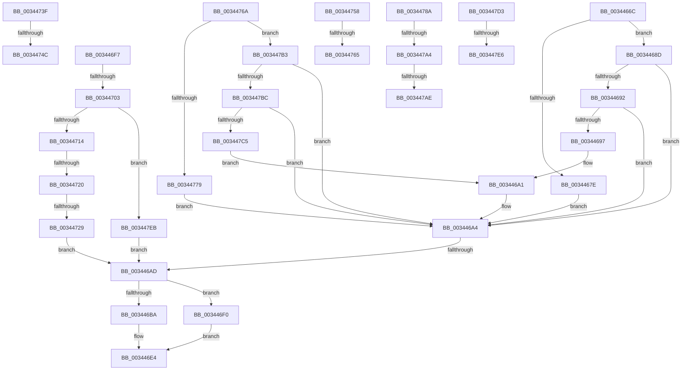

# sub_0034466C

- RVA: `0x0034466C`–`0x00344800` (길이 `404` bytes)
- VA: `0x000000014034466C`
- 실행 섹션: `.text`
- PDB 이름 있음: `아니요`; PDB Function 태그: `아니요`
- unwind 정보 RVA: `0x00077D38`
- 디코드: `103`개 명령, `404/404` bytes 표시
- 미해석 바이트: `0` (있으면 어셈블리에 `.byte`로 보존)

> 이 문서는 커널 이미지의 기계어와 PDB 기호를 분석해 생성했습니다. 4번과 5번은 함수 원형과 자료형을 바이너리 사용 방식에서 추정한 C 해석이며 원본 소스 복구 결과는 아닙니다.

## 1. Dependencies

- 직접 호출 지점: **5**; 고유 호출 대상: **4**
- 직접 호출자로 확인된 함수: **0**
- RIP 상대 이미지 참조: **1**

### Outgoing calls
- `0x003446C3` → [KeReleaseInStackQueuedSpinLock](KeReleaseInStackQueuedSpinLock_function_00342CE0.md) (function, `0x00342CE0`)
- `0x003446D0` → [ObfReferenceObjectWithTag](../21/ObfReferenceObjectWithTag_function_00210710.md) (function, `0x00210710`)
- `0x003446DF` → [ExpInterlockedPushEntrySList](../6B/ExpInterlockedPushEntrySList_function_006BA5B0.md) (function, `0x006BA5B0`)
- `0x003446E6` → [ExpSetWorkerFactoryDeferredCreateTimer](../../page/A6/ExpSetWorkerFactoryDeferredCreateTimer_function_00A6B2CC.md) (function, `0x00A6B2CC`)
- `0x003446F0` → [KeReleaseInStackQueuedSpinLock](KeReleaseInStackQueuedSpinLock_function_00342CE0.md) (function, `0x00342CE0`)

### Direct callers
- 이 함수 시작 RVA로 연결되는 직접 call은 확인되지 않았습니다. 간접 호출은 완전히 역산할 수 없습니다.

### Static image references
- `0x003446D8` → RVA `0x00E29160` (`.data`; read)

## 2. Other-region calls and transfers

- 다른 실행 섹션으로 향하는 call: **1**
  - `0x003446E6` → [ExpSetWorkerFactoryDeferredCreateTimer](../../page/A6/ExpSetWorkerFactoryDeferredCreateTimer_function_00A6B2CC.md) (`.text` → `PAGE`)
- call이 아닌 외부 분기/꼬리 이동: **14**
  - `0x003446A7` → [sub_003444DD + 0x39](Unknown_function_003444DD.md) (`tail-transfer`)
  - `0x003446EB` → [sub_003444DD + 0x41](Unknown_function_003444DD.md) (`tail-transfer`)
  - `0x003446FD` → [sub_00344568 + 0x64](Unknown_function_00344568.md) (`tail-transfer`)
  - `0x0034471A` → [sub_003444DD + 0x39](Unknown_function_003444DD.md) (`tail-transfer`)
  - `0x00344723` → [sub_003444DD + 0x39](Unknown_function_003444DD.md) (`tail-transfer`)
  - `0x00344746` → [sub_00344568 + 0x4D](Unknown_function_00344568.md) (`tail-transfer`)
  - `0x00344753` → [sub_00344568 + 0x3D](Unknown_function_00344568.md) (`tail-transfer`)
  - `0x0034475F` → [sub_00344568 + 0x31](Unknown_function_00344568.md) (`tail-transfer`)
  - `0x00344765` → [sub_00344568 + 0x20](Unknown_function_00344568.md) (`tail-transfer`)
  - `0x0034479E` → [sub_003444DD + 0xE](Unknown_function_003444DD.md) (`tail-transfer`)
  - `0x003447A8` → [sub_003444DD + 0xE](Unknown_function_003444DD.md) (`tail-transfer`)
  - `0x003447AE` → [sub_003444DD + 0x39](Unknown_function_003444DD.md) (`tail-transfer`)
  - `0x003447E0` → [sub_00344568 + 0x64](Unknown_function_00344568.md) (`tail-transfer`)
  - `0x003447E6` → [sub_00344568 + 0x56](Unknown_function_00344568.md) (`tail-transfer`)

## 3. Assembly (complete function range)

```asm
0034466C  41 8B 07                        mov eax, dword ptr [r15]
0034466F  BE 04 00 00 00                  mov esi, 4
00344674  8B C8                           mov ecx, eax
00344676  81 E1 C0 00 00 00               and ecx, 0xc0
0034467C  75 0F                           jne 0x14034468d
0034467E  0F BA F0 07                     btr eax, 7
00344682  8D 71 03                        lea esi, [rcx + 3]
00344685  83 C8 40                        or eax, 0x40
00344688  41 89 07                        mov dword ptr [r15], eax
0034468B  EB 17                           jmp 0x1403446a4
0034468D  83 F9 40                        cmp ecx, 0x40
00344690  75 12                           jne 0x1403446a4
00344692  45 84 F6                        test r14b, r14b
00344695  74 0D                           je 0x1403446a4
00344697  83 E0 BF                        and eax, 0xffffffbf
0034469A  0F BA E8 07                     bts eax, 7
0034469E  41 89 07                        mov dword ptr [r15], eax
003446A1  41 8B F4                        mov esi, r12d
003446A4  83 FE 04                        cmp esi, 4
003446A7  0F 84 69 FE FF FF               je 0x140344516
003446AD  8B 83 98 01 00 00               mov eax, dword ptr [rbx + 0x198]
003446B3  48 8B CF                        mov rcx, rdi
003446B6  A8 08                           test al, 8
003446B8  75 36                           jne 0x1403446f0
003446BA  83 C8 08                        or eax, 8
003446BD  89 83 98 01 00 00               mov dword ptr [rbx + 0x198], eax
003446C3  E8 18 E6 FF FF                  call 0x140342ce0
003446C8  BA 44 66 6C 74                  mov edx, 0x746c6644
003446CD  48 8B CB                        mov rcx, rbx
003446D0  E8 3B C0 EC FF                  call 0x140210710
003446D5  48 8B D3                        mov rdx, rbx
003446D8  48 8D 0D 81 4A AE 00            lea rcx, [rip + 0xae4a81]
003446DF  E8 CC 5E 37 00                  call 0x1406ba5b0
003446E4  8B CE                           mov ecx, esi
003446E6  E8 E1 6B 72 00                  call 0x140a6b2cc
003446EB  E9 2E FE FF FF                  jmp 0x14034451e
003446F0  E8 EB E5 FF FF                  call 0x140342ce0
003446F5  EB ED                           jmp 0x1403446e4
003446F7  39 83 80 01 00 00               cmp dword ptr [rbx + 0x180], eax
003446FD  0F 86 C9 FE FF FF               jbe 0x1403445cc
00344703  8B 45 00                        mov eax, dword ptr [rbp]
00344706  8B C8                           mov ecx, eax
00344708  81 E1 00 30 00 00               and ecx, 0x3000
0034470E  0F 84 D7 00 00 00               je 0x1403447eb
00344714  81 F9 00 10 00 00               cmp ecx, 0x1000
0034471A  0F 85 F6 FD FF FF               jne 0x140344516
00344720  45 84 F6                        test r14b, r14b
00344723  0F 84 ED FD FF FF               je 0x140344516
00344729  0F BA F0 0C                     btr eax, 0xc
0034472D  41 8B F4                        mov esi, r12d
00344730  0F BA E8 0D                     bts eax, 0xd
00344734  89 83 98 01 00 00               mov dword ptr [rbx + 0x198], eax
0034473A  E9 6E FF FF FF                  jmp 0x1403446ad
0034473F  41 8B 07                        mov eax, dword ptr [r15]
00344742  24 30                           and al, 0x30
00344744  3C 20                           cmp al, 0x20
00344746  0F 84 69 FE FF FF               je 0x1403445b5
0034474C  48 8D AB 98 01 00 00            lea rbp, [rbx + 0x198]
00344753  E9 4D FE FF FF                  jmp 0x1403445a5
00344758  41 8B 07                        mov eax, dword ptr [r15]
0034475B  24 C0                           and al, 0xc0
0034475D  3C 80                           cmp al, 0x80
0034475F  0F 84 34 FE FF FF               je 0x140344599
00344765  E9 1E FE FF FF                  jmp 0x140344588
0034476A  41 8B 07                        mov eax, dword ptr [r15]
0034476D  BE 04 00 00 00                  mov esi, 4
00344772  8B C8                           mov ecx, eax
00344774  83 E1 30                        and ecx, 0x30
00344777  75 3A                           jne 0x1403447b3
00344779  83 E0 DF                        and eax, 0xffffffdf
0034477C  8D 71 03                        lea esi, [rcx + 3]
0034477F  83 C8 10                        or eax, 0x10
00344782  41 89 07                        mov dword ptr [r15], eax
00344785  E9 1A FF FF FF                  jmp 0x1403446a4
0034478A  8B 8B 98 01 00 00               mov ecx, dword ptr [rbx + 0x198]
00344790  8B C1                           mov eax, ecx
00344792  C1 E8 06                        shr eax, 6
00344795  0B C1                           or eax, ecx
00344797  C1 E8 02                        shr eax, 2
0034479A  0B C1                           or eax, ecx
0034479C  A8 30                           test al, 0x30
0034479E  0F 85 47 FD FF FF               jne 0x1403444eb
003447A4  0F BA E1 08                     bt ecx, 8
003447A8  0F 82 3D FD FF FF               jb 0x1403444eb
003447AE  E9 63 FD FF FF                  jmp 0x140344516
003447B3  83 F9 10                        cmp ecx, 0x10
003447B6  0F 85 E8 FE FF FF               jne 0x1403446a4
003447BC  45 84 F6                        test r14b, r14b
003447BF  0F 84 DF FE FF FF               je 0x1403446a4
003447C5  83 E0 EF                        and eax, 0xffffffef
003447C8  83 C8 20                        or eax, 0x20
003447CB  89 45 00                        mov dword ptr [rbp], eax
003447CE  E9 CE FE FF FF                  jmp 0x1403446a1
003447D3  8B 45 00                        mov eax, dword ptr [rbp]
003447D6  25 00 30 00 00                  and eax, 0x3000
003447DB  3D 00 20 00 00                  cmp eax, 0x2000
003447E0  0F 84 E6 FD FF FF               je 0x1403445cc
003447E6  E9 D3 FD FF FF                  jmp 0x1403445be
003447EB  0F BA F0 0D                     btr eax, 0xd
003447EF  BE 03 00 00 00                  mov esi, 3
003447F4  0F BA E8 0C                     bts eax, 0xc
003447F8  89 45 00                        mov dword ptr [rbp], eax
003447FB  E9 AD FE FF FF                  jmp 0x1403446ad
```

## 4. C-style interpretation (structured pseudocode)

```c
__int64 __fastcall sub_0034466C(void)
{
    __int64 result;

    a1 = (unsigned int)(((unsigned int)((unsigned int)((unsigned int)(*(unsigned int *)(v_r15))))) & (192));
    if (condition_is_not_equal) goto loc_0034468D;
    result = (unsigned int)(((unsigned int)(*(unsigned int *)(v_r15))) | (64));
    *(unsigned int *)(v_r15) = (unsigned int)(result);
    goto loc_003446A4;
loc_0034468D:
    if (((unsigned int)(a1)) != 64) goto loc_003446A4;
    if ((unsigned __int8)(v_r14) == 0) goto loc_003446A4;
    result = (unsigned int)((result) & (0xFFFFFFBFULL));
    *(unsigned int *)(v_r15) = (unsigned int)(result);
loc_003446A1:
loc_003446A4:
loc_003446AD:
    if ((((unsigned __int8)((unsigned int)(*(unsigned int *)(v_rbx + 408)))) & (8)) != 0) goto loc_003446F0;
    result = (unsigned int)(((unsigned int)(*(unsigned int *)(v_rbx + 408))) | (8));
    *(unsigned int *)(v_rbx + 408) = (unsigned int)(result);
    result = KeReleaseInStackQueuedSpinLock(v_rdi, a2, a3, a4);
    result = ObfReferenceObjectWithTag(v_rbx, (unsigned int)(0x746C6644ULL), a3, a4);
    result = ExpInterlockedPushEntrySList(v_rip + 11422337, v_rbx, a3, a4);
loc_003446E4:
    result = ExpSetWorkerFactoryDeferredCreateTimer((unsigned int)((unsigned int)((unsigned int)((unsigned int)(v_r12)))), v_rbx, a3, a4);
loc_003446F0:
    result = KeReleaseInStackQueuedSpinLock((unsigned int)((unsigned int)((unsigned int)((unsigned int)(v_r12)))), v_rbx, a3, a4);
    goto loc_003446E4;
}
```

## 5. (Beta) C Style

```c
void sub_0034466C(void)
{
    int64_t result;

    a1 = (uint32_t)(((uint32_t)((uint32_t)((uint32_t)(*(uint32_t *)(local_r15))))) & (192));
    if (condition_is_not_equal) goto loc_0034468D;
    result = (uint32_t)(((uint32_t)(*(uint32_t *)(local_r15))) | (64));
    *(uint32_t *)(local_r15) = (uint32_t)(result);
    goto loc_003446A4;
loc_0034468D:
    if (((uint32_t)(a1)) != 64) goto loc_003446A4;
    if ((uint8_t)(local_r14) == 0) goto loc_003446A4;
    result = (uint32_t)((result) & (0xFFFFFFBFULL));
    *(uint32_t *)(local_r15) = (uint32_t)(result);
loc_003446A1:
loc_003446A4:
loc_003446AD:
    if ((((uint8_t)((uint32_t)(*(uint32_t *)(local_rbx + 0x198)))) & (8)) != 0) goto loc_003446F0;
    result = (uint32_t)(((uint32_t)(*(uint32_t *)(local_rbx + 0x198))) | (8));
    *(uint32_t *)(local_rbx + 0x198) = (uint32_t)(result);
    result = KeReleaseInStackQueuedSpinLock(local_rdi, a2, a3, a4);
    result = ObfReferenceObjectWithTag(local_rbx, (uint32_t)(0x746C6644ULL), a3, a4);
    result = ExpInterlockedPushEntrySList(v_rip + 11422337, local_rbx, a3, a4);
loc_003446E4:
    result = ExpSetWorkerFactoryDeferredCreateTimer((uint32_t)((uint32_t)((uint32_t)((uint32_t)(local_r12)))), local_rbx, a3, a4);
loc_003446F0:
    result = KeReleaseInStackQueuedSpinLock((uint32_t)((uint32_t)((uint32_t)((uint32_t)(local_r12)))), local_rbx, a3, a4);
    goto loc_003446E4;
}
```

## 6. Execution-region graph

[열기: 2D/3D 그래프와 함수 탐색 컨트롤 패널](../../../control-panel.html?section=text&rva=0x0034466C&view=graph)

- 2D 그래프는 위에서 아래로 흐르고, 3D 그래프는 빈 공간을 드래그해 회전합니다. Shift+드래그는 이동, 휠은 확대·축소, 함수 노드 선택은 대상 보고서 이동입니다.

### Static fallback


