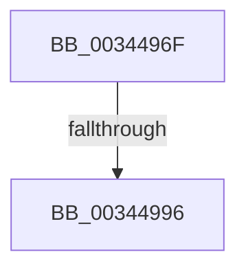

# sub_0034496F

- RVA: `0x0034496F`–`0x003449A0` (길이 `49` bytes)
- VA: `0x000000014034496F`
- 실행 섹션: `.text`
- PDB 이름 있음: `아니요`; PDB Function 태그: `아니요`
- unwind 정보 RVA: `0x00077D70`
- 디코드: `10`개 명령, `49/49` bytes 표시
- 미해석 바이트: `0` (있으면 어셈블리에 `.byte`로 보존)

> 이 문서는 커널 이미지의 기계어와 PDB 기호를 분석해 생성했습니다. 4번과 5번은 함수 원형과 자료형을 바이너리 사용 방식에서 추정한 C 해석이며 원본 소스 복구 결과는 아닙니다.

## 1. Dependencies

- 직접 호출 지점: **1**; 고유 호출 대상: **1**
- 직접 호출자로 확인된 함수: **0**
- RIP 상대 이미지 참조: **0**

### Outgoing calls
- `0x00344989` → [PfSnReferenceProcessTrace](PfSnReferenceProcessTrace_function_00344A80.md) (function, `0x00344A80`)

### Direct callers
- 이 함수 시작 RVA로 연결되는 직접 call은 확인되지 않았습니다. 간접 호출은 완전히 역산할 수 없습니다.

### Static image references
- 디코드된 RIP-relative 메모리 참조가 없습니다.

## 2. Other-region calls and transfers

- 다른 실행 섹션으로 향하는 call: **0**
- call이 아닌 외부 분기/꼬리 이동: **1**
  - `0x00344994` → [sub_003449AA](Unknown_function_003449AA.md) (`tail-transfer`)

## 3. Assembly (complete function range)

```asm
0034496F  48 89 5C 24 50                  mov qword ptr [rsp + 0x50], rbx
00344974  48 89 74 24 58                  mov qword ptr [rsp + 0x58], rsi
00344979  65 48 8B 34 25 88 01 00 00      mov rsi, qword ptr gs:[0x188]
00344982  48 8B 8E B8 00 00 00            mov rcx, qword ptr [rsi + 0xb8]
00344989  E8 F2 00 00 00                  call 0x140344a80
0034498E  48 8B D8                        mov rbx, rax
00344991  48 85 C0                        test rax, rax
00344994  75 14                           jne 0x1403449aa
00344996  48 8B 5C 24 50                  mov rbx, qword ptr [rsp + 0x50]
0034499B  48 8B 74 24 58                  mov rsi, qword ptr [rsp + 0x58]
```

## 4. C-style interpretation (structured pseudocode)

```c
__int64 __fastcall sub_0034496F(__int64 a1, __int64 a2, __int64 a3, __int64 a4, __int64 a5, __int64 a6, __int64 a7, __int64 a8, __int64 a9, __int64 a10, __int64 a11)
{
    __int64 result;
    unsigned __int64 v_stack_p50;
    unsigned __int64 v_stack_p58;

    v_stack_p50 = v_rbx;
    v_stack_p58 = v_rsi;
    result = PfSnReferenceProcessTrace(*(unsigned __int64 *)(*(unsigned __int64 *)(gs_base + (0 + 392)) + 184), a2, a3, a4);
    return result;
}
```

## 5. (Beta) C Style

```c
int64_t sub_0034496F(int64_t Arg1, int64_t Arg2, int64_t Arg3, int64_t Arg4, uint64_t Arg5, uint64_t Arg6, uint64_t Arg7, uint64_t Arg8, uint64_t Arg9, int64_t Arg10, int64_t Arg11)
{
    int64_t result;
    uint64_t v_stack_p50;
    uint64_t v_stack_p58;

    v_stack_p50 = local_rbx;
    v_stack_p58 = local_rsi;
    result = PfSnReferenceProcessTrace(*(uint64_t *)(*(uint64_t *)(gs_base + (0 + 0x188)) + 0xB8), Arg2, Arg3, Arg4);
    return result;
}
```

## 6. Execution-region graph

[열기: 2D/3D 그래프와 함수 탐색 컨트롤 패널](../../../control-panel.html?section=text&rva=0x0034496F&view=graph)

- 2D 그래프는 위에서 아래로 흐르고, 3D 그래프는 빈 공간을 드래그해 회전합니다. Shift+드래그는 이동, 휠은 확대·축소, 함수 노드 선택은 대상 보고서 이동입니다.

### Static fallback


