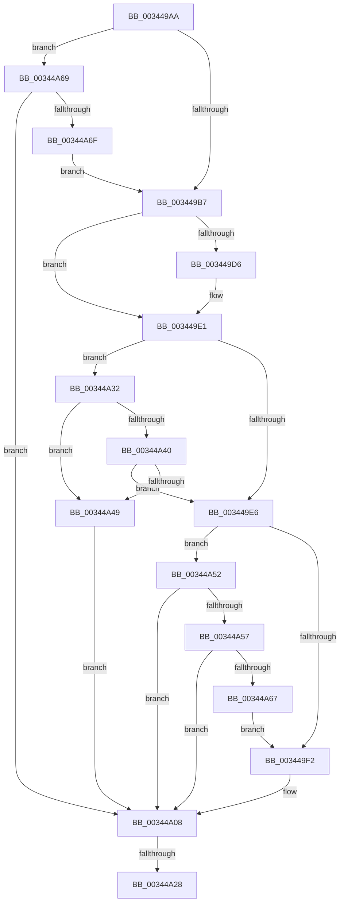

# sub_003449AA

- RVA: `0x003449AA`–`0x00344A74` (길이 `202` bytes)
- VA: `0x00000001403449AA`
- 실행 섹션: `.text`
- PDB 이름 있음: `아니요`; PDB Function 태그: `아니요`
- unwind 정보 RVA: `0x00077D9C`
- 디코드: `48`개 명령, `202/202` bytes 표시
- 미해석 바이트: `0` (있으면 어셈블리에 `.byte`로 보존)

> 이 문서는 커널 이미지의 기계어와 PDB 기호를 분석해 생성했습니다. 4번과 5번은 함수 원형과 자료형을 바이너리 사용 방식에서 추정한 C 해석이며 원본 소스 복구 결과는 아닙니다.

## 1. Dependencies

- 직접 호출 지점: **2**; 고유 호출 대상: **2**
- 직접 호출자로 확인된 함수: **0**
- RIP 상대 이미지 참조: **0**

### Outgoing calls
- `0x00344A03` → [PfSnLogPageFaultCommon](PfSnLogPageFaultCommon_function_00343070.md) (function, `0x00343070`)
- `0x00344A28` → [ExfReleaseRundownProtection](ExfReleaseRundownProtection_function_00349EB0.md) (function, `0x00349EB0`)

### Direct callers
- 이 함수 시작 RVA로 연결되는 직접 call은 확인되지 않았습니다. 간접 호출은 완전히 역산할 수 없습니다.

### Static image references
- 디코드된 RIP-relative 메모리 참조가 없습니다.

## 2. Other-region calls and transfers

- 다른 실행 섹션으로 향하는 call: **0**
- call이 아닌 외부 분기/꼬리 이동: **2**
  - `0x00344A22` → [sub_0034496F + 0x27](Unknown_function_0034496F.md) (`tail-transfer`)
  - `0x00344A2D` → [sub_0034496F + 0x27](Unknown_function_0034496F.md) (`tail-transfer`)

## 3. Assembly (complete function range)

```asm
003449AA  F6 86 A8 05 00 00 40            test byte ptr [rsi + 0x5a8], 0x40
003449B1  0F 85 B2 00 00 00               jne 0x140344a69
003449B7  48 8B 86 20 02 00 00            mov rax, qword ptr [rsi + 0x220]
003449BE  8B 8E A0 05 00 00               mov ecx, dword ptr [rsi + 0x5a0]
003449C4  C1 E9 09                        shr ecx, 9
003449C7  83 E1 07                        and ecx, 7
003449CA  48 8B 80 A0 02 00 00            mov rax, qword ptr [rax + 0x2a0]
003449D1  48 85 C0                        test rax, rax
003449D4  74 0B                           je 0x1403449e1
003449D6  8B 80 3C 04 00 00               mov eax, dword ptr [rax + 0x43c]
003449DC  3B C8                           cmp ecx, eax
003449DE  0F 4D C8                        cmovge ecx, eax
003449E1  83 F9 02                        cmp ecx, 2
003449E4  7C 4C                           jl 0x140344a32
003449E6  48 8B 83 B0 01 00 00            mov rax, qword ptr [rbx + 0x1b0]
003449ED  48 85 C0                        test rax, rax
003449F0  75 60                           jne 0x140344a52
003449F2  4C 8B 47 18                     mov r8, qword ptr [rdi + 0x18]
003449F6  4D 8B CE                        mov r9, r14
003449F9  48 8B D7                        mov rdx, rdi
003449FC  89 6C 24 20                     mov dword ptr [rsp + 0x20], ebp
00344A00  48 8B CB                        mov rcx, rbx
00344A03  E8 68 E6 FF FF                  call 0x140343070
00344A08  48 8D 8B 68 01 00 00            lea rcx, [rbx + 0x168]
00344A0F  0F 0D 09                        prefetchw byte ptr [rcx]
00344A12  48 8B 01                        mov rax, qword ptr [rcx]
00344A15  48 83 E0 FE                     and rax, 0xfffffffffffffffe
00344A19  48 8D 50 FE                     lea rdx, [rax - 2]
00344A1D  F0 48 0F B1 11                  lock cmpxchg qword ptr [rcx], rdx
00344A22  0F 84 6E FF FF FF               je 0x140344996
00344A28  E8 83 54 00 00                  call 0x140349eb0
00344A2D  E9 64 FF FF FF                  jmp 0x140344996
00344A32  65 48 8B 04 25 88 01 00 00      mov rax, qword ptr gs:[0x188]
00344A3B  48 3B F0                        cmp rsi, rax
00344A3E  75 09                           jne 0x140344a49
00344A40  83 BE E0 05 00 00 00            cmp dword ptr [rsi + 0x5e0], 0
00344A47  75 9D                           jne 0x1403449e6
00344A49  F0 FF 83 50 01 00 00            lock inc dword ptr [rbx + 0x150]
00344A50  EB B6                           jmp 0x140344a08
00344A52  48 3B C6                        cmp rax, rsi
00344A55  75 B1                           jne 0x140344a08
00344A57  48 8B 86 10 05 00 00            mov rax, qword ptr [rsi + 0x510]
00344A5E  48 39 83 B8 01 00 00            cmp qword ptr [rbx + 0x1b8], rax
00344A65  75 A1                           jne 0x140344a08
00344A67  EB 89                           jmp 0x1403449f2
00344A69  40 F6 C5 02                     test bpl, 2
00344A6D  74 99                           je 0x140344a08
00344A6F  E9 43 FF FF FF                  jmp 0x1403449b7
```

## 4. C-style interpretation (structured pseudocode)

```c
__int64 __fastcall sub_003449AA(void)
{
    __int64 result;
    unsigned int v_stack_p20;

    if (((*(unsigned __int8 *)(v_rsi + 1448)) & (64)) != 0) goto loc_00344A69;
loc_003449B7:
    a1 = (unsigned int)(((unsigned int)(*(unsigned int *)(v_rsi + 1440))) >> (9));
    a1 = (unsigned int)((a1) & (7));
    result = *(unsigned __int64 *)(*(unsigned __int64 *)(v_rsi + 544) + 672);
    if (*(unsigned __int64 *)(*(unsigned __int64 *)(v_rsi + 544) + 672) != 0) {
        result = *(unsigned int *)(*(unsigned __int64 *)(*(unsigned __int64 *)(v_rsi + 544) + 672) + 1084);
        if (((unsigned int)(a1)) >= ((unsigned int)(result))) { a1 = (unsigned int)(result); }
    }
    if (((unsigned int)(a1)) < 2) goto loc_00344A32;
loc_003449E6:
    if (*(unsigned __int64 *)(v_rbx + 432) != 0) goto loc_00344A52;
loc_003449F2:
    v_stack_p20 = (unsigned int)(v_rbp);
    result = PfSnLogPageFaultCommon(v_rbx, v_rdi, *(unsigned __int64 *)(v_rdi + 24), v_r14);
loc_00344A08:
    result = (*(unsigned __int64 *)(v_rbx + 360)) & (-2);
    result = ExfReleaseRundownProtection(v_rbx + 360, result - 2, *(unsigned __int64 *)(v_rdi + 24), v_r14);
loc_00344A32:
    if (v_rsi != (*(unsigned __int64 *)(gs_base + (0 + 392)))) goto loc_00344A49;
    if ((*(unsigned int *)(v_rsi + 1504)) != 0) goto loc_003449E6;
loc_00344A49:
    goto loc_00344A08;
loc_00344A52:
    if ((*(unsigned __int64 *)(gs_base + (0 + 392))) != v_rsi) goto loc_00344A08;
    if ((*(unsigned __int64 *)(v_rbx + 440)) != (*(unsigned __int64 *)(v_rsi + 1296))) goto loc_00344A08;
    goto loc_003449F2;
loc_00344A69:
    if ((((unsigned __int8)(v_rbp)) & (2)) == 0) goto loc_00344A08;
    goto loc_003449B7;
}
```

## 5. (Beta) C Style

```c
void sub_003449AA(void)
{
    int64_t result;
    uint32_t v_stack_p20;

    if (((*(uint8_t *)(local_rsi + 0x5A8)) & (64)) != 0) goto loc_00344A69;
loc_003449B7:
    a1 = (uint32_t)(((uint32_t)(*(uint32_t *)(local_rsi + 0x5A0))) >> (9));
    a1 = (uint32_t)((a1) & (7));
    result = *(uint64_t *)(*(uint64_t *)(local_rsi + 0x220) + 0x2A0);
    if (*(uint64_t *)(*(uint64_t *)(local_rsi + 0x220) + 0x2A0) != 0) {
        result = *(uint32_t *)(*(uint64_t *)(*(uint64_t *)(local_rsi + 0x220) + 0x2A0) + 0x43C);
        if (((uint32_t)(a1)) >= ((uint32_t)(result))) { a1 = (uint32_t)(result); }
    }
    if (((uint32_t)(a1)) < 2) goto loc_00344A32;
loc_003449E6:
    if (*(uint64_t *)(local_rbx + 0x1B0) != 0) goto loc_00344A52;
loc_003449F2:
    v_stack_p20 = (uint32_t)(local_rbp);
    result = PfSnLogPageFaultCommon(local_rbx, local_rdi, *(uint64_t *)(local_rdi + 0x18), local_r14);
loc_00344A08:
    result = (*(uint64_t *)(local_rbx + 0x168)) & (-2);
    result = ExfReleaseRundownProtection(local_rbx + 360, result - 2, *(uint64_t *)(local_rdi + 0x18), local_r14);
loc_00344A32:
    if (local_rsi != (*(uint64_t *)(gs_base + (0 + 0x188)))) goto loc_00344A49;
    if ((*(uint32_t *)(local_rsi + 0x5E0)) != 0) goto loc_003449E6;
loc_00344A49:
    goto loc_00344A08;
loc_00344A52:
    if ((*(uint64_t *)(gs_base + (0 + 0x188))) != local_rsi) goto loc_00344A08;
    if ((*(uint64_t *)(local_rbx + 0x1B8)) != (*(uint64_t *)(local_rsi + 0x510))) goto loc_00344A08;
    goto loc_003449F2;
loc_00344A69:
    if ((((uint8_t)(local_rbp)) & (2)) == 0) goto loc_00344A08;
    goto loc_003449B7;
}
```

## 6. Execution-region graph

[열기: 2D/3D 그래프와 함수 탐색 컨트롤 패널](../../../control-panel.html?section=text&rva=0x003449AA&view=graph)

- 2D 그래프는 위에서 아래로 흐르고, 3D 그래프는 빈 공간을 드래그해 회전합니다. Shift+드래그는 이동, 휠은 확대·축소, 함수 노드 선택은 대상 보고서 이동입니다.

### Static fallback


