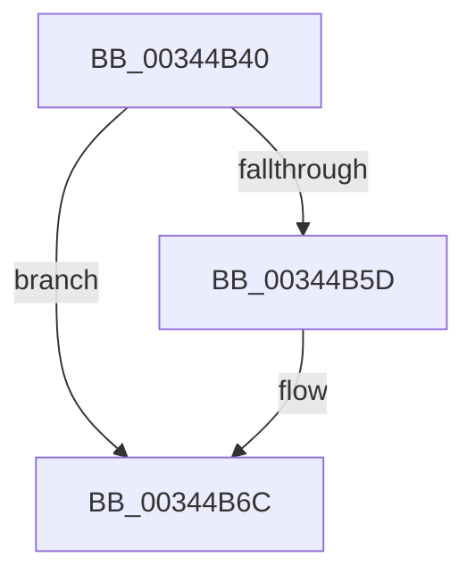

# sub_00344B40

- RVA: `0x00344B40`–`0x00344B95` (길이 `85` bytes)
- VA: `0x0000000140344B40`
- 실행 섹션: `.text`
- PDB 이름 있음: `아니요`; PDB Function 태그: `아니요`
- unwind 정보 RVA: `0x00077DC4`
- 디코드: `21`개 명령, `85/85` bytes 표시
- 미해석 바이트: `0` (있으면 어셈블리에 `.byte`로 보존)

> 이 문서는 커널 이미지의 기계어와 PDB 기호를 분석해 생성했습니다. 4번과 5번은 함수 원형과 자료형을 바이너리 사용 방식에서 추정한 C 해석이며 원본 소스 복구 결과는 아닙니다.

## 1. Dependencies

- 직접 호출 지점: **3**; 고유 호출 대상: **3**
- 직접 호출자로 확인된 함수: **0**
- RIP 상대 이미지 참조: **1**

### Outgoing calls
- `0x00344B48` → [KeAcquireSpinLockRaiseToDpc](../20/KeAcquireSpinLockRaiseToDpc_function_00208470.md) (function, `0x00208470`)
- `0x00344B64` → [ExAcquireRundownProtection](../21/ExAcquireRundownProtection_function_00216620.md) (function, `0x00216620`)
- `0x00344B77` → [KeReleaseSpinLock](../39/KeReleaseSpinLock_function_00392BA0.md) (function, `0x00392BA0`)

### Direct callers
- 이 함수 시작 RVA로 연결되는 직접 call은 확인되지 않았습니다. 간접 호출은 완전히 역산할 수 없습니다.

### Static image references
- `0x00344B70` → RVA `0x00E67260` (`.data`; read)

## 2. Other-region calls and transfers

- 다른 실행 섹션으로 향하는 call: **0**
- 별도 외부 분기/꼬리 이동을 확인하지 못했습니다.

## 3. Assembly (complete function range)

```asm
00344B40  48 89 74 24 30                  mov qword ptr [rsp + 0x30], rsi
00344B45  40 B7 01                        mov dil, 1
00344B48  E8 23 39 EC FF                  call 0x140208470
00344B4D  48 8B 9B 90 03 00 00            mov rbx, qword ptr [rbx + 0x390]
00344B54  0F B6 F0                        movzx esi, al
00344B57  48 83 E3 F0                     and rbx, 0xfffffffffffffff0
00344B5B  74 0F                           je 0x140344b6c
00344B5D  48 8D 8B 68 01 00 00            lea rcx, [rbx + 0x168]
00344B64  E8 B7 1A ED FF                  call 0x140216620
00344B69  0F B6 F8                        movzx edi, al
00344B6C  40 0F B6 D6                     movzx edx, sil
00344B70  48 8D 0D E9 26 B2 00            lea rcx, [rip + 0xb226e9]
00344B77  E8 24 E0 04 00                  call 0x140392ba0
00344B7C  48 8B 74 24 30                  mov rsi, qword ptr [rsp + 0x30]
00344B81  33 C0                           xor eax, eax
00344B83  40 84 FF                        test dil, dil
00344B86  48 0F 45 C3                     cmovne rax, rbx
00344B8A  48 8B 5C 24 38                  mov rbx, qword ptr [rsp + 0x38]
00344B8F  48 83 C4 20                     add rsp, 0x20
00344B93  5F                              pop rdi
00344B94  C3                              ret
```

## 4. C-style interpretation (structured pseudocode)

```c
__int64 __fastcall sub_00344B40(__int64 a1, __int64 a2, __int64 a3, __int64 a4, __int64 a5, __int64 a6, __int64 a7)
{
    __int64 result;
    __int64 v_rbx;
    __int64 v_rdi;
    __int64 v_rsp;
    unsigned __int64 v_stack_p30;

    v_stack_p30 = v_rsi;
    result = KeAcquireSpinLockRaiseToDpc(a1, a2, a3, a4);
    v_rbx = (*(unsigned __int64 *)(v_rbx + 912)) & (-16);
    v_rdi = 1;
    if (!(condition_is_equal)) {
        a1 = v_rbx + 360;
        result = ExAcquireRundownProtection(a1, a2, a3, a4);
        v_rdi = (unsigned __int8)(result);
    }
    result = KeReleaseSpinLock(v_rip + 11675369, (unsigned __int8)((unsigned __int8)(result)), a3, a4);
    result = 0;
    if ((unsigned __int8)(v_rdi) != 0) { result = v_rbx; }
    v_rsp = (v_rsp) + (32);
    return result;
}
```

## 5. (Beta) C Style

```c
int64_t sub_00344B40(int64_t Arg1, int64_t Arg2, int64_t Arg3, int64_t Arg4, uint64_t Arg5, int64_t Arg6, int64_t Arg7)
{
    int64_t result;
    int64_t local_rbx;
    int64_t local_rdi;
    int64_t local_rsp;
    uint64_t v_stack_p30;

    v_stack_p30 = local_rsi;
    result = KeAcquireSpinLockRaiseToDpc(Arg1, Arg2, Arg3, Arg4);
    local_rbx = (*(uint64_t *)(local_rbx + 0x390)) & (-16);
    local_rdi = 1;
    if (!(condition_is_equal)) {
        Arg1 = local_rbx + 360;
        result = ExAcquireRundownProtection(Arg1, Arg2, Arg3, Arg4);
        local_rdi = (uint8_t)(result);
    }
    result = KeReleaseSpinLock(v_rip + 11675369, (uint8_t)((uint8_t)(result)), Arg3, Arg4);
    result = 0;
    if ((uint8_t)(local_rdi) != 0) { result = local_rbx; }
    local_rsp = (local_rsp) + (32);
    return result;
}
```

## 6. Execution-region graph

[열기: 2D/3D 그래프와 함수 탐색 컨트롤 패널](../../../control-panel.html?section=text&rva=0x00344B40&view=graph)

- 2D 그래프는 위에서 아래로 흐르고, 3D 그래프는 빈 공간을 드래그해 회전합니다. Shift+드래그는 이동, 휠은 확대·축소, 함수 노드 선택은 대상 보고서 이동입니다.

### Static fallback


