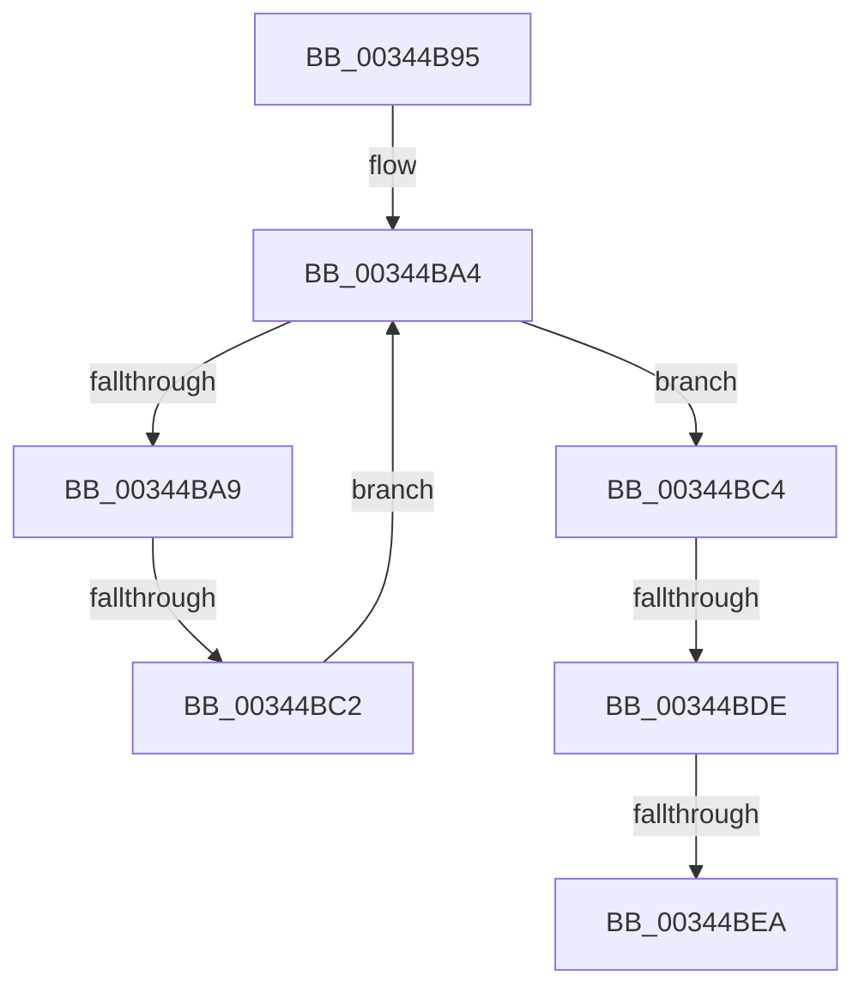

# sub_00344B95

- RVA: `0x00344B95`–`0x00344BFD` (길이 `104` bytes)
- VA: `0x0000000140344B95`
- 실행 섹션: `.text`
- PDB 이름 있음: `아니요`; PDB Function 태그: `아니요`
- unwind 정보 RVA: `0x00077DDC`
- 디코드: `23`개 명령, `104/104` bytes 표시
- 미해석 바이트: `0` (있으면 어셈블리에 `.byte`로 보존)

> 이 문서는 커널 이미지의 기계어와 PDB 기호를 분석해 생성했습니다. 4번과 5번은 함수 원형과 자료형을 바이너리 사용 방식에서 추정한 C 해석이며 원본 소스 복구 결과는 아닙니다.

## 1. Dependencies

- 직접 호출 지점: **1**; 고유 호출 대상: **1**
- 직접 호출자로 확인된 함수: **0**
- RIP 상대 이미지 참조: **0**

### Outgoing calls
- `0x00344BF3` → [KeSetEvent](../33/KeSetEvent_function_0033F310.md) (function, `0x0033F310`)

### Direct callers
- 이 함수 시작 RVA로 연결되는 직접 call은 확인되지 않았습니다. 간접 호출은 완전히 역산할 수 없습니다.

### Static image references
- 디코드된 RIP-relative 메모리 참조가 없습니다.

## 2. Other-region calls and transfers

- 다른 실행 섹션으로 향하는 call: **0**
- call이 아닌 외부 분기/꼬리 이동: **4**
  - `0x00344BBC` → [PfSnReferenceProcessTrace + 0x42](PfSnReferenceProcessTrace_function_00344A80.md) (`tail-transfer`)
  - `0x00344BD8` → [PfSnReferenceProcessTrace + 0x42](PfSnReferenceProcessTrace_function_00344A80.md) (`tail-transfer`)
  - `0x00344BE4` → [PfSnReferenceProcessTrace + 0x42](PfSnReferenceProcessTrace_function_00344A80.md) (`tail-transfer`)
  - `0x00344BF8` → [PfSnReferenceProcessTrace + 0x42](PfSnReferenceProcessTrace_function_00344A80.md) (`tail-transfer`)

## 3. Assembly (complete function range)

```asm
00344B95  CC                              int3
00344B96  0F 0D 8F 68 01 00 00            prefetchw byte ptr [rdi + 0x168]
00344B9D  48 8B 97 68 01 00 00            mov rdx, qword ptr [rdi + 0x168]
00344BA4  F6 C2 01                        test dl, 1
00344BA7  75 1B                           jne 0x140344bc4
00344BA9  48 8D 4A E2                     lea rcx, [rdx - 0x1e]
00344BAD  48 8B C2                        mov rax, rdx
00344BB0  F0 48 0F B1 8F 68 01 00 00      lock cmpxchg qword ptr [rdi + 0x168], rcx
00344BB9  48 8B D0                        mov rdx, rax
00344BBC  0F 84 00 FF FF FF               je 0x140344ac2
00344BC2  EB E0                           jmp 0x140344ba4
00344BC4  48 83 E2 FE                     and rdx, 0xfffffffffffffffe
00344BC8  48 C7 C0 F1 FF FF FF            mov rax, 0xfffffffffffffff1
00344BCF  F0 48 0F C1 02                  lock xadd qword ptr [rdx], rax
00344BD4  48 83 F8 0F                     cmp rax, 0xf
00344BD8  0F 85 E4 FE FF FF               jne 0x140344ac2
00344BDE  F0 0F BA 72 20 00               lock btr dword ptr [rdx + 0x20], 0
00344BE4  0F 82 D8 FE FF FF               jb 0x140344ac2
00344BEA  48 8D 4A 08                     lea rcx, [rdx + 8]
00344BEE  45 33 C0                        xor r8d, r8d
00344BF1  33 D2                           xor edx, edx
00344BF3  E8 18 A7 FF FF                  call 0x14033f310
00344BF8  E9 C5 FE FF FF                  jmp 0x140344ac2
```

## 4. C-style interpretation (structured pseudocode)

```c
__int64 __fastcall sub_00344B95(__int64 a1, __int64 a2, int a3)
{
    __int64 result;

loc_00344BA4:
    if ((((unsigned __int8)(*(unsigned __int64 *)(v_rdi + 360))) & (1)) != 0) goto loc_00344BC4;
    goto loc_00344BA4;
loc_00344BC4:
    a2 = (*(unsigned __int64 *)(v_rdi + 360)) & (-2);
    a3 = 0;
    a2 = 0;
    result = KeSetEvent(a2 + 8, a2, a3, a4);
}
```

## 5. (Beta) C Style

```c
int64_t sub_00344B95(int64_t Arg1, int64_t Arg2, int32_t Arg3)
{
    int64_t result;

loc_00344BA4:
    if ((((uint8_t)(*(uint64_t *)(local_rdi + 0x168))) & (1)) != 0) goto loc_00344BC4;
    goto loc_00344BA4;
loc_00344BC4:
    Arg2 = (*(uint64_t *)(local_rdi + 0x168)) & (-2);
    Arg3 = 0;
    Arg2 = 0;
    result = KeSetEvent(Arg2 + 8, Arg2, Arg3, a4);
}
```

## 6. Execution-region graph

[열기: 2D/3D 그래프와 함수 탐색 컨트롤 패널](../../../control-panel.html?section=text&rva=0x00344B95&view=graph)

- 2D 그래프는 위에서 아래로 흐르고, 3D 그래프는 빈 공간을 드래그해 회전합니다. Shift+드래그는 이동, 휠은 확대·축소, 함수 노드 선택은 대상 보고서 이동입니다.

### Static fallback


