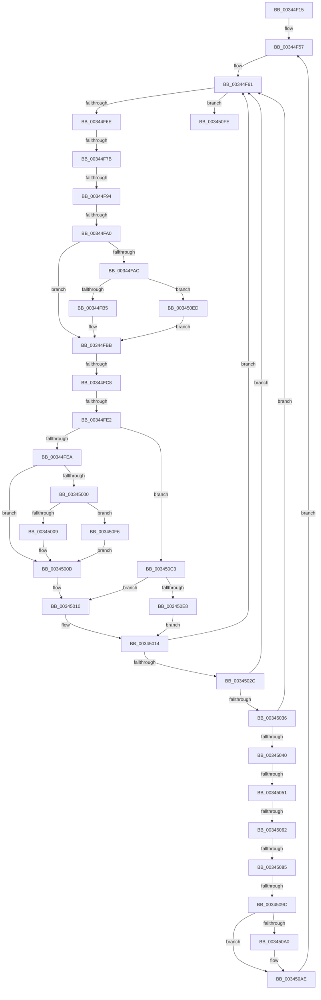

# sub_00344F15

- RVA: `0x00344F15`–`0x00345124` (길이 `527` bytes)
- VA: `0x0000000140344F15`
- 실행 섹션: `.text`
- PDB 이름 있음: `아니요`; PDB Function 태그: `아니요`
- unwind 정보 RVA: `0x00077E14`
- 디코드: `120`개 명령, `527/527` bytes 표시
- 미해석 바이트: `0` (있으면 어셈블리에 `.byte`로 보존)

> 이 문서는 커널 이미지의 기계어와 PDB 기호를 분석해 생성했습니다. 4번과 5번은 함수 원형과 자료형을 바이너리 사용 방식에서 추정한 C 해석이며 원본 소스 복구 결과는 아닙니다.

## 1. Dependencies

- 직접 호출 지점: **4**; 고유 호출 대상: **4**
- 직접 호출자로 확인된 함수: **0**
- RIP 상대 이미지 참조: **2**

### Outgoing calls
- `0x003450A7` → [MiDecreaseUsedPtes](../37/MiDecreaseUsedPtes_function_00378080.md) (function, `0x00378080`)
- `0x003450B1` → [MiUnlockPoolCommitWs](../32/MiUnlockPoolCommitWs_function_003297DC.md) (function, `0x003297DC`)
- `0x003450B9` → [MiLockPoolCommitWs](../46/MiLockPoolCommitWs_function_00469EC0.md) (function, `0x00469EC0`)
- `0x003450DB` → [MiAssignNonPagedPoolPte](MiAssignNonPagedPoolPte_function_003451F0.md) (function, `0x003451F0`)

### Direct callers
- 이 함수 시작 RVA로 연결되는 직접 call은 확인되지 않았습니다. 간접 호출은 완전히 역산할 수 없습니다.

### Static image references
- `0x00344FA0` → RVA `0x00E2DC80` (`.data`; read)
- `0x00345062` → RVA `0x00E38840` (`.data`; read)

## 2. Other-region calls and transfers

- 다른 실행 섹션으로 향하는 call: **0**
- call이 아닌 외부 분기/꼬리 이동: **9**
  - `0x00344F75` → [sub_0034512B + 0x7](Unknown_function_0034512B.md) (`tail-transfer`)
  - `0x00344F8E` → [sub_0034512B + 0x6B](Unknown_function_0034512B.md) (`tail-transfer`)
  - `0x00344F9A` → [sub_0034512B + 0x66](Unknown_function_0034512B.md) (`tail-transfer`)
  - `0x00344FC2` → [sub_0034512B](Unknown_function_0034512B.md) (`tail-transfer`)
  - `0x00344FDC` → [sub_0034512B + 0x37](Unknown_function_0034512B.md) (`tail-transfer`)
  - `0x0034504B` → [sub_0034512B + 0x92](Unknown_function_0034512B.md) (`tail-transfer`)
  - `0x0034505C` → [sub_0034512B + 0xAE](Unknown_function_0034512B.md) (`tail-transfer`)
  - `0x0034507F` → [sub_0034512B + 0x5F](Unknown_function_0034512B.md) (`tail-transfer`)
  - `0x00345096` → [sub_0034512B + 0x92](Unknown_function_0034512B.md) (`tail-transfer`)

## 3. Assembly (complete function range)

```asm
00344F15  48 89 68 18                     mov qword ptr [rax + 0x18], rbp
00344F19  33 ED                           xor ebp, ebp
00344F1B  48 89 70 F0                     mov qword ptr [rax - 0x10], rsi
00344F1F  33 F6                           xor esi, esi
00344F21  48 89 78 E8                     mov qword ptr [rax - 0x18], rdi
00344F25  4C 89 60 E0                     mov qword ptr [rax - 0x20], r12
00344F29  4C 89 68 D8                     mov qword ptr [rax - 0x28], r13
00344F2D  49 BD 00 00 00 00 40 00 00 00   movabs r13, 0x4000000000
00344F37  4C 89 70 D0                     mov qword ptr [rax - 0x30], r14
00344F3B  4C 8B 71 48                     mov r14, qword ptr [rcx + 0x48]
00344F3F  4C 89 78 C8                     mov qword ptr [rax - 0x38], r15
00344F43  49 BF FF FF FF FF 7F 00 00 00   movabs r15, 0x7fffffffff
00344F4D  49 BC 00 00 00 00 80 F6 FF FF   movabs r12, 0xfffff68000000000
00344F57  48 B8 F8 FF FF FF 7F 00 00 00   movabs rax, 0x7ffffffff8
00344F61  48 8B 7B 38                     mov rdi, qword ptr [rbx + 0x38]
00344F65  48 85 FF                        test rdi, rdi
00344F68  0F 84 90 01 00 00               je 0x1403450fe
00344F6E  48 8B 53 58                     mov rdx, qword ptr [rbx + 0x58]
00344F72  48 85 D2                        test rdx, rdx
00344F75  0F 84 B7 01 00 00               je 0x140345132
00344F7B  48 8B CF                        mov rcx, rdi
00344F7E  48 C1 E9 09                     shr rcx, 9
00344F82  48 23 C8                        and rcx, rax
00344F85  49 8B C4                        mov rax, r12
00344F88  48 03 C8                        add rcx, rax
00344F8B  48 3B CA                        cmp rcx, rdx
00344F8E  0F 85 02 02 00 00               jne 0x140345196
00344F94  48 8B 0F                        mov rcx, qword ptr [rdi]
00344F97  48 85 C9                        test rcx, rcx
00344F9A  0F 84 F1 01 00 00               je 0x140345191
00344FA0  48 8B 05 D9 8C AE 00            mov rax, qword ptr [rip + 0xae8cd9]
00344FA7  48 85 C0                        test rax, rax
00344FAA  74 0F                           je 0x140344fbb
00344FAC  F6 C1 10                        test cl, 0x10
00344FAF  0F 85 38 01 00 00               jne 0x1403450ed
00344FB5  48 F7 D0                        not rax
00344FB8  48 23 C8                        and rcx, rax
00344FBB  48 C1 E9 19                     shr rcx, 0x19
00344FBF  49 3B CF                        cmp rcx, r15
00344FC2  0F 84 63 01 00 00               je 0x14034512b
00344FC8  49 8B C4                        mov rax, r12
00344FCB  49 03 C5                        add rax, r13
00344FCE  48 8D 04 C8                     lea rax, [rax + rcx*8]
00344FD2  48 89 43 38                     mov qword ptr [rbx + 0x38], rax
00344FD6  0F B7 43 64                     movzx eax, word ptr [rbx + 0x64]
00344FDA  A8 01                           test al, 1
00344FDC  0F 85 80 01 00 00               jne 0x140345162
00344FE2  A8 02                           test al, 2
00344FE4  0F 84 D9 00 00 00               je 0x1403450c3
00344FEA  48 8B 15 8F 8C AE 00            mov rdx, qword ptr [rip + 0xae8c8f]
00344FF1  C1 E8 03                        shr eax, 3
00344FF4  83 E0 1F                        and eax, 0x1f
00344FF7  48 C1 E0 05                     shl rax, 5
00344FFB  48 85 D2                        test rdx, rdx
00344FFE  74 0D                           je 0x14034500d
00345000  48 85 D0                        test rax, rdx
00345003  0F 84 ED 00 00 00               je 0x1403450f6
00345009  48 83 C8 10                     or rax, 0x10
0034500D  48 89 07                        mov qword ptr [rdi], rax
00345010  48 FF 43 30                     inc qword ptr [rbx + 0x30]
00345014  48 FF C6                        inc rsi
00345017  48 B8 F8 FF FF FF 7F 00 00 00   movabs rax, 0x7ffffffff8
00345021  48 83 7B 38 00                  cmp qword ptr [rbx + 0x38], 0
00345026  0F 84 35 FF FF FF               je 0x140344f61
0034502C  40 F6 C6 0F                     test sil, 0xf
00345030  0F 85 2B FF FF FF               jne 0x140344f61
00345036  80 7B 67 02                     cmp byte ptr [rbx + 0x67], 2
0034503A  0F 83 21 FF FF FF               jae 0x140344f61
00345040  41 8B 86 B8 00 00 00            mov eax, dword ptr [r14 + 0xb8]
00345047  24 0F                           and al, 0xf
00345049  3C 05                           cmp al, 5
0034504B  0F 87 6C 01 00 00               ja 0x1403451bd
00345051  41 8B 86 B8 00 00 00            mov eax, dword ptr [r14 + 0xb8]
00345058  24 0F                           and al, 0xf
0034505A  3C 01                           cmp al, 1
0034505C  0F 85 77 01 00 00               jne 0x1403451d9
00345062  48 8D 05 D7 37 AF 00            lea rax, [rip + 0xaf37d7]
00345069  48 8B 10                        mov rdx, qword ptr [rax]
0034506C  65 48 8B 04 25 20 00 00 00      mov rax, qword ptr gs:[0x20]
00345075  48 8B 88 38 88 00 00            mov rcx, qword ptr [rax + 0x8838]
0034507C  48 85 C9                        test rcx, rcx
0034507F  0F 84 05 01 00 00               je 0x14034518a
00345085  8B 81 44 01 00 00               mov eax, dword ptr [rcx + 0x144]
0034508B  48 C1 E0 06                     shl rax, 6
0034508F  8B 0C 10                        mov ecx, dword ptr [rax + rdx]
00345092  0F BA E1 1E                     bt ecx, 0x1e
00345096  0F 83 21 01 00 00               jae 0x1403451bd
0034509C  85 ED                           test ebp, ebp
0034509E  74 0E                           je 0x1403450ae
003450A0  48 8B 53 58                     mov rdx, qword ptr [rbx + 0x58]
003450A4  44 8B C5                        mov r8d, ebp
003450A7  E8 D4 2F 03 00                  call 0x140378080
003450AC  33 ED                           xor ebp, ebp
003450AE  48 8B CB                        mov rcx, rbx
003450B1  E8 26 47 FE FF                  call 0x1403297dc
003450B6  48 8B CB                        mov rcx, rbx
003450B9  E8 02 4E 12 00                  call 0x140469ec0
003450BE  E9 94 FE FF FF                  jmp 0x140344f57
003450C3  48 C1 E7 19                     shl rdi, 0x19
003450C7  49 8B C4                        mov rax, r12
003450CA  48 C1 E0 19                     shl rax, 0x19
003450CE  48 8B CB                        mov rcx, rbx
003450D1  48 2B F8                        sub rdi, rax
003450D4  48 C1 FF 10                     sar rdi, 0x10
003450D8  48 8B D7                        mov rdx, rdi
003450DB  E8 10 01 00 00                  call 0x1403451f0
003450E0  85 C0                           test eax, eax
003450E2  0F 85 28 FF FF FF               jne 0x140345010
003450E8  E9 27 FF FF FF                  jmp 0x140345014
003450ED  48 83 E1 EF                     and rcx, 0xffffffffffffffef
003450F1  E9 C5 FE FF FF                  jmp 0x140344fbb
003450F6  48 0B C2                        or rax, rdx
003450F9  E9 0F FF FF FF                  jmp 0x14034500d
003450FE  4C 8B 74 24 38                  mov r14, qword ptr [rsp + 0x38]
00345103  4C 8B 6C 24 40                  mov r13, qword ptr [rsp + 0x40]
00345108  4C 8B 64 24 48                  mov r12, qword ptr [rsp + 0x48]
0034510D  48 8B 7C 24 50                  mov rdi, qword ptr [rsp + 0x50]
00345112  48 8B 74 24 58                  mov rsi, qword ptr [rsp + 0x58]
00345117  48 8B AC 24 80 00 00 00         mov rbp, qword ptr [rsp + 0x80]
0034511F  4C 8B 7C 24 30                  mov r15, qword ptr [rsp + 0x30]
```

## 4. C-style interpretation (structured pseudocode)

```c
__int64 __fastcall sub_00344F15(__int64 a1, __int64 a2, __int64 a3, __int64 a4, __int64 a5, __int64 a6, __int64 a7, __int64 a8, __int64 a9, __int64 a10, __int64 a11, __int64 a12, __int64 a13, __int64 a14, __int64 a15, __int64 a16)
{
    __int64 result;
    __int64 v_rbp;
    __int64 v_rdi;
    __int64 v_rsi;

    *(unsigned __int64 *)(result + 24) = v_rbp;
    v_rbp = 0;
    *(unsigned __int64 *)(result - 16) = v_rsi;
    v_rsi = 0;
    *(unsigned __int64 *)(result - 24) = v_rdi;
    *(unsigned __int64 *)(result - 32) = v_r12;
    *(unsigned __int64 *)(result - 40) = v_r13;
    *(unsigned __int64 *)(result - 48) = v_r14;
    *(unsigned __int64 *)(result - 56) = v_r15;
loc_00344F57:
loc_00344F61:
    if (*(unsigned __int64 *)(v_rbx + 56) == 0) goto loc_003450FE;
    a1 = (*(unsigned __int64 *)(v_rbx + 56)) >> (9);
    a1 = (a1) & (result);
    a1 = (a1) + (v_r12);
    if (*(unsigned __int64 *)(v_rip + 11439321) == 0) goto loc_00344FBB;
    if ((((unsigned __int8)(*(unsigned __int64 *)(*(unsigned __int64 *)(v_rbx + 56)))) & (16)) != 0) goto loc_003450ED;
    result = ~(*(unsigned __int64 *)(v_rip + 11439321));
    a1 = (*(unsigned __int64 *)(*(unsigned __int64 *)(v_rbx + 56))) & (result);
loc_00344FBB:
    a1 = (a1) >> (25);
    result = (v_r12) + (v_r13);
    *(unsigned __int64 *)(v_rbx + 56) = result + a1 * 8;
    if ((((unsigned __int8)(*(unsigned __int16 *)(v_rbx + 100))) & (2)) == 0) goto loc_003450C3;
    result = (unsigned int)((*(unsigned __int16 *)(v_rbx + 100)) >> (3));
    result = (unsigned int)((result) & (31));
    result = (result) << (5);
    if (*(unsigned __int64 *)(v_rip + 11439247) == 0) goto loc_0034500D;
    if (((result) & (*(unsigned __int64 *)(v_rip + 11439247))) == 0) goto loc_003450F6;
    result = (result) | (16);
loc_0034500D:
    *(unsigned __int64 *)(*(unsigned __int64 *)(v_rbx + 56)) = result;
loc_00345010:
loc_00345014:
    v_rsi = (v_rsi) + 1;
    if ((*(unsigned __int64 *)(v_rbx + 56)) == 0) goto loc_00344F61;
    if ((((unsigned __int8)(v_rsi)) & (15)) != 0) goto loc_00344F61;
    if ((*(unsigned __int8 *)(v_rbx + 103)) >= 2) goto loc_00344F61;
    result = (unsigned __int8)(((unsigned int)(*(unsigned int *)(*(unsigned __int64 *)(a1 + 72) + 184))) & (15));
    result = (unsigned __int8)(((unsigned int)(*(unsigned int *)(*(unsigned __int64 *)(a1 + 72) + 184))) & (15));
    result = ((unsigned int)(*(unsigned int *)(*(unsigned __int64 *)(*(unsigned __int64 *)(gs_base + (0 + 32)) + 34872) + 324))) << (6);
    if (0 != 0) {
        a2 = *(unsigned __int64 *)(v_rbx + 88);
        a3 = 0;
        result = MiDecreaseUsedPtes((unsigned int)(*(unsigned int *)(result + *(unsigned __int64 *)(v_rip + 11483095) * 1)), a2, a3, a4);
        v_rbp = 0;
    }
    result = MiUnlockPoolCommitWs(v_rbx, a2, a3, a4);
    result = MiLockPoolCommitWs(v_rbx, a2, a3, a4);
    goto loc_00344F57;
loc_003450C3:
    v_rdi = (*(unsigned __int64 *)(v_rbx + 56)) << (25);
    result = (v_r12) << (25);
    v_rdi = (v_rdi) - (result);
    v_rdi = (v_rdi) >> (16);
    result = MiAssignNonPagedPoolPte(v_rbx, v_rdi, a3, a4);
    if ((unsigned int)(result) != 0) goto loc_00345010;
    goto loc_00345014;
loc_003450ED:
    a1 = (v_rbx) & (-17);
    goto loc_00344FBB;
loc_003450F6:
    result = (result) | (v_rdi);
    goto loc_0034500D;
loc_003450FE:
    return result;
}
```

## 5. (Beta) C Style

```c
int64_t sub_00344F15(void *Arg1, int64_t Arg2, int64_t Arg3, int64_t Arg4, uint64_t Arg5, int64_t Arg6, int64_t Arg7, int64_t Arg8, int64_t Arg9, int64_t Arg10, int64_t Arg11, uint64_t Arg12, uint64_t Arg13, uint64_t Arg14, uint64_t Arg15, int64_t Arg16)
{
    uint8_t *arg1 = (uint8_t *)Arg1;

    int64_t result;
    int64_t local_rbp;
    int64_t local_rdi;
    int64_t local_rsi;

    *(uint64_t *)(result + 0x18) = local_rbp;
    local_rbp = 0;
    *(uint64_t *)(result - 0x10) = local_rsi;
    local_rsi = 0;
    *(uint64_t *)(result - 0x18) = local_rdi;
    *(uint64_t *)(result - 0x20) = local_r12;
    *(uint64_t *)(result - 0x28) = local_r13;
    *(uint64_t *)(result - 0x30) = local_r14;
    *(uint64_t *)(result - 0x38) = local_r15;
loc_00344F57:
loc_00344F61:
    if (*(uint64_t *)(local_rbx + 0x38) == 0) goto loc_003450FE;
    Arg1 = (*(uint64_t *)(local_rbx + 0x38)) >> (9);
    Arg1 = (Arg1) & (result);
    Arg1 = (Arg1) + (local_r12);
    if (*(uint64_t *)(v_rip + 0xAE8CD9) == 0) goto loc_00344FBB;
    if ((((uint8_t)(*(uint64_t *)(*(uint64_t *)(local_rbx + 0x38)))) & (16)) != 0) goto loc_003450ED;
    result = ~(*(uint64_t *)(v_rip + 0xAE8CD9));
    Arg1 = (*(uint64_t *)(*(uint64_t *)(local_rbx + 0x38))) & (result);
loc_00344FBB:
    Arg1 = (Arg1) >> (25);
    result = (local_r12) + (local_r13);
    *(uint64_t *)(local_rbx + 0x38) = result + Arg1 * 8;
    if ((((uint8_t)(*(uint16_t *)(local_rbx + 0x64))) & (2)) == 0) goto loc_003450C3;
    result = (uint32_t)((*(uint16_t *)(local_rbx + 0x64)) >> (3));
    result = (uint32_t)((result) & (31));
    result = (result) << (5);
    if (*(uint64_t *)(v_rip + 0xAE8C8F) == 0) goto loc_0034500D;
    if (((result) & (*(uint64_t *)(v_rip + 0xAE8C8F))) == 0) goto loc_003450F6;
    result = (result) | (16);
loc_0034500D:
    *(uint64_t *)(*(uint64_t *)(local_rbx + 0x38)) = result;
loc_00345010:
loc_00345014:
    local_rsi = (local_rsi) + 1;
    if ((*(uint64_t *)(local_rbx + 0x38)) == 0) goto loc_00344F61;
    if ((((uint8_t)(local_rsi)) & (15)) != 0) goto loc_00344F61;
    if ((*(uint8_t *)(local_rbx + 0x67)) >= 2) goto loc_00344F61;
    result = (uint8_t)(((uint32_t)(*(uint32_t *)(*(uint64_t *)(arg1 + 0x48) + 0xB8))) & (15));
    result = (uint8_t)(((uint32_t)(*(uint32_t *)(*(uint64_t *)(arg1 + 0x48) + 0xB8))) & (15));
    result = ((uint32_t)(*(uint32_t *)(*(uint64_t *)(*(uint64_t *)(gs_base + (0 + 0x20)) + 0x8838) + 0x144))) << (6);
    if (0 != 0) {
        Arg2 = *(uint64_t *)(local_rbx + 0x58);
        Arg3 = 0;
        result = MiDecreaseUsedPtes((uint32_t)(*(uint32_t *)(result + *(uint64_t *)(v_rip + 0xAF37D7) * 1)), Arg2, Arg3, Arg4);
        local_rbp = 0;
    }
    result = MiUnlockPoolCommitWs(local_rbx, Arg2, Arg3, Arg4);
    result = MiLockPoolCommitWs(local_rbx, Arg2, Arg3, Arg4);
    goto loc_00344F57;
loc_003450C3:
    local_rdi = (*(uint64_t *)(local_rbx + 0x38)) << (25);
    result = (local_r12) << (25);
    local_rdi = (local_rdi) - (result);
    local_rdi = (local_rdi) >> (16);
    result = MiAssignNonPagedPoolPte(local_rbx, local_rdi, Arg3, Arg4);
    if ((uint32_t)(result) != 0) goto loc_00345010;
    goto loc_00345014;
loc_003450ED:
    Arg1 = (local_rbx) & (-17);
    goto loc_00344FBB;
loc_003450F6:
    result = (result) | (local_rdi);
    goto loc_0034500D;
loc_003450FE:
    return result;
}
```

### 관측된 메모리 오프셋

구조체 형식이 확인되지 않은 접근은 인자 기준의 오프셋으로만 기록했습니다.

| 기준 인자 | 오프셋 표현 | 폭 (bit) | 접근 |
|---|---:|---:|---|
| `Arg1` | `+ 0x48` | `64` | `R` |

## 6. Execution-region graph

[열기: 2D/3D 그래프와 함수 탐색 컨트롤 패널](../../../control-panel.html?section=text&rva=0x00344F15&view=graph)

- 2D 그래프는 위에서 아래로 흐르고, 3D 그래프는 빈 공간을 드래그해 회전합니다. Shift+드래그는 이동, 휠은 확대·축소, 함수 노드 선택은 대상 보고서 이동입니다.

### Static fallback


