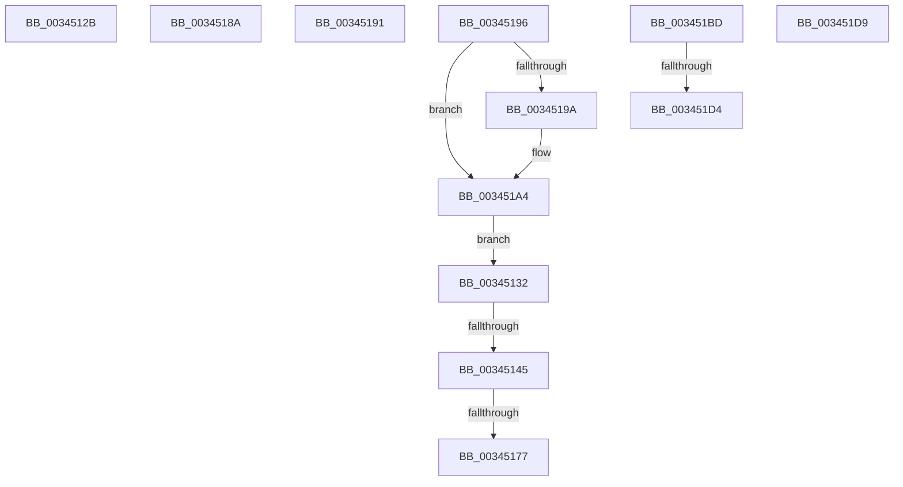

# sub_0034512B

- RVA: `0x0034512B`–`0x003451E5` (길이 `186` bytes)
- VA: `0x000000014034512B`
- 실행 섹션: `.text`
- PDB 이름 있음: `아니요`; PDB Function 태그: `아니요`
- unwind 정보 RVA: `0x00077E54`
- 디코드: `44`개 명령, `186/186` bytes 표시
- 미해석 바이트: `0` (있으면 어셈블리에 `.byte`로 보존)

> 이 문서는 커널 이미지의 기계어와 PDB 기호를 분석해 생성했습니다. 4번과 5번은 함수 원형과 자료형을 바이너리 사용 방식에서 추정한 C 해석이며 원본 소스 복구 결과는 아닙니다.

## 1. Dependencies

- 직접 호출 지점: **6**; 고유 호출 대상: **5**
- 직접 호출자로 확인된 함수: **0**
- RIP 상대 이미지 참조: **1**

### Outgoing calls
- `0x00345138` → [MiLockPoolCommitPageTable](../32/MiLockPoolCommitPageTable_function_00328BAC.md) (function, `0x00328BAC`)
- `0x0034515C` → [KeBugCheckEx](../4F/KeBugCheckEx_function_004FD660.md) (function, `0x004FD660`)
- `0x0034517E` → [MiDecreaseUsedPtes](../37/MiDecreaseUsedPtes_function_00378080.md) (function, `0x00378080`)
- `0x0034519D` → [MiDecreaseUsedPtes](../37/MiDecreaseUsedPtes_function_00378080.md) (function, `0x00378080`)
- `0x003451AB` → [MiUnlockPageTable](../21/MiUnlockPageTable_function_00216EC0.md) (function, `0x00216EC0`)
- `0x003451BD` → [KeShouldYieldProcessor](../27/KeShouldYieldProcessor_function_002773E0.md) (function, `0x002773E0`)

### Direct callers
- 이 함수 시작 RVA로 연결되는 직접 call은 확인되지 않았습니다. 간접 호출은 완전히 역산할 수 없습니다.

### Static image references
- `0x00345162` → RVA `0x00010880` (`.rdata`; read)

## 2. Other-region calls and transfers

- 다른 실행 섹션으로 향하는 call: **0**
- call이 아닌 외부 분기/꼬리 이동: **9**
  - `0x0034512D` → [sub_00344F15 + 0xBD](Unknown_function_00344F15.md) (`tail-transfer`)
  - `0x0034513F` → [sub_00344F15 + 0x7F](Unknown_function_00344F15.md) (`tail-transfer`)
  - `0x00345171` → [sub_00344F15 + 0xFF](Unknown_function_00344F15.md) (`tail-transfer`)
  - `0x00345185` → [sub_00344F15 + 0xFF](Unknown_function_00344F15.md) (`tail-transfer`)
  - `0x0034518C` → [sub_00344F15 + 0x176](Unknown_function_00344F15.md) (`tail-transfer`)
  - `0x00345191` → [sub_00344F15 + 0xB3](Unknown_function_00344F15.md) (`tail-transfer`)
  - `0x003451CE` → [sub_00344F15 + 0x4C](Unknown_function_00344F15.md) (`tail-transfer`)
  - `0x003451D4` → [sub_00344F15 + 0x187](Unknown_function_00344F15.md) (`tail-transfer`)
  - `0x003451E0` → [sub_00344F15 + 0x154](Unknown_function_00344F15.md) (`tail-transfer`)

## 3. Assembly (complete function range)

```asm
0034512B  33 C0                           xor eax, eax
0034512D  E9 A0 FE FF FF                  jmp 0x140344fd2
00345132  48 8B D7                        mov rdx, rdi
00345135  48 8B CB                        mov rcx, rbx
00345138  E8 6F 3A FE FF                  call 0x140328bac
0034513D  85 C0                           test eax, eax
0034513F  0F 85 4F FE FF FF               jne 0x140344f94
00345145  45 33 C9                        xor r9d, r9d
00345148  48 C7 44 24 20 00 00 00 00      mov qword ptr [rsp + 0x20], 0
00345151  4C 8B C7                        mov r8, rdi
00345154  8D 48 1A                        lea ecx, [rax + 0x1a]
00345157  BA 0A 53 00 00                  mov edx, 0x530a
0034515C  E8 FF 84 1B 00                  call 0x1404fd660
00345161  CC                              int3
00345162  48 8B 05 17 B7 CC FF            mov rax, qword ptr [rip - 0x3348e9]
00345169  FF C5                           inc ebp
0034516B  48 89 07                        mov qword ptr [rdi], rax
0034516E  49 3B CF                        cmp rcx, r15
00345171  0F 85 9D FE FF FF               jne 0x140345014
00345177  48 8B 53 58                     mov rdx, qword ptr [rbx + 0x58]
0034517B  44 8B C5                        mov r8d, ebp
0034517E  E8 FD 2E 03 00                  call 0x140378080
00345183  33 ED                           xor ebp, ebp
00345185  E9 8A FE FF FF                  jmp 0x140345014
0034518A  33 C0                           xor eax, eax
0034518C  E9 FA FE FF FF                  jmp 0x14034508b
00345191  E9 32 FE FF FF                  jmp 0x140344fc8
00345196  85 ED                           test ebp, ebp
00345198  74 0A                           je 0x1403451a4
0034519A  44 8B C5                        mov r8d, ebp
0034519D  E8 DE 2E 03 00                  call 0x140378080
003451A2  33 ED                           xor ebp, ebp
003451A4  48 8B 53 58                     mov rdx, qword ptr [rbx + 0x58]
003451A8  49 8B CE                        mov rcx, r14
003451AB  E8 10 1D ED FF                  call 0x140216ec0
003451B0  48 C7 43 58 00 00 00 00         mov qword ptr [rbx + 0x58], 0
003451B8  E9 75 FF FF FF                  jmp 0x140345132
003451BD  E8 1E 22 F3 FF                  call 0x1402773e0
003451C2  85 C0                           test eax, eax
003451C4  48 B8 F8 FF FF FF 7F 00 00 00   movabs rax, 0x7ffffffff8
003451CE  0F 84 8D FD FF FF               je 0x140344f61
003451D4  E9 C3 FE FF FF                  jmp 0x14034509c
003451D9  49 8D 86 C0 00 00 00            lea rax, [r14 + 0xc0]
003451E0  E9 84 FE FF FF                  jmp 0x140345069
```

## 4. C-style interpretation (structured pseudocode)

```c
__int64 __fastcall sub_0034512B(__int64 a1, __int64 a2, __int64 a3, int a4)
{
    __int64 result;
    unsigned __int64 v_stack_p20;

    result = 0;
}
```

## 5. (Beta) C Style

```c
int64_t sub_0034512B(int64_t Arg1, int64_t Arg2, int64_t Arg3, int32_t Arg4)
{
    int64_t result;
    uint64_t v_stack_p20;

    result = 0;
}
```

## 6. Execution-region graph

[열기: 2D/3D 그래프와 함수 탐색 컨트롤 패널](../../../control-panel.html?section=text&rva=0x0034512B&view=graph)

- 2D 그래프는 위에서 아래로 흐르고, 3D 그래프는 빈 공간을 드래그해 회전합니다. Shift+드래그는 이동, 휠은 확대·축소, 함수 노드 선택은 대상 보고서 이동입니다.

### Static fallback


