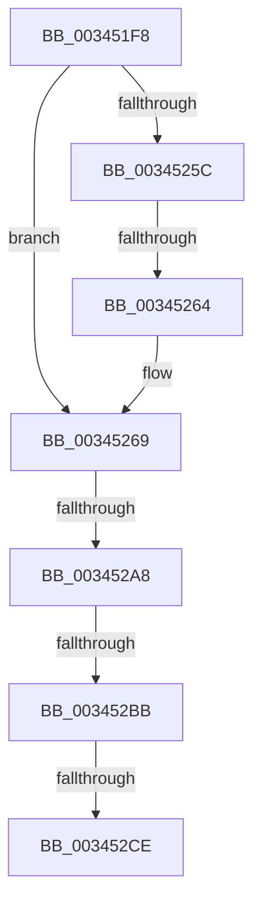

# sub_003451F8

- RVA: `0x003451F8`–`0x00345327` (길이 `303` bytes)
- VA: `0x00000001403451F8`
- 실행 섹션: `.text`
- PDB 이름 있음: `아니요`; PDB Function 태그: `아니요`
- unwind 정보 RVA: `0x00077E8C`
- 디코드: `65`개 명령, `303/303` bytes 표시
- 미해석 바이트: `0` (있으면 어셈블리에 `.byte`로 보존)

> 이 문서는 커널 이미지의 기계어와 PDB 기호를 분석해 생성했습니다. 4번과 5번은 함수 원형과 자료형을 바이너리 사용 방식에서 추정한 C 해석이며 원본 소스 복구 결과는 아닙니다.

## 1. Dependencies

- 직접 호출 지점: **2**; 고유 호출 대상: **2**
- 직접 호출자로 확인된 함수: **0**
- RIP 상대 이미지 참조: **3**

### Outgoing calls
- `0x0034523E` → [MiGetContainingPageTable](MiGetContainingPageTable_function_003467F0.md) (function, `0x003467F0`)
- `0x003452FB` → [MiIsAddressGlobal](../33/MiIsAddressGlobal_function_003308D0.md) (function, `0x003308D0`)

### Direct callers
- 이 함수 시작 RVA로 연결되는 직접 call은 확인되지 않았습니다. 간접 호출은 완전히 역산할 수 없습니다.

### Static image references
- `0x00345243` → RVA `0x00E2DC80` (`.data`; read)
- `0x0034526E` → RVA `0x00010990` (`.rdata`; read)
- `0x00345311` → RVA `0x00E2EE84` (`.data`; read)

## 2. Other-region calls and transfers

- 다른 실행 섹션으로 향하는 call: **0**
- call이 아닌 외부 분기/꼬리 이동: **4**
  - `0x0034525E` → [sub_00345562 + 0xD](Unknown_function_00345562.md) (`tail-transfer`)
  - `0x003452A2` → [sub_00345562](Unknown_function_00345562.md) (`tail-transfer`)
  - `0x003452B5` → [sub_00345562](Unknown_function_00345562.md) (`tail-transfer`)
  - `0x003452C8` → [sub_00345562 + 0x1A](Unknown_function_00345562.md) (`tail-transfer`)

## 3. Assembly (complete function range)

```asm
003451F8  48 89 6C 24 78                  mov qword ptr [rsp + 0x78], rbp
003451FD  48 B8 F8 FF FF FF 7F 00 00 00   movabs rax, 0x7ffffffff8
00345207  48 89 74 24 40                  mov qword ptr [rsp + 0x40], rsi
0034520C  48 8B E9                        mov rbp, rcx
0034520F  48 89 7C 24 38                  mov qword ptr [rsp + 0x38], rdi
00345214  4C 89 64 24 30                  mov qword ptr [rsp + 0x30], r12
00345219  4C 8B E2                        mov r12, rdx
0034521C  4C 89 74 24 20                  mov qword ptr [rsp + 0x20], r14
00345221  4C 8B F2                        mov r14, rdx
00345224  49 C1 EE 09                     shr r14, 9
00345228  4C 23 F0                        and r14, rax
0034522B  48 BE 00 00 00 00 80 F6 FF FF   movabs rsi, 0xfffff68000000000
00345235  48 8B C6                        mov rax, rsi
00345238  4C 03 F0                        add r14, rax
0034523B  49 8B CE                        mov rcx, r14
0034523E  E8 AD 15 00 00                  call 0x1403467f0
00345243  48 8B 15 36 8A AE 00            mov rdx, qword ptr [rip + 0xae8a36]
0034524A  4C 8B D0                        mov r10, rax
0034524D  48 89 44 24 70                  mov qword ptr [rsp + 0x70], rax
00345252  BF 80 00 00 00                  mov edi, 0x80
00345257  48 85 D2                        test rdx, rdx
0034525A  74 0D                           je 0x140345269
0034525C  85 D7                           test edi, edx
0034525E  0F 84 0B 03 00 00               je 0x14034556f
00345264  BF 90 00 00 00                  mov edi, 0x90
00345269  44 0F B7 7D 64                  movzx r15d, word ptr [rbp + 0x64]
0034526E  48 8D 05 1B B7 CC FF            lea rax, [rip - 0x3348e5]
00345275  41 C1 EF 03                     shr r15d, 3
00345279  41 83 E7 1F                     and r15d, 0x1f
0034527D  4A 8B 1C F8                     mov rbx, qword ptr [rax + r15*8]
00345281  48 B8 7F 0E 00 00 00 00 F0 FF   movabs rax, 0xfff0000000000e7f
0034528B  48 23 D8                        and rbx, rax
0034528E  48 83 CB 21                     or rbx, 0x21
00345292  48 8B C6                        mov rax, rsi
00345295  49 BB FF FF FF FF FF FF FF 7F   movabs r11, 0x7fffffffffffffff
0034529F  4C 3B F0                        cmp r14, rax
003452A2  0F 82 BA 02 00 00               jb 0x140345562
003452A8  48 B8 FF FF FF FF FF F6 FF FF   movabs rax, 0xfffff6ffffffffff
003452B2  4C 3B F0                        cmp r14, rax
003452B5  0F 87 A7 02 00 00               ja 0x140345562
003452BB  48 B8 00 00 00 40 FB F6 FF FF   movabs rax, 0xfffff6fb40000000
003452C5  4C 3B F0                        cmp r14, rax
003452C8  0F 83 AE 02 00 00               jae 0x14034557c
003452CE  49 8B CE                        mov rcx, r14
003452D1  48 C1 E1 19                     shl rcx, 0x19
003452D5  48 8B C6                        mov rax, rsi
003452D8  48 C1 E0 19                     shl rax, 0x19
003452DC  48 8B D3                        mov rdx, rbx
003452DF  48 2B C8                        sub rcx, rax
003452E2  48 83 CA 04                     or rdx, 4
003452E6  48 C1 F9 10                     sar rcx, 0x10
003452EA  48 B8 FF FF FE FF FF 7F 00 00   movabs rax, 0x7ffffffeffff
003452F4  48 3B C8                        cmp rcx, rax
003452F7  48 0F 47 D3                     cmova rdx, rbx
003452FB  E8 D0 B5 FE FF                  call 0x1403308d0
00345300  48 8B DA                        mov rbx, rdx
00345303  B9 00 01 00 00                  mov ecx, 0x100
00345308  48 0B D9                        or rbx, rcx
0034530B  85 C0                           test eax, eax
0034530D  48 0F 44 DA                     cmove rbx, rdx
00345311  0F B6 05 6C 9B AE 00            movzx eax, byte ptr [rip + 0xae9b6c]
00345318  41 80 E7 05                     and r15b, 5
0034531C  48 C1 E0 08                     shl rax, 8
00345320  48 8B F3                        mov rsi, rbx
00345323  48 83 CE 42                     or rsi, 0x42
```

## 4. C-style interpretation (structured pseudocode)

```c
__int64 __fastcall sub_003451F8(__int64 a1, __int64 a2)
{
    __int64 result;
    __int64 v_r14;
    __int64 v_r15;
    __int64 v_rbx;
    __int64 v_rsi;
    unsigned __int64 v_stack_p20;
    unsigned __int64 v_stack_p30;
    unsigned __int64 v_stack_p38;
    unsigned __int64 v_stack_p40;
    unsigned __int64 v_stack_p70;
    unsigned __int64 v_stack_p78;

    v_stack_p78 = v_rbp;
    v_stack_p40 = v_rsi;
    v_stack_p38 = v_rdi;
    v_stack_p30 = v_r12;
    v_stack_p20 = v_r14;
    v_r14 = (a2) >> (9);
    v_r14 = (v_r14) & (result);
    v_r14 = (v_r14) + (v_rsi);
    result = MiGetContainingPageTable(v_r14, a2, a3, a4);
    v_stack_p70 = result;
    if (*(unsigned __int64 *)(v_rip + 11438646) == 0) goto loc_00345269;
loc_00345269:
    v_r15 = (unsigned int)((*(unsigned __int16 *)(a1 + 100)) >> (3));
    v_r15 = (unsigned int)((v_r15) & (31));
    v_rbx = (*(unsigned __int64 *)(v_rip - 3360997 + v_r15 * 8)) & (v_rip - 3360997);
    v_rbx = (v_rbx) | (33);
    a1 = (v_r14) << (25);
    result = (v_rsi) << (25);
    a1 = (a1) - (result);
    a2 = (v_rbx) | (4);
    a1 = (a1) >> (16);
    if (a1 > result) { a2 = v_rbx; }
    result = MiIsAddressGlobal(a1, a2, a3, a4);
    v_rbx = (a2) | (256);
    if ((unsigned int)(result) == 0) { v_rbx = a2; }
    v_r15 = (unsigned __int8)((v_r15) & (5));
    result = (*(unsigned __int8 *)(v_rip + 11443052)) << (8);
    v_rsi = (v_rbx) | (66);
    return result;
}
```

## 5. (Beta) C Style

```c
int64_t sub_003451F8(void *Arg1, int64_t Arg2)
{
    uint8_t *arg1 = (uint8_t *)Arg1;

    int64_t result;
    int64_t local_r14;
    int64_t local_r15;
    int64_t local_rbx;
    int64_t local_rsi;
    uint64_t v_stack_p20;
    uint64_t v_stack_p30;
    uint64_t v_stack_p38;
    uint64_t v_stack_p40;
    uint64_t v_stack_p70;
    uint64_t v_stack_p78;

    v_stack_p78 = local_rbp;
    v_stack_p40 = local_rsi;
    v_stack_p38 = local_rdi;
    v_stack_p30 = local_r12;
    v_stack_p20 = local_r14;
    local_r14 = (Arg2) >> (9);
    local_r14 = (local_r14) & (result);
    local_r14 = (local_r14) + (local_rsi);
    result = MiGetContainingPageTable(local_r14, Arg2, a3, a4);
    v_stack_p70 = result;
    if (*(uint64_t *)(v_rip + 0xAE8A36) == 0) goto loc_00345269;
loc_00345269:
    local_r15 = (uint32_t)((*(uint16_t *)(arg1 + 0x64)) >> (3));
    local_r15 = (uint32_t)((local_r15) & (31));
    local_rbx = (*(uint64_t *)(v_rip - 0x3348E5 + local_r15 * 8)) & (v_rip - 3360997);
    local_rbx = (local_rbx) | (33);
    Arg1 = (local_r14) << (25);
    result = (local_rsi) << (25);
    Arg1 = (Arg1) - (result);
    Arg2 = (local_rbx) | (4);
    Arg1 = (Arg1) >> (16);
    if (Arg1 > result) { Arg2 = local_rbx; }
    result = MiIsAddressGlobal(Arg1, Arg2, a3, a4);
    local_rbx = (Arg2) | (256);
    if ((uint32_t)(result) == 0) { local_rbx = Arg2; }
    local_r15 = (uint8_t)((local_r15) & (5));
    result = (*(uint8_t *)(v_rip + 0xAE9B6C)) << (8);
    local_rsi = (local_rbx) | (66);
    return result;
}
```

### 관측된 메모리 오프셋

구조체 형식이 확인되지 않은 접근은 인자 기준의 오프셋으로만 기록했습니다.

| 기준 인자 | 오프셋 표현 | 폭 (bit) | 접근 |
|---|---:|---:|---|
| `Arg1` | `+ 0x64` | `16` | `R` |

## 6. Execution-region graph

[열기: 2D/3D 그래프와 함수 탐색 컨트롤 패널](../../../control-panel.html?section=text&rva=0x003451F8&view=graph)

- 2D 그래프는 위에서 아래로 흐르고, 3D 그래프는 빈 공간을 드래그해 회전합니다. Shift+드래그는 이동, 휠은 확대·축소, 함수 노드 선택은 대상 보고서 이동입니다.

### Static fallback


