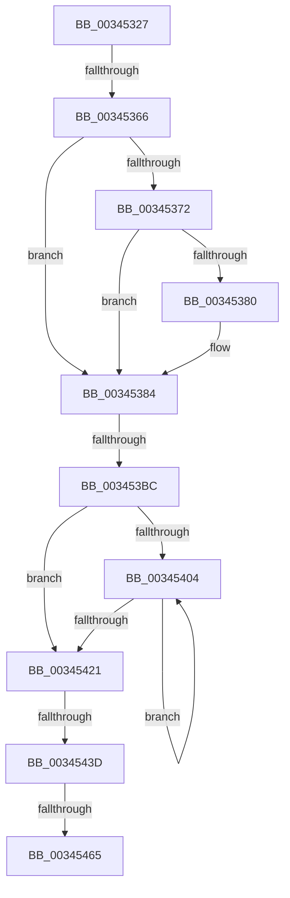

# sub_00345327

- RVA: `0x00345327`–`0x003454FC` (길이 `469` bytes)
- VA: `0x0000000140345327`
- 실행 섹션: `.text`
- PDB 이름 있음: `아니요`; PDB Function 태그: `아니요`
- unwind 정보 RVA: `0x00077EB0`
- 디코드: `108`개 명령, `469/469` bytes 표시
- 미해석 바이트: `0` (있으면 어셈블리에 `.byte`로 보존)

> 이 문서는 커널 이미지의 기계어와 PDB 기호를 분석해 생성했습니다. 4번과 5번은 함수 원형과 자료형을 바이너리 사용 방식에서 추정한 C 해석이며 원본 소스 복구 결과는 아닙니다.

## 1. Dependencies

- 직접 호출 지점: **0**; 고유 호출 대상: **0**
- 직접 호출자로 확인된 함수: **0**
- RIP 상대 이미지 참조: **1**

### Outgoing calls
- 직접 디코드된 call 명령이 없습니다.

### Direct callers
- 이 함수 시작 RVA로 연결되는 직접 call은 확인되지 않았습니다. 간접 호출은 완전히 역산할 수 없습니다.

### Static image references
- `0x003454ED` → RVA `0x00FC6A88` (`ALMOSTRO`; read)

## 2. Other-region calls and transfers

- 다른 실행 섹션으로 향하는 call: **0**
- call이 아닌 외부 분기/꼬리 이동: **5**
  - `0x00345360` → [sub_00345601 + 0x1F](Unknown_function_00345601.md) (`tail-transfer`)
  - `0x003453B6` → [sub_00345692](Unknown_function_00345692.md) (`tail-transfer`)
  - `0x00345437` → [sub_00345601](Unknown_function_00345601.md) (`tail-transfer`)
  - `0x0034545F` → [sub_003456C4 + 0x27](Unknown_function_003456C4.md) (`tail-transfer`)
  - `0x003454F6` → [sub_00345640](Unknown_function_00345640.md) (`tail-transfer`)

## 3. Assembly (complete function range)

```asm
00345327  4C 89 6C 24 28                  mov qword ptr [rsp + 0x28], r13
0034532C  41 80 FF 04                     cmp r15b, 4
00345330  48 0F 45 F3                     cmovne rsi, rbx
00345334  48 33 F0                        xor rsi, rax
00345337  48 0F BA F6 08                  btr rsi, 8
0034533C  48 33 F0                        xor rsi, rax
0034533F  48 B8 FF FF FF FF FF FF FF FA   movabs rax, 0xfaffffffffffffff
00345349  48 23 F0                        and rsi, rax
0034534C  48 B8 00 00 00 00 00 00 00 0A   movabs rax, 0xa00000000000000
00345356  48 0B F0                        or rsi, rax
00345359  49 8B 06                        mov rax, qword ptr [r14]
0034535C  66 85 4D 64                     test word ptr [rbp + 0x64], cx
00345360  0F 85 BA 02 00 00               jne 0x140345620
00345366  48 8B 5D 10                     mov rbx, qword ptr [rbp + 0x10]
0034536A  45 33 FF                        xor r15d, r15d
0034536D  48 85 DB                        test rbx, rbx
00345370  74 12                           je 0x140345384
00345372  48 8B 03                        mov rax, qword ptr [rbx]
00345375  48 83 6D 20 01                  sub qword ptr [rbp + 0x20], 1
0034537A  48 89 45 10                     mov qword ptr [rbp + 0x10], rax
0034537E  75 04                           jne 0x140345384
00345380  4C 89 7D 18                     mov qword ptr [rbp + 0x18], r15
00345384  49 B9 00 00 00 00 00 DE FF FF   movabs r9, 0xffffde0000000000
0034538E  49 8B C1                        mov rax, r9
00345391  48 8B EB                        mov rbp, rbx
00345394  41 BD 01 00 00 00               mov r13d, 1
0034539A  48 2B E8                        sub rbp, rax
0034539D  48 8B CB                        mov rcx, rbx
003453A0  48 C1 FD 04                     sar rbp, 4
003453A4  48 B8 AB AA AA AA AA AA AA AA   movabs rax, 0xaaaaaaaaaaaaaaab
003453AE  48 0F AF E8                     imul rbp, rax
003453B2  F6 43 23 10                     test byte ptr [rbx + 0x23], 0x10
003453B6  0F 85 D6 02 00 00               jne 0x140345692
003453BC  48 89 7B 10                     mov qword ptr [rbx + 0x10], rdi
003453C0  48 8B 43 28                     mov rax, qword ptr [rbx + 0x28]
003453C4  49 23 C3                        and rax, r11
003453C7  44 89 6C 24 60                  mov dword ptr [rsp + 0x60], r13d
003453CC  48 89 43 28                     mov qword ptr [rbx + 0x28], rax
003453D0  B8 28 00 00 00                  mov eax, 0x28
003453D5  49 B9 00 00 00 00 00 FF FF FF   movabs r9, 0xffffff0000000000
003453DF  48 8B 14 08                     mov rdx, qword ptr [rax + rcx]
003453E3  4C 8D 24 08                     lea r12, [rax + rcx]
003453E7  48 8B CA                        mov rcx, rdx
003453EA  48 8B C2                        mov rax, rdx
003453ED  49 33 CA                        xor rcx, r10
003453F0  49 23 C9                        and rcx, r9
003453F3  49 33 CA                        xor rcx, r10
003453F6  F0 49 0F B1 0C 24               lock cmpxchg qword ptr [r12], rcx
003453FC  4C 8B C0                        mov r8, rax
003453FF  48 3B D0                        cmp rdx, rax
00345402  74 1D                           je 0x140345421
00345404  49 8B C8                        mov rcx, r8
00345407  4D 33 C2                        xor r8, r10
0034540A  4D 23 C1                        and r8, r9
0034540D  48 8B C1                        mov rax, rcx
00345410  4D 33 C2                        xor r8, r10
00345413  F0 4D 0F B1 04 24               lock cmpxchg qword ptr [r12], r8
00345419  4C 8B C0                        mov r8, rax
0034541C  48 3B C8                        cmp rcx, rax
0034541F  75 E3                           jne 0x140345404
00345421  41 8B FF                        mov edi, r15d
00345424  0F 1F 40 00                     nop dword ptr [rax]
00345428  0F 1F 84 00 00 00 00 00         nop dword ptr [rax + rax]
00345430  F0 48 0F BA 6B 18 3F            lock bts qword ptr [rbx + 0x18], 0x3f
00345437  0F 82 C4 01 00 00               jb 0x140345601
0034543D  49 8B 04 24                     mov rax, qword ptr [r12]
00345441  49 BB FF FF FF FF FF FF FF 7F   movabs r11, 0x7fffffffffffffff
0034544B  49 23 C3                        and rax, r11
0034544E  48 89 43 28                     mov qword ptr [rbx + 0x28], rax
00345452  4C 89 3B                        mov qword ptr [rbx], r15
00345455  8B 43 20                        mov eax, dword ptr [rbx + 0x20]
00345458  C1 E8 10                        shr eax, 0x10
0034545B  24 C0                           and al, 0xc0
0034545D  3C 40                           cmp al, 0x40
0034545F  0F 85 86 02 00 00               jne 0x1403456eb
00345465  48 8B 43 18                     mov rax, qword ptr [rbx + 0x18]
00345469  48 B9 01 00 00 00 00 00 00 C0   movabs rcx, 0xc000000000000001
00345473  48 23 C1                        and rax, rcx
00345476  49 0B C5                        or rax, r13
00345479  48 89 43 18                     mov qword ptr [rbx + 0x18], rax
0034547D  8B 43 20                        mov eax, dword ptr [rbx + 0x20]
00345480  89 44 24 68                     mov dword ptr [rsp + 0x68], eax
00345484  66 44 89 6C 24 68               mov word ptr [rsp + 0x68], r13w
0034548A  8B 44 24 68                     mov eax, dword ptr [rsp + 0x68]
0034548E  89 43 20                        mov dword ptr [rbx + 0x20], eax
00345491  4C 89 73 08                     mov qword ptr [rbx + 8], r14
00345495  8B 43 20                        mov eax, dword ptr [rbx + 0x20]
00345498  89 44 24 68                     mov dword ptr [rsp + 0x68], eax
0034549C  C1 E8 10                        shr eax, 0x10
0034549F  24 FE                           and al, 0xfe
003454A1  0C 06                           or al, 6
003454A3  88 44 24 6A                     mov byte ptr [rsp + 0x6a], al
003454A7  8B 44 24 68                     mov eax, dword ptr [rsp + 0x68]
003454AB  89 43 20                        mov dword ptr [rbx + 0x20], eax
003454AE  F0 4C 21 5B 18                  lock and qword ptr [rbx + 0x18], r11
003454B3  4C 8B 54 24 70                  mov r10, qword ptr [rsp + 0x70]
003454B8  4C 8B 6C 24 28                  mov r13, qword ptr [rsp + 0x28]
003454BD  48 B8 FF 0F 00 00 00 00 F0 FF   movabs rax, 0xfff0000000000fff
003454C7  4C 8B 64 24 30                  mov r12, qword ptr [rsp + 0x30]
003454CC  48 8B 7C 24 38                  mov rdi, qword ptr [rsp + 0x38]
003454D1  48 C1 E5 0C                     shl rbp, 0xc
003454D5  48 33 F5                        xor rsi, rbp
003454D8  49 B9 00 00 00 00 00 DE FF FF   movabs r9, 0xffffde0000000000
003454E2  48 23 F0                        and rsi, rax
003454E5  48 33 F5                        xor rsi, rbp
003454E8  48 8B 6C 24 78                  mov rbp, qword ptr [rsp + 0x78]
003454ED  48 0F BA 25 92 15 C8 00 24      bt qword ptr [rip + 0xc81592], 0x24
003454F6  0F 82 44 01 00 00               jb 0x140345640
```

## 4. C-style interpretation (structured pseudocode)

```c
__int64 __fastcall sub_00345327(__int64 a1, __int64 a2, __int64 a3, __int64 a4, __int64 a5, __int64 a6, __int64 a7, __int64 a8, __int64 a9, __int64 a10, __int64 a11, __int64 a12, unsigned int a13, __int64 a14, __int64 a15)
{
    __int64 result;
    __int64 v_r15;
    __int64 v_rbp;
    __int64 v_rsi;
    unsigned __int64 v_stack_p28;
    unsigned int v_stack_p60;
    unsigned int v_stack_p68;
    unsigned __int8 v_stack_p6A;

    v_stack_p28 = v_r13;
    if (((unsigned __int8)(v_r15)) != 4) { v_rsi = v_rbx; }
    v_rsi = (v_rsi) ^ (result);
    v_rsi = (v_rsi) ^ (result);
    v_rsi = (v_rsi) & (result);
    v_rsi = (v_rsi) | (result);
    v_r15 = 0;
    if (*(unsigned __int64 *)(v_rbp + 16) == 0) goto loc_00345384;
    *(unsigned __int64 *)(v_rbp + 16) = *(unsigned __int64 *)(*(unsigned __int64 *)(v_rbp + 16));
    if (*(unsigned __int64 *)(v_rbp + 16) == 0) {
        *(unsigned __int64 *)(v_rbp + 24) = 0;
    }
    v_rbp = (*(unsigned __int64 *)(v_rbp + 16)) - (a4);
    v_rbp = (v_rbp) >> (4);
    v_rbp = (v_rbp) * (a4);
    *(unsigned __int64 *)(*(unsigned __int64 *)(v_rbp + 16) + 16) = v_rdi;
    result = (*(unsigned __int64 *)(*(unsigned __int64 *)(v_rbp + 16) + 40)) & (v_r11);
    v_stack_p60 = 1;
    *(unsigned __int64 *)(*(unsigned __int64 *)(v_rbp + 16) + 40) = result;
    a1 = (*(unsigned __int64 *)(40 + *(unsigned __int64 *)(v_rbp + 16) * 1)) ^ (v_r10);
    a1 = (a1) & (a4);
    a1 = (a1) ^ (v_r10);
    if ((*(unsigned __int64 *)(40 + *(unsigned __int64 *)(v_rbp + 16) * 1)) == (*(unsigned __int64 *)(40 + *(unsigned __int64 *)(v_rbp + 16) * 1))) goto loc_00345421;
loc_00345404:
    a3 = (*(unsigned __int64 *)(40 + *(unsigned __int64 *)(v_rbp + 16) * 1)) ^ (v_r10);
    a3 = (a3) & (a4);
    a3 = (a3) ^ (v_r10);
    if ((*(unsigned __int64 *)(40 + *(unsigned __int64 *)(v_rbp + 16) * 1)) != (*(unsigned __int64 *)(40 + *(unsigned __int64 *)(v_rbp + 16) * 1))) goto loc_00345404;
loc_00345421:
    result = (*(unsigned __int64 *)(40 + *(unsigned __int64 *)(v_rbp + 16) * 1)) & (v_r11);
    *(unsigned __int64 *)(*(unsigned __int64 *)(v_rbp + 16) + 40) = result;
    *(unsigned __int64 *)(*(unsigned __int64 *)(v_rbp + 16)) = 0;
    result = (unsigned int)(((unsigned int)(*(unsigned int *)(*(unsigned __int64 *)(v_rbp + 16) + 32))) >> (16));
    result = (unsigned __int8)((result) & (192));
    result = (*(unsigned __int64 *)(*(unsigned __int64 *)(v_rbp + 16) + 24)) & (*(unsigned __int64 *)(40 + *(unsigned __int64 *)(v_rbp + 16) * 1));
    result = (result) | (1);
    *(unsigned __int64 *)(*(unsigned __int64 *)(v_rbp + 16) + 24) = result;
    v_stack_p68 = (unsigned int)((unsigned int)(*(unsigned int *)(*(unsigned __int64 *)(v_rbp + 16) + 32)));
    v_stack_p68 = 1;
    *(unsigned int *)(*(unsigned __int64 *)(v_rbp + 16) + 32) = (unsigned int)((unsigned int)(a13));
    *(unsigned __int64 *)(*(unsigned __int64 *)(v_rbp + 16) + 8) = v_r14;
    v_stack_p68 = (unsigned int)((unsigned int)(*(unsigned int *)(*(unsigned __int64 *)(v_rbp + 16) + 32)));
    result = (unsigned int)(((unsigned int)(*(unsigned int *)(*(unsigned __int64 *)(v_rbp + 16) + 32))) >> (16));
    result = (unsigned __int8)((result) & (254));
    result = (unsigned __int8)((result) | (6));
    v_stack_p6A = (unsigned __int8)(result);
    *(unsigned int *)(*(unsigned __int64 *)(v_rbp + 16) + 32) = (unsigned int)((unsigned int)(a13));
    v_rbp = (v_rbp) << (12);
    v_rsi = (v_rsi) ^ (v_rbp);
    v_rsi = (v_rsi) & ((unsigned int)(a13));
    v_rsi = (v_rsi) ^ (v_rbp);
}
```

## 5. (Beta) C Style

```c
int64_t sub_00345327(int64_t Arg1, int64_t Arg2, int64_t Arg3, int64_t Arg4, int64_t Arg5, int64_t Arg6, int64_t Arg7, uint64_t Arg8, uint64_t Arg9, uint64_t Arg10, uint64_t Arg11, uint64_t Arg12, uint32_t Arg13, int64_t Arg14, int64_t Arg15)
{
    int64_t result;
    int64_t local_r15;
    int64_t local_rbp;
    int64_t local_rsi;
    uint64_t v_stack_p28;
    uint32_t v_stack_p60;
    uint32_t v_stack_p68;
    uint8_t v_stack_p6A;

    v_stack_p28 = local_r13;
    if (((uint8_t)(local_r15)) != 4) { local_rsi = local_rbx; }
    local_rsi = (local_rsi) ^ (result);
    local_rsi = (local_rsi) ^ (result);
    local_rsi = (local_rsi) & (result);
    local_rsi = (local_rsi) | (result);
    local_r15 = 0;
    if (*(uint64_t *)(local_rbp + 0x10) == 0) goto loc_00345384;
    *(uint64_t *)(local_rbp + 0x10) = *(uint64_t *)(*(uint64_t *)(local_rbp + 0x10));
    if (*(uint64_t *)(local_rbp + 0x10) == 0) {
        *(uint64_t *)(local_rbp + 0x18) = 0;
    }
    local_rbp = (*(uint64_t *)(local_rbp + 0x10)) - (Arg4);
    local_rbp = (local_rbp) >> (4);
    local_rbp = (local_rbp) * (Arg4);
    *(uint64_t *)(*(uint64_t *)(local_rbp + 0x10) + 0x10) = local_rdi;
    result = (*(uint64_t *)(*(uint64_t *)(local_rbp + 0x10) + 0x28)) & (local_r11);
    v_stack_p60 = 1;
    *(uint64_t *)(*(uint64_t *)(local_rbp + 0x10) + 0x28) = result;
    Arg1 = (*(uint64_t *)(40 + *(uint64_t *)(local_rbp + 0x10) * 1)) ^ (local_r10);
    Arg1 = (Arg1) & (Arg4);
    Arg1 = (Arg1) ^ (local_r10);
    if ((*(uint64_t *)(40 + *(uint64_t *)(local_rbp + 0x10) * 1)) == (*(uint64_t *)(40 + *(uint64_t *)(local_rbp + 0x10) * 1))) goto loc_00345421;
loc_00345404:
    Arg3 = (*(uint64_t *)(40 + *(uint64_t *)(local_rbp + 0x10) * 1)) ^ (local_r10);
    Arg3 = (Arg3) & (Arg4);
    Arg3 = (Arg3) ^ (local_r10);
    if ((*(uint64_t *)(40 + *(uint64_t *)(local_rbp + 0x10) * 1)) != (*(uint64_t *)(40 + *(uint64_t *)(local_rbp + 0x10) * 1))) goto loc_00345404;
loc_00345421:
    result = (*(uint64_t *)(40 + *(uint64_t *)(local_rbp + 0x10) * 1)) & (local_r11);
    *(uint64_t *)(*(uint64_t *)(local_rbp + 0x10) + 0x28) = result;
    *(uint64_t *)(*(uint64_t *)(local_rbp + 0x10)) = 0;
    result = (uint32_t)(((uint32_t)(*(uint32_t *)(*(uint64_t *)(local_rbp + 0x10) + 0x20))) >> (16));
    result = (uint8_t)((result) & (192));
    result = (*(uint64_t *)(*(uint64_t *)(local_rbp + 0x10) + 0x18)) & (*(uint64_t *)(40 + *(uint64_t *)(local_rbp + 0x10) * 1));
    result = (result) | (1);
    *(uint64_t *)(*(uint64_t *)(local_rbp + 0x10) + 0x18) = result;
    v_stack_p68 = (uint32_t)((uint32_t)(*(uint32_t *)(*(uint64_t *)(local_rbp + 0x10) + 0x20)));
    v_stack_p68 = 1;
    *(uint32_t *)(*(uint64_t *)(local_rbp + 0x10) + 0x20) = (uint32_t)((uint32_t)(Arg13));
    *(uint64_t *)(*(uint64_t *)(local_rbp + 0x10) + 0x8) = local_r14;
    v_stack_p68 = (uint32_t)((uint32_t)(*(uint32_t *)(*(uint64_t *)(local_rbp + 0x10) + 0x20)));
    result = (uint32_t)(((uint32_t)(*(uint32_t *)(*(uint64_t *)(local_rbp + 0x10) + 0x20))) >> (16));
    result = (uint8_t)((result) & (254));
    result = (uint8_t)((result) | (6));
    v_stack_p6A = (uint8_t)(result);
    *(uint32_t *)(*(uint64_t *)(local_rbp + 0x10) + 0x20) = (uint32_t)((uint32_t)(Arg13));
    local_rbp = (local_rbp) << (12);
    local_rsi = (local_rsi) ^ (local_rbp);
    local_rsi = (local_rsi) & ((uint32_t)(Arg13));
    local_rsi = (local_rsi) ^ (local_rbp);
}
```

## 6. Execution-region graph

[열기: 2D/3D 그래프와 함수 탐색 컨트롤 패널](../../../control-panel.html?section=text&rva=0x00345327&view=graph)

- 2D 그래프는 위에서 아래로 흐르고, 3D 그래프는 빈 공간을 드래그해 회전합니다. Shift+드래그는 이동, 휠은 확대·축소, 함수 노드 선택은 대상 보고서 이동입니다.

### Static fallback


