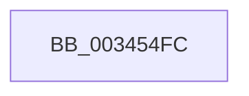

# sub_003454FC

- RVA: `0x003454FC`–`0x00345517` (길이 `27` bytes)
- VA: `0x00000001403454FC`
- 실행 섹션: `.text`
- PDB 이름 있음: `아니요`; PDB Function 태그: `아니요`
- unwind 정보 RVA: `0x00077EC4`
- 디코드: `7`개 명령, `27/27` bytes 표시
- 미해석 바이트: `0` (있으면 어셈블리에 `.byte`로 보존)

> 이 문서는 커널 이미지의 기계어와 PDB 기호를 분석해 생성했습니다. 4번과 5번은 함수 원형과 자료형을 바이너리 사용 방식에서 추정한 C 해석이며 원본 소스 복구 결과는 아닙니다.

## 1. Dependencies

- 직접 호출 지점: **0**; 고유 호출 대상: **0**
- 직접 호출자로 확인된 함수: **0**
- RIP 상대 이미지 참조: **0**

### Outgoing calls
- 직접 디코드된 call 명령이 없습니다.

### Direct callers
- 이 함수 시작 RVA로 연결되는 직접 call은 확인되지 않았습니다. 간접 호출은 완전히 역산할 수 없습니다.

### Static image references
- 디코드된 RIP-relative 메모리 참조가 없습니다.

## 2. Other-region calls and transfers

- 다른 실행 섹션으로 향하는 call: **0**
- 별도 외부 분기/꼬리 이동을 확인하지 못했습니다.

## 3. Assembly (complete function range)

```asm
003454FC  4B 8D 1C 52                     lea rbx, [r10 + r10*2]
00345500  49 89 36                        mov qword ptr [r14], rsi
00345503  48 C1 E3 04                     shl rbx, 4
00345507  49 8B C1                        mov rax, r9
0034550A  4C 8B 74 24 20                  mov r14, qword ptr [rsp + 0x20]
0034550F  48 03 D8                        add rbx, rax
00345512  48 8B 74 24 40                  mov rsi, qword ptr [rsp + 0x40]
```

## 4. C-style interpretation (structured pseudocode)

```c
__int64 __fastcall sub_003454FC(__int64 a1, __int64 a2, __int64 a3, __int64 a4, __int64 a5, __int64 a6, __int64 a7, __int64 a8)
{
    __int64 v_rbx;
    unsigned __int64 v_stack_p20;

    *(unsigned __int64 *)(v_r14) = v_rsi;
    v_rbx = (v_r10 + v_r10 * 2) << (4);
    v_rbx = (v_rbx) + (a4);
    return a4;
}
```

## 5. (Beta) C Style

```c
int64_t sub_003454FC(int64_t Arg1, int64_t Arg2, int64_t Arg3, int64_t Arg4, uint64_t Arg5, uint64_t Arg6, uint64_t Arg7, int64_t Arg8)
{
    int64_t local_rbx;
    uint64_t v_stack_p20;

    *(uint64_t *)(local_r14) = local_rsi;
    local_rbx = (local_r10 + local_r10 * 2) << (4);
    local_rbx = (local_rbx) + (Arg4);
    return Arg4;
}
```

## 6. Execution-region graph

[열기: 2D/3D 그래프와 함수 탐색 컨트롤 패널](../../../control-panel.html?section=text&rva=0x003454FC&view=graph)

- 2D 그래프는 위에서 아래로 흐르고, 3D 그래프는 빈 공간을 드래그해 회전합니다. Shift+드래그는 이동, 휠은 확대·축소, 함수 노드 선택은 대상 보고서 이동입니다.

### Static fallback


