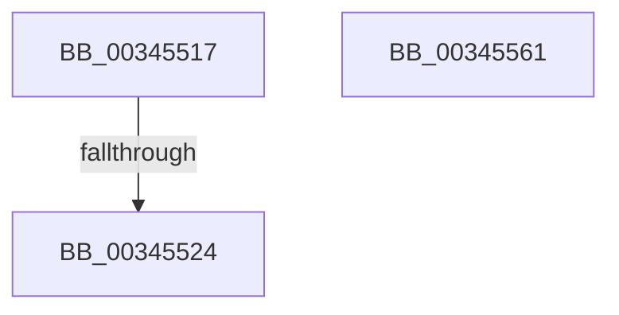

# sub_00345517

- RVA: `0x00345517`–`0x00345562` (길이 `75` bytes)
- VA: `0x0000000140345517`
- 실행 섹션: `.text`
- PDB 이름 있음: `아니요`; PDB Function 태그: `아니요`
- unwind 정보 RVA: `0x00077EDC`
- 디코드: `18`개 명령, `75/75` bytes 표시
- 미해석 바이트: `0` (있으면 어셈블리에 `.byte`로 보존)

> 이 문서는 커널 이미지의 기계어와 PDB 기호를 분석해 생성했습니다. 4번과 5번은 함수 원형과 자료형을 바이너리 사용 방식에서 추정한 C 해석이며 원본 소스 복구 결과는 아닙니다.

## 1. Dependencies

- 직접 호출 지점: **0**; 고유 호출 대상: **0**
- 직접 호출자로 확인된 함수: **0**
- RIP 상대 이미지 참조: **0**

### Outgoing calls
- 직접 디코드된 call 명령이 없습니다.

### Direct callers
- 이 함수 시작 RVA로 연결되는 직접 call은 확인되지 않았습니다. 간접 호출은 완전히 역산할 수 없습니다.

### Static image references
- 디코드된 RIP-relative 메모리 참조가 없습니다.

## 2. Other-region calls and transfers

- 다른 실행 섹션으로 향하는 call: **0**
- call이 아닌 외부 분기/꼬리 이동: **1**
  - `0x0034551E` → [sub_003455E0](Unknown_function_003455E0.md) (`tail-transfer`)

## 3. Assembly (complete function range)

```asm
00345517  F0 48 0F BA 6B 18 3F            lock bts qword ptr [rbx + 0x18], 0x3f
0034551E  0F 82 BC 00 00 00               jb 0x1403455e0
00345524  48 8B 4B 18                     mov rcx, qword ptr [rbx + 0x18]
00345528  48 B8 00 00 00 00 00 00 00 C0   movabs rax, 0xc000000000000000
00345532  48 8D 51 01                     lea rdx, [rcx + 1]
00345536  4C 8B C2                        mov r8, rdx
00345539  4C 33 C1                        xor r8, rcx
0034553C  4C 23 C0                        and r8, rax
0034553F  48 B8 FF FF FF FF FF FF FF 7F   movabs rax, 0x7fffffffffffffff
00345549  4C 33 C2                        xor r8, rdx
0034554C  4C 89 43 18                     mov qword ptr [rbx + 0x18], r8
00345550  F0 48 21 43 18                  lock and qword ptr [rbx + 0x18], rax
00345555  8B 44 24 60                     mov eax, dword ptr [rsp + 0x60]
00345559  48 83 C4 48                     add rsp, 0x48
0034555D  41 5F                           pop r15
0034555F  5B                              pop rbx
00345560  C3                              ret
00345561  CC                              int3
```

## 4. C-style interpretation (structured pseudocode)

```c
__int64 __fastcall sub_00345517(__int64 a1, __int64 a2, __int64 a3, __int64 a4, __int64 a5, __int64 a6, __int64 a7, __int64 a8, __int64 a9, __int64 a10, __int64 a11, unsigned int a12)
{
    __int64 v_rsp;

    a3 = (*(unsigned __int64 *)(v_rbx + 24) + 1) ^ (*(unsigned __int64 *)(v_rbx + 24));
    a3 = (a3) & (result);
    a3 = (a3) ^ (*(unsigned __int64 *)(v_rbx + 24) + 1);
    *(unsigned __int64 *)(v_rbx + 24) = a3;
    v_rsp = (v_rsp) + (72);
    return (unsigned int)(a12);
}
```

## 5. (Beta) C Style

```c
int64_t sub_00345517(int64_t Arg1, int64_t Arg2, int64_t Arg3, int64_t Arg4, uint64_t Arg5, uint64_t Arg6, uint64_t Arg7, uint64_t Arg8, uint64_t Arg9, uint64_t Arg10, uint64_t Arg11, uint32_t Arg12)
{
    int64_t local_rsp;

    Arg3 = (*(uint64_t *)(local_rbx + 0x18) + 1) ^ (*(uint64_t *)(local_rbx + 0x18));
    Arg3 = (Arg3) & (result);
    Arg3 = (Arg3) ^ (*(uint64_t *)(local_rbx + 0x18) + 1);
    *(uint64_t *)(local_rbx + 0x18) = Arg3;
    local_rsp = (local_rsp) + (72);
    return (uint32_t)(Arg12);
}
```

## 6. Execution-region graph

[열기: 2D/3D 그래프와 함수 탐색 컨트롤 패널](../../../control-panel.html?section=text&rva=0x00345517&view=graph)

- 2D 그래프는 위에서 아래로 흐르고, 3D 그래프는 빈 공간을 드래그해 회전합니다. Shift+드래그는 이동, 휠은 확대·축소, 함수 노드 선택은 대상 보고서 이동입니다.

### Static fallback


