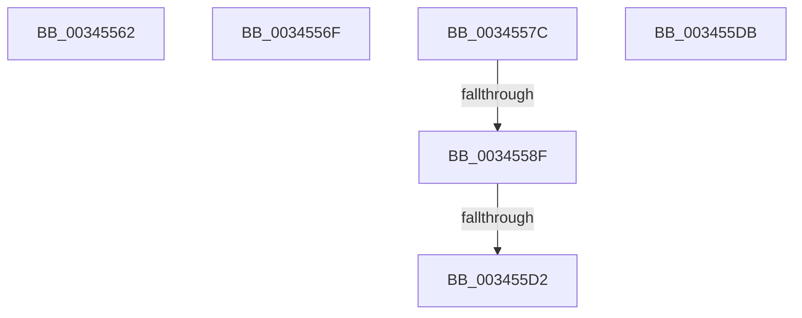

# sub_00345562

- RVA: `0x00345562`–`0x003455E0` (길이 `126` bytes)
- VA: `0x0000000140345562`
- 실행 섹션: `.text`
- PDB 이름 있음: `아니요`; PDB Function 태그: `아니요`
- unwind 정보 RVA: `0x00077EF0`
- 디코드: `25`개 명령, `126/126` bytes 표시
- 미해석 바이트: `0` (있으면 어셈블리에 `.byte`로 보존)

> 이 문서는 커널 이미지의 기계어와 PDB 기호를 분석해 생성했습니다. 4번과 5번은 함수 원형과 자료형을 바이너리 사용 방식에서 추정한 C 해석이며 원본 소스 복구 결과는 아닙니다.

## 1. Dependencies

- 직접 호출 지점: **1**; 고유 호출 대상: **1**
- 직접 호출자로 확인된 함수: **0**
- RIP 상대 이미지 참조: **0**

### Outgoing calls
- `0x003455B6` → [MiUserPdeOrAbove](../2C/MiUserPdeOrAbove_function_002C57F0.md) (function, `0x002C57F0`)

### Direct callers
- 이 함수 시작 RVA로 연결되는 직접 call은 확인되지 않았습니다. 간접 호출은 완전히 역산할 수 없습니다.

### Static image references
- 디코드된 RIP-relative 메모리 참조가 없습니다.

## 2. Other-region calls and transfers

- 다른 실행 섹션으로 향하는 call: **0**
- call이 아닌 외부 분기/꼬리 이동: **5**
  - `0x0034556A` → [sub_003451F8 + 0x119](Unknown_function_003451F8.md) (`tail-transfer`)
  - `0x00345577` → [sub_003451F8 + 0x71](Unknown_function_003451F8.md) (`tail-transfer`)
  - `0x00345589` → [sub_003451F8 + 0xD6](Unknown_function_003451F8.md) (`tail-transfer`)
  - `0x003455CC` → [sub_003451F8 + 0xD6](Unknown_function_003451F8.md) (`tail-transfer`)
  - `0x003455D6` → [sub_003451F8 + 0xD6](Unknown_function_003451F8.md) (`tail-transfer`)

## 3. Assembly (complete function range)

```asm
00345562  B9 00 01 00 00                  mov ecx, 0x100
00345567  48 0B D9                        or rbx, rcx
0034556A  E9 A2 FD FF FF                  jmp 0x140345311
0034556F  48 8B FA                        mov rdi, rdx
00345572  48 0F BA EF 07                  bts rdi, 7
00345577  E9 ED FC FF FF                  jmp 0x140345269
0034557C  48 B8 FF FF FF 7F FB F6 FF FF   movabs rax, 0xfffff6fb7fffffff
00345586  4C 3B F0                        cmp r14, rax
00345589  0F 87 3F FD FF FF               ja 0x1403452ce
0034558F  48 BA 68 DF BE 7D FB F6 FF FF   movabs rdx, 0xfffff6fb7dbedf68
00345599  48 8B C3                        mov rax, rbx
0034559C  48 B9 00 00 00 00 00 00 00 80   movabs rcx, 0x8000000000000000
003455A6  49 23 C3                        and rax, r11
003455A9  48 0B D9                        or rbx, rcx
003455AC  4C 3B F2                        cmp r14, rdx
003455AF  49 8B CE                        mov rcx, r14
003455B2  48 0F 45 D8                     cmovne rbx, rax
003455B6  E8 35 02 F8 FF                  call 0x1402c57f0
003455BB  4C 8B 54 24 70                  mov r10, qword ptr [rsp + 0x70]
003455C0  49 BB FF FF FF FF FF FF FF 7F   movabs r11, 0x7fffffffffffffff
003455CA  85 C0                           test eax, eax
003455CC  0F 84 FC FC FF FF               je 0x1403452ce
003455D2  48 83 CB 04                     or rbx, 4
003455D6  E9 F3 FC FF FF                  jmp 0x1403452ce
003455DB  0F 1F 44 00 00                  nop dword ptr [rax + rax]
```

## 4. C-style interpretation (structured pseudocode)

```c
__int64 __fastcall sub_00345562(__int64 a1, __int64 a2)
{
    __int64 v_rbx;
    unsigned __int64 v_stack_p70;

    v_rbx = (v_rbx) | (256);
}
```

## 5. (Beta) C Style

```c
int64_t sub_00345562(int64_t Arg1, int64_t Arg2)
{
    int64_t local_rbx;
    uint64_t v_stack_p70;

    local_rbx = (local_rbx) | (256);
}
```

## 6. Execution-region graph

[열기: 2D/3D 그래프와 함수 탐색 컨트롤 패널](../../../control-panel.html?section=text&rva=0x00345562&view=graph)

- 2D 그래프는 위에서 아래로 흐르고, 3D 그래프는 빈 공간을 드래그해 회전합니다. Shift+드래그는 이동, 휠은 확대·축소, 함수 노드 선택은 대상 보고서 이동입니다.

### Static fallback


