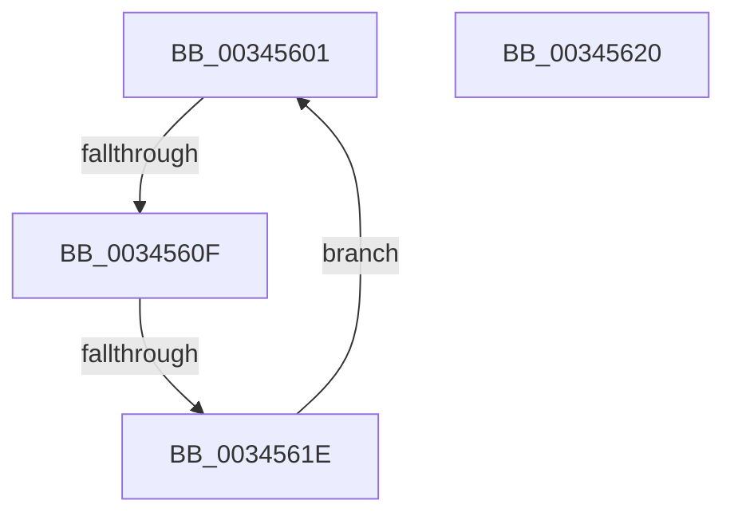

# sub_00345601

- RVA: `0x00345601`–`0x00345640` (길이 `63` bytes)
- VA: `0x0000000140345601`
- 실행 섹션: `.text`
- PDB 이름 있음: `아니요`; PDB Function 태그: `아니요`
- unwind 정보 RVA: `0x00077F24`
- 디코드: `15`개 명령, `63/63` bytes 표시
- 미해석 바이트: `0` (있으면 어셈블리에 `.byte`로 보존)

> 이 문서는 커널 이미지의 기계어와 PDB 기호를 분석해 생성했습니다. 4번과 5번은 함수 원형과 자료형을 바이너리 사용 방식에서 추정한 C 해석이며 원본 소스 복구 결과는 아닙니다.

## 1. Dependencies

- 직접 호출 지점: **0**; 고유 호출 대상: **0**
- 직접 호출자로 확인된 함수: **0**
- RIP 상대 이미지 참조: **1**

### Outgoing calls
- 직접 디코드된 call 명령이 없습니다.

### Direct callers
- 이 함수 시작 RVA로 연결되는 직접 call은 확인되지 않았습니다. 간접 호출은 완전히 역산할 수 없습니다.

### Static image references
- `0x00345603` → RVA `0x00FC52AC` (`ALMOSTRO`; reference)

## 2. Other-region calls and transfers

- 다른 실행 섹션으로 향하는 call: **0**
- call이 아닌 외부 분기/꼬리 이동: **3**
  - `0x00345609` → [sub_003456C4](Unknown_function_003456C4.md) (`tail-transfer`)
  - `0x00345618` → [sub_00345327 + 0x109](Unknown_function_00345327.md) (`tail-transfer`)
  - `0x0034563B` → [sub_00345327 + 0x191](Unknown_function_00345327.md) (`tail-transfer`)

## 3. Assembly (complete function range)

```asm
00345601  FF C7                           inc edi
00345603  85 3D A3 FC C7 00               test dword ptr [rip + 0xc7fca3], edi
00345609  0F 84 B5 00 00 00               je 0x1403456c4
0034560F  F3 90                           pause
00345611  48 8B 43 18                     mov rax, qword ptr [rbx + 0x18]
00345615  48 85 C0                        test rax, rax
00345618  0F 89 12 FE FF FF               jns 0x140345430
0034561E  EB E1                           jmp 0x140345601
00345620  4C 2B 65 00                     sub r12, qword ptr [rbp]
00345624  48 8B 45 28                     mov rax, qword ptr [rbp + 0x28]
00345628  49 C1 EC 0C                     shr r12, 0xc
0034562C  C7 44 24 60 01 00 00 00         mov dword ptr [rsp + 0x60], 1
00345634  45 33 FF                        xor r15d, r15d
00345637  4A 8B 2C E0                     mov rbp, qword ptr [rax + r12*8]
0034563B  E9 78 FE FF FF                  jmp 0x1403454b8
```

## 4. C-style interpretation (structured pseudocode)

```c
__int64 __fastcall sub_00345601(void)
{
    __int64 v_rdi;
    unsigned int v_stack_p60;

    v_rdi = (unsigned int)((v_rdi) + 1);
    goto loc_00345601;
}
```

## 5. (Beta) C Style

```c
void sub_00345601(void)
{
    int64_t local_rdi;
    uint32_t v_stack_p60;

    local_rdi = (uint32_t)((local_rdi) + 1);
    goto loc_00345601;
}
```

## 6. Execution-region graph

[열기: 2D/3D 그래프와 함수 탐색 컨트롤 패널](../../../control-panel.html?section=text&rva=0x00345601&view=graph)

- 2D 그래프는 위에서 아래로 흐르고, 3D 그래프는 빈 공간을 드래그해 회전합니다. Shift+드래그는 이동, 휠은 확대·축소, 함수 노드 선택은 대상 보고서 이동입니다.

### Static fallback


