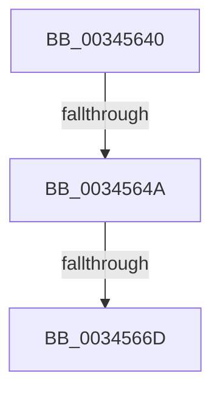

# sub_00345640

- RVA: `0x00345640`–`0x00345692` (길이 `82` bytes)
- VA: `0x0000000140345640`
- 실행 섹션: `.text`
- PDB 이름 있음: `아니요`; PDB Function 태그: `아니요`
- unwind 정보 RVA: `0x00077F4C`
- 디코드: `15`개 명령, `82/82` bytes 표시
- 미해석 바이트: `0` (있으면 어셈블리에 `.byte`로 보존)

> 이 문서는 커널 이미지의 기계어와 PDB 기호를 분석해 생성했습니다. 4번과 5번은 함수 원형과 자료형을 바이너리 사용 방식에서 추정한 C 해석이며 원본 소스 복구 결과는 아닙니다.

## 1. Dependencies

- 직접 호출 지점: **1**; 고유 호출 대상: **1**
- 직접 호출자로 확인된 함수: **0**
- RIP 상대 이미지 참조: **0**

### Outgoing calls
- `0x00345679` → [MiCheckLinearProtectedPteAccessedBit](../29/MiCheckLinearProtectedPteAccessedBit_function_00292D80.md) (function, `0x00292D80`)

### Direct callers
- 이 함수 시작 RVA로 연결되는 직접 call은 확인되지 않았습니다. 간접 호출은 완전히 역산할 수 없습니다.

### Static image references
- 디코드된 RIP-relative 메모리 참조가 없습니다.

## 2. Other-region calls and transfers

- 다른 실행 섹션으로 향하는 call: **0**
- call이 아닌 외부 분기/꼬리 이동: **3**
  - `0x00345644` → [sub_003454FC](Unknown_function_003454FC.md) (`tail-transfer`)
  - `0x00345667` → [sub_003454FC](Unknown_function_003454FC.md) (`tail-transfer`)
  - `0x0034568D` → [sub_003454FC](Unknown_function_003454FC.md) (`tail-transfer`)

## 3. Assembly (complete function range)

```asm
00345640  40 F6 C6 20                     test sil, 0x20
00345644  0F 85 B2 FE FF FF               jne 0x1403454fc
0034564A  48 B8 00 00 00 00 80 F6 FF FF   movabs rax, 0xfffff68000000000
00345654  48 8B C0                        mov rax, rax
00345657  48 B9 00 00 00 00 40 00 00 00   movabs rcx, 0x4000000000
00345661  48 03 C1                        add rax, rcx
00345664  4C 3B F0                        cmp r14, rax
00345667  0F 82 8F FE FF FF               jb 0x1403454fc
0034566D  41 B8 80 00 00 00               mov r8d, 0x80
00345673  48 8B D6                        mov rdx, rsi
00345676  49 8B CE                        mov rcx, r14
00345679  E8 02 D7 F4 FF                  call 0x140292d80
0034567E  4C 8B 54 24 70                  mov r10, qword ptr [rsp + 0x70]
00345683  49 B9 00 00 00 00 00 DE FF FF   movabs r9, 0xffffde0000000000
0034568D  E9 6A FE FF FF                  jmp 0x1403454fc
```

## 4. C-style interpretation (structured pseudocode)

```c
__int64 __fastcall sub_00345640(__int64 a1, __int64 a2, __int64 a3, __int64 a4, __int64 a5, __int64 a6, __int64 a7, __int64 a8, __int64 a9, __int64 a10, __int64 a11, __int64 a12, __int64 a13, __int64 a14)
{
    __int64 result;

    result = (result) + (a1);
    result = MiCheckLinearProtectedPteAccessedBit(v_r14, v_rsi, 128, a4);
}
```

## 5. (Beta) C Style

```c
int64_t sub_00345640(int64_t Arg1, int64_t Arg2, int64_t Arg3, int64_t Arg4, uint64_t Arg5, uint64_t Arg6, uint64_t Arg7, uint64_t Arg8, uint64_t Arg9, uint64_t Arg10, uint64_t Arg11, uint64_t Arg12, uint64_t Arg13, int64_t Arg14)
{
    int64_t result;

    result = (result) + (Arg1);
    result = MiCheckLinearProtectedPteAccessedBit(local_r14, local_rsi, 128, Arg4);
}
```

## 6. Execution-region graph

[열기: 2D/3D 그래프와 함수 탐색 컨트롤 패널](../../../control-panel.html?section=text&rva=0x00345640&view=graph)

- 2D 그래프는 위에서 아래로 흐르고, 3D 그래프는 빈 공간을 드래그해 회전합니다. Shift+드래그는 이동, 휠은 확대·축소, 함수 노드 선택은 대상 보고서 이동입니다.

### Static fallback


