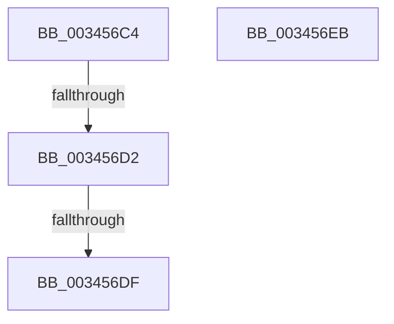

# sub_003456C4

- RVA: `0x003456C4`–`0x00345708` (길이 `68` bytes)
- VA: `0x00000001403456C4`
- 실행 섹션: `.text`
- PDB 이름 있음: `아니요`; PDB Function 태그: `아니요`
- unwind 정보 RVA: `0x00077F9C`
- 디코드: `15`개 명령, `68/68` bytes 표시
- 미해석 바이트: `0` (있으면 어셈블리에 `.byte`로 보존)

> 이 문서는 커널 이미지의 기계어와 PDB 기호를 분석해 생성했습니다. 4번과 5번은 함수 원형과 자료형을 바이너리 사용 방식에서 추정한 C 해석이며 원본 소스 복구 결과는 아닙니다.

## 1. Dependencies

- 직접 호출 지점: **3**; 고유 호출 대상: **3**
- 직접 호출자로 확인된 함수: **0**
- RIP 상대 이미지 참조: **1**

### Outgoing calls
- `0x003456D2` → [KiCheckVpBackingLongSpinWaitHypercall](../30/KiCheckVpBackingLongSpinWaitHypercall_function_0030F490.md) (function, `0x0030F490`)
- `0x003456E1` → [HvlNotifyLongSpinWait](../30/HvlNotifyLongSpinWait_function_0030F460.md) (function, `0x0030F460`)
- `0x003456F4` → [MiChangePageAttribute](../33/MiChangePageAttribute_function_00332ECC.md) (function, `0x00332ECC`)

### Direct callers
- 이 함수 시작 RVA로 연결되는 직접 call은 확인되지 않았습니다. 간접 호출은 완전히 역산할 수 없습니다.

### Static image references
- `0x003456C4` → RVA `0x00FC6AB8` (`ALMOSTRO`; read)

## 2. Other-region calls and transfers

- 다른 실행 섹션으로 향하는 call: **0**
- call이 아닌 외부 분기/꼬리 이동: **4**
  - `0x003456CC` → [sub_00345601 + 0xE](Unknown_function_00345601.md) (`tail-transfer`)
  - `0x003456D9` → [sub_00345601 + 0xE](Unknown_function_00345601.md) (`tail-transfer`)
  - `0x003456E6` → [sub_00345601 + 0x10](Unknown_function_00345601.md) (`tail-transfer`)
  - `0x00345703` → [sub_00345327 + 0x13E](Unknown_function_00345327.md) (`tail-transfer`)

## 3. Assembly (complete function range)

```asm
003456C4  8B 05 EE 13 C8 00               mov eax, dword ptr [rip + 0xc813ee]
003456CA  A8 40                           test al, 0x40
003456CC  0F 84 3D FF FF FF               je 0x14034560f
003456D2  E8 B9 9D FC FF                  call 0x14030f490
003456D7  84 C0                           test al, al
003456D9  0F 84 30 FF FF FF               je 0x14034560f
003456DF  8B CF                           mov ecx, edi
003456E1  E8 7A 9D FC FF                  call 0x14030f460
003456E6  E9 26 FF FF FF                  jmp 0x140345611
003456EB  45 8B C5                        mov r8d, r13d
003456EE  41 8B D5                        mov edx, r13d
003456F1  48 8B CB                        mov rcx, rbx
003456F4  E8 D3 D7 FE FF                  call 0x140332ecc
003456F9  49 BB FF FF FF FF FF FF FF 7F   movabs r11, 0x7fffffffffffffff
00345703  E9 5D FD FF FF                  jmp 0x140345465
```

## 4. C-style interpretation (structured pseudocode)

```c
__int64 __fastcall sub_003456C4(void)
{
    __int64 result;

    result = KiCheckVpBackingLongSpinWaitHypercall(a1, a2, a3, a4);
    result = HvlNotifyLongSpinWait((unsigned int)((unsigned int)(v_rdi)), a2, a3, a4);
}
```

## 5. (Beta) C Style

```c
void sub_003456C4(void)
{
    int64_t result;

    result = KiCheckVpBackingLongSpinWaitHypercall(a1, a2, a3, a4);
    result = HvlNotifyLongSpinWait((uint32_t)((uint32_t)(local_rdi)), a2, a3, a4);
}
```

## 6. Execution-region graph

[열기: 2D/3D 그래프와 함수 탐색 컨트롤 패널](../../../control-panel.html?section=text&rva=0x003456C4&view=graph)

- 2D 그래프는 위에서 아래로 흐르고, 3D 그래프는 빈 공간을 드래그해 회전합니다. Shift+드래그는 이동, 휠은 확대·축소, 함수 노드 선택은 대상 보고서 이동입니다.

### Static fallback


