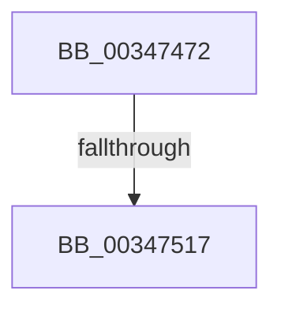

# sub_00347472

- RVA: `0x00347472`–`0x0034753C` (길이 `202` bytes)
- VA: `0x0000000140347472`
- 실행 섹션: `.text`
- PDB 이름 있음: `아니요`; PDB Function 태그: `아니요`
- unwind 정보 RVA: `0x00078060`
- 디코드: `45`개 명령, `202/202` bytes 표시
- 미해석 바이트: `0` (있으면 어셈블리에 `.byte`로 보존)

> 이 문서는 커널 이미지의 기계어와 PDB 기호를 분석해 생성했습니다. 4번과 5번은 함수 원형과 자료형을 바이너리 사용 방식에서 추정한 C 해석이며 원본 소스 복구 결과는 아닙니다.

## 1. Dependencies

- 직접 호출 지점: **6**; 고유 호출 대상: **6**
- 직접 호출자로 확인된 함수: **0**
- RIP 상대 이미지 참조: **1**

### Outgoing calls
- `0x00347493` → [memset](../6C/memset_function_006C6C40.md) (function, `0x006C6C40`)
- `0x003474B9` → [MiLockWorkingSetOptimal](../23/MiLockWorkingSetOptimal_function_00238FC0.md) (function, `0x00238FC0`)
- `0x003474C4` → [MiGetContainingPageTable](MiGetContainingPageTable_function_003467F0.md) (function, `0x003467F0`)
- `0x003474EA` → [MiGetMultiplexedVm](MiGetMultiplexedVm_function_003479B0.md) (function, `0x003479B0`)
- `0x0034751C` → [MiUnlockFaultPageTable](../27/MiUnlockFaultPageTable_function_0027D870.md) (function, `0x0027D870`)
- `0x0034752B` → [MiUnlockWorkingSetShared](../27/MiUnlockWorkingSetShared_function_0027D690.md) (function, `0x0027D690`)

### Direct callers
- 이 함수 시작 RVA로 연결되는 직접 call은 확인되지 않았습니다. 간접 호출은 완전히 역산할 수 없습니다.

### Static image references
- `0x003474A8` → RVA `0x00E3D680` (`.data`; read)

## 2. Other-region calls and transfers

- 다른 실행 섹션으로 향하는 call: **0**
- call이 아닌 외부 분기/꼬리 이동: **2**
  - `0x00347511` → [sub_003475D6](Unknown_function_003475D6.md) (`tail-transfer`)
  - `0x0034753A` → [sub_0034753C + 0x7A](Unknown_function_0034753C.md) (`tail-transfer`)

## 3. Assembly (complete function range)

```asm
00347472  4C 89 BC 24 90 01 00 00         mov qword ptr [rsp + 0x190], r15
0034747A  0F 57 C0                        xorps xmm0, xmm0
0034747D  C6 44 24 40 00                  mov byte ptr [rsp + 0x40], 0
00347482  33 D2                           xor edx, edx
00347484  48 8D 4D 00                     lea rcx, [rbp]
00347488  41 B8 80 00 00 00               mov r8d, 0x80
0034748E  0F 11 44 24 48                  movups xmmword ptr [rsp + 0x48], xmm0
00347493  E8 A8 F7 37 00                  call 0x1406c6c40
00347498  45 33 ED                        xor r13d, r13d
0034749B  4C 8D 44 24 40                  lea r8, [rsp + 0x40]
003474A0  49 8B D6                        mov rdx, r14
003474A3  44 89 6C 24 44                  mov dword ptr [rsp + 0x44], r13d
003474A8  48 8D 0D D1 61 AF 00            lea rcx, [rip + 0xaf61d1]
003474AF  4C 89 6D 80                     mov qword ptr [rbp - 0x80], r13
003474B3  45 8B FD                        mov r15d, r13d
003474B6  41 8B F5                        mov esi, r13d
003474B9  E8 02 1B EF FF                  call 0x140238fc0
003474BE  49 8B CE                        mov rcx, r14
003474C1  4C 8B D0                        mov r10, rax
003474C4  E8 27 F3 FF FF                  call 0x1403467f0
003474C9  49 8B D6                        mov rdx, r14
003474CC  48 89 44 24 70                  mov qword ptr [rsp + 0x70], rax
003474D1  48 C1 E2 19                     shl rdx, 0x19
003474D5  48 B9 00 00 00 00 80 F6 FF FF   movabs rcx, 0xfffff68000000000
003474DF  48 C1 E1 19                     shl rcx, 0x19
003474E3  48 2B D1                        sub rdx, rcx
003474E6  48 C1 FA 10                     sar rdx, 0x10
003474EA  E8 C1 04 00 00                  call 0x1403479b0
003474EF  80 4C 24 55 08                  or byte ptr [rsp + 0x55], 8
003474F4  4C 8B D8                        mov r11, rax
003474F7  0F B6 4C 24 40                  movzx ecx, byte ptr [rsp + 0x40]
003474FC  88 4C 24 54                     mov byte ptr [rsp + 0x54], cl
00347500  48 89 44 24 60                  mov qword ptr [rsp + 0x60], rax
00347505  48 89 44 24 48                  mov qword ptr [rsp + 0x48], rax
0034750A  4C 89 54 24 58                  mov qword ptr [rsp + 0x58], r10
0034750F  85 DB                           test ebx, ebx
00347511  0F 85 BF 00 00 00               jne 0x1403475d6
00347517  48 8D 4C 24 48                  lea rcx, [rsp + 0x48]
0034751C  E8 4F 63 F3 FF                  call 0x14027d870
00347521  0F B6 54 24 40                  movzx edx, byte ptr [rsp + 0x40]
00347526  48 8B 4C 24 60                  mov rcx, qword ptr [rsp + 0x60]
0034752B  E8 60 61 F3 FF                  call 0x14027d690
00347530  4C 8B BC 24 90 01 00 00         mov r15, qword ptr [rsp + 0x190]
00347538  85 F6                           test esi, esi
0034753A  74 7A                           je 0x1403475b6
```

## 4. C-style interpretation (structured pseudocode)

```c
__int64 __fastcall sub_00347472(__int64 a1, int a2, __int64 a3, __int64 a4, __int64 a5, __int64 a6, __int64 a7, unsigned __int8 a8, __int64 a9, __int64 a10, __int64 a11, __int64 a12, __int64 a13, __int64 a14, __int64 a15, __int64 a16, __int64 a17, __int64 a18, __int64 a19, __int64 a20, __int64 a21, __int64 a22, __int64 a23, __int64 a24, __int64 a25, __int64 a26, __int64 a27, __int64 a28, __int64 a29, __int64 a30, __int64 a31, __int64 a32, __int64 a33, __int64 a34, __int64 a35, __int64 a36, __int64 a37, __int64 a38, __int64 a39, __int64 a40, __int64 a41, __int64 a42, __int64 a43, __int64 a44, __int64 a45, __int64 a46, __int64 a47, __int64 a48, __int64 a49, __int64 a50)
{
    __int64 result;
    __int64 v_r13;
    unsigned __int64 v_stack_p190;
    unsigned __int8 v_stack_p40;
    unsigned int v_stack_p44;
    unsigned __int64 v_stack_p48;
    unsigned __int8 v_stack_p54;
    unsigned __int8 v_stack_p55;
    unsigned __int64 v_stack_p58;
    unsigned __int64 v_stack_p60;
    unsigned __int64 v_stack_p70;

    v_stack_p190 = v_r15;
    v_stack_p40 = 0;
    a2 = 0;
    a9 = v_xmm0;
    result = memset(v_rbp, a2, 128, a4);
    v_r13 = 0;
    v_stack_p44 = 0;
    *(unsigned __int64 *)(v_rbp - 128) = 0;
    result = MiLockWorkingSetOptimal(v_rip + 11493841, v_r14, a8, a4);
    result = MiGetContainingPageTable(v_r14, v_r14, a8, a4);
    v_stack_p70 = result;
    a2 = (v_r14) << (25);
    a1 = (v_r14) << (25);
    a2 = (a2) - (a1);
    a2 = (a2) >> (16);
    result = MiGetMultiplexedVm(a1, a2, a8, a4);
    v_stack_p54 = a8;
    v_stack_p60 = result;
    v_stack_p48 = result;
    v_stack_p58 = result;
    result = MiUnlockFaultPageTable(a9, a2, a8, a4);
    result = MiUnlockWorkingSetShared(a12, a8, a8, a4);
}
```

## 5. (Beta) C Style

```c
int64_t sub_00347472(int64_t Arg1, int32_t Arg2, int64_t Arg3, int64_t Arg4, uint64_t Arg5, uint64_t Arg6, uint64_t Arg7, uint8_t Arg8, int64_t Arg9, uint64_t Arg10, uint64_t Arg11, int64_t Arg12, uint64_t Arg13, uint64_t Arg14, uint64_t Arg15, uint64_t Arg16, uint64_t Arg17, uint64_t Arg18, uint64_t Arg19, uint64_t Arg20, uint64_t Arg21, uint64_t Arg22, uint64_t Arg23, uint64_t Arg24, uint64_t Arg25, uint64_t Arg26, uint64_t Arg27, uint64_t Arg28, uint64_t Arg29, uint64_t Arg30, uint64_t Arg31, uint64_t Arg32, uint64_t Arg33, uint64_t Arg34, uint64_t Arg35, uint64_t Arg36, uint64_t Arg37, uint64_t Arg38, uint64_t Arg39, uint64_t Arg40, uint64_t Arg41, uint64_t Arg42, uint64_t Arg43, uint64_t Arg44, uint64_t Arg45, uint64_t Arg46, uint64_t Arg47, uint64_t Arg48, uint64_t Arg49, int64_t Arg50)
{
    int64_t result;
    int64_t local_r13;
    uint64_t v_stack_p190;
    uint8_t v_stack_p40;
    uint32_t v_stack_p44;
    uint64_t v_stack_p48;
    uint8_t v_stack_p54;
    uint8_t v_stack_p55;
    uint64_t v_stack_p58;
    uint64_t v_stack_p60;
    uint64_t v_stack_p70;

    v_stack_p190 = local_r15;
    v_stack_p40 = 0;
    Arg2 = 0;
    Arg9 = v_xmm0;
    result = memset(local_rbp, Arg2, 128, Arg4);
    local_r13 = 0;
    v_stack_p44 = 0;
    *(uint64_t *)(local_rbp - 0x80) = 0;
    result = MiLockWorkingSetOptimal(v_rip + 11493841, local_r14, Arg8, Arg4);
    result = MiGetContainingPageTable(local_r14, local_r14, Arg8, Arg4);
    v_stack_p70 = result;
    Arg2 = (local_r14) << (25);
    Arg1 = (local_r14) << (25);
    Arg2 = (Arg2) - (Arg1);
    Arg2 = (Arg2) >> (16);
    result = MiGetMultiplexedVm(Arg1, Arg2, Arg8, Arg4);
    v_stack_p54 = Arg8;
    v_stack_p60 = result;
    v_stack_p48 = result;
    v_stack_p58 = result;
    result = MiUnlockFaultPageTable(Arg9, Arg2, Arg8, Arg4);
    result = MiUnlockWorkingSetShared(Arg12, Arg8, Arg8, Arg4);
}
```

## 6. Execution-region graph

[열기: 2D/3D 그래프와 함수 탐색 컨트롤 패널](../../../control-panel.html?section=text&rva=0x00347472&view=graph)

- 2D 그래프는 위에서 아래로 흐르고, 3D 그래프는 빈 공간을 드래그해 회전합니다. Shift+드래그는 이동, 휠은 확대·축소, 함수 노드 선택은 대상 보고서 이동입니다.

### Static fallback


