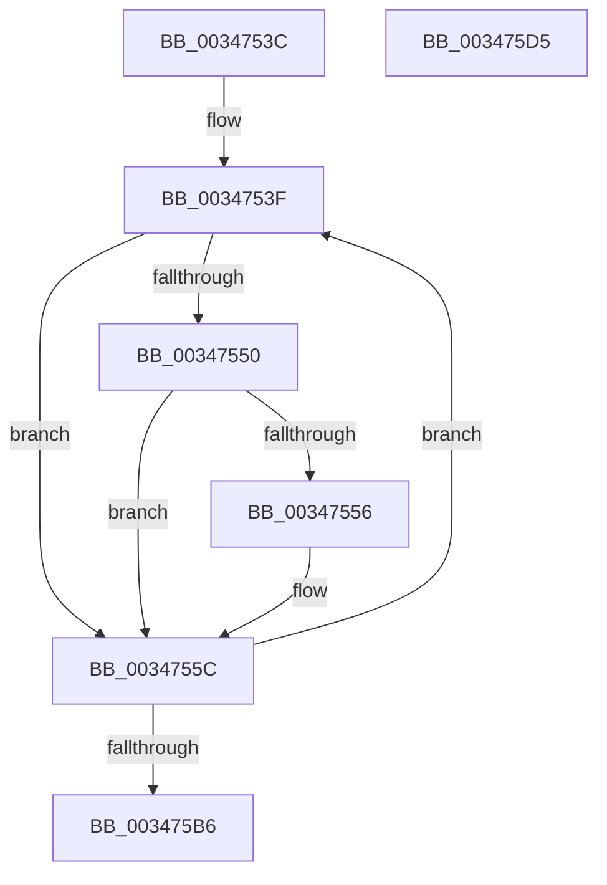

# sub_0034753C

- RVA: `0x0034753C`–`0x003475D6` (길이 `154` bytes)
- VA: `0x000000014034753C`
- 실행 섹션: `.text`
- PDB 이름 있음: `아니요`; PDB Function 태그: `아니요`
- unwind 정보 RVA: `0x00078074`
- 디코드: `43`개 명령, `154/154` bytes 표시
- 미해석 바이트: `0` (있으면 어셈블리에 `.byte`로 보존)

> 이 문서는 커널 이미지의 기계어와 PDB 기호를 분석해 생성했습니다. 4번과 5번은 함수 원형과 자료형을 바이너리 사용 방식에서 추정한 C 해석이며 원본 소스 복구 결과는 아닙니다.

## 1. Dependencies

- 직접 호출 지점: **5**; 고유 호출 대상: **5**
- 직접 호출자로 확인된 함수: **0**
- RIP 상대 이미지 참조: **1**

### Outgoing calls
- `0x0034756E` → [MiReferenceControlAreaFileWithTag](MiReferenceControlAreaFileWithTag_function_00348390.md) (function, `0x00348390`)
- `0x00347584` → [MiStartingOffset](MiStartingOffset_function_003482E0.md) (function, `0x003482E0`)
- `0x00347595` → [PfSnLogPageFault](PfSnLogPageFault_function_00344950.md) (function, `0x00344950`)
- `0x003475A7` → [ObFastDereferenceObjectDeferDelete](../23/ObFastDereferenceObjectDeferDelete_function_002378C0.md) (function, `0x002378C0`)
- `0x003475C0` → [_security_check_cookie](../6A/_security_check_cookie_function_006AC640.md) (function, `0x006AC640`)

### Direct callers
- 이 함수 시작 RVA로 연결되는 직접 call은 확인되지 않았습니다. 간접 호출은 완전히 역산할 수 없습니다.

### Static image references
- `0x0034753F` → RVA `0x00E2DC80` (`.data`; read)

## 2. Other-region calls and transfers

- 다른 실행 섹션으로 향하는 call: **0**
- 별도 외부 분기/꼬리 이동을 확인하지 못했습니다.

## 3. Assembly (complete function range)

```asm
0034753C  44 8B F6                        mov r14d, esi
0034753F  48 8B 05 3A 67 AE 00            mov rax, qword ptr [rip + 0xae673a]
00347546  4A 8B 74 2D 80                  mov rsi, qword ptr [rbp + r13 - 0x80]
0034754B  48 85 C0                        test rax, rax
0034754E  74 0C                           je 0x14034755c
00347550  40 F6 C6 10                     test sil, 0x10
00347554  75 06                           jne 0x14034755c
00347556  48 F7 D0                        not rax
00347559  48 23 F0                        and rsi, rax
0034755C  48 C1 FE 10                     sar rsi, 0x10
00347560  45 33 C0                        xor r8d, r8d
00347563  BA 4D 6D 53 63                  mov edx, 0x63536d4d
00347568  48 8B 3E                        mov rdi, qword ptr [rsi]
0034756B  48 8B CF                        mov rcx, rdi
0034756E  E8 1D 0E 00 00                  call 0x140348390
00347573  4A 8B 54 2D 00                  mov rdx, qword ptr [rbp + r13]
00347578  41 B8 FF FF FF FF               mov r8d, 0xffffffff
0034757E  48 8B CE                        mov rcx, rsi
00347581  48 8B D8                        mov rbx, rax
00347584  E8 57 0D 00 00                  call 0x1403482e0
00347589  41 B8 04 00 00 00               mov r8d, 4
0034758F  48 8B D0                        mov rdx, rax
00347592  48 8B CB                        mov rcx, rbx
00347595  E8 B6 D3 FF FF                  call 0x140344950
0034759A  48 8D 4F 40                     lea rcx, [rdi + 0x40]
0034759E  41 B8 4D 6D 53 63               mov r8d, 0x63536d4d
003475A4  48 8B D3                        mov rdx, rbx
003475A7  E8 14 03 EF FF                  call 0x1402378c0
003475AC  49 83 C5 08                     add r13, 8
003475B0  49 83 EE 01                     sub r14, 1
003475B4  75 89                           jne 0x14034753f
003475B6  48 8B 8D 80 00 00 00            mov rcx, qword ptr [rbp + 0x80]
003475BD  48 33 CC                        xor rcx, rsp
003475C0  E8 7B 50 36 00                  call 0x1406ac640
003475C5  48 81 C4 98 01 00 00            add rsp, 0x198
003475CC  41 5E                           pop r14
003475CE  41 5D                           pop r13
003475D0  5F                              pop rdi
003475D1  5E                              pop rsi
003475D2  5B                              pop rbx
003475D3  5D                              pop rbp
003475D4  C3                              ret
003475D5  CC                              int3
```

## 4. C-style interpretation (structured pseudocode)

```c
__int64 __fastcall sub_0034753C(__int64 a1, __int64 a2, int a3)
{
    __int64 result;
    __int64 v_r13;
    __int64 v_r14;
    __int64 v_rsi;
    __int64 v_rsp;

loc_0034753F:
    if (*(unsigned __int64 *)(v_rip + 11429690) == 0) goto loc_0034755C;
    result = *(unsigned __int64 *)(v_rip + 11429690);
    v_rsi = *(unsigned __int64 *)(v_rbp + v_r13 * 1 - 128);
    if ((((unsigned __int8)(*(unsigned __int64 *)(v_rbp + v_r13 * 1 - 128))) & (16)) == 0) {
        result = ~(*(unsigned __int64 *)(v_rip + 11429690));
        v_rsi = (*(unsigned __int64 *)(v_rbp + v_r13 * 1 - 128)) & (result);
    }
    v_rsi = (v_rsi) >> (16);
    a3 = 0;
    result = MiReferenceControlAreaFileWithTag(*(unsigned __int64 *)(v_rsi), (unsigned int)(0x63536D4DULL), a3, a4);
    result = MiStartingOffset(v_rsi, *(unsigned __int64 *)(v_rbp + v_r13 * 1), (unsigned int)(0xFFFFFFFFULL), a4);
    result = PfSnLogPageFault(result, result, 4, a4);
    result = ObFastDereferenceObjectDeferDelete(*(unsigned __int64 *)(v_rsi) + 64, result, (unsigned int)(0x63536D4DULL), a4);
    v_r13 = (v_r13) + (8);
    v_r14 = ((unsigned int)((unsigned int)(v_rsi))) - (1);
    if (condition_is_not_equal) goto loc_0034753F;
    a1 = (*(unsigned __int64 *)(v_rbp + 128)) ^ (v_rsp);
    result = _security_check_cookie(a1, result, (unsigned int)(0x63536D4DULL), a4);
    v_rsp = (v_rsp) + (408);
    return result;
}
```

## 5. (Beta) C Style

```c
int64_t sub_0034753C(int64_t Arg1, int64_t Arg2, int32_t Arg3)
{
    int64_t result;
    int64_t local_r13;
    int64_t local_r14;
    int64_t local_rsi;
    int64_t local_rsp;

loc_0034753F:
    if (*(uint64_t *)(v_rip + 0xAE673A) == 0) goto loc_0034755C;
    result = *(uint64_t *)(v_rip + 0xAE673A);
    local_rsi = *(uint64_t *)(local_rbp + local_r13 * 1 - 0x80);
    if ((((uint8_t)(*(uint64_t *)(local_rbp + local_r13 * 1 - 0x80))) & (16)) == 0) {
        result = ~(*(uint64_t *)(v_rip + 0xAE673A));
        local_rsi = (*(uint64_t *)(local_rbp + local_r13 * 1 - 0x80)) & (result);
    }
    local_rsi = (local_rsi) >> (16);
    Arg3 = 0;
    result = MiReferenceControlAreaFileWithTag(*(uint64_t *)(local_rsi), (uint32_t)(0x63536D4DULL), Arg3, a4);
    result = MiStartingOffset(local_rsi, *(uint64_t *)(local_rbp + local_r13 * 1), (uint32_t)(0xFFFFFFFFULL), a4);
    result = PfSnLogPageFault(result, result, 4, a4);
    result = ObFastDereferenceObjectDeferDelete(*(uint64_t *)(local_rsi) + 64, result, (uint32_t)(0x63536D4DULL), a4);
    local_r13 = (local_r13) + (8);
    local_r14 = ((uint32_t)((uint32_t)(local_rsi))) - (1);
    if (condition_is_not_equal) goto loc_0034753F;
    Arg1 = (*(uint64_t *)(local_rbp + 0x80)) ^ (local_rsp);
    result = _security_check_cookie(Arg1, result, (uint32_t)(0x63536D4DULL), a4);
    local_rsp = (local_rsp) + (408);
    return result;
}
```

## 6. Execution-region graph

[열기: 2D/3D 그래프와 함수 탐색 컨트롤 패널](../../../control-panel.html?section=text&rva=0x0034753C&view=graph)

- 2D 그래프는 위에서 아래로 흐르고, 3D 그래프는 빈 공간을 드래그해 회전합니다. Shift+드래그는 이동, 휠은 확대·축소, 함수 노드 선택은 대상 보고서 이동입니다.

### Static fallback


