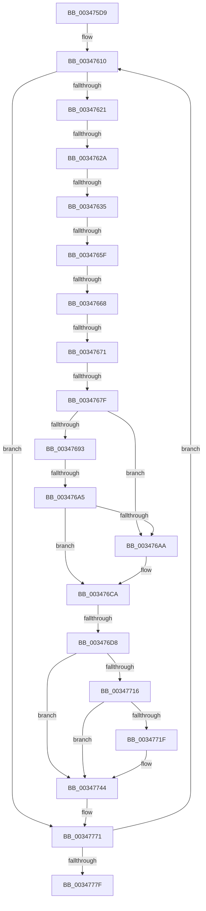

# sub_003475D9

- RVA: `0x003475D9`–`0x0034778C` (길이 `435` bytes)
- VA: `0x00000001403475D9`
- 실행 섹션: `.text`
- PDB 이름 있음: `아니요`; PDB Function 태그: `아니요`
- unwind 정보 RVA: `0x0007809C`
- 디코드: `97`개 명령, `435/435` bytes 표시
- 미해석 바이트: `0` (있으면 어셈블리에 `.byte`로 보존)

> 이 문서는 커널 이미지의 기계어와 PDB 기호를 분석해 생성했습니다. 4번과 5번은 함수 원형과 자료형을 바이너리 사용 방식에서 추정한 C 해석이며 원본 소스 복구 결과는 아닙니다.

## 1. Dependencies

- 직접 호출 지점: **2**; 고유 호출 대상: **2**
- 직접 호출자로 확인된 함수: **0**
- RIP 상대 이미지 참조: **1**

### Outgoing calls
- `0x003476AF` → [MiEmptyDeferredWorkingSetEntries](MiEmptyDeferredWorkingSetEntries_function_00347910.md) (function, `0x00347910`)
- `0x0034770A` → [MiAllocateWsle](../33/MiAllocateWsle_function_003332C0.md) (function, `0x003332C0`)

### Direct callers
- 이 함수 시작 RVA로 연결되는 직접 call은 확인되지 않았습니다. 간접 호출은 완전히 역산할 수 없습니다.

### Static image references
- `0x00347716` → RVA `0x00E67248` (`.data`; read)

## 2. Other-region calls and transfers

- 다른 실행 섹션으로 향하는 call: **0**
- call이 아닌 외부 분기/꼬리 이동: **9**
  - `0x00347624` → [sub_003477E9](Unknown_function_003477E9.md) (`tail-transfer`)
  - `0x0034762F` → [sub_003477E9 + 0x16](Unknown_function_003477E9.md) (`tail-transfer`)
  - `0x00347659` → [sub_0034789E](Unknown_function_0034789E.md) (`tail-transfer`)
  - `0x00347662` → [sub_0034789E](Unknown_function_0034789E.md) (`tail-transfer`)
  - `0x0034766B` → [sub_0034789E](Unknown_function_0034789E.md) (`tail-transfer`)
  - `0x00347679` → [sub_003477E9 + 0x6B](Unknown_function_003477E9.md) (`tail-transfer`)
  - `0x0034769F` → [sub_003477E9 + 0x5D](Unknown_function_003477E9.md) (`tail-transfer`)
  - `0x003476D2` → [sub_003477E9 + 0x6B](Unknown_function_003477E9.md) (`tail-transfer`)
  - `0x0034778A` → [sub_0034778C + 0x54](Unknown_function_0034778C.md) (`tail-transfer`)

## 3. Assembly (complete function range)

```asm
003475D9  4C 89 A4 24 E0 01 00 00         mov qword ptr [rsp + 0x1e0], r12
003475E1  48 89 7C 24 68                  mov qword ptr [rsp + 0x68], rdi
003475E6  4C 8B E3                        mov r12, rbx
003475E9  48 BE FF FF FF FF FF 00 00 00   movabs rsi, 0xffffffffff
003475F3  48 BA 00 00 00 00 00 DE FF FF   movabs rdx, 0xffffde0000000000
003475FD  41 B8 FF 01 00 00               mov r8d, 0x1ff
00347603  41 B9 01 00 00 00               mov r9d, 1
00347609  0F 1F 80 00 00 00 00            nop dword ptr [rax]
00347610  49 8B 1C 3E                     mov rbx, qword ptr [r14 + rdi]
00347614  49 8D 0C 3E                     lea rcx, [r14 + rdi]
00347618  48 85 DB                        test rbx, rbx
0034761B  0F 84 50 01 00 00               je 0x140347771
00347621  F6 C3 01                        test bl, 1
00347624  0F 84 BF 01 00 00               je 0x1403477e9
0034762A  49 8B 06                        mov rax, qword ptr [r14]
0034762D  A8 01                           test al, 1
0034762F  0F 85 CA 01 00 00               jne 0x1403477ff
00347635  48 8B C3                        mov rax, rbx
00347638  48 C1 E8 0C                     shr rax, 0xc
0034763C  48 23 C6                        and rax, rsi
0034763F  48 8D 34 40                     lea rsi, [rax + rax*2]
00347643  48 C1 E6 04                     shl rsi, 4
00347647  48 8B C2                        mov rax, rdx
0034764A  0F B6 4C 24 55                  movzx ecx, byte ptr [rsp + 0x55]
0034764F  48 03 F0                        add rsi, rax
00347652  48 8B 7E 10                     mov rdi, qword ptr [rsi + 0x10]
00347656  F6 C1 08                        test cl, 8
00347659  0F 84 3F 02 00 00               je 0x14034789e
0034765F  F6 C1 01                        test cl, 1
00347662  0F 85 36 02 00 00               jne 0x14034789e
00347668  F6 C1 04                        test cl, 4
0034766B  0F 85 2D 02 00 00               jne 0x14034789e
00347671  0F B7 44 24 52                  movzx eax, word ptr [rsp + 0x52]
00347676  66 85 C0                        test ax, ax
00347679  0F 84 D5 01 00 00               je 0x140347854
0034767F  0F B7 4C 24 50                  movzx ecx, word ptr [rsp + 0x50]
00347684  03 C8                           add ecx, eax
00347686  41 8B C6                        mov eax, r14d
00347689  C1 E8 03                        shr eax, 3
0034768C  41 23 C0                        and eax, r8d
0034768F  3B C8                           cmp ecx, eax
00347691  75 17                           jne 0x1403476aa
00347693  48 8B 46 28                     mov rax, qword ptr [rsi + 0x28]
00347697  0F B6 4C 24 55                  movzx ecx, byte ptr [rsp + 0x55]
0034769C  48 85 C0                        test rax, rax
0034769F  0F 88 A1 01 00 00               js 0x140347846
003476A5  F6 C1 02                        test cl, 2
003476A8  75 20                           jne 0x1403476ca
003476AA  48 8D 4C 24 48                  lea rcx, [rsp + 0x48]
003476AF  E8 5C 02 00 00                  call 0x140347910
003476B4  4C 8B 5C 24 60                  mov r11, qword ptr [rsp + 0x60]
003476B9  41 B9 01 00 00 00               mov r9d, 1
003476BF  0F B6 4C 24 55                  movzx ecx, byte ptr [rsp + 0x55]
003476C4  41 B8 FF 01 00 00               mov r8d, 0x1ff
003476CA  0F B7 44 24 52                  movzx eax, word ptr [rsp + 0x52]
003476CF  66 85 C0                        test ax, ax
003476D2  0F 84 7C 01 00 00               je 0x140347854
003476D8  66 FF C0                        inc ax
003476DB  66 89 44 24 52                  mov word ptr [rsp + 0x52], ax
003476E0  BA 04 00 00 00                  mov edx, 4
003476E5  8B C2                           mov eax, edx
003476E7  4C 89 6C 24 30                  mov qword ptr [rsp + 0x30], r13
003476EC  83 C8 10                        or eax, 0x10
003476EF  4C 8B C6                        mov r8, rsi
003476F2  F6 C1 01                        test cl, 1
003476F5  49 8B CB                        mov rcx, r11
003476F8  0F 44 C2                        cmove eax, edx
003476FB  45 33 C9                        xor r9d, r9d
003476FE  89 44 24 28                     mov dword ptr [rsp + 0x28], eax
00347702  49 8B D6                        mov rdx, r14
00347705  48 89 5C 24 20                  mov qword ptr [rsp + 0x20], rbx
0034770A  E8 B1 BB FE FF                  call 0x1403332c0
0034770F  48 0F BA E7 0A                  bt rdi, 0xa
00347714  73 2E                           jae 0x140347744
00347716  44 39 2D 2B FB B1 00            cmp dword ptr [rip + 0xb1fb2b], r13d
0034771D  74 25                           je 0x140347744
0034771F  8B 54 24 44                     mov edx, dword ptr [rsp + 0x44]
00347723  49 B8 00 00 00 00 00 00 00 80   movabs r8, 0x8000000000000000
0034772D  48 8B 4E 08                     mov rcx, qword ptr [rsi + 8]
00347731  49 0B C8                        or rcx, r8
00347734  48 89 4C D5 00                  mov qword ptr [rbp + rdx*8], rcx
00347739  48 89 7C D5 80                  mov qword ptr [rbp + rdx*8 - 0x80], rdi
0034773E  FF C2                           inc edx
00347740  89 54 24 44                     mov dword ptr [rsp + 0x44], edx
00347744  49 FF C7                        inc r15
00347747  48 BE FF FF FF FF FF 00 00 00   movabs rsi, 0xffffffffff
00347751  4C 8B 5C 24 60                  mov r11, qword ptr [rsp + 0x60]
00347756  41 B9 01 00 00 00               mov r9d, 1
0034775C  48 8B 7C 24 68                  mov rdi, qword ptr [rsp + 0x68]
00347761  41 B8 FF 01 00 00               mov r8d, 0x1ff
00347767  48 BA 00 00 00 00 00 DE FF FF   movabs rdx, 0xffffde0000000000
00347771  49 83 C6 08                     add r14, 8
00347775  49 83 EC 01                     sub r12, 1
00347779  0F 85 91 FE FF FF               jne 0x140347610
0034777F  4C 8B A4 24 E0 01 00 00         mov r12, qword ptr [rsp + 0x1e0]
00347787  4D 85 FF                        test r15, r15
0034778A  74 54                           je 0x1403477e0
```

## 4. C-style interpretation (structured pseudocode)

```c
__int64 __fastcall sub_003475D9(__int64 a1, __int64 a2, __int64 a3, __int64 a4, __int64 a5, __int64 a6, __int64 a7, __int64 a8, __int64 a9, unsigned __int16 a10, __int64 a11, __int64 a12, __int64 a13, __int64 a14, __int64 a15, __int64 a16, __int64 a17, __int64 a18, __int64 a19, __int64 a20, __int64 a21, __int64 a22, __int64 a23, __int64 a24, __int64 a25, __int64 a26, __int64 a27, __int64 a28, __int64 a29, __int64 a30, __int64 a31, __int64 a32, __int64 a33, __int64 a34, __int64 a35, __int64 a36, __int64 a37, __int64 a38, __int64 a39, __int64 a40, __int64 a41, __int64 a42, __int64 a43, __int64 a44, __int64 a45, __int64 a46, __int64 a47, __int64 a48, __int64 a49, __int64 a50, __int64 a51, __int64 a52, __int64 a53, __int64 a54, __int64 a55, __int64 a56, __int64 a57, __int64 a58, __int64 a59, __int64 a60)
{
    __int64 result;
    __int64 v_r11;
    __int64 v_r12;
    __int64 v_r14;
    __int64 v_r15;
    __int64 v_rsi;
    unsigned __int64 v_stack_p1E0;
    unsigned __int64 v_stack_p20;
    unsigned int v_stack_p28;
    unsigned __int64 v_stack_p30;
    unsigned int v_stack_p44;
    unsigned __int16 v_stack_p52;
    unsigned __int8 v_stack_p55;
    unsigned __int64 v_stack_p68;

    v_stack_p1E0 = v_r12;
    v_stack_p68 = v_rdi;
loc_00347610:
    if (*(unsigned __int64 *)(v_r14 + v_rdi * 1) == 0) goto loc_00347771;
    result = (*(unsigned __int64 *)(v_r14 + v_rdi * 1)) >> (12);
    result = (result) & (v_rsi);
    v_rsi = (result + result * 2) << (4);
    v_rsi = (v_rsi) + (a2);
    a1 = (unsigned int)((a10) + ((unsigned int)(v_stack_p52)));
    result = (unsigned int)(((unsigned int)((unsigned int)(v_r14))) >> (3));
    result = (unsigned int)((result) & (511));
    if (((unsigned int)(a1)) != ((unsigned int)(result))) goto loc_003476AA;
    result = *(unsigned __int64 *)(v_rsi + 40);
    if ((((unsigned __int8)(v_stack_p55)) & (2)) == 0) {
        a1 = a9;
        result = MiEmptyDeferredWorkingSetEntries(a1, a2, 511, 1);
        v_r11 = a12;
        a4 = 1;
        a1 = v_stack_p55;
        a3 = 511;
    }
    result = (unsigned __int16)((v_stack_p52) + 1);
    v_stack_p52 = (unsigned __int16)(result);
    v_stack_p30 = v_r13;
    result = (unsigned int)((4) | (16));
    if ((((unsigned __int8)(a1)) & (1)) == 0) { result = 4; }
    a4 = 0;
    v_stack_p28 = (unsigned int)(result);
    v_stack_p20 = *(unsigned __int64 *)(v_r14 + v_rdi * 1);
    result = MiAllocateWsle(v_r11, v_r14, v_rsi, a4);
    if (condition_is_above_or_equal) goto loc_00347744;
    if ((*(unsigned int *)(v_rip + 11664171)) != ((unsigned int)(v_r13))) {
        a2 = v_stack_p44;
        a1 = *(unsigned __int64 *)(v_rsi + 8);
        a1 = (a1) | (v_rsi);
        *(unsigned __int64 *)(v_rbp + a2 * 8) = a1;
        *(unsigned __int64 *)(v_rbp + a2 * 8 - 128) = *(unsigned __int64 *)(v_rsi + 16);
        a2 = (unsigned int)((a2) + 1);
        v_stack_p44 = (unsigned int)(a2);
    }
    v_r15 = (v_r15) + 1;
loc_00347771:
    v_r14 = (v_r14) + (8);
    v_r12 = (v_rbx) - (1);
    if (condition_is_not_equal) goto loc_00347610;
}
```

## 5. (Beta) C Style

```c
int64_t sub_003475D9(int64_t Arg1, int64_t Arg2, int64_t Arg3, int64_t Arg4, uint64_t Arg5, uint64_t Arg6, uint64_t Arg7, uint64_t Arg8, int64_t Arg9, uint16_t Arg10, uint64_t Arg11, int64_t Arg12, int64_t Arg13, uint64_t Arg14, uint64_t Arg15, uint64_t Arg16, uint64_t Arg17, uint64_t Arg18, uint64_t Arg19, uint64_t Arg20, uint64_t Arg21, uint64_t Arg22, uint64_t Arg23, uint64_t Arg24, uint64_t Arg25, uint64_t Arg26, uint64_t Arg27, uint64_t Arg28, uint64_t Arg29, uint64_t Arg30, uint64_t Arg31, uint64_t Arg32, uint64_t Arg33, uint64_t Arg34, uint64_t Arg35, uint64_t Arg36, uint64_t Arg37, uint64_t Arg38, uint64_t Arg39, uint64_t Arg40, uint64_t Arg41, uint64_t Arg42, uint64_t Arg43, uint64_t Arg44, uint64_t Arg45, uint64_t Arg46, uint64_t Arg47, uint64_t Arg48, uint64_t Arg49, uint64_t Arg50, uint64_t Arg51, uint64_t Arg52, uint64_t Arg53, uint64_t Arg54, uint64_t Arg55, uint64_t Arg56, uint64_t Arg57, uint64_t Arg58, uint64_t Arg59, int64_t Arg60)
{
    int64_t result;
    int64_t local_r11;
    int64_t local_r12;
    int64_t local_r14;
    int64_t local_r15;
    int64_t local_rsi;
    uint64_t v_stack_p1E0;
    uint64_t v_stack_p20;
    uint32_t v_stack_p28;
    uint64_t v_stack_p30;
    uint32_t v_stack_p44;
    uint16_t v_stack_p52;
    uint8_t v_stack_p55;
    uint64_t v_stack_p68;

    v_stack_p1E0 = local_r12;
    v_stack_p68 = local_rdi;
loc_00347610:
    if (*(uint64_t *)(local_r14 + local_rdi * 1) == 0) goto loc_00347771;
    result = (*(uint64_t *)(local_r14 + local_rdi * 1)) >> (12);
    result = (result) & (local_rsi);
    local_rsi = (result + result * 2) << (4);
    local_rsi = (local_rsi) + (Arg2);
    Arg1 = (uint32_t)((Arg10) + ((uint32_t)(v_stack_p52)));
    result = (uint32_t)(((uint32_t)((uint32_t)(local_r14))) >> (3));
    result = (uint32_t)((result) & (511));
    if (((uint32_t)(Arg1)) != ((uint32_t)(result))) goto loc_003476AA;
    result = *(uint64_t *)(local_rsi + 0x28);
    if ((((uint8_t)(v_stack_p55)) & (2)) == 0) {
        Arg1 = Arg9;
        result = MiEmptyDeferredWorkingSetEntries(Arg1, Arg2, 511, 1);
        local_r11 = Arg12;
        Arg4 = 1;
        Arg1 = v_stack_p55;
        Arg3 = 511;
    }
    result = (uint16_t)((v_stack_p52) + 1);
    v_stack_p52 = (uint16_t)(result);
    v_stack_p30 = local_r13;
    result = (uint32_t)((4) | (16));
    if ((((uint8_t)(Arg1)) & (1)) == 0) { result = 4; }
    Arg4 = 0;
    v_stack_p28 = (uint32_t)(result);
    v_stack_p20 = *(uint64_t *)(local_r14 + local_rdi * 1);
    result = MiAllocateWsle(local_r11, local_r14, local_rsi, Arg4);
    if (condition_is_above_or_equal) goto loc_00347744;
    if ((*(uint32_t *)(v_rip + 0xB1FB2B)) != ((uint32_t)(local_r13))) {
        Arg2 = v_stack_p44;
        Arg1 = *(uint64_t *)(local_rsi + 0x8);
        Arg1 = (Arg1) | (local_rsi);
        *(uint64_t *)(local_rbp + Arg2 * 8) = Arg1;
        *(uint64_t *)(local_rbp + Arg2 * 8 - 0x80) = *(uint64_t *)(local_rsi + 0x10);
        Arg2 = (uint32_t)((Arg2) + 1);
        v_stack_p44 = (uint32_t)(Arg2);
    }
    local_r15 = (local_r15) + 1;
loc_00347771:
    local_r14 = (local_r14) + (8);
    local_r12 = (local_rbx) - (1);
    if (condition_is_not_equal) goto loc_00347610;
}
```

## 6. Execution-region graph

[열기: 2D/3D 그래프와 함수 탐색 컨트롤 패널](../../../control-panel.html?section=text&rva=0x003475D9&view=graph)

- 2D 그래프는 위에서 아래로 흐르고, 3D 그래프는 빈 공간을 드래그해 회전합니다. Shift+드래그는 이동, 휠은 확대·축소, 함수 노드 선택은 대상 보고서 이동입니다.

### Static fallback


