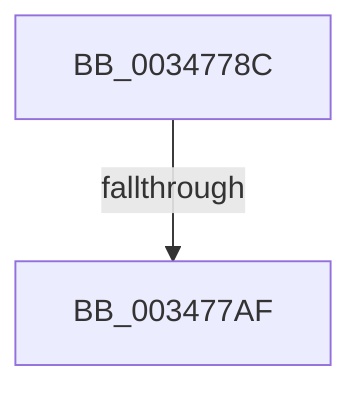

# sub_0034778C

- RVA: `0x0034778C`–`0x003477E9` (길이 `93` bytes)
- VA: `0x000000014034778C`
- 실행 섹션: `.text`
- PDB 이름 있음: `아니요`; PDB Function 태그: `아니요`
- unwind 정보 RVA: `0x000780B0`
- 디코드: `20`개 명령, `93/93` bytes 표시
- 미해석 바이트: `0` (있으면 어셈블리에 `.byte`로 보존)

> 이 문서는 커널 이미지의 기계어와 PDB 기호를 분석해 생성했습니다. 4번과 5번은 함수 원형과 자료형을 바이너리 사용 방식에서 추정한 C 해석이며 원본 소스 복구 결과는 아닙니다.

## 1. Dependencies

- 직접 호출 지점: **0**; 고유 호출 대상: **0**
- 직접 호출자로 확인된 함수: **0**
- RIP 상대 이미지 참조: **0**

### Outgoing calls
- 직접 디코드된 call 명령이 없습니다.

### Direct callers
- 이 함수 시작 RVA로 연결되는 직접 call은 확인되지 않았습니다. 간접 호출은 완전히 역산할 수 없습니다.

### Static image references
- 디코드된 RIP-relative 메모리 참조가 없습니다.

## 2. Other-region calls and transfers

- 다른 실행 섹션으로 향하는 call: **0**
- call이 아닌 외부 분기/꼬리 이동: **2**
  - `0x003477A9` → [sub_00347883](Unknown_function_00347883.md) (`tail-transfer`)
  - `0x003477E4` → [sub_00347472 + 0xA5](Unknown_function_00347472.md) (`tail-transfer`)

## 3. Assembly (complete function range)

```asm
0034778C  4C 8B 4C 24 70                  mov r9, qword ptr [rsp + 0x70]
00347791  4B 8D 1C 49                     lea rbx, [r9 + r9*2]
00347795  48 C1 E3 04                     shl rbx, 4
00347799  48 8B C2                        mov rax, rdx
0034779C  48 03 D8                        add rbx, rax
0034779F  41 8B FD                        mov edi, r13d
003477A2  F0 48 0F BA 6B 18 3F            lock bts qword ptr [rbx + 0x18], 0x3f
003477A9  0F 82 D4 00 00 00               jb 0x140347883
003477AF  48 8B 43 18                     mov rax, qword ptr [rbx + 0x18]
003477B3  49 BA FF FF FF FF FF FF FF 7F   movabs r10, 0x7fffffffffffffff
003477BD  4A 8D 0C 38                     lea rcx, [rax + r15]
003477C1  48 8B D1                        mov rdx, rcx
003477C4  48 33 D0                        xor rdx, rax
003477C7  48 B8 00 00 00 00 00 00 00 C0   movabs rax, 0xc000000000000000
003477D1  48 23 D0                        and rdx, rax
003477D4  48 33 D1                        xor rdx, rcx
003477D7  48 89 53 18                     mov qword ptr [rbx + 0x18], rdx
003477DB  F0 4C 21 53 18                  lock and qword ptr [rbx + 0x18], r10
003477E0  8B 74 24 44                     mov esi, dword ptr [rsp + 0x44]
003477E4  E9 2E FD FF FF                  jmp 0x140347517
```

## 4. C-style interpretation (structured pseudocode)

```c
__int64 __fastcall sub_0034778C(__int64 a1, __int64 a2, __int64 a3, __int64 a4, __int64 a5, __int64 a6, __int64 a7, __int64 a8, __int64 a9, __int64 a10, __int64 a11, __int64 a12, __int64 a13, __int64 a14)
{
    __int64 v_rbx;
    unsigned int v_stack_p44;

    v_rbx = (a14 + a14 * 2) << (4);
    v_rbx = (v_rbx) + (a2);
    a2 = (*(unsigned __int64 *)(v_rbx + 24) + v_r15 * 1) ^ (*(unsigned __int64 *)(v_rbx + 24));
    a2 = (a2) & (*(unsigned __int64 *)(v_rbx + 24));
    a2 = (a2) ^ (*(unsigned __int64 *)(v_rbx + 24) + v_r15 * 1);
    *(unsigned __int64 *)(v_rbx + 24) = a2;
}
```

## 5. (Beta) C Style

```c
int64_t sub_0034778C(int64_t Arg1, int64_t Arg2, int64_t Arg3, int64_t Arg4, uint64_t Arg5, uint64_t Arg6, uint64_t Arg7, uint64_t Arg8, uint64_t Arg9, uint64_t Arg10, uint64_t Arg11, uint64_t Arg12, uint64_t Arg13, void *Arg14)
{
    uint8_t *arg14 = (uint8_t *)Arg14;

    int64_t local_rbx;
    uint32_t v_stack_p44;

    local_rbx = (Arg14 + Arg14 * 2) << (4);
    local_rbx = (local_rbx) + (Arg2);
    Arg2 = (*(uint64_t *)(local_rbx + 0x18) + local_r15 * 1) ^ (*(uint64_t *)(local_rbx + 0x18));
    Arg2 = (Arg2) & (*(uint64_t *)(local_rbx + 0x18));
    Arg2 = (Arg2) ^ (*(uint64_t *)(local_rbx + 0x18) + local_r15 * 1);
    *(uint64_t *)(local_rbx + 0x18) = Arg2;
}
```

### 관측된 메모리 오프셋

구조체 형식이 확인되지 않은 접근은 인자 기준의 오프셋으로만 기록했습니다.

| 기준 인자 | 오프셋 표현 | 폭 (bit) | 접근 |
|---|---:|---:|---|
| `Arg14` | `+ 0x0 + r9*2` | `64` | `R` |

## 6. Execution-region graph

[열기: 2D/3D 그래프와 함수 탐색 컨트롤 패널](../../../control-panel.html?section=text&rva=0x0034778C&view=graph)

- 2D 그래프는 위에서 아래로 흐르고, 3D 그래프는 빈 공간을 드래그해 회전합니다. Shift+드래그는 이동, 휠은 확대·축소, 함수 노드 선택은 대상 보고서 이동입니다.

### Static fallback


