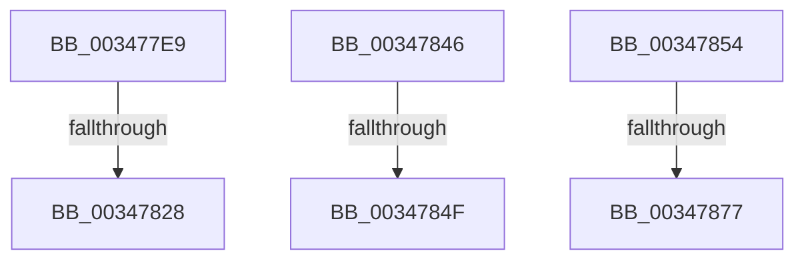

# sub_003477E9

- RVA: `0x003477E9`–`0x00347883` (길이 `154` bytes)
- VA: `0x00000001403477E9`
- 실행 섹션: `.text`
- PDB 이름 있음: `아니요`; PDB Function 태그: `아니요`
- unwind 정보 RVA: `0x000780C0`
- 디코드: `35`개 명령, `154/154` bytes 표시
- 미해석 바이트: `0` (있으면 어셈블리에 `.byte`로 보존)

> 이 문서는 커널 이미지의 기계어와 PDB 기호를 분석해 생성했습니다. 4번과 5번은 함수 원형과 자료형을 바이너리 사용 방식에서 추정한 C 해석이며 원본 소스 복구 결과는 아닙니다.

## 1. Dependencies

- 직접 호출 지점: **2**; 고유 호출 대상: **2**
- 직접 호출자로 확인된 함수: **0**
- RIP 상대 이미지 참조: **0**

### Outgoing calls
- `0x003477F0` → [MiWriteValidPteNewProtection](../28/MiWriteValidPteNewProtection_function_00281810.md) (function, `0x00281810`)
- `0x0034782D` → [MiDecrementShareCountEx](../33/MiDecrementShareCountEx_function_00333F70.md) (function, `0x00333F70`)

### Direct callers
- 이 함수 시작 RVA로 연결되는 직접 call은 확인되지 않았습니다. 간접 호출은 완전히 역산할 수 없습니다.

### Static image references
- 디코드된 RIP-relative 메모리 참조가 없습니다.

## 2. Other-region calls and transfers

- 다른 실행 섹션으로 향하는 call: **0**
- call이 아닌 외부 분기/꼬리 이동: **6**
  - `0x00347822` → [sub_003478D0](Unknown_function_003478D0.md) (`tail-transfer`)
  - `0x00347841` → [sub_003475D9 + 0x178](Unknown_function_003475D9.md) (`tail-transfer`)
  - `0x00347849` → [sub_003475D9 + 0xD1](Unknown_function_003475D9.md) (`tail-transfer`)
  - `0x0034784F` → [sub_003475D9 + 0xF1](Unknown_function_003475D9.md) (`tail-transfer`)
  - `0x00347875` → [sub_0034789E + 0x8](Unknown_function_0034789E.md) (`tail-transfer`)
  - `0x0034787E` → [sub_003475D9 + 0x107](Unknown_function_003475D9.md) (`tail-transfer`)

## 3. Assembly (complete function range)

```asm
003477E9  48 83 CB 01                     or rbx, 1
003477ED  48 8B D3                        mov rdx, rbx
003477F0  E8 1B A0 F3 FF                  call 0x140281810
003477F5  48 BA 00 00 00 00 00 DE FF FF   movabs rdx, 0xffffde0000000000
003477FF  49 8B 04 3E                     mov rax, qword ptr [r14 + rdi]
00347803  48 C1 E8 0C                     shr rax, 0xc
00347807  48 23 C6                        and rax, rsi
0034780A  48 8D 1C 40                     lea rbx, [rax + rax*2]
0034780E  48 C1 E3 04                     shl rbx, 4
00347812  48 8B C2                        mov rax, rdx
00347815  48 03 D8                        add rbx, rax
00347818  41 8B FD                        mov edi, r13d
0034781B  F0 48 0F BA 6B 18 3F            lock bts qword ptr [rbx + 0x18], 0x3f
00347822  0F 82 A8 00 00 00               jb 0x1403478d0
00347828  33 D2                           xor edx, edx
0034782A  48 8B CB                        mov rcx, rbx
0034782D  E8 3E C7 FE FF                  call 0x140333f70
00347832  48 B8 FF FF FF FF FF FF FF 7F   movabs rax, 0x7fffffffffffffff
0034783C  F0 48 21 43 18                  lock and qword ptr [rbx + 0x18], rax
00347841  E9 0B FF FF FF                  jmp 0x140347751
00347846  F6 C1 02                        test cl, 2
00347849  0F 85 5B FE FF FF               jne 0x1403476aa
0034784F  E9 76 FE FF FF                  jmp 0x1403476ca
00347854  41 8B C6                        mov eax, r14d
00347857  66 44 89 4C 24 52               mov word ptr [rsp + 0x52], r9w
0034785D  C1 E8 03                        shr eax, 3
00347860  66 41 23 C0                     and ax, r8w
00347864  66 89 44 24 50                  mov word ptr [rsp + 0x50], ax
00347869  48 8B 46 28                     mov rax, qword ptr [rsi + 0x28]
0034786D  0F B6 4C 24 55                  movzx ecx, byte ptr [rsp + 0x55]
00347872  48 85 C0                        test rax, rax
00347875  79 2F                           jns 0x1403478a6
00347877  80 E1 FD                        and cl, 0xfd
0034787A  88 4C 24 55                     mov byte ptr [rsp + 0x55], cl
0034787E  E9 5D FE FF FF                  jmp 0x1403476e0
```

## 4. C-style interpretation (structured pseudocode)

```c
__int64 __fastcall sub_003477E9(__int64 a1, __int64 a2, unsigned __int16 a3, unsigned __int16 a4)
{
    __int64 result;
    __int64 v_rbx;
    unsigned __int16 v_stack_p50;
    unsigned __int16 v_stack_p52;
    unsigned __int8 v_stack_p55;

    v_rbx = (v_rbx) | (1);
    result = MiWriteValidPteNewProtection(a1, v_rbx, a3, a4);
    result = (*(unsigned __int64 *)(v_r14 + v_rdi * 1)) >> (12);
    result = (result) & (v_rsi);
    v_rbx = (result + result * 2) << (4);
    v_rbx = (v_rbx) + (v_rbx);
    a2 = 0;
    result = MiDecrementShareCountEx(v_rbx, a2, a3, a4);
}
```

## 5. (Beta) C Style

```c
int64_t sub_003477E9(int64_t Arg1, int64_t Arg2, uint16_t Arg3, uint16_t Arg4)
{
    int64_t result;
    int64_t local_rbx;
    uint16_t v_stack_p50;
    uint16_t v_stack_p52;
    uint8_t v_stack_p55;

    local_rbx = (local_rbx) | (1);
    result = MiWriteValidPteNewProtection(Arg1, local_rbx, Arg3, Arg4);
    result = (*(uint64_t *)(local_r14 + local_rdi * 1)) >> (12);
    result = (result) & (local_rsi);
    local_rbx = (result + result * 2) << (4);
    local_rbx = (local_rbx) + (local_rbx);
    Arg2 = 0;
    result = MiDecrementShareCountEx(local_rbx, Arg2, Arg3, Arg4);
}
```

## 6. Execution-region graph

[열기: 2D/3D 그래프와 함수 탐색 컨트롤 패널](../../../control-panel.html?section=text&rva=0x003477E9&view=graph)

- 2D 그래프는 위에서 아래로 흐르고, 3D 그래프는 빈 공간을 드래그해 회전합니다. Shift+드래그는 이동, 휠은 확대·축소, 함수 노드 선택은 대상 보고서 이동입니다.

### Static fallback


