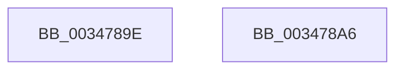

# sub_0034789E

- RVA: `0x0034789E`–`0x003478B2` (길이 `20` bytes)
- VA: `0x000000014034789E`
- 실행 섹션: `.text`
- PDB 이름 있음: `아니요`; PDB Function 태그: `아니요`
- unwind 정보 RVA: `0x000780E4`
- 디코드: `5`개 명령, `20/20` bytes 표시
- 미해석 바이트: `0` (있으면 어셈블리에 `.byte`로 보존)

> 이 문서는 커널 이미지의 기계어와 PDB 기호를 분석해 생성했습니다. 4번과 5번은 함수 원형과 자료형을 바이너리 사용 방식에서 추정한 C 해석이며 원본 소스 복구 결과는 아닙니다.

## 1. Dependencies

- 직접 호출 지점: **0**; 고유 호출 대상: **0**
- 직접 호출자로 확인된 함수: **0**
- RIP 상대 이미지 참조: **0**

### Outgoing calls
- 직접 디코드된 call 명령이 없습니다.

### Direct callers
- 이 함수 시작 RVA로 연결되는 직접 call은 확인되지 않았습니다. 간접 호출은 완전히 역산할 수 없습니다.

### Static image references
- 디코드된 RIP-relative 메모리 참조가 없습니다.

## 2. Other-region calls and transfers

- 다른 실행 섹션으로 향하는 call: **0**
- call이 아닌 외부 분기/꼬리 이동: **2**
  - `0x003478A1` → [sub_003475D9 + 0x10C](Unknown_function_003475D9.md) (`tail-transfer`)
  - `0x003478AD` → [sub_003475D9 + 0x107](Unknown_function_003475D9.md) (`tail-transfer`)

## 3. Assembly (complete function range)

```asm
0034789E  41 8B D5                        mov edx, r13d
003478A1  E9 3F FE FF FF                  jmp 0x1403476e5
003478A6  80 C9 02                        or cl, 2
003478A9  88 4C 24 55                     mov byte ptr [rsp + 0x55], cl
003478AD  E9 2E FE FF FF                  jmp 0x1403476e0
```

## 4. C-style interpretation (structured pseudocode)

```c
void __fastcall sub_0034789E(unsigned __int8 a1)
{
    unsigned __int8 v_stack_p55;
}
```

## 5. (Beta) C Style

```c
void sub_0034789E(uint8_t Arg1)
{
    uint8_t v_stack_p55;
}
```

## 6. Execution-region graph

[열기: 2D/3D 그래프와 함수 탐색 컨트롤 패널](../../../control-panel.html?section=text&rva=0x0034789E&view=graph)

- 2D 그래프는 위에서 아래로 흐르고, 3D 그래프는 빈 공간을 드래그해 회전합니다. Shift+드래그는 이동, 휠은 확대·축소, 함수 노드 선택은 대상 보고서 이동입니다.

### Static fallback


