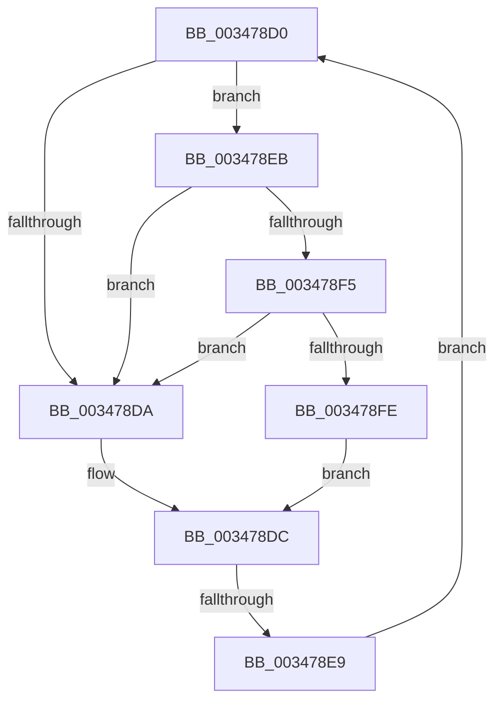

# sub_003478D0

- RVA: `0x003478D0`–`0x00347907` (길이 `55` bytes)
- VA: `0x00000001403478D0`
- 실행 섹션: `.text`
- PDB 이름 있음: `아니요`; PDB Function 태그: `아니요`
- unwind 정보 RVA: `0x00078108`
- 디코드: `17`개 명령, `55/55` bytes 표시
- 미해석 바이트: `0` (있으면 어셈블리에 `.byte`로 보존)

> 이 문서는 커널 이미지의 기계어와 PDB 기호를 분석해 생성했습니다. 4번과 5번은 함수 원형과 자료형을 바이너리 사용 방식에서 추정한 C 해석이며 원본 소스 복구 결과는 아닙니다.

## 1. Dependencies

- 직접 호출 지점: **2**; 고유 호출 대상: **2**
- 직접 호출자로 확인된 함수: **0**
- RIP 상대 이미지 참조: **2**

### Outgoing calls
- `0x003478F5` → [KiCheckVpBackingLongSpinWaitHypercall](../30/KiCheckVpBackingLongSpinWaitHypercall_function_0030F490.md) (function, `0x0030F490`)
- `0x00347900` → [HvlNotifyLongSpinWait](../30/HvlNotifyLongSpinWait_function_0030F460.md) (function, `0x0030F460`)

### Direct callers
- 이 함수 시작 RVA로 연결되는 직접 call은 확인되지 않았습니다. 간접 호출은 완전히 역산할 수 없습니다.

### Static image references
- `0x003478D2` → RVA `0x00FC52AC` (`ALMOSTRO`; reference)
- `0x003478EB` → RVA `0x00FC6AB8` (`ALMOSTRO`; read)

## 2. Other-region calls and transfers

- 다른 실행 섹션으로 향하는 call: **0**
- call이 아닌 외부 분기/꼬리 이동: **1**
  - `0x003478E3` → [sub_003477E9 + 0x32](Unknown_function_003477E9.md) (`tail-transfer`)

## 3. Assembly (complete function range)

```asm
003478D0  FF C7                           inc edi
003478D2  85 3D D4 D9 C7 00               test dword ptr [rip + 0xc7d9d4], edi
003478D8  74 11                           je 0x1403478eb
003478DA  F3 90                           pause
003478DC  48 8B 43 18                     mov rax, qword ptr [rbx + 0x18]
003478E0  48 85 C0                        test rax, rax
003478E3  0F 89 32 FF FF FF               jns 0x14034781b
003478E9  EB E5                           jmp 0x1403478d0
003478EB  8B 05 C7 F1 C7 00               mov eax, dword ptr [rip + 0xc7f1c7]
003478F1  A8 40                           test al, 0x40
003478F3  74 E5                           je 0x1403478da
003478F5  E8 96 7B FC FF                  call 0x14030f490
003478FA  84 C0                           test al, al
003478FC  74 DC                           je 0x1403478da
003478FE  8B CF                           mov ecx, edi
00347900  E8 5B 7B FC FF                  call 0x14030f460
00347905  EB D5                           jmp 0x1403478dc
```

## 4. C-style interpretation (structured pseudocode)

```c
__int64 __fastcall sub_003478D0(void)
{
    __int64 result;
    __int64 v_rdi;

    v_rdi = (unsigned int)((v_rdi) + 1);
    if (((*(unsigned int *)(v_rip + 13097428)) & ((unsigned int)(v_rdi))) == 0) goto loc_003478EB;
loc_003478DA:
loc_003478DC:
    goto loc_003478D0;
loc_003478EB:
    if ((((unsigned __int8)((unsigned int)(*(unsigned int *)(v_rip + 13103559)))) & (64)) == 0) goto loc_003478DA;
    result = KiCheckVpBackingLongSpinWaitHypercall(a1, a2, a3, a4);
    if ((unsigned __int8)(result) == 0) goto loc_003478DA;
    result = HvlNotifyLongSpinWait((unsigned int)((unsigned int)(v_rdi)), a2, a3, a4);
    goto loc_003478DC;
}
```

## 5. (Beta) C Style

```c
void sub_003478D0(void)
{
    int64_t result;
    int64_t local_rdi;

    local_rdi = (uint32_t)((local_rdi) + 1);
    if (((*(uint32_t *)(v_rip + 0xC7D9D4)) & ((uint32_t)(local_rdi))) == 0) goto loc_003478EB;
loc_003478DA:
loc_003478DC:
    goto loc_003478D0;
loc_003478EB:
    if ((((uint8_t)((uint32_t)(*(uint32_t *)(v_rip + 0xC7F1C7)))) & (64)) == 0) goto loc_003478DA;
    result = KiCheckVpBackingLongSpinWaitHypercall(a1, a2, a3, a4);
    if ((uint8_t)(result) == 0) goto loc_003478DA;
    result = HvlNotifyLongSpinWait((uint32_t)((uint32_t)(local_rdi)), a2, a3, a4);
    goto loc_003478DC;
}
```

## 6. Execution-region graph

[열기: 2D/3D 그래프와 함수 탐색 컨트롤 패널](../../../control-panel.html?section=text&rva=0x003478D0&view=graph)

- 2D 그래프는 위에서 아래로 흐르고, 3D 그래프는 빈 공간을 드래그해 회전합니다. Shift+드래그는 이동, 휠은 확대·축소, 함수 노드 선택은 대상 보고서 이동입니다.

### Static fallback


