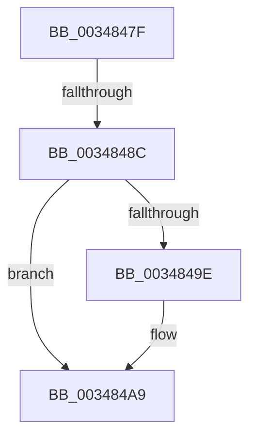

# sub_0034847F

- RVA: `0x0034847F`–`0x003484C0` (길이 `65` bytes)
- VA: `0x000000014034847F`
- 실행 섹션: `.text`
- PDB 이름 있음: `아니요`; PDB Function 태그: `아니요`
- unwind 정보 RVA: `0x000781CC`
- 디코드: `17`개 명령, `65/65` bytes 표시
- 미해석 바이트: `0` (있으면 어셈블리에 `.byte`로 보존)

> 이 문서는 커널 이미지의 기계어와 PDB 기호를 분석해 생성했습니다. 4번과 5번은 함수 원형과 자료형을 바이너리 사용 방식에서 추정한 C 해석이며 원본 소스 복구 결과는 아닙니다.

## 1. Dependencies

- 직접 호출 지점: **3**; 고유 호출 대상: **3**
- 직접 호출자로 확인된 함수: **0**
- RIP 상대 이미지 참조: **0**

### Outgoing calls
- `0x0034848C` → [ExAcquireSpinLockShared](../24/ExAcquireSpinLockShared_function_0024DCE0.md) (function, `0x0024DCE0`)
- `0x003484A4` → [ObfReferenceObjectWithTag](../21/ObfReferenceObjectWithTag_function_00210710.md) (function, `0x00210710`)
- `0x003484B1` → [MiReleaseSpinLockShared](MiReleaseSpinLockShared_function_00348BF0.md) (function, `0x00348BF0`)

### Direct callers
- 이 함수 시작 RVA로 연결되는 직접 call은 확인되지 않았습니다. 간접 호출은 완전히 역산할 수 없습니다.

### Static image references
- 디코드된 RIP-relative 메모리 참조가 없습니다.

## 2. Other-region calls and transfers

- 다른 실행 섹션으로 향하는 call: **0**
- call이 아닌 외부 분기/꼬리 이동: **2**
  - `0x0034848A` → [sub_003484C0](Unknown_function_003484C0.md) (`tail-transfer`)
  - `0x003484BB` → [MiReferenceControlAreaFileWithTag + 0x6D](MiReferenceControlAreaFileWithTag_function_00348390.md) (`tail-transfer`)

## 3. Assembly (complete function range)

```asm
0034847F  48 89 74 24 40                  mov qword ptr [rsp + 0x40], rsi
00348484  48 8D 4F 48                     lea rcx, [rdi + 0x48]
00348488  85 ED                           test ebp, ebp
0034848A  75 34                           jne 0x1403484c0
0034848C  E8 4F 58 F0 FF                  call 0x14024dce0
00348491  0F B6 E8                        movzx ebp, al
00348494  48 8B 5F 40                     mov rbx, qword ptr [rdi + 0x40]
00348498  48 83 E3 F0                     and rbx, 0xfffffffffffffff0
0034849C  74 0B                           je 0x1403484a9
0034849E  41 8B D6                        mov edx, r14d
003484A1  48 8B CB                        mov rcx, rbx
003484A4  E8 67 82 EC FF                  call 0x140210710
003484A9  40 0F B6 D5                     movzx edx, bpl
003484AD  48 8D 4F 48                     lea rcx, [rdi + 0x48]
003484B1  E8 3A 07 00 00                  call 0x140348bf0
003484B6  48 8B 74 24 40                  mov rsi, qword ptr [rsp + 0x40]
003484BB  E9 3D FF FF FF                  jmp 0x1403483fd
```

## 4. C-style interpretation (structured pseudocode)

```c
__int64 __fastcall sub_0034847F(__int64 a1, __int64 a2, __int64 a3, __int64 a4, __int64 a5, __int64 a6, __int64 a7, __int64 a8)
{
    __int64 result;
    __int64 v_rbx;
    unsigned __int64 v_stack_p40;

    v_stack_p40 = v_rsi;
    result = ExAcquireSpinLockShared(v_rdi + 72, a2, a3, a4);
    v_rbx = (*(unsigned __int64 *)(v_rdi + 64)) & (-16);
    if (!(condition_is_equal)) {
        a2 = (unsigned int)(v_r14);
        a1 = v_rbx;
        result = ObfReferenceObjectWithTag(a1, a2, a3, a4);
    }
    result = MiReleaseSpinLockShared(v_rdi + 72, (unsigned __int8)((unsigned __int8)(result)), a3, a4);
}
```

## 5. (Beta) C Style

```c
int64_t sub_0034847F(int64_t Arg1, int64_t Arg2, int64_t Arg3, int64_t Arg4, uint64_t Arg5, uint64_t Arg6, uint64_t Arg7, int64_t Arg8)
{
    int64_t result;
    int64_t local_rbx;
    uint64_t v_stack_p40;

    v_stack_p40 = local_rsi;
    result = ExAcquireSpinLockShared(local_rdi + 72, Arg2, Arg3, Arg4);
    local_rbx = (*(uint64_t *)(local_rdi + 0x40)) & (-16);
    if (!(condition_is_equal)) {
        Arg2 = (uint32_t)(local_r14);
        Arg1 = local_rbx;
        result = ObfReferenceObjectWithTag(Arg1, Arg2, Arg3, Arg4);
    }
    result = MiReleaseSpinLockShared(local_rdi + 72, (uint8_t)((uint8_t)(result)), Arg3, Arg4);
}
```

## 6. Execution-region graph

[열기: 2D/3D 그래프와 함수 탐색 컨트롤 패널](../../../control-panel.html?section=text&rva=0x0034847F&view=graph)

- 2D 그래프는 위에서 아래로 흐르고, 3D 그래프는 빈 공간을 드래그해 회전합니다. Shift+드래그는 이동, 휠은 확대·축소, 함수 노드 선택은 대상 보고서 이동입니다.

### Static fallback


