# sub_003490AD

- RVA: `0x003490AD`–`0x0034933D` (길이 `656` bytes)
- VA: `0x00000001403490AD`
- 실행 섹션: `.text`
- PDB 이름 있음: `아니요`; PDB Function 태그: `아니요`
- unwind 정보 RVA: `0x000782C0`
- 디코드: `157`개 명령, `656/656` bytes 표시
- 미해석 바이트: `0` (있으면 어셈블리에 `.byte`로 보존)

> 이 문서는 커널 이미지의 기계어와 PDB 기호를 분석해 생성했습니다. 4번과 5번은 함수 원형과 자료형을 바이너리 사용 방식에서 추정한 C 해석이며 원본 소스 복구 결과는 아닙니다.

## 1. Dependencies

- 직접 호출 지점: **7**; 고유 호출 대상: **5**
- 직접 호출자로 확인된 함수: **0**
- RIP 상대 이미지 참조: **1**

### Outgoing calls
- `0x003491B6` → [MiIncreaseUsedPtes](../24/MiIncreaseUsedPtes_function_00243630.md) (function, `0x00243630`)
- `0x003491D1` → [MiUnlockWorkingSetOptimal](../23/MiUnlockWorkingSetOptimal_function_00238DFC.md) (function, `0x00238DFC`)
- `0x003491E9` → [MiLockWorkingSetOptimal](../23/MiLockWorkingSetOptimal_function_00238FC0.md) (function, `0x00238FC0`)
- `0x0034923B` → [MiGetSharedProtos](MiGetSharedProtos_function_00348D58.md) (function, `0x00348D58`)
- `0x003492E2` → [MiMakeDemandZeroPte](../33/MiMakeDemandZeroPte_function_00337A00.md) (function, `0x00337A00`)
- `0x003492FF` → [MiIncreaseUsedPtes](../24/MiIncreaseUsedPtes_function_00243630.md) (function, `0x00243630`)
- `0x00349318` → [MiUnlockWorkingSetOptimal](../23/MiUnlockWorkingSetOptimal_function_00238DFC.md) (function, `0x00238DFC`)

### Direct callers
- 이 함수 시작 RVA로 연결되는 직접 call은 확인되지 않았습니다. 간접 호출은 완전히 역산할 수 없습니다.

### Static image references
- `0x00349141` → RVA `0x00E2DC80` (`.data`; read)

## 2. Other-region calls and transfers

- 다른 실행 섹션으로 향하는 call: **0**
- call이 아닌 외부 분기/꼬리 이동: **3**
  - `0x003490FB` → [sub_003493D0](Unknown_function_003493D0.md) (`tail-transfer`)
  - `0x0034913B` → [sub_00349353](Unknown_function_00349353.md) (`tail-transfer`)
  - `0x00349205` → [sub_00349353 + 0x23](Unknown_function_00349353.md) (`tail-transfer`)

## 3. Assembly (complete function range)

```asm
003490AD  48 89 6C 24 78                  mov qword ptr [rsp + 0x78], rbp
003490B2  8B EE                           mov ebp, esi
003490B4  4C 89 64 24 70                  mov qword ptr [rsp + 0x70], r12
003490B9  0F B7 50 0C                     movzx edx, word ptr [rax + 0xc]
003490BD  8B 40 08                        mov eax, dword ptr [rax + 8]
003490C0  81 E2 FF 03 00 00               and edx, 0x3ff
003490C6  48 C1 E2 20                     shl rdx, 0x20
003490CA  48 0B D0                        or rdx, rax
003490CD  4C 89 7C 24 68                  mov qword ptr [rsp + 0x68], r15
003490D2  48 8B 44 24 40                  mov rax, qword ptr [rsp + 0x40]
003490D7  4C 8B FE                        mov r15, rsi
003490DA  48 89 54 24 50                  mov qword ptr [rsp + 0x50], rdx
003490DF  C6 84 24 D0 00 00 00 11         mov byte ptr [rsp + 0xd0], 0x11
003490E7  48 8D 34 C1                     lea rsi, [rcx + rax*8]
003490EB  41 8B 42 2C                     mov eax, dword ptr [r10 + 0x2c]
003490EF  4C 8D 24 C1                     lea r12, [rcx + rax*8]
003490F3  41 8B 42 20                     mov eax, dword ptr [r10 + 0x20]
003490F7  0F BA E0 11                     bt eax, 0x11
003490FB  0F 82 CF 02 00 00               jb 0x1403493d0
00349101  45 33 C9                        xor r9d, r9d
00349104  45 8B F1                        mov r14d, r9d
00349107  49 3B FD                        cmp rdi, r13
0034910A  0F 83 DF 01 00 00               jae 0x1403492ef
00349110  4D 85 FF                        test r15, r15
00349113  0F 84 BD 00 00 00               je 0x1403491d6
00349119  48 F7 C7 FF 0F 00 00            test rdi, 0xfff
00349120  0F 84 80 00 00 00               je 0x1403491a6
00349126  49 3B F4                        cmp rsi, r12
00349129  0F 83 CF 00 00 00               jae 0x1403491fe
0034912F  48 85 F6                        test rsi, rsi
00349132  0F 84 DE 00 00 00               je 0x140349216
00349138  45 85 F6                        test r14d, r14d
0034913B  0F 85 12 02 00 00               jne 0x140349353
00349141  4C 8B 05 38 4B AE 00            mov r8, qword ptr [rip + 0xae4b38]
00349148  48 8B CE                        mov rcx, rsi
0034914B  48 C1 E1 10                     shl rcx, 0x10
0034914F  48 8B C1                        mov rax, rcx
00349152  48 0F BA E9 0A                  bts rcx, 0xa
00349157  4D 85 C0                        test r8, r8
0034915A  74 1B                           je 0x140349177
0034915C  49 8B D0                        mov rdx, r8
0034915F  48 0B D0                        or rdx, rax
00349162  48 0D 10 04 00 00               or rax, 0x410
00349168  48 0F BA EA 0A                  bts rdx, 0xa
0034916D  4C 85 C1                        test rcx, r8
00349170  48 0F 44 C2                     cmove rax, rdx
00349174  48 8B C8                        mov rcx, rax
00349177  83 BC 24 E0 00 00 00 00         cmp dword ptr [rsp + 0xe0], 0
0034917F  75 13                           jne 0x140349194
00349181  48 8B 84 24 C8 00 00 00         mov rax, qword ptr [rsp + 0xc8]
00349189  8B 40 38                        mov eax, dword ptr [rax + 0x38]
0034918C  A8 20                           test al, 0x20
0034918E  74 04                           je 0x140349194
00349190  48 83 C9 08                     or rcx, 8
00349194  48 89 0F                        mov qword ptr [rdi], rcx
00349197  FF C5                           inc ebp
00349199  48 83 C7 08                     add rdi, 8
0034919D  48 83 C6 08                     add rsi, 8
003491A1  E9 61 FF FF FF                  jmp 0x140349107
003491A6  85 ED                           test ebp, ebp
003491A8  74 13                           je 0x1403491bd
003491AA  41 B9 02 00 00 00               mov r9d, 2
003491B0  44 8B C5                        mov r8d, ebp
003491B3  49 8B D7                        mov rdx, r15
003491B6  E8 75 A4 EF FF                  call 0x140243630
003491BB  33 ED                           xor ebp, ebp
003491BD  44 0F B6 84 24 D0 00 00 00      movzx r8d, byte ptr [rsp + 0xd0]
003491C6  49 8B D7                        mov rdx, r15
003491C9  48 8B 8C 24 B0 00 00 00         mov rcx, qword ptr [rsp + 0xb0]
003491D1  E8 26 FC EE FF                  call 0x140238dfc
003491D6  48 8B 8C 24 B0 00 00 00         mov rcx, qword ptr [rsp + 0xb0]
003491DE  4C 8D 84 24 D0 00 00 00         lea r8, [rsp + 0xd0]
003491E6  48 8B D7                        mov rdx, rdi
003491E9  E8 D2 FD EE FF                  call 0x140238fc0
003491EE  4C 8B 94 24 C0 00 00 00         mov r10, qword ptr [rsp + 0xc0]
003491F6  4C 8B F8                        mov r15, rax
003491F9  E9 28 FF FF FF                  jmp 0x140349126
003491FE  49 8B 42 10                     mov rax, qword ptr [r10 + 0x10]
00349202  48 85 C0                        test rax, rax
00349205  0F 84 6B 01 00 00               je 0x140349376
0034920B  4C 8B D0                        mov r10, rax
0034920E  48 89 84 24 C0 00 00 00         mov qword ptr [rsp + 0xc0], rax
00349216  41 8B 42 20                     mov eax, dword ptr [r10 + 0x20]
0034921A  0F BA E0 11                     bt eax, 0x11
0034921E  73 31                           jae 0x140349251
00349220  48 8B 8C 24 C8 00 00 00         mov rcx, qword ptr [rsp + 0xc8]
00349228  F7 41 38 00 00 00 08            test dword ptr [rcx + 0x38], 0x8000000
0034922F  74 20                           je 0x140349251
00349231  8B 94 24 D8 00 00 00            mov edx, dword ptr [rsp + 0xd8]
00349238  4D 8B C2                        mov r8, r10
0034923B  E8 18 FB FF FF                  call 0x140348d58
00349240  4C 8B 94 24 C0 00 00 00         mov r10, qword ptr [rsp + 0xc0]
00349248  48 8B 70 48                     mov rsi, qword ptr [rax + 0x48]
0034924C  48 85 F6                        test rsi, rsi
0034924F  75 04                           jne 0x140349255
00349251  49 8B 72 08                     mov rsi, qword ptr [r10 + 8]
00349255  41 8B 42 2C                     mov eax, dword ptr [r10 + 0x2c]
00349259  45 33 C9                        xor r9d, r9d
0034925C  45 8B F1                        mov r14d, r9d
0034925F  4C 8D 24 C6                     lea r12, [rsi + rax*8]
00349263  44 39 8C 24 B8 00 00 00         cmp dword ptr [rsp + 0xb8], r9d
0034926B  0F 84 D0 FE FF FF               je 0x140349141
00349271  45 8B 42 20                     mov r8d, dword ptr [r10 + 0x20]
00349275  41 D1 E8                        shr r8d, 1
00349278  41 F6 C0 02                     test r8b, 2
0034927C  0F 84 BF FE FF FF               je 0x140349141
00349282  41 8B 42 20                     mov eax, dword ptr [r10 + 0x20]
00349286  4D 8B F4                        mov r14, r12
00349289  41 8B 4A 20                     mov ecx, dword ptr [r10 + 0x20]
0034928D  41 8B 52 28                     mov edx, dword ptr [r10 + 0x28]
00349291  C1 E8 14                        shr eax, 0x14
00349294  C1 E2 09                        shl edx, 9
00349297  03 D0                           add edx, eax
00349299  41 8B 42 28                     mov eax, dword ptr [r10 + 0x28]
0034929D  F7 C2 FF 0F 00 00               test edx, 0xfff
003492A3  41 8B D1                        mov edx, r9d
003492A6  0F 95 C2                        setne dl
003492A9  C1 E0 09                        shl eax, 9
003492AC  C1 E9 14                        shr ecx, 0x14
003492AF  03 C1                           add eax, ecx
003492B1  C1 E8 0C                        shr eax, 0xc
003492B4  03 D0                           add edx, eax
003492B6  48 8D 04 D6                     lea rax, [rsi + rdx*8]
003492BA  4C 2B F0                        sub r14, rax
003492BD  48 89 44 24 48                  mov qword ptr [rsp + 0x48], rax
003492C2  41 8B 42 34                     mov eax, dword ptr [r10 + 0x34]
003492C6  25 FF FF FF 3F                  and eax, 0x3fffffff
003492CB  49 C1 FE 03                     sar r14, 3
003492CF  44 2B F0                        sub r14d, eax
003492D2  B8 01 00 00 00                  mov eax, 1
003492D7  41 83 E0 1D                     and r8d, 0x1d
003492DB  44 0F 44 C0                     cmove r8d, eax
003492DF  41 8B C8                        mov ecx, r8d
003492E2  E8 19 E7 FE FF                  call 0x140337a00
003492E7  48 8B D8                        mov rbx, rax
003492EA  E9 49 FE FF FF                  jmp 0x140349138
003492EF  85 ED                           test ebp, ebp
003492F1  74 11                           je 0x140349304
003492F3  41 B9 02 00 00 00               mov r9d, 2
003492F9  44 8B C5                        mov r8d, ebp
003492FC  49 8B D7                        mov rdx, r15
003492FF  E8 2C A3 EF FF                  call 0x140243630
00349304  44 0F B6 84 24 D0 00 00 00      movzx r8d, byte ptr [rsp + 0xd0]
0034930D  49 8B D7                        mov rdx, r15
00349310  48 8B 8C 24 B0 00 00 00         mov rcx, qword ptr [rsp + 0xb0]
00349318  E8 DF FA EE FF                  call 0x140238dfc
0034931D  4C 8B 64 24 70                  mov r12, qword ptr [rsp + 0x70]
00349322  33 C0                           xor eax, eax
00349324  48 8B 6C 24 78                  mov rbp, qword ptr [rsp + 0x78]
00349329  4C 8B 7C 24 68                  mov r15, qword ptr [rsp + 0x68]
0034932E  48 81 C4 80 00 00 00            add rsp, 0x80
00349335  41 5E                           pop r14
00349337  41 5D                           pop r13
00349339  5F                              pop rdi
0034933A  5E                              pop rsi
0034933B  5B                              pop rbx
0034933C  C3                              ret
```

## 4. C-style interpretation (structured pseudocode)

```c
__int64 __fastcall sub_003490AD(__int64 a1, __int64 a2, __int64 a3, int a4, __int64 a5, __int64 a6, __int64 a7, __int64 a8, __int64 a9, __int64 a10, __int64 a11, __int64 a12, __int64 a13, __int64 a14, __int64 a15, __int64 a16, __int64 a17, __int64 a18, __int64 a19, __int64 a20, __int64 a21, __int64 a22, unsigned int a23, __int64 a24, __int64 a25, unsigned __int8 a26, unsigned int a27, unsigned int a28)
{
    __int64 result;
    __int64 v_r14;
    __int64 v_rbp;
    __int64 v_rdi;
    __int64 v_rsi;
    __int64 v_rsp;
    unsigned __int64 v_stack_p48;
    unsigned __int64 v_stack_p50;
    unsigned __int64 v_stack_p68;
    unsigned __int64 v_stack_p70;
    unsigned __int64 v_stack_p78;
    unsigned __int64 v_stack_pC0;
    unsigned __int8 v_stack_pD0;

    v_stack_p78 = v_rbp;
    v_stack_p70 = v_r12;
    a2 = (unsigned int)((*(unsigned __int16 *)(result + 12)) & (0x3FFULL));
    a2 = (a2) << (32);
    a2 = (a2) | ((unsigned int)(*(unsigned int *)(result + 8)));
    v_stack_p68 = v_r15;
    v_stack_p50 = a2;
    v_stack_pD0 = 17;
    a4 = 0;
loc_00349107:
    if (v_rdi >= v_r13) goto loc_003492EF;
    if (v_rsi == 0) goto loc_003491D6;
    if (((v_rdi) & (0xFFFULL)) == 0) goto loc_003491A6;
loc_00349126:
    if ((a1 + a8 * 8) >= (a1 + (unsigned int)(*(unsigned int *)(v_r10 + 44)) * 8)) goto loc_003491FE;
    if (a1 + a8 * 8 == 0) goto loc_00349216;
loc_00349138:
loc_00349141:
    a1 = (a1 + a8 * 8) << (16);
    result = a1;
    if (*(unsigned __int64 *)(v_rip + 11422520) != 0) {
        a2 = *(unsigned __int64 *)(v_rip + 11422520);
        a2 = (a2) | (a1);
        result = (a1) | (0x410ULL);
        if (((a1) & (*(unsigned __int64 *)(v_rip + 11422520))) == 0) { result = a2; }
        a1 = result;
    }
    if (a28 != 0) goto loc_00349194;
    if ((((unsigned __int8)((unsigned int)(*(unsigned int *)(a25 + 56)))) & (32)) != 0) {
        a1 = (a1) | (8);
    }
    *(unsigned __int64 *)(v_rdi) = a1;
    v_rbp = (unsigned int)(((unsigned int)((unsigned int)(v_rsi))) + 1);
    v_rdi = (v_rdi) + (8);
    v_rsi = (a1 + a8 * 8) + (8);
    goto loc_00349107;
loc_003491A6:
    result = (unsigned int)(*(unsigned int *)(a25 + 56));
    if ((unsigned int)(v_rbp) != 0) {
        a4 = 2;
        a3 = (unsigned int)(v_rbp);
        a2 = v_rsi;
        result = MiIncreaseUsedPtes(a1, a2, a3, a4);
        v_rbp = 0;
    }
    result = MiUnlockWorkingSetOptimal(a22, v_rsi, a26, a4);
loc_003491D6:
    result = MiLockWorkingSetOptimal(a22, v_rdi, a26, a4);
    goto loc_00349126;
loc_003491FE:
    v_stack_pC0 = *(unsigned __int64 *)(a24 + 16);
loc_00349216:
    if (condition_is_above_or_equal) goto loc_00349251;
    if (((*(unsigned int *)(a25 + 56)) & (0x8000000ULL)) == 0) goto loc_00349251;
    result = MiGetSharedProtos(a25, (unsigned int)(a27), *(unsigned __int64 *)(a24 + 16), a4);
    v_rsi = *(unsigned __int64 *)(result + 72);
    if (*(unsigned __int64 *)(result + 72) == 0) {
        v_rsi = *(unsigned __int64 *)(a24 + 8);
    }
    a4 = 0;
    if (a23 == 0) goto loc_00349141;
    a3 = (unsigned int)(((unsigned int)(*(unsigned int *)(a24 + 32))) >> (1));
    if ((((unsigned __int8)(a3)) & (2)) == 0) goto loc_00349141;
    result = (unsigned int)(((unsigned int)(*(unsigned int *)(a24 + 32))) >> (20));
    a2 = (unsigned int)(((unsigned int)(*(unsigned int *)(a24 + 40))) << (9));
    a2 = (unsigned int)((a2) + ((unsigned int)(result)));
    a2 = ((((unsigned int)(a2)) & (0xFFFULL)) != 0) ? 1 : 0;
    result = (unsigned int)(((unsigned int)(*(unsigned int *)(a24 + 40))) << (9));
    a1 = (unsigned int)(((unsigned int)(*(unsigned int *)(a24 + 32))) >> (20));
    result = (unsigned int)((result) + ((unsigned int)(a1)));
    result = (unsigned int)((result) >> (12));
    a2 = (unsigned int)((a2) + ((unsigned int)(result)));
    v_r14 = (v_rsi + (unsigned int)(*(unsigned int *)(a24 + 44)) * 8) - (v_rsi + a2 * 8);
    v_stack_p48 = v_rsi + a2 * 8;
    result = (unsigned int)(((unsigned int)(*(unsigned int *)(a24 + 52))) & (0x3FFFFFFFULL));
    v_r14 = (v_r14) >> (3);
    v_r14 = (unsigned int)((v_r14) - ((unsigned int)(result)));
    a3 = (unsigned int)((a3) & (29));
    if (condition_is_equal) { a3 = 1; }
    result = MiMakeDemandZeroPte((unsigned int)((unsigned int)(a3)), a2, a3, a4);
    goto loc_00349138;
loc_003492EF:
    if (0 != 0) {
        a4 = 2;
        a3 = 0;
        a2 = result;
        result = MiIncreaseUsedPtes((unsigned int)((unsigned int)(a3)), a2, a3, a4);
    }
    result = MiUnlockWorkingSetOptimal(a22, result, a26, a4);
    result = 0;
    v_rsp = (v_rsp) + (128);
    return result;
}
```

## 5. (Beta) C Style

```c
int64_t sub_003490AD(void *Arg1, int64_t Arg2, int64_t Arg3, int32_t Arg4, uint64_t Arg5, uint64_t Arg6, uint64_t Arg7, int64_t Arg8, uint64_t Arg9, uint64_t Arg10, uint64_t Arg11, uint64_t Arg12, int64_t Arg13, int64_t Arg14, int64_t Arg15, uint64_t Arg16, uint64_t Arg17, uint64_t Arg18, uint64_t Arg19, uint64_t Arg20, uint64_t Arg21, int64_t Arg22, uint32_t Arg23, int64_t Arg24, void *Arg25, uint8_t Arg26, uint32_t Arg27, uint32_t Arg28)
{
    uint8_t *arg1 = (uint8_t *)Arg1;
    uint8_t *arg25 = (uint8_t *)Arg25;

    int64_t result;
    int64_t local_r14;
    int64_t local_rbp;
    int64_t local_rdi;
    int64_t local_rsi;
    int64_t local_rsp;
    uint64_t v_stack_p48;
    uint64_t v_stack_p50;
    uint64_t v_stack_p68;
    uint64_t v_stack_p70;
    uint64_t v_stack_p78;
    uint64_t v_stack_pC0;
    uint8_t v_stack_pD0;

    v_stack_p78 = local_rbp;
    v_stack_p70 = local_r12;
    Arg2 = (uint32_t)((*(uint16_t *)(result + 0xC)) & (0x3FFULL));
    Arg2 = (Arg2) << (32);
    Arg2 = (Arg2) | ((uint32_t)(*(uint32_t *)(result + 0x8)));
    v_stack_p68 = local_r15;
    v_stack_p50 = Arg2;
    v_stack_pD0 = 17;
    Arg4 = 0;
loc_00349107:
    if (local_rdi >= local_r13) goto loc_003492EF;
    if (local_rsi == 0) goto loc_003491D6;
    if (((local_rdi) & (0xFFFULL)) == 0) goto loc_003491A6;
loc_00349126:
    if ((Arg1 + Arg8 * 8) >= (Arg1 + (uint32_t)(*(uint32_t *)(local_r10 + 0x2C)) * 8)) goto loc_003491FE;
    if (Arg1 + Arg8 * 8 == 0) goto loc_00349216;
loc_00349138:
loc_00349141:
    Arg1 = (Arg1 + Arg8 * 8) << (16);
    result = Arg1;
    if (*(uint64_t *)(v_rip + 0xAE4B38) != 0) {
        Arg2 = *(uint64_t *)(v_rip + 0xAE4B38);
        Arg2 = (Arg2) | (Arg1);
        result = (Arg1) | (0x410ULL);
        if (((Arg1) & (*(uint64_t *)(v_rip + 0xAE4B38))) == 0) { result = Arg2; }
        Arg1 = result;
    }
    if (Arg28 != 0) goto loc_00349194;
    if ((((uint8_t)((uint32_t)(*(uint32_t *)(arg25 + 0x38)))) & (32)) != 0) {
        Arg1 = (Arg1) | (8);
    }
    *(void **)(local_rdi) = Arg1;
    local_rbp = (uint32_t)(((uint32_t)((uint32_t)(local_rsi))) + 1);
    local_rdi = (local_rdi) + (8);
    local_rsi = (Arg1 + Arg8 * 8) + (8);
    goto loc_00349107;
loc_003491A6:
    result = (uint32_t)(*(uint32_t *)(arg25 + 0x38));
    if ((uint32_t)(local_rbp) != 0) {
        Arg4 = 2;
        Arg3 = (uint32_t)(local_rbp);
        Arg2 = local_rsi;
        result = MiIncreaseUsedPtes(Arg1, Arg2, Arg3, Arg4);
        local_rbp = 0;
    }
    result = MiUnlockWorkingSetOptimal(Arg22, local_rsi, Arg26, Arg4);
loc_003491D6:
    result = MiLockWorkingSetOptimal(Arg22, local_rdi, Arg26, Arg4);
    goto loc_00349126;
loc_003491FE:
    v_stack_pC0 = *(uint64_t *)(Arg24 + 0x10);
loc_00349216:
    if (condition_is_above_or_equal) goto loc_00349251;
    if (((*(uint32_t *)(arg25 + 0x38)) & (0x8000000ULL)) == 0) goto loc_00349251;
    result = MiGetSharedProtos(Arg25, (uint32_t)(Arg27), *(uint64_t *)(Arg24 + 0x10), Arg4);
    local_rsi = *(uint64_t *)(result + 0x48);
    if (*(uint64_t *)(result + 0x48) == 0) {
        local_rsi = *(uint64_t *)(Arg24 + 0x8);
    }
    Arg4 = 0;
    if (Arg23 == 0) goto loc_00349141;
    Arg3 = (uint32_t)(((uint32_t)(*(uint32_t *)(Arg24 + 0x20))) >> (1));
    if ((((uint8_t)(Arg3)) & (2)) == 0) goto loc_00349141;
    result = (uint32_t)(((uint32_t)(*(uint32_t *)(Arg24 + 0x20))) >> (20));
    Arg2 = (uint32_t)(((uint32_t)(*(uint32_t *)(Arg24 + 0x28))) << (9));
    Arg2 = (uint32_t)((Arg2) + ((uint32_t)(result)));
    Arg2 = ((((uint32_t)(Arg2)) & (0xFFFULL)) != 0) ? 1 : 0;
    result = (uint32_t)(((uint32_t)(*(uint32_t *)(Arg24 + 0x28))) << (9));
    Arg1 = (uint32_t)(((uint32_t)(*(uint32_t *)(Arg24 + 0x20))) >> (20));
    result = (uint32_t)((result) + ((uint32_t)(Arg1)));
    result = (uint32_t)((result) >> (12));
    Arg2 = (uint32_t)((Arg2) + ((uint32_t)(result)));
    local_r14 = (local_rsi + (uint32_t)(*(uint32_t *)(Arg24 + 0x2C)) * 8) - (local_rsi + Arg2 * 8);
    v_stack_p48 = local_rsi + Arg2 * 8;
    result = (uint32_t)(((uint32_t)(*(uint32_t *)(Arg24 + 0x34))) & (0x3FFFFFFFULL));
    local_r14 = (local_r14) >> (3);
    local_r14 = (uint32_t)((local_r14) - ((uint32_t)(result)));
    Arg3 = (uint32_t)((Arg3) & (29));
    if (condition_is_equal) { Arg3 = 1; }
    result = MiMakeDemandZeroPte((uint32_t)((uint32_t)(Arg3)), Arg2, Arg3, Arg4);
    goto loc_00349138;
loc_003492EF:
    if (0 != 0) {
        Arg4 = 2;
        Arg3 = 0;
        Arg2 = result;
        result = MiIncreaseUsedPtes((uint32_t)((uint32_t)(Arg3)), Arg2, Arg3, Arg4);
    }
    result = MiUnlockWorkingSetOptimal(Arg22, result, Arg26, Arg4);
    result = 0;
    local_rsp = (local_rsp) + (128);
    return result;
}
```

### 관측된 메모리 오프셋

구조체 형식이 확인되지 않은 접근은 인자 기준의 오프셋으로만 기록했습니다.

| 기준 인자 | 오프셋 표현 | 폭 (bit) | 접근 |
|---|---:|---:|---|
| `Arg1` | `+ 0x0 + rax*8` | `64` | `R` |
| `Arg25` | `+ 0x38` | `32` | `R` |

## 6. Execution-region graph

[열기: 2D/3D 그래프와 함수 탐색 컨트롤 패널](../../../control-panel.html?section=text&rva=0x003490AD&view=graph)

- 2D 그래프는 위에서 아래로 흐르고, 3D 그래프는 빈 공간을 드래그해 회전합니다. Shift+드래그는 이동, 휠은 확대·축소, 함수 노드 선택은 대상 보고서 이동입니다.

### Static fallback

```mermaid
flowchart TD
  bb_003490AD[BB_003490AD]
  bb_00349101[BB_00349101]
  bb_00349107[BB_00349107]
  bb_00349110[BB_00349110]
  bb_00349119[BB_00349119]
  bb_00349126[BB_00349126]
  bb_0034912F[BB_0034912F]
  bb_00349138[BB_00349138]
  bb_00349141[BB_00349141]
  bb_0034915C[BB_0034915C]
  bb_00349177[BB_00349177]
  bb_00349181[BB_00349181]
  bb_00349190[BB_00349190]
  bb_00349194[BB_00349194]
  bb_003491A6[BB_003491A6]
  bb_003491AA[BB_003491AA]
  bb_003491BD[BB_003491BD]
  bb_003491D6[BB_003491D6]
  bb_003491FE[BB_003491FE]
  bb_0034920B[BB_0034920B]
  bb_00349216[BB_00349216]
  bb_00349220[BB_00349220]
  bb_00349231[BB_00349231]
  bb_00349251[BB_00349251]
  bb_00349255[BB_00349255]
  bb_00349271[BB_00349271]
  bb_00349282[BB_00349282]
  bb_003492EF[BB_003492EF]
  bb_003492F3[BB_003492F3]
  bb_00349304[BB_00349304]
  bb_003490AD -->|fallthrough| bb_00349101
  bb_00349101 -->|flow| bb_00349107
  bb_00349107 -->|branch| bb_003492EF
  bb_00349107 -->|fallthrough| bb_00349110
  bb_00349110 -->|branch| bb_003491D6
  bb_00349110 -->|fallthrough| bb_00349119
  bb_00349119 -->|branch| bb_003491A6
  bb_00349119 -->|fallthrough| bb_00349126
  bb_00349126 -->|branch| bb_003491FE
  bb_00349126 -->|fallthrough| bb_0034912F
  bb_0034912F -->|branch| bb_00349216
  bb_0034912F -->|fallthrough| bb_00349138
  bb_00349138 -->|fallthrough| bb_00349141
  bb_00349141 -->|branch| bb_00349177
  bb_00349141 -->|fallthrough| bb_0034915C
  bb_0034915C -->|flow| bb_00349177
  bb_00349177 -->|branch| bb_00349194
  bb_00349177 -->|fallthrough| bb_00349181
  bb_00349181 -->|branch| bb_00349194
  bb_00349181 -->|fallthrough| bb_00349190
  bb_00349190 -->|flow| bb_00349194
  bb_00349194 -->|branch| bb_00349107
  bb_003491A6 -->|branch| bb_003491BD
  bb_003491A6 -->|fallthrough| bb_003491AA
  bb_003491AA -->|flow| bb_003491BD
  bb_003491BD -->|flow| bb_003491D6
  bb_003491D6 -->|branch| bb_00349126
  bb_003491FE -->|fallthrough| bb_0034920B
  bb_0034920B -->|flow| bb_00349216
  bb_00349216 -->|branch| bb_00349251
  bb_00349216 -->|fallthrough| bb_00349220
  bb_00349220 -->|branch| bb_00349251
  bb_00349220 -->|fallthrough| bb_00349231
  bb_00349231 -->|branch| bb_00349255
  bb_00349231 -->|fallthrough| bb_00349251
  bb_00349251 -->|flow| bb_00349255
  bb_00349255 -->|branch| bb_00349141
  bb_00349255 -->|fallthrough| bb_00349271
  bb_00349271 -->|branch| bb_00349141
  bb_00349271 -->|fallthrough| bb_00349282
  bb_00349282 -->|branch| bb_00349138
  bb_003492EF -->|branch| bb_00349304
  bb_003492EF -->|fallthrough| bb_003492F3
  bb_003492F3 -->|flow| bb_00349304
```


