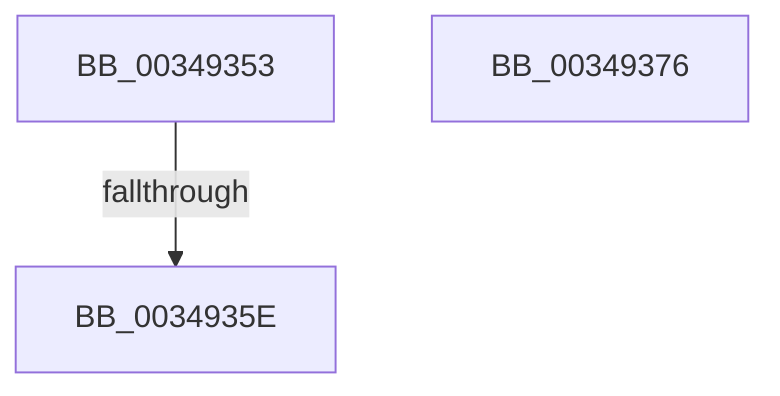

# sub_00349353

- RVA: `0x00349353`–`0x003493AA` (길이 `87` bytes)
- VA: `0x0000000140349353`
- 실행 섹션: `.text`
- PDB 이름 있음: `아니요`; PDB Function 태그: `아니요`
- unwind 정보 RVA: `0x000782F4`
- 디코드: `19`개 명령, `87/87` bytes 표시
- 미해석 바이트: `0` (있으면 어셈블리에 `.byte`로 보존)

> 이 문서는 커널 이미지의 기계어와 PDB 기호를 분석해 생성했습니다. 4번과 5번은 함수 원형과 자료형을 바이너리 사용 방식에서 추정한 C 해석이며 원본 소스 복구 결과는 아닙니다.

## 1. Dependencies

- 직접 호출 지점: **1**; 고유 호출 대상: **1**
- 직접 호출자로 확인된 함수: **0**
- RIP 상대 이미지 참조: **0**

### Outgoing calls
- `0x003493A0` → [MiAddMappedPtesPadding](../4D/MiAddMappedPtesPadding_function_004DA2E8.md) (function, `0x004DA2E8`)

### Direct callers
- 이 함수 시작 RVA로 연결되는 직접 call은 확인되지 않았습니다. 간접 호출은 완전히 역산할 수 없습니다.

### Static image references
- 디코드된 RIP-relative 메모리 참조가 없습니다.

## 2. Other-region calls and transfers

- 다른 실행 섹션으로 향하는 call: **0**
- call이 아닌 외부 분기/꼬리 이동: **3**
  - `0x00349358` → [sub_003490AD + 0x94](Unknown_function_003490AD.md) (`tail-transfer`)
  - `0x00349371` → [sub_003490AD + 0x5A](Unknown_function_003490AD.md) (`tail-transfer`)
  - `0x003493A5` → [sub_003490AD + 0x270](Unknown_function_003490AD.md) (`tail-transfer`)

## 3. Assembly (complete function range)

```asm
00349353  48 3B 74 24 48                  cmp rsi, qword ptr [rsp + 0x48]
00349358  0F 82 E3 FD FF FF               jb 0x140349141
0034935E  48 89 1F                        mov qword ptr [rdi], rbx
00349361  41 FF CE                        dec r14d
00349364  48 83 C7 08                     add rdi, 8
00349368  FF C5                           inc ebp
0034936A  48 83 C6 08                     add rsi, 8
0034936E  48 8B CB                        mov rcx, rbx
00349371  E9 91 FD FF FF                  jmp 0x140349107
00349376  48 8B 44 24 50                  mov rax, qword ptr [rsp + 0x50]
0034937B  4C 8B CF                        mov r9, rdi
0034937E  44 0F B6 84 24 D0 00 00 00      movzx r8d, byte ptr [rsp + 0xd0]
00349387  49 8B CA                        mov rcx, r10
0034938A  48 8B 94 24 B0 00 00 00         mov rdx, qword ptr [rsp + 0xb0]
00349392  89 6C 24 30                     mov dword ptr [rsp + 0x30], ebp
00349396  48 89 44 24 28                  mov qword ptr [rsp + 0x28], rax
0034939B  4C 89 6C 24 20                  mov qword ptr [rsp + 0x20], r13
003493A0  E8 43 0F 19 00                  call 0x1404da2e8
003493A5  E9 73 FF FF FF                  jmp 0x14034931d
```

## 4. C-style interpretation (structured pseudocode)

```c
__int64 __fastcall sub_00349353(__int64 a1, __int64 a2, __int64 a3, __int64 a4, __int64 a5, __int64 a6, __int64 a7, __int64 a8, __int64 a9)
{
    __int64 v_r14;
    __int64 v_rbp;
    __int64 v_rdi;
    __int64 v_rsi;
    unsigned __int64 v_stack_p20;
    unsigned __int64 v_stack_p28;
    unsigned int v_stack_p30;
    unsigned __int64 v_stack_p50;
    unsigned __int64 v_stack_pB0;
    unsigned __int8 v_stack_pD0;

    *(unsigned __int64 *)(v_rdi) = v_rbx;
    v_r14 = (unsigned int)((v_r14) - 1);
    v_rdi = (v_rdi) + (8);
    v_rbp = (unsigned int)((v_rbp) + 1);
    v_rsi = (v_rsi) + (8);
}
```

## 5. (Beta) C Style

```c
int64_t sub_00349353(int64_t Arg1, int64_t Arg2, int64_t Arg3, int64_t Arg4, uint64_t Arg5, uint64_t Arg6, uint64_t Arg7, uint64_t Arg8, int64_t Arg9)
{
    int64_t local_r14;
    int64_t local_rbp;
    int64_t local_rdi;
    int64_t local_rsi;
    uint64_t v_stack_p20;
    uint64_t v_stack_p28;
    uint32_t v_stack_p30;
    uint64_t v_stack_p50;
    uint64_t v_stack_pB0;
    uint8_t v_stack_pD0;

    *(uint64_t *)(local_rdi) = local_rbx;
    local_r14 = (uint32_t)((local_r14) - 1);
    local_rdi = (local_rdi) + (8);
    local_rbp = (uint32_t)((local_rbp) + 1);
    local_rsi = (local_rsi) + (8);
}
```

## 6. Execution-region graph

[열기: 2D/3D 그래프와 함수 탐색 컨트롤 패널](../../../control-panel.html?section=text&rva=0x00349353&view=graph)

- 2D 그래프는 위에서 아래로 흐르고, 3D 그래프는 빈 공간을 드래그해 회전합니다. Shift+드래그는 이동, 휠은 확대·축소, 함수 노드 선택은 대상 보고서 이동입니다.

### Static fallback


