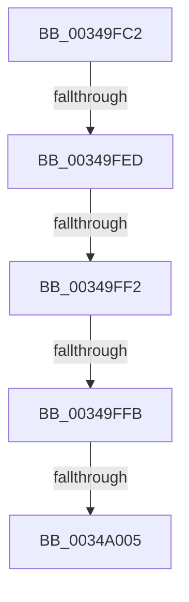

# sub_00349FC2

- RVA: `0x00349FC2`–`0x0034A027` (길이 `101` bytes)
- VA: `0x0000000140349FC2`
- 실행 섹션: `.text`
- PDB 이름 있음: `아니요`; PDB Function 태그: `아니요`
- unwind 정보 RVA: `0x00078430`
- 디코드: `26`개 명령, `101/101` bytes 표시
- 미해석 바이트: `0` (있으면 어셈블리에 `.byte`로 보존)

> 이 문서는 커널 이미지의 기계어와 PDB 기호를 분석해 생성했습니다. 4번과 5번은 함수 원형과 자료형을 바이너리 사용 방식에서 추정한 C 해석이며 원본 소스 복구 결과는 아닙니다.

## 1. Dependencies

- 직접 호출 지점: **0**; 고유 호출 대상: **0**
- 직접 호출자로 확인된 함수: **0**
- RIP 상대 이미지 참조: **0**

### Outgoing calls
- 직접 디코드된 call 명령이 없습니다.

### Direct callers
- 이 함수 시작 RVA로 연결되는 직접 call은 확인되지 않았습니다. 간접 호출은 완전히 역산할 수 없습니다.

### Static image references
- 디코드된 RIP-relative 메모리 참조가 없습니다.

## 2. Other-region calls and transfers

- 다른 실행 섹션으로 향하는 call: **0**
- call이 아닌 외부 분기/꼬리 이동: **5**
  - `0x00349FE7` → [sub_0034A18B](Unknown_function_0034A18B.md) (`tail-transfer`)
  - `0x00349FF0` → [sub_0034A03B + 0x2E](Unknown_function_0034A03B.md) (`tail-transfer`)
  - `0x00349FF9` → [sub_0034A03B](Unknown_function_0034A03B.md) (`tail-transfer`)
  - `0x0034A003` → [sub_0034A03B](Unknown_function_0034A03B.md) (`tail-transfer`)
  - `0x0034A021` → [sub_0034A167](Unknown_function_0034A167.md) (`tail-transfer`)

## 3. Assembly (complete function range)

```asm
00349FC2  48 89 68 08                     mov qword ptr [rax + 8], rbp
00349FC6  4C 8B F1                        mov r14, rcx
00349FC9  33 C9                           xor ecx, ecx
00349FCB  48 89 78 10                     mov qword ptr [rax + 0x10], rdi
00349FCF  4C 89 60 18                     mov qword ptr [rax + 0x18], r12
00349FD3  41 8B E9                        mov ebp, r9d
00349FD6  45 8B F8                        mov r15d, r8d
00349FD9  4C 8B E2                        mov r12, rdx
00349FDC  48 8D 59 FF                     lea rbx, [rcx - 1]
00349FE0  44 8D 69 11                     lea r13d, [rcx + 0x11]
00349FE4  45 85 C9                        test r9d, r9d
00349FE7  0F 84 9E 01 00 00               je 0x14034a18b
00349FED  45 85 FF                        test r15d, r15d
00349FF0  75 77                           jne 0x14034a069
00349FF2  49 8B 76 18                     mov rsi, qword ptr [r14 + 0x18]
00349FF6  48 85 F6                        test rsi, rsi
00349FF9  74 40                           je 0x14034a03b
00349FFB  49 8B 04 24                     mov rax, qword ptr [r12]
00349FFF  48 39 46 08                     cmp qword ptr [rsi + 8], rax
0034A003  75 36                           jne 0x14034a03b
0034A005  33 C9                           xor ecx, ecx
0034A007  4C 8B A4 24 C0 00 00 00         mov r12, qword ptr [rsp + 0xc0]
0034A00F  85 ED                           test ebp, ebp
0034A011  48 8B AC 24 B0 00 00 00         mov rbp, qword ptr [rsp + 0xb0]
0034A019  48 8B BC 24 B8 00 00 00         mov rdi, qword ptr [rsp + 0xb8]
0034A021  0F 84 40 01 00 00               je 0x14034a167
```

## 4. C-style interpretation (structured pseudocode)

```c
__int64 __fastcall sub_00349FC2(__int64 a1, __int64 a2, int a3, int a4, __int64 a5, __int64 a6, __int64 a7, __int64 a8, __int64 a9, __int64 a10, __int64 a11, __int64 a12, __int64 a13, __int64 a14, __int64 a15, __int64 a16, __int64 a17, __int64 a18, __int64 a19, __int64 a20, __int64 a21, __int64 a22, __int64 a23, __int64 a24)
{
    *(unsigned __int64 *)(result + 8) = v_rbp;
    a1 = 0;
    *(unsigned __int64 *)(result + 16) = v_rdi;
    *(unsigned __int64 *)(result + 24) = v_r12;
    a1 = 0;
}
```

## 5. (Beta) C Style

```c
int64_t sub_00349FC2(void *Arg1, void *Arg2, int32_t Arg3, int32_t Arg4, uint64_t Arg5, uint64_t Arg6, uint64_t Arg7, uint64_t Arg8, uint64_t Arg9, uint64_t Arg10, uint64_t Arg11, uint64_t Arg12, uint64_t Arg13, uint64_t Arg14, uint64_t Arg15, uint64_t Arg16, uint64_t Arg17, uint64_t Arg18, uint64_t Arg19, uint64_t Arg20, uint64_t Arg21, int64_t Arg22, int64_t Arg23, int64_t Arg24)
{
    uint8_t *arg1 = (uint8_t *)Arg1;
    uint8_t *arg2 = (uint8_t *)Arg2;

    *(uint64_t *)(result + 0x8) = local_rbp;
    Arg1 = 0;
    *(uint64_t *)(result + 0x10) = local_rdi;
    *(uint64_t *)(result + 0x18) = local_r12;
    Arg1 = 0;
}
```

### 관측된 메모리 오프셋

구조체 형식이 확인되지 않은 접근은 인자 기준의 오프셋으로만 기록했습니다.

| 기준 인자 | 오프셋 표현 | 폭 (bit) | 접근 |
|---|---:|---:|---|
| `Arg1` | `+ 0x18` | `64` | `R` |
| `Arg2` | `+ 0x0` | `64` | `R` |

## 6. Execution-region graph

[열기: 2D/3D 그래프와 함수 탐색 컨트롤 패널](../../../control-panel.html?section=text&rva=0x00349FC2&view=graph)

- 2D 그래프는 위에서 아래로 흐르고, 3D 그래프는 빈 공간을 드래그해 회전합니다. Shift+드래그는 이동, 휠은 확대·축소, 함수 노드 선택은 대상 보고서 이동입니다.

### Static fallback


