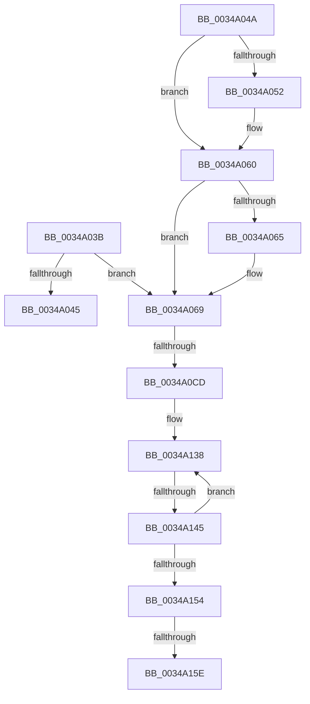

# sub_0034A03B

- RVA: `0x0034A03B`–`0x0034A167` (길이 `300` bytes)
- VA: `0x000000014034A03B`
- 실행 섹션: `.text`
- PDB 이름 있음: `아니요`; PDB Function 태그: `아니요`
- unwind 정보 RVA: `0x00078460`
- 디코드: `81`개 명령, `300/300` bytes 표시
- 미해석 바이트: `0` (있으면 어셈블리에 `.byte`로 보존)

> 이 문서는 커널 이미지의 기계어와 PDB 기호를 분석해 생성했습니다. 4번과 5번은 함수 원형과 자료형을 바이너리 사용 방식에서 추정한 C 해석이며 원본 소스 복구 결과는 아닙니다.

## 1. Dependencies

- 직접 호출 지점: **1**; 고유 호출 대상: **1**
- 직접 호출자로 확인된 함수: **0**
- RIP 상대 이미지 참조: **0**

### Outgoing calls
- `0x0034A05B` → [ExfAcquirePushLockExclusiveEx](../20/ExfAcquirePushLockExclusiveEx_function_0020FC90.md) (function, `0x0020FC90`)

### Direct callers
- 이 함수 시작 RVA로 연결되는 직접 call은 확인되지 않았습니다. 간접 호출은 완전히 역산할 수 없습니다.

### Static image references
- 디코드된 RIP-relative 메모리 참조가 없습니다.

## 2. Other-region calls and transfers

- 다른 실행 섹션으로 향하는 call: **0**
- call이 아닌 외부 분기/꼬리 이동: **5**
  - `0x0034A048` → [sub_00349FC2 + 0x43](Unknown_function_00349FC2.md) (`tail-transfer`)
  - `0x0034A0C7` → [sub_0034A18B + 0x57](Unknown_function_0034A18B.md) (`tail-transfer`)
  - `0x0034A13F` → [sub_0034A18B + 0x57](Unknown_function_0034A18B.md) (`tail-transfer`)
  - `0x0034A158` → [sub_0034A229](Unknown_function_0034A229.md) (`tail-transfer`)
  - `0x0034A162` → [sub_00349FC2 + 0x43](Unknown_function_00349FC2.md) (`tail-transfer`)

## 3. Assembly (complete function range)

```asm
0034A03B  49 8B 46 20                     mov rax, qword ptr [r14 + 0x20]
0034A03F  49 39 04 24                     cmp qword ptr [r12], rax
0034A043  75 24                           jne 0x14034a069
0034A045  48 8B F1                        mov rsi, rcx
0034A048  EB BB                           jmp 0x14034a005
0034A04A  F0 49 0F BA 2E 00               lock bts qword ptr [r14], 0
0034A050  73 0E                           jae 0x14034a060
0034A052  4D 8B C6                        mov r8, r14
0034A055  48 8B D7                        mov rdx, rdi
0034A058  49 8B CE                        mov rcx, r14
0034A05B  E8 30 5C EC FF                  call 0x14020fc90
0034A060  48 85 FF                        test rdi, rdi
0034A063  74 04                           je 0x14034a069
0034A065  C6 47 0A 01                     mov byte ptr [rdi + 0xa], 1
0034A069  45 8B 46 0C                     mov r8d, dword ptr [r14 + 0xc]
0034A06D  4C 8B CB                        mov r9, rbx
0034A070  41 8B C8                        mov ecx, r8d
0034A073  41 C1 E8 05                     shr r8d, 5
0034A077  83 E1 1F                        and ecx, 0x1f
0034A07A  49 D3 E1                        shl r9, cl
0034A07D  49 8B F9                        mov rdi, r9
0034A080  49 23 3C 24                     and rdi, qword ptr [r12]
0034A084  48 8B C7                        mov rax, rdi
0034A087  4C 8B D7                        mov r10, rdi
0034A08A  48 C1 E8 20                     shr rax, 0x20
0034A08E  4C 8B DF                        mov r11, rdi
0034A091  48 89 44 24 30                  mov qword ptr [rsp + 0x30], rax
0034A096  48 8B F7                        mov rsi, rdi
0034A099  48 8B C7                        mov rax, rdi
0034A09C  49 C1 EA 38                     shr r10, 0x38
0034A0A0  48 C1 E8 18                     shr rax, 0x18
0034A0A4  48 8B D7                        mov rdx, rdi
0034A0A7  48 89 44 24 28                  mov qword ptr [rsp + 0x28], rax
0034A0AC  48 8B C7                        mov rax, rdi
0034A0AF  48 C1 E8 10                     shr rax, 0x10
0034A0B3  49 C1 EB 30                     shr r11, 0x30
0034A0B7  48 C1 EE 28                     shr rsi, 0x28
0034A0BB  48 C1 EA 08                     shr rdx, 8
0034A0BF  48 89 44 24 20                  mov qword ptr [rsp + 0x20], rax
0034A0C4  45 85 C0                        test r8d, r8d
0034A0C7  0F 84 15 01 00 00               je 0x14034a1e2
0034A0CD  40 0F B6 C7                     movzx eax, dil
0034A0D1  48 05 CB 5D B1 00               add rax, 0xb15dcb
0034A0D7  48 89 7C 24 38                  mov qword ptr [rsp + 0x38], rdi
0034A0DC  48 6B C8 25                     imul rcx, rax, 0x25
0034A0E0  0F B6 C2                        movzx eax, dl
0034A0E3  48 03 C8                        add rcx, rax
0034A0E6  0F B6 44 24 20                  movzx eax, byte ptr [rsp + 0x20]
0034A0EB  48 6B D1 25                     imul rdx, rcx, 0x25
0034A0EF  48 03 D0                        add rdx, rax
0034A0F2  0F B6 44 24 28                  movzx eax, byte ptr [rsp + 0x28]
0034A0F7  48 6B CA 25                     imul rcx, rdx, 0x25
0034A0FB  48 03 C8                        add rcx, rax
0034A0FE  0F B6 44 24 30                  movzx eax, byte ptr [rsp + 0x30]
0034A103  48 6B D1 25                     imul rdx, rcx, 0x25
0034A107  48 03 D0                        add rdx, rax
0034A10A  40 0F B6 C6                     movzx eax, sil
0034A10E  48 6B CA 25                     imul rcx, rdx, 0x25
0034A112  48 03 C8                        add rcx, rax
0034A115  41 0F B6 C3                     movzx eax, r11b
0034A119  48 6B D1 25                     imul rdx, rcx, 0x25
0034A11D  48 03 D0                        add rdx, rax
0034A120  48 6B C2 25                     imul rax, rdx, 0x25
0034A124  41 8D 50 FF                     lea edx, [r8 - 1]
0034A128  49 03 C2                        add rax, r10
0034A12B  8B C0                           mov eax, eax
0034A12D  48 23 D0                        and rdx, rax
0034A130  49 8B 46 10                     mov rax, qword ptr [r14 + 0x10]
0034A134  48 8D 34 D0                     lea rsi, [rax + rdx*8]
0034A138  48 8B 36                        mov rsi, qword ptr [rsi]
0034A13B  40 F6 C6 01                     test sil, 1
0034A13F  0F 85 9D 00 00 00               jne 0x14034a1e2
0034A145  48 8B 56 08                     mov rdx, qword ptr [rsi + 8]
0034A149  48 8B C2                        mov rax, rdx
0034A14C  49 23 C1                        and rax, r9
0034A14F  48 3B F8                        cmp rdi, rax
0034A152  75 E4                           jne 0x14034a138
0034A154  41 83 FF 02                     cmp r15d, 2
0034A158  0F 84 CB 00 00 00               je 0x14034a229
0034A15E  49 89 76 18                     mov qword ptr [r14 + 0x18], rsi
0034A162  E9 9E FE FF FF                  jmp 0x14034a005
```

## 4. C-style interpretation (structured pseudocode)

```c
__int64 __fastcall sub_0034A03B(__int64 a1, __int64 a2, __int64 a3, __int64 a4, unsigned __int8 a5, unsigned __int8 a6)
{
    __int64 result;
    __int64 v_r10;
    __int64 v_r11;
    __int64 v_rdi;
    __int64 v_rsi;
    unsigned __int64 v_stack_p20;
    unsigned __int64 v_stack_p28;
    unsigned __int64 v_stack_p30;
    unsigned __int64 v_stack_p38;

    if ((*(unsigned __int64 *)(v_r12)) != (*(unsigned __int64 *)(v_r14 + 32))) goto loc_0034A069;
loc_0034A069:
    a3 = (unsigned int)(((unsigned int)(*(unsigned int *)(v_r14 + 12))) >> (5));
    a1 = (unsigned int)(((unsigned int)((unsigned int)((unsigned int)(*(unsigned int *)(v_r14 + 12))))) & (31));
    a4 = (v_rbx) << ((unsigned __int8)(a1));
    v_rdi = (a4) & (*(unsigned __int64 *)(v_r12));
    result = (v_rdi) >> (32);
    v_stack_p30 = result;
    v_r10 = (v_rdi) >> (56);
    result = (v_rdi) >> (24);
    v_stack_p28 = result;
    result = (v_rdi) >> (16);
    v_r11 = (v_rdi) >> (48);
    v_rsi = (v_rdi) >> (40);
    a2 = (v_rdi) >> (8);
    v_stack_p20 = result;
    result = ((unsigned __int8)(v_rdi)) + (0xB15DCBULL);
    v_stack_p38 = v_rdi;
    a1 = (a1) * (result);
    a1 = (a1) + ((unsigned __int8)(a2));
    a2 = (a2) * (a1);
    a2 = (a2) + (v_stack_p20);
    a1 = (a1) * (a2);
    a1 = (a1) + (a5);
    a2 = (a2) * (a1);
    a2 = (a2) + (a6);
    a1 = (a1) * (a2);
    a1 = (a1) + ((unsigned __int8)(v_rsi));
    a2 = (a2) * (a1);
    a2 = (a2) + ((unsigned __int8)(v_r11));
    result = ((unsigned __int8)(v_r11)) * (a2);
    result = (result) + (v_r10);
    a2 = (a3 - 1) & ((unsigned int)((unsigned int)(result)));
loc_0034A138:
    result = (*(unsigned __int64 *)(*(unsigned __int64 *)(*(unsigned __int64 *)(v_r14 + 16) + a2 * 8) + 8)) & (a4);
    if (v_rdi != result) goto loc_0034A138;
    *(unsigned __int64 *)(v_r14 + 24) = *(unsigned __int64 *)(*(unsigned __int64 *)(v_r14 + 16) + a2 * 8);
}
```

## 5. (Beta) C Style

```c
int64_t sub_0034A03B(int64_t Arg1, int64_t Arg2, int64_t Arg3, int64_t Arg4, uint8_t Arg5, uint8_t Arg6)
{
    int64_t result;
    int64_t local_r10;
    int64_t local_r11;
    int64_t local_rdi;
    int64_t local_rsi;
    uint64_t v_stack_p20;
    uint64_t v_stack_p28;
    uint64_t v_stack_p30;
    uint64_t v_stack_p38;

    if ((*(uint64_t *)(local_r12)) != (*(uint64_t *)(local_r14 + 0x20))) goto loc_0034A069;
loc_0034A069:
    Arg3 = (uint32_t)(((uint32_t)(*(uint32_t *)(local_r14 + 0xC))) >> (5));
    Arg1 = (uint32_t)(((uint32_t)((uint32_t)((uint32_t)(*(uint32_t *)(local_r14 + 0xC))))) & (31));
    Arg4 = (local_rbx) << ((uint8_t)(Arg1));
    local_rdi = (Arg4) & (*(uint64_t *)(local_r12));
    result = (local_rdi) >> (32);
    v_stack_p30 = result;
    local_r10 = (local_rdi) >> (56);
    result = (local_rdi) >> (24);
    v_stack_p28 = result;
    result = (local_rdi) >> (16);
    local_r11 = (local_rdi) >> (48);
    local_rsi = (local_rdi) >> (40);
    Arg2 = (local_rdi) >> (8);
    v_stack_p20 = result;
    result = ((uint8_t)(local_rdi)) + (0xB15DCBULL);
    v_stack_p38 = local_rdi;
    Arg1 = (Arg1) * (result);
    Arg1 = (Arg1) + ((uint8_t)(Arg2));
    Arg2 = (Arg2) * (Arg1);
    Arg2 = (Arg2) + (v_stack_p20);
    Arg1 = (Arg1) * (Arg2);
    Arg1 = (Arg1) + (Arg5);
    Arg2 = (Arg2) * (Arg1);
    Arg2 = (Arg2) + (Arg6);
    Arg1 = (Arg1) * (Arg2);
    Arg1 = (Arg1) + ((uint8_t)(local_rsi));
    Arg2 = (Arg2) * (Arg1);
    Arg2 = (Arg2) + ((uint8_t)(local_r11));
    result = ((uint8_t)(local_r11)) * (Arg2);
    result = (result) + (local_r10);
    Arg2 = (Arg3 - 1) & ((uint32_t)((uint32_t)(result)));
loc_0034A138:
    result = (*(uint64_t *)(*(uint64_t *)(*(uint64_t *)(local_r14 + 0x10) + Arg2 * 8) + 0x8)) & (Arg4);
    if (local_rdi != result) goto loc_0034A138;
    *(uint64_t *)(local_r14 + 0x18) = *(uint64_t *)(*(uint64_t *)(local_r14 + 0x10) + Arg2 * 8);
}
```

## 6. Execution-region graph

[열기: 2D/3D 그래프와 함수 탐색 컨트롤 패널](../../../control-panel.html?section=text&rva=0x0034A03B&view=graph)

- 2D 그래프는 위에서 아래로 흐르고, 3D 그래프는 빈 공간을 드래그해 회전합니다. Shift+드래그는 이동, 휠은 확대·축소, 함수 노드 선택은 대상 보고서 이동입니다.

### Static fallback


