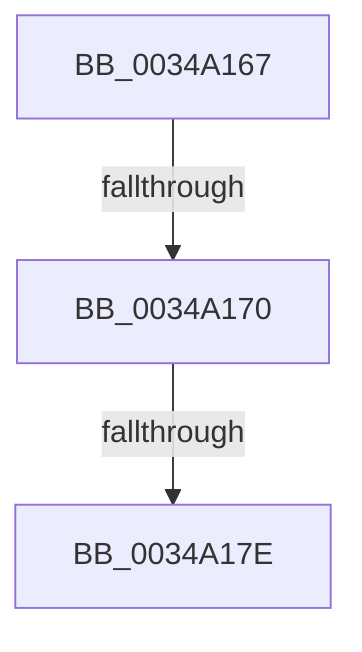

# sub_0034A167

- RVA: `0x0034A167`–`0x0034A18B` (길이 `36` bytes)
- VA: `0x000000014034A167`
- 실행 섹션: `.text`
- PDB 이름 있음: `아니요`; PDB Function 태그: `아니요`
- unwind 정보 RVA: `0x0007847C`
- 디코드: `8`개 명령, `36/36` bytes 표시
- 미해석 바이트: `0` (있으면 어셈블리에 `.byte`로 보존)

> 이 문서는 커널 이미지의 기계어와 PDB 기호를 분석해 생성했습니다. 4번과 5번은 함수 원형과 자료형을 바이너리 사용 방식에서 추정한 C 해석이며 원본 소스 복구 결과는 아닙니다.

## 1. Dependencies

- 직접 호출 지점: **1**; 고유 호출 대상: **1**
- 직접 호출자로 확인된 함수: **0**
- RIP 상대 이미지 참조: **0**

### Outgoing calls
- `0x0034A181` → [ExfReleasePushLockShared](../26/ExfReleasePushLockShared_function_00263440.md) (function, `0x00263440`)

### Direct callers
- 이 함수 시작 RVA로 연결되는 직접 call은 확인되지 않았습니다. 간접 호출은 완전히 역산할 수 없습니다.

### Static image references
- 디코드된 RIP-relative 메모리 참조가 없습니다.

## 2. Other-region calls and transfers

- 다른 실행 섹션으로 향하는 call: **0**
- call이 아닌 외부 분기/꼬리 이동: **3**
  - `0x0034A16A` → [sub_0034A1FD](Unknown_function_0034A1FD.md) (`tail-transfer`)
  - `0x0034A178` → [sub_0034A1FD + 0x11](Unknown_function_0034A1FD.md) (`tail-transfer`)
  - `0x0034A186` → [sub_0034A1FD + 0x11](Unknown_function_0034A1FD.md) (`tail-transfer`)

## 3. Assembly (complete function range)

```asm
0034A167  45 85 FF                        test r15d, r15d
0034A16A  0F 8F 8D 00 00 00               jg 0x14034a1fd
0034A170  49 8B C5                        mov rax, r13
0034A173  F0 49 0F B1 0E                  lock cmpxchg qword ptr [r14], rcx
0034A178  0F 84 90 00 00 00               je 0x14034a20e
0034A17E  49 8B CE                        mov rcx, r14
0034A181  E8 BA 92 F1 FF                  call 0x140263440
0034A186  E9 83 00 00 00                  jmp 0x14034a20e
```

## 4. C-style interpretation (structured pseudocode)

```c
__int64 __fastcall sub_0034A167(__int64 a1)
{
    __int64 result;

    result = ExfReleasePushLockShared(v_r14, a2, a3, a4);
}
```

## 5. (Beta) C Style

```c
int64_t sub_0034A167(int64_t Arg1)
{
    int64_t result;

    result = ExfReleasePushLockShared(local_r14, a2, a3, a4);
}
```

## 6. Execution-region graph

[열기: 2D/3D 그래프와 함수 탐색 컨트롤 패널](../../../control-panel.html?section=text&rva=0x0034A167&view=graph)

- 2D 그래프는 위에서 아래로 흐르고, 3D 그래프는 빈 공간을 드래그해 회전합니다. Shift+드래그는 이동, 휠은 확대·축소, 함수 노드 선택은 대상 보고서 이동입니다.

### Static fallback


