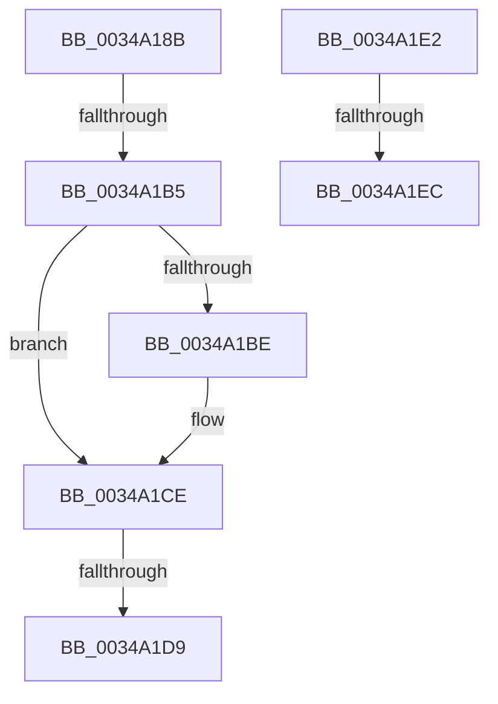

# sub_0034A18B

- RVA: `0x0034A18B`–`0x0034A1FD` (길이 `114` bytes)
- VA: `0x000000014034A18B`
- 실행 섹션: `.text`
- PDB 이름 있음: `아니요`; PDB Function 태그: `아니요`
- unwind 정보 RVA: `0x0007848C`
- 디코드: `30`개 명령, `114/114` bytes 표시
- 미해석 바이트: `0` (있으면 어셈블리에 `.byte`로 보존)

> 이 문서는 커널 이미지의 기계어와 PDB 기호를 분석해 생성했습니다. 4번과 5번은 함수 원형과 자료형을 바이너리 사용 방식에서 추정한 C 해석이며 원본 소스 복구 결과는 아닙니다.

## 1. Dependencies

- 직접 호출 지점: **2**; 고유 호출 대상: **2**
- 직접 호출자로 확인된 함수: **0**
- RIP 상대 이미지 참조: **0**

### Outgoing calls
- `0x0034A1A4` → [KeAbPreAcquire](../21/KeAbPreAcquire_function_00210230.md) (function, `0x00210230`)
- `0x0034A1C9` → [ExfAcquirePushLockSharedEx](../21/ExfAcquirePushLockSharedEx_function_0021044C.md) (function, `0x0021044C`)

### Direct callers
- 이 함수 시작 RVA로 연결되는 직접 call은 확인되지 않았습니다. 간접 호출은 완전히 역산할 수 없습니다.

### Static image references
- 디코드된 RIP-relative 메모리 참조가 없습니다.

## 2. Other-region calls and transfers

- 다른 실행 섹션으로 향하는 call: **0**
- call이 아닌 외부 분기/꼬리 이동: **5**
  - `0x0034A1AF` → [sub_0034A03B + 0xF](Unknown_function_0034A03B.md) (`tail-transfer`)
  - `0x0034A1D3` → [sub_00349FC2 + 0x2B](Unknown_function_00349FC2.md) (`tail-transfer`)
  - `0x0034A1DD` → [sub_00349FC2 + 0x2B](Unknown_function_00349FC2.md) (`tail-transfer`)
  - `0x0034A1E6` → [sub_0034A229 + 0x101](Unknown_function_0034A229.md) (`tail-transfer`)
  - `0x0034A1F8` → [sub_00349FC2 + 0x45](Unknown_function_00349FC2.md) (`tail-transfer`)

## 3. Assembly (complete function range)

```asm
0034A18B  65 48 8B 04 25 88 01 00 00      mov rax, qword ptr gs:[0x188]
0034A194  45 33 C0                        xor r8d, r8d
0034A197  33 D2                           xor edx, edx
0034A199  49 8B CE                        mov rcx, r14
0034A19C  66 FF 88 E4 01 00 00            dec word ptr [rax + 0x1e4]
0034A1A3  90                              nop
0034A1A4  E8 87 60 EC FF                  call 0x140210230
0034A1A9  48 8B F8                        mov rdi, rax
0034A1AC  45 85 FF                        test r15d, r15d
0034A1AF  0F 8F 95 FE FF FF               jg 0x14034a04a
0034A1B5  33 C0                           xor eax, eax
0034A1B7  F0 4D 0F B1 2E                  lock cmpxchg qword ptr [r14], r13
0034A1BC  74 10                           je 0x14034a1ce
0034A1BE  4D 8B CE                        mov r9, r14
0034A1C1  4C 8B C7                        mov r8, rdi
0034A1C4  33 D2                           xor edx, edx
0034A1C6  49 8B CE                        mov rcx, r14
0034A1C9  E8 7E 62 EC FF                  call 0x14021044c
0034A1CE  33 C9                           xor ecx, ecx
0034A1D0  48 85 FF                        test rdi, rdi
0034A1D3  0F 84 14 FE FF FF               je 0x140349fed
0034A1D9  C6 47 0A 01                     mov byte ptr [rdi + 0xa], 1
0034A1DD  E9 0B FE FF FF                  jmp 0x140349fed
0034A1E2  41 83 FF 01                     cmp r15d, 1
0034A1E6  0F 84 3E 01 00 00               je 0x14034a32a
0034A1EC  49 8B 04 24                     mov rax, qword ptr [r12]
0034A1F0  33 C9                           xor ecx, ecx
0034A1F2  49 89 46 20                     mov qword ptr [r14 + 0x20], rax
0034A1F6  8B F1                           mov esi, ecx
0034A1F8  E9 0A FE FF FF                  jmp 0x14034a007
```

## 4. C-style interpretation (structured pseudocode)

```c
__int64 __fastcall sub_0034A18B(__int64 a1, int a2, int a3)
{
    __int64 result;

    a3 = 0;
    a2 = 0;
    result = KeAbPreAcquire(v_r14, a2, a3, a4);
    result = 0;
    if (!(condition_is_equal)) {
        a4 = v_r14;
        a3 = 0;
        a2 = 0;
        a1 = v_r14;
        result = ExfAcquirePushLockSharedEx(a1, a2, a3, a4);
    }
    a1 = 0;
    *(unsigned __int8 *)(result + 10) = 1;
}
```

## 5. (Beta) C Style

```c
int64_t sub_0034A18B(int64_t Arg1, int32_t Arg2, int32_t Arg3)
{
    int64_t result;

    Arg3 = 0;
    Arg2 = 0;
    result = KeAbPreAcquire(local_r14, Arg2, Arg3, a4);
    result = 0;
    if (!(condition_is_equal)) {
        a4 = local_r14;
        Arg3 = 0;
        Arg2 = 0;
        Arg1 = local_r14;
        result = ExfAcquirePushLockSharedEx(Arg1, Arg2, Arg3, a4);
    }
    Arg1 = 0;
    *(uint8_t *)(result + 0xA) = 1;
}
```

## 6. Execution-region graph

[열기: 2D/3D 그래프와 함수 탐색 컨트롤 패널](../../../control-panel.html?section=text&rva=0x0034A18B&view=graph)

- 2D 그래프는 위에서 아래로 흐르고, 3D 그래프는 빈 공간을 드래그해 회전합니다. Shift+드래그는 이동, 휠은 확대·축소, 함수 노드 선택은 대상 보고서 이동입니다.

### Static fallback


