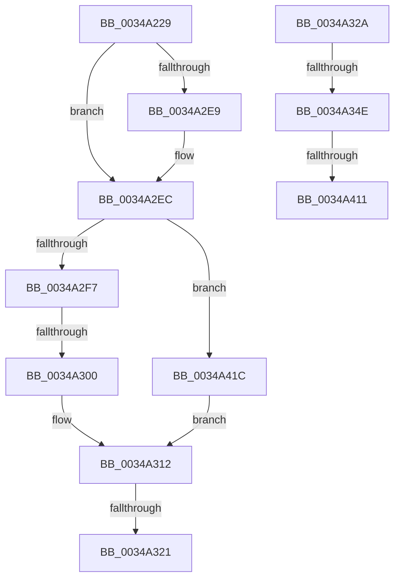

# sub_0034A229

- RVA: `0x0034A229`–`0x0034A424` (길이 `507` bytes)
- VA: `0x000000014034A229`
- 실행 섹션: `.text`
- PDB 이름 있음: `아니요`; PDB Function 태그: `아니요`
- unwind 정보 RVA: `0x000784B8`
- 디코드: `140`개 명령, `507/507` bytes 표시
- 미해석 바이트: `0` (있으면 어셈블리에 `.byte`로 보존)

> 이 문서는 커널 이미지의 기계어와 PDB 기호를 분석해 생성했습니다. 4번과 5번은 함수 원형과 자료형을 바이너리 사용 방식에서 추정한 C 해석이며 원본 소스 복구 결과는 아닙니다.

## 1. Dependencies

- 직접 호출 지점: **0**; 고유 호출 대상: **0**
- 직접 호출자로 확인된 함수: **0**
- RIP 상대 이미지 참조: **0**

### Outgoing calls
- 직접 디코드된 call 명령이 없습니다.

### Direct callers
- 이 함수 시작 RVA로 연결되는 직접 call은 확인되지 않았습니다. 간접 호출은 완전히 역산할 수 없습니다.

### Static image references
- 디코드된 RIP-relative 메모리 참조가 없습니다.

## 2. Other-region calls and transfers

- 다른 실행 섹션으로 향하는 call: **0**
- call이 아닌 외부 분기/꼬리 이동: **6**
  - `0x0034A2FA` → [sub_0034A431](Unknown_function_0034A431.md) (`tail-transfer`)
  - `0x0034A31B` → [sub_00349FC2 + 0x45](Unknown_function_00349FC2.md) (`tail-transfer`)
  - `0x0034A325` → [sub_00349FC2 + 0x45](Unknown_function_00349FC2.md) (`tail-transfer`)
  - `0x0034A348` → [sub_0034A431 + 0x8](Unknown_function_0034A431.md) (`tail-transfer`)
  - `0x0034A40B` → [sub_00349FC2 + 0x43](Unknown_function_00349FC2.md) (`tail-transfer`)
  - `0x0034A417` → [sub_00349FC2 + 0x45](Unknown_function_00349FC2.md) (`tail-transfer`)

## 3. Assembly (complete function range)

```asm
0034A229  45 8B 46 0C                     mov r8d, dword ptr [r14 + 0xc]
0034A22D  48 8B FB                        mov rdi, rbx
0034A230  41 8B C8                        mov ecx, r8d
0034A233  45 33 D2                        xor r10d, r10d
0034A236  83 E1 1F                        and ecx, 0x1f
0034A239  41 C1 E8 05                     shr r8d, 5
0034A23D  48 D3 E7                        shl rdi, cl
0034A240  48 23 FA                        and rdi, rdx
0034A243  40 0F B6 C7                     movzx eax, dil
0034A247  48 05 CB 5D B1 00               add rax, 0xb15dcb
0034A24D  48 89 7C 24 48                  mov qword ptr [rsp + 0x48], rdi
0034A252  48 6B C8 25                     imul rcx, rax, 0x25
0034A256  48 8B C7                        mov rax, rdi
0034A259  48 C1 E8 08                     shr rax, 8
0034A25D  0F B6 C0                        movzx eax, al
0034A260  48 03 C8                        add rcx, rax
0034A263  48 8B C7                        mov rax, rdi
0034A266  48 C1 E8 10                     shr rax, 0x10
0034A26A  0F B6 C0                        movzx eax, al
0034A26D  48 6B D1 25                     imul rdx, rcx, 0x25
0034A271  48 03 D0                        add rdx, rax
0034A274  48 8B C7                        mov rax, rdi
0034A277  48 C1 E8 18                     shr rax, 0x18
0034A27B  0F B6 C0                        movzx eax, al
0034A27E  48 6B CA 25                     imul rcx, rdx, 0x25
0034A282  48 03 C8                        add rcx, rax
0034A285  48 8B C7                        mov rax, rdi
0034A288  48 C1 E8 20                     shr rax, 0x20
0034A28C  0F B6 C0                        movzx eax, al
0034A28F  48 6B D1 25                     imul rdx, rcx, 0x25
0034A293  48 03 D0                        add rdx, rax
0034A296  48 8B C7                        mov rax, rdi
0034A299  48 C1 E8 28                     shr rax, 0x28
0034A29D  0F B6 C0                        movzx eax, al
0034A2A0  48 6B CA 25                     imul rcx, rdx, 0x25
0034A2A4  48 03 C8                        add rcx, rax
0034A2A7  48 8B C7                        mov rax, rdi
0034A2AA  48 C1 E8 30                     shr rax, 0x30
0034A2AE  0F B6 C0                        movzx eax, al
0034A2B1  48 6B D1 25                     imul rdx, rcx, 0x25
0034A2B5  48 C1 EF 38                     shr rdi, 0x38
0034A2B9  41 8D 48 FF                     lea ecx, [r8 - 1]
0034A2BD  48 03 D0                        add rdx, rax
0034A2C0  48 6B C2 25                     imul rax, rdx, 0x25
0034A2C4  48 03 C7                        add rax, rdi
0034A2C7  48 BF 02 00 00 00 00 00 00 80   movabs rdi, 0x8000000000000002
0034A2D1  8B C0                           mov eax, eax
0034A2D3  48 23 C8                        and rcx, rax
0034A2D6  49 8B 46 10                     mov rax, qword ptr [r14 + 0x10]
0034A2DA  48 8D 14 C8                     lea rdx, [rax + rcx*8]
0034A2DE  48 8B 06                        mov rax, qword ptr [rsi]
0034A2E1  48 23 C7                        and rax, rdi
0034A2E4  48 3B C7                        cmp rax, rdi
0034A2E7  75 03                           jne 0x14034a2ec
0034A2E9  49 8B 02                        mov rax, qword ptr [r10]
0034A2EC  48 8B 02                        mov rax, qword ptr [rdx]
0034A2EF  A8 01                           test al, 1
0034A2F1  0F 85 25 01 00 00               jne 0x14034a41c
0034A2F7  48 3B C6                        cmp rax, rsi
0034A2FA  0F 85 31 01 00 00               jne 0x14034a431
0034A300  48 8B 06                        mov rax, qword ptr [rsi]
0034A303  B9 FF FF FF FF                  mov ecx, 0xffffffff
0034A308  48 89 02                        mov qword ptr [rdx], rax
0034A30B  41 01 4E 08                     add dword ptr [r14 + 8], ecx
0034A30F  48 09 3E                        or qword ptr [rsi], rdi
0034A312  49 8B 46 18                     mov rax, qword ptr [r14 + 0x18]
0034A316  33 C9                           xor ecx, ecx
0034A318  48 3B C6                        cmp rax, rsi
0034A31B  0F 85 E6 FC FF FF               jne 0x14034a007
0034A321  4D 89 56 18                     mov qword ptr [r14 + 0x18], r10
0034A325  E9 DD FC FF FF                  jmp 0x14034a007
0034A32A  4D 8D 4E 08                     lea r9, [r14 + 8]
0034A32E  41 8B 79 04                     mov edi, dword ptr [r9 + 4]
0034A332  49 8D 41 04                     lea rax, [r9 + 4]
0034A336  C1 EF 05                        shr edi, 5
0034A339  49 8D 74 24 F8                  lea rsi, [r12 - 8]
0034A33E  03 FF                           add edi, edi
0034A340  48 89 44 24 30                  mov qword ptr [rsp + 0x30], rax
0034A345  41 39 39                        cmp dword ptr [r9], edi
0034A348  0F 83 EB 00 00 00               jae 0x14034a439
0034A34E  41 8B 49 04                     mov ecx, dword ptr [r9 + 4]
0034A352  48 8B FB                        mov rdi, rbx
0034A355  44 8B C1                        mov r8d, ecx
0034A358  83 E1 1F                        and ecx, 0x1f
0034A35B  48 D3 E7                        shl rdi, cl
0034A35E  49 23 3C 24                     and rdi, qword ptr [r12]
0034A362  48 8B C7                        mov rax, rdi
0034A365  41 C1 E8 05                     shr r8d, 5
0034A369  48 C1 E8 08                     shr rax, 8
0034A36D  0F B6 C8                        movzx ecx, al
0034A370  40 0F B6 C7                     movzx eax, dil
0034A374  48 05 CB 5D B1 00               add rax, 0xb15dcb
0034A37A  48 89 7C 24 58                  mov qword ptr [rsp + 0x58], rdi
0034A37F  48 6B C0 25                     imul rax, rax, 0x25
0034A383  48 03 C8                        add rcx, rax
0034A386  48 8B C7                        mov rax, rdi
0034A389  48 C1 E8 10                     shr rax, 0x10
0034A38D  0F B6 C0                        movzx eax, al
0034A390  48 6B D1 25                     imul rdx, rcx, 0x25
0034A394  48 03 D0                        add rdx, rax
0034A397  48 8B C7                        mov rax, rdi
0034A39A  48 C1 E8 18                     shr rax, 0x18
0034A39E  0F B6 C0                        movzx eax, al
0034A3A1  48 6B CA 25                     imul rcx, rdx, 0x25
0034A3A5  48 03 C8                        add rcx, rax
0034A3A8  48 8B C7                        mov rax, rdi
0034A3AB  48 C1 E8 20                     shr rax, 0x20
0034A3AF  0F B6 C0                        movzx eax, al
0034A3B2  48 6B D1 25                     imul rdx, rcx, 0x25
0034A3B6  48 03 D0                        add rdx, rax
0034A3B9  48 8B C7                        mov rax, rdi
0034A3BC  48 C1 E8 28                     shr rax, 0x28
0034A3C0  0F B6 C0                        movzx eax, al
0034A3C3  48 6B CA 25                     imul rcx, rdx, 0x25
0034A3C7  48 03 C8                        add rcx, rax
0034A3CA  48 8B C7                        mov rax, rdi
0034A3CD  48 C1 E8 30                     shr rax, 0x30
0034A3D1  0F B6 C0                        movzx eax, al
0034A3D4  48 6B D1 25                     imul rdx, rcx, 0x25
0034A3D8  48 C1 EF 38                     shr rdi, 0x38
0034A3DC  41 8D 48 FF                     lea ecx, [r8 - 1]
0034A3E0  48 03 D0                        add rdx, rax
0034A3E3  48 6B C2 25                     imul rax, rdx, 0x25
0034A3E7  48 03 C7                        add rax, rdi
0034A3EA  8B C0                           mov eax, eax
0034A3EC  48 23 C8                        and rcx, rax
0034A3EF  49 8B 41 08                     mov rax, qword ptr [r9 + 8]
0034A3F3  48 8D 0C C8                     lea rcx, [rax + rcx*8]
0034A3F7  48 8B 01                        mov rax, qword ptr [rcx]
0034A3FA  48 89 06                        mov qword ptr [rsi], rax
0034A3FD  48 89 31                        mov qword ptr [rcx], rsi
0034A400  41 FF 01                        inc dword ptr [r9]
0034A403  49 8B 46 20                     mov rax, qword ptr [r14 + 0x20]
0034A407  49 3B 04 24                     cmp rax, qword ptr [r12]
0034A40B  0F 85 F4 FB FF FF               jne 0x14034a005
0034A411  33 C9                           xor ecx, ecx
0034A413  49 89 4E 20                     mov qword ptr [r14 + 0x20], rcx
0034A417  E9 EB FB FF FF                  jmp 0x14034a007
0034A41C  49 8B 02                        mov rax, qword ptr [r10]
0034A41F  E9 EE FE FF FF                  jmp 0x14034a312
```

## 4. C-style interpretation (structured pseudocode)

```c
__int64 __fastcall sub_0034A229(__int64 a1, __int64 a2)
{
    __int64 result;
    __int64 v_r10;
    __int64 v_rdi;
    unsigned __int64 v_stack_p30;
    unsigned __int64 v_stack_p48;
    unsigned __int64 v_stack_p58;

    v_r10 = 0;
    a1 = (unsigned int)(((unsigned int)((unsigned int)((unsigned int)(*(unsigned int *)(v_r14 + 12))))) & (31));
    a3 = (unsigned int)(((unsigned int)(*(unsigned int *)(v_r14 + 12))) >> (5));
    v_rdi = (v_rbx) << ((unsigned __int8)(a1));
    v_rdi = (v_rdi) & (a2);
    result = ((unsigned __int8)(v_rdi)) + (0xB15DCBULL);
    v_stack_p48 = v_rdi;
    a1 = (a1) * (result);
    result = (v_rdi) >> (8);
    a1 = (a1) + ((unsigned __int8)(result));
    result = (v_rdi) >> (16);
    a2 = (a2) * (a1);
    a2 = (a2) + ((unsigned __int8)(result));
    result = (v_rdi) >> (24);
    a1 = (a1) * (a2);
    a1 = (a1) + ((unsigned __int8)(result));
    result = (v_rdi) >> (32);
    a2 = (a2) * (a1);
    a2 = (a2) + ((unsigned __int8)(result));
    result = (v_rdi) >> (40);
    a1 = (a1) * (a2);
    a1 = (a1) + ((unsigned __int8)(result));
    result = (v_rdi) >> (48);
    a2 = (a2) * (a1);
    v_rdi = (v_rdi) >> (56);
    a2 = (a2) + ((unsigned __int8)(result));
    result = ((unsigned __int8)(result)) * (a2);
    result = (result) + (v_rdi);
    a1 = (a3 - 1) & ((unsigned int)((unsigned int)(result)));
    result = (*(unsigned __int64 *)(v_rsi)) & (v_rdi);
    if (result == v_rdi) {
        result = *(unsigned __int64 *)(v_r10);
    }
    if ((((unsigned __int8)(*(unsigned __int64 *)(*(unsigned __int64 *)(v_r14 + 16) + a1 * 8))) & (1)) != 0) goto loc_0034A41C;
    *(unsigned __int64 *)(*(unsigned __int64 *)(v_r14 + 16) + a1 * 8) = *(unsigned __int64 *)(v_rsi);
loc_0034A312:
    a1 = 0;
    *(unsigned __int64 *)(v_r14 + 24) = 0;
loc_0034A41C:
    goto loc_0034A312;
}
```

## 5. (Beta) C Style

```c
int64_t sub_0034A229(int64_t Arg1, int64_t Arg2)
{
    int64_t result;
    int64_t local_r10;
    int64_t local_rdi;
    uint64_t v_stack_p30;
    uint64_t v_stack_p48;
    uint64_t v_stack_p58;

    local_r10 = 0;
    Arg1 = (uint32_t)(((uint32_t)((uint32_t)((uint32_t)(*(uint32_t *)(local_r14 + 0xC))))) & (31));
    a3 = (uint32_t)(((uint32_t)(*(uint32_t *)(local_r14 + 0xC))) >> (5));
    local_rdi = (local_rbx) << ((uint8_t)(Arg1));
    local_rdi = (local_rdi) & (Arg2);
    result = ((uint8_t)(local_rdi)) + (0xB15DCBULL);
    v_stack_p48 = local_rdi;
    Arg1 = (Arg1) * (result);
    result = (local_rdi) >> (8);
    Arg1 = (Arg1) + ((uint8_t)(result));
    result = (local_rdi) >> (16);
    Arg2 = (Arg2) * (Arg1);
    Arg2 = (Arg2) + ((uint8_t)(result));
    result = (local_rdi) >> (24);
    Arg1 = (Arg1) * (Arg2);
    Arg1 = (Arg1) + ((uint8_t)(result));
    result = (local_rdi) >> (32);
    Arg2 = (Arg2) * (Arg1);
    Arg2 = (Arg2) + ((uint8_t)(result));
    result = (local_rdi) >> (40);
    Arg1 = (Arg1) * (Arg2);
    Arg1 = (Arg1) + ((uint8_t)(result));
    result = (local_rdi) >> (48);
    Arg2 = (Arg2) * (Arg1);
    local_rdi = (local_rdi) >> (56);
    Arg2 = (Arg2) + ((uint8_t)(result));
    result = ((uint8_t)(result)) * (Arg2);
    result = (result) + (local_rdi);
    Arg1 = (a3 - 1) & ((uint32_t)((uint32_t)(result)));
    result = (*(uint64_t *)(local_rsi)) & (local_rdi);
    if (result == local_rdi) {
        result = *(uint64_t *)(local_r10);
    }
    if ((((uint8_t)(*(uint64_t *)(*(uint64_t *)(local_r14 + 0x10) + Arg1 * 8))) & (1)) != 0) goto loc_0034A41C;
    *(uint64_t *)(*(uint64_t *)(local_r14 + 0x10) + Arg1 * 8) = *(uint64_t *)(local_rsi);
loc_0034A312:
    Arg1 = 0;
    *(uint64_t *)(local_r14 + 0x18) = 0;
loc_0034A41C:
    goto loc_0034A312;
}
```

## 6. Execution-region graph

[열기: 2D/3D 그래프와 함수 탐색 컨트롤 패널](../../../control-panel.html?section=text&rva=0x0034A229&view=graph)

- 2D 그래프는 위에서 아래로 흐르고, 3D 그래프는 빈 공간을 드래그해 회전합니다. Shift+드래그는 이동, 휠은 확대·축소, 함수 노드 선택은 대상 보고서 이동입니다.

### Static fallback


