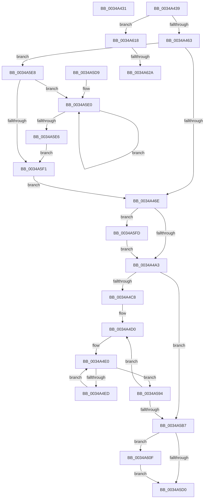

# sub_0034A431

- RVA: `0x0034A431`–`0x0034A633` (길이 `514` bytes)
- VA: `0x000000014034A431`
- 실행 섹션: `.text`
- PDB 이름 있음: `아니요`; PDB Function 태그: `아니요`
- unwind 정보 RVA: `0x000784E4`
- 디코드: `138`개 명령, `514/514` bytes 표시
- 미해석 바이트: `0` (있으면 어셈블리에 `.byte`로 보존)

> 이 문서는 커널 이미지의 기계어와 PDB 기호를 분석해 생성했습니다. 4번과 5번은 함수 원형과 자료형을 바이너리 사용 방식에서 추정한 C 해석이며 원본 소스 복구 결과는 아닙니다.

## 1. Dependencies

- 직접 호출 지점: **2**; 고유 호출 대상: **2**
- 직접 호출자로 확인된 함수: **0**
- RIP 상대 이미지 참조: **0**

### Outgoing calls
- `0x0034A452` → [ExAllocatePool2](../../poolcode/B8/ExAllocatePool2_function_00B820F0.md) (function, `0x00B820F0`)
- `0x0034A611` → [ExFreePoolWithTag](../../poolcode/B8/ExFreePoolWithTag_function_00B82870.md) (function, `0x00B82870`)

### Direct callers
- 이 함수 시작 RVA로 연결되는 직접 call은 확인되지 않았습니다. 간접 호출은 완전히 역산할 수 없습니다.

### Static image references
- 디코드된 RIP-relative 메모리 참조가 없습니다.

## 2. Other-region calls and transfers

- 다른 실행 섹션으로 향하는 call: **2**
  - `0x0034A452` → [ExAllocatePool2](../../poolcode/B8/ExAllocatePool2_function_00B820F0.md) (`.text` → `POOLCODE`)
  - `0x0034A611` → [ExFreePoolWithTag](../../poolcode/B8/ExFreePoolWithTag_function_00B82870.md) (`.text` → `POOLCODE`)
- call이 아닌 외부 분기/꼬리 이동: **4**
  - `0x0034A434` → [sub_0034A229 + 0xC3](Unknown_function_0034A229.md) (`tail-transfer`)
  - `0x0034A5D4` → [sub_0034A229 + 0x125](Unknown_function_0034A229.md) (`tail-transfer`)
  - `0x0034A624` → [sub_0034A229 + 0x125](Unknown_function_0034A229.md) (`tail-transfer`)
  - `0x0034A62E` → [sub_00349FC2 + 0x45](Unknown_function_00349FC2.md) (`tail-transfer`)

## 3. Assembly (complete function range)

```asm
0034A431  48 8B D0                        mov rdx, rax
0034A434  E9 B3 FE FF FF                  jmp 0x14034a2ec
0034A439  B8 04 00 00 00                  mov eax, 4
0034A43E  41 B8 73 6D 48 54               mov r8d, 0x54486d73
0034A444  3B F8                           cmp edi, eax
0034A446  0F 42 F8                        cmovb edi, eax
0034A449  8B D7                           mov edx, edi
0034A44B  8D 48 3C                        lea ecx, [rax + 0x3c]
0034A44E  48 C1 E2 03                     shl rdx, 3
0034A452  E8 99 7C 83 00                  call 0x140b820f0
0034A457  4C 8B C8                        mov r9, rax
0034A45A  48 85 C0                        test rax, rax
0034A45D  0F 84 B5 01 00 00               je 0x14034a618
0034A463  8D 4F FF                        lea ecx, [rdi - 1]
0034A466  85 CF                           test edi, ecx
0034A468  0F 85 7A 01 00 00               jne 0x14034a5e8
0034A46E  B8 00 00 00 04                  mov eax, 0x4000000
0034A473  4D 8D 46 08                     lea r8, [r14 + 8]
0034A477  3B F8                           cmp edi, eax
0034A479  0F 47 F8                        cmova edi, eax
0034A47C  45 33 D2                        xor r10d, r10d
0034A47F  49 8B C0                        mov rax, r8
0034A482  8B CF                           mov ecx, edi
0034A484  48 83 C8 01                     or rax, 1
0034A488  89 BC 24 C8 00 00 00            mov dword ptr [rsp + 0xc8], edi
0034A48F  49 8D 14 F9                     lea rdx, [r9 + rdi*8]
0034A493  4C 3B CA                        cmp r9, rdx
0034A496  41 0F 47 CA                     cmova ecx, r10d
0034A49A  48 85 C9                        test rcx, rcx
0034A49D  0F 85 5A 01 00 00               jne 0x14034a5fd
0034A4A3  41 8B 50 04                     mov edx, dword ptr [r8 + 4]
0034A4A7  48 8B C3                        mov rax, rbx
0034A4AA  8B CA                           mov ecx, edx
0034A4AC  44 89 54 24 20                  mov dword ptr [rsp + 0x20], r10d
0034A4B1  83 E1 1F                        and ecx, 0x1f
0034A4B4  48 D3 E0                        shl rax, cl
0034A4B7  48 89 44 24 30                  mov qword ptr [rsp + 0x30], rax
0034A4BC  F7 C2 E0 FF FF FF               test edx, 0xffffffe0
0034A4C2  0F 86 EF 00 00 00               jbe 0x14034a5b7
0034A4C8  0F 1F 84 00 00 00 00 00         nop dword ptr [rax + rax]
0034A4D0  49 8B 40 08                     mov rax, qword ptr [r8 + 8]
0034A4D4  4C 8B 44 24 30                  mov r8, qword ptr [rsp + 0x30]
0034A4D9  41 8B CA                        mov ecx, r10d
0034A4DC  4C 8D 14 C8                     lea r10, [rax + rcx*8]
0034A4E0  4D 8B 1A                        mov r11, qword ptr [r10]
0034A4E3  41 F6 C3 01                     test r11b, 1
0034A4E7  0F 85 A7 00 00 00               jne 0x14034a594
0034A4ED  49 8B 03                        mov rax, qword ptr [r11]
0034A4F0  49 8B F8                        mov rdi, r8
0034A4F3  49 89 02                        mov qword ptr [r10], rax
0034A4F6  49 23 7B 08                     and rdi, qword ptr [r11 + 8]
0034A4FA  48 8B C7                        mov rax, rdi
0034A4FD  48 C1 E8 08                     shr rax, 8
0034A501  0F B6 C8                        movzx ecx, al
0034A504  40 0F B6 C7                     movzx eax, dil
0034A508  48 05 CB 5D B1 00               add rax, 0xb15dcb
0034A50E  48 6B C0 25                     imul rax, rax, 0x25
0034A512  48 03 C8                        add rcx, rax
0034A515  48 8B C7                        mov rax, rdi
0034A518  48 C1 E8 10                     shr rax, 0x10
0034A51C  0F B6 C0                        movzx eax, al
0034A51F  48 6B D1 25                     imul rdx, rcx, 0x25
0034A523  48 03 D0                        add rdx, rax
0034A526  48 8B C7                        mov rax, rdi
0034A529  48 C1 E8 18                     shr rax, 0x18
0034A52D  0F B6 C0                        movzx eax, al
0034A530  48 6B CA 25                     imul rcx, rdx, 0x25
0034A534  48 03 C8                        add rcx, rax
0034A537  48 8B C7                        mov rax, rdi
0034A53A  48 C1 E8 20                     shr rax, 0x20
0034A53E  0F B6 C0                        movzx eax, al
0034A541  48 6B D1 25                     imul rdx, rcx, 0x25
0034A545  48 03 D0                        add rdx, rax
0034A548  48 8B C7                        mov rax, rdi
0034A54B  48 C1 E8 28                     shr rax, 0x28
0034A54F  0F B6 C0                        movzx eax, al
0034A552  48 6B CA 25                     imul rcx, rdx, 0x25
0034A556  48 03 C8                        add rcx, rax
0034A559  48 8B C7                        mov rax, rdi
0034A55C  48 C1 E8 30                     shr rax, 0x30
0034A560  0F B6 C0                        movzx eax, al
0034A563  48 6B D1 25                     imul rdx, rcx, 0x25
0034A567  48 C1 EF 38                     shr rdi, 0x38
0034A56B  48 03 D0                        add rdx, rax
0034A56E  48 6B C2 25                     imul rax, rdx, 0x25
0034A572  48 03 C7                        add rax, rdi
0034A575  8B BC 24 C8 00 00 00            mov edi, dword ptr [rsp + 0xc8]
0034A57C  8B C0                           mov eax, eax
0034A57E  8D 4F FF                        lea ecx, [rdi - 1]
0034A581  48 23 C8                        and rcx, rax
0034A584  49 8B 04 C9                     mov rax, qword ptr [r9 + rcx*8]
0034A588  49 89 03                        mov qword ptr [r11], rax
0034A58B  4D 89 1C C9                     mov qword ptr [r9 + rcx*8], r11
0034A58F  E9 4C FF FF FF                  jmp 0x14034a4e0
0034A594  44 8B 54 24 20                  mov r10d, dword ptr [rsp + 0x20]
0034A599  4D 8D 46 08                     lea r8, [r14 + 8]
0034A59D  41 8B 50 04                     mov edx, dword ptr [r8 + 4]
0034A5A1  41 FF C2                        inc r10d
0034A5A4  8B C2                           mov eax, edx
0034A5A6  44 89 54 24 20                  mov dword ptr [rsp + 0x20], r10d
0034A5AB  C1 E8 05                        shr eax, 5
0034A5AE  44 3B D0                        cmp r10d, eax
0034A5B1  0F 82 19 FF FF FF               jb 0x14034a4d0
0034A5B7  49 8B 48 08                     mov rcx, qword ptr [r8 + 8]
0034A5BB  83 E2 1F                        and edx, 0x1f
0034A5BE  C1 E7 05                        shl edi, 5
0034A5C1  0B D7                           or edx, edi
0034A5C3  4D 89 48 08                     mov qword ptr [r8 + 8], r9
0034A5C7  41 89 50 04                     mov dword ptr [r8 + 4], edx
0034A5CB  48 85 C9                        test rcx, rcx
0034A5CE  75 3F                           jne 0x14034a60f
0034A5D0  4D 8D 4E 08                     lea r9, [r14 + 8]
0034A5D4  E9 75 FD FF FF                  jmp 0x14034a34e
0034A5D9  0F 1F 80 00 00 00 00            nop dword ptr [rax]
0034A5E0  FF C1                           inc ecx
0034A5E2  D1 EF                           shr edi, 1
0034A5E4  75 FA                           jne 0x14034a5e0
0034A5E6  EB 09                           jmp 0x14034a5f1
0034A5E8  B9 FF FF FF FF                  mov ecx, 0xffffffff
0034A5ED  85 FF                           test edi, edi
0034A5EF  75 EF                           jne 0x14034a5e0
0034A5F1  BF 01 00 00 00                  mov edi, 1
0034A5F6  D3 E7                           shl edi, cl
0034A5F8  E9 71 FE FF FF                  jmp 0x14034a46e
0034A5FD  49 8B F9                        mov rdi, r9
0034A600  F3 48 AB                        rep stosq qword ptr [rdi], rax
0034A603  8B BC 24 C8 00 00 00            mov edi, dword ptr [rsp + 0xc8]
0034A60A  E9 94 FE FF FF                  jmp 0x14034a4a3
0034A60F  33 D2                           xor edx, edx
0034A611  E8 5A 82 83 00                  call 0x140b82870
0034A616  EB B8                           jmp 0x14034a5d0
0034A618  48 8B 44 24 30                  mov rax, qword ptr [rsp + 0x30]
0034A61D  4D 8D 4E 08                     lea r9, [r14 + 8]
0034A621  83 38 20                        cmp dword ptr [rax], 0x20
0034A624  0F 83 24 FD FF FF               jae 0x14034a34e
0034A62A  33 C9                           xor ecx, ecx
0034A62C  8B F1                           mov esi, ecx
0034A62E  E9 D4 F9 FF FF                  jmp 0x14034a007
```

## 4. C-style interpretation (structured pseudocode)

```c
__int64 __fastcall sub_0034A431(void)
{
    unsigned int v_stack_p20;
    unsigned __int64 v_stack_p30;
    unsigned int v_stack_pC8;
}
```

## 5. (Beta) C Style

```c
void sub_0034A431(void)
{
    uint32_t v_stack_p20;
    uint64_t v_stack_p30;
    uint32_t v_stack_pC8;
}
```

## 6. Execution-region graph

[열기: 2D/3D 그래프와 함수 탐색 컨트롤 패널](../../../control-panel.html?section=text&rva=0x0034A431&view=graph)

- 2D 그래프는 위에서 아래로 흐르고, 3D 그래프는 빈 공간을 드래그해 회전합니다. Shift+드래그는 이동, 휠은 확대·축소, 함수 노드 선택은 대상 보고서 이동입니다.

### Static fallback


