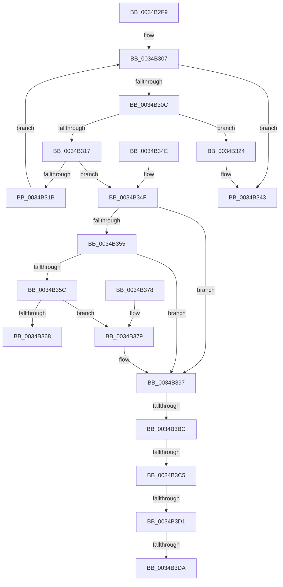

# sub_0034B2F9

- RVA: `0x0034B2F9`–`0x0034B3DF` (길이 `230` bytes)
- VA: `0x000000014034B2F9`
- 실행 섹션: `.text`
- PDB 이름 있음: `아니요`; PDB Function 태그: `아니요`
- unwind 정보 RVA: `0x0007856C`
- 디코드: `64`개 명령, `230/230` bytes 표시
- 미해석 바이트: `0` (있으면 어셈블리에 `.byte`로 보존)

> 이 문서는 커널 이미지의 기계어와 PDB 기호를 분석해 생성했습니다. 4번과 5번은 함수 원형과 자료형을 바이너리 사용 방식에서 추정한 C 해석이며 원본 소스 복구 결과는 아닙니다.

## 1. Dependencies

- 직접 호출 지점: **4**; 고유 호출 대상: **3**
- 직접 호출자로 확인된 함수: **0**
- RIP 상대 이미지 참조: **0**

### Outgoing calls
- `0x0034B33D` → [KeBugCheckEx](../4F/KeBugCheckEx_function_004FD660.md) (function, `0x004FD660`)
- `0x0034B35F` → [MiGenerateAccessViolation](MiGenerateAccessViolation_function_0034B50C.md) (function, `0x0034B50C`)
- `0x0034B391` → [KeBugCheckEx](../4F/KeBugCheckEx_function_004FD660.md) (function, `0x004FD660`)
- `0x0034B3A3` → [MiCheckSystemNxFault](../4A/MiCheckSystemNxFault_function_004A44C0.md) (function, `0x004A44C0`)

### Direct callers
- 이 함수 시작 RVA로 연결되는 직접 call은 확인되지 않았습니다. 간접 호출은 완전히 역산할 수 없습니다.

### Static image references
- 디코드된 RIP-relative 메모리 참조가 없습니다.

## 2. Other-region calls and transfers

- 다른 실행 섹션으로 향하는 call: **0**
- call이 아닌 외부 분기/꼬리 이동: **5**
  - `0x0034B3B6` → [sub_006E21F4](../6E/Unknown_function_006E21F4.md) (`tail-transfer`)
  - `0x0034B3BF` → [sub_006E21F4 + 0x48](../6E/Unknown_function_006E21F4.md) (`tail-transfer`)
  - `0x0034B3CB` → [sub_006E21F4 + 0x48](../6E/Unknown_function_006E21F4.md) (`tail-transfer`)
  - `0x0034B3D4` → [sub_006E21F4 + 0xB](../6E/Unknown_function_006E21F4.md) (`tail-transfer`)
  - `0x0034B3DA` → [sub_006E21F4 + 0x48](../6E/Unknown_function_006E21F4.md) (`tail-transfer`)

## 3. Assembly (complete function range)

```asm
0034B2F9  48 89 5C 24 40                  mov qword ptr [rsp + 0x40], rbx
0034B2FE  48 83 C1 30                     add rcx, 0x30
0034B302  B8 03 00 00 00                  mov eax, 3
0034B307  48 85 C0                        test rax, rax
0034B30A  74 37                           je 0x14034b343
0034B30C  48 8B 19                        mov rbx, qword ptr [rcx]
0034B30F  48 8B 1B                        mov rbx, qword ptr [rbx]
0034B312  F6 C3 01                        test bl, 1
0034B315  74 0D                           je 0x14034b324
0034B317  84 DB                           test bl, bl
0034B319  78 34                           js 0x14034b34f
0034B31B  48 FF C8                        dec rax
0034B31E  48 83 E9 08                     sub rcx, 8
0034B322  EB E3                           jmp 0x14034b307
0034B324  4C 8B 4F 10                     mov r9, qword ptr [rdi + 0x10]
0034B328  B9 50 00 00 00                  mov ecx, 0x50
0034B32D  4C 8B 47 08                     mov r8, qword ptr [rdi + 8]
0034B331  48 8B 17                        mov rdx, qword ptr [rdi]
0034B334  48 C7 44 24 20 0D 00 00 00      mov qword ptr [rsp + 0x20], 0xd
0034B33D  E8 1E 23 1B 00                  call 0x1404fd660
0034B342  CC                              int3
0034B343  48 8B 5C 24 40                  mov rbx, qword ptr [rsp + 0x40]
0034B348  48 83 C4 30                     add rsp, 0x30
0034B34C  5F                              pop rdi
0034B34D  C3                              ret
0034B34E  CC                              int3
0034B34F  F6 47 08 02                     test byte ptr [rdi + 8], 2
0034B353  74 42                           je 0x14034b397
0034B355  48 0F BA E3 0B                  bt rbx, 0xb
0034B35A  72 3B                           jb 0x14034b397
0034B35C  48 8B CF                        mov rcx, rdi
0034B35F  E8 A8 01 00 00                  call 0x14034b50c
0034B364  85 C0                           test eax, eax
0034B366  74 11                           je 0x14034b379
0034B368  48 8B 5C 24 40                  mov rbx, qword ptr [rsp + 0x40]
0034B36D  B8 02 00 00 00                  mov eax, 2
0034B372  48 83 C4 30                     add rsp, 0x30
0034B376  5F                              pop rdi
0034B377  C3                              ret
0034B378  CC                              int3
0034B379  4C 8B 4F 10                     mov r9, qword ptr [rdi + 0x10]
0034B37D  4C 8B C3                        mov r8, rbx
0034B380  48 8B 17                        mov rdx, qword ptr [rdi]
0034B383  B9 BE 00 00 00                  mov ecx, 0xbe
0034B388  48 C7 44 24 20 10 00 00 00      mov qword ptr [rsp + 0x20], 0x10
0034B391  E8 CA 22 1B 00                  call 0x1404fd660
0034B396  CC                              int3
0034B397  41 B8 06 00 00 00               mov r8d, 6
0034B39D  48 8B D3                        mov rdx, rbx
0034B3A0  48 8B CF                        mov rcx, rdi
0034B3A3  E8 18 91 15 00                  call 0x1404a44c0
0034B3A8  48 8B 4F 10                     mov rcx, qword ptr [rdi + 0x10]
0034B3AC  48 8B C1                        mov rax, rcx
0034B3AF  48 83 E0 FE                     and rax, 0xfffffffffffffffe
0034B3B3  F6 C1 01                        test cl, 1
0034B3B6  0F 84 38 6E 39 00               je 0x1406e21f4
0034B3BC  80 38 01                        cmp byte ptr [rax], 1
0034B3BF  0F 84 77 6E 39 00               je 0x1406e223c
0034B3C5  0F B6 08                        movzx ecx, byte ptr [rax]
0034B3C8  80 F9 03                        cmp cl, 3
0034B3CB  0F 84 6B 6E 39 00               je 0x1406e223c
0034B3D1  80 F9 06                        cmp cl, 6
0034B3D4  0F 85 25 6E 39 00               jne 0x1406e21ff
0034B3DA  E9 5D 6E 39 00                  jmp 0x1406e223c
```

## 4. C-style interpretation (structured pseudocode)

```c
__int64 __fastcall sub_0034B2F9(__int64 a1, __int64 a2, __int64 a3, __int64 a4, __int64 a5, __int64 a6, __int64 a7, __int64 a8)
{
    __int64 result;
    __int64 v_rsp;
    unsigned __int64 v_stack_p20;
    unsigned __int64 v_stack_p40;
    unsigned __int64 v_stack_p90;

    v_stack_p40 = v_rbx;
    a1 = (a1) + (48);
loc_0034B307:
    if (3 == 0) goto loc_0034B343;
    if ((((unsigned __int8)(*(unsigned __int64 *)(*(unsigned __int64 *)(a1)))) & (1)) == 0) goto loc_0034B324;
    if (sign_flag) goto loc_0034B34F;
    result = (3) - 1;
    a1 = (a1) - (8);
    goto loc_0034B307;
loc_0034B324:
    v_stack_p20 = 13;
    result = KeBugCheckEx(80, *(unsigned __int64 *)(v_rdi), *(unsigned __int64 *)(v_rdi + 8), *(unsigned __int64 *)(v_rdi + 16));
loc_0034B343:
    v_rsp = (v_rsp) + (48);
    return result;
loc_0034B34F:
    if (((*(unsigned __int8 *)(v_rdi + 8)) & (2)) == 0) goto loc_0034B397;
    if (condition_is_below) goto loc_0034B397;
    result = MiGenerateAccessViolation(v_rdi, *(unsigned __int64 *)(v_rdi), *(unsigned __int64 *)(v_rdi + 8), *(unsigned __int64 *)(v_rdi + 16));
    if ((unsigned int)(result) == 0) goto loc_0034B379;
    v_rsp = (v_rsp) + (48);
    return 2;
loc_0034B379:
    v_stack_p90 = 16;
    result = KeBugCheckEx(190, *(unsigned __int64 *)(v_rdi), a8, *(unsigned __int64 *)(v_rdi + 16));
loc_0034B397:
    result = MiCheckSystemNxFault(v_rdi, a8, 6, *(unsigned __int64 *)(v_rdi + 16));
    result = (*(unsigned __int64 *)(v_rdi + 16)) & (-2);
}
```

## 5. (Beta) C Style

```c
int64_t sub_0034B2F9(void *Arg1, int64_t Arg2, int64_t Arg3, int64_t Arg4, uint64_t Arg5, uint64_t Arg6, uint64_t Arg7, int64_t Arg8)
{
    uint8_t *arg1 = (uint8_t *)Arg1;

    int64_t result;
    int64_t local_rsp;
    uint64_t v_stack_p20;
    uint64_t v_stack_p40;
    uint64_t v_stack_p90;

    v_stack_p40 = local_rbx;
    Arg1 = (Arg1) + (48);
loc_0034B307:
    if (3 == 0) goto loc_0034B343;
    if ((((uint8_t)(*(uint64_t *)(*(uint64_t *)(arg1)))) & (1)) == 0) goto loc_0034B324;
    if (sign_flag) goto loc_0034B34F;
    result = (3) - 1;
    Arg1 = (Arg1) - (8);
    goto loc_0034B307;
loc_0034B324:
    v_stack_p20 = 13;
    result = KeBugCheckEx(80, *(uint64_t *)(local_rdi), *(uint64_t *)(local_rdi + 0x8), *(uint64_t *)(local_rdi + 0x10));
loc_0034B343:
    local_rsp = (local_rsp) + (48);
    return result;
loc_0034B34F:
    if (((*(uint8_t *)(local_rdi + 0x8)) & (2)) == 0) goto loc_0034B397;
    if (condition_is_below) goto loc_0034B397;
    result = MiGenerateAccessViolation(local_rdi, *(uint64_t *)(local_rdi), *(uint64_t *)(local_rdi + 0x8), *(uint64_t *)(local_rdi + 0x10));
    if ((uint32_t)(result) == 0) goto loc_0034B379;
    local_rsp = (local_rsp) + (48);
    return 2;
loc_0034B379:
    v_stack_p90 = 16;
    result = KeBugCheckEx(190, *(uint64_t *)(local_rdi), Arg8, *(uint64_t *)(local_rdi + 0x10));
loc_0034B397:
    result = MiCheckSystemNxFault(local_rdi, Arg8, 6, *(uint64_t *)(local_rdi + 0x10));
    result = (*(uint64_t *)(local_rdi + 0x10)) & (-2);
}
```

### 관측된 메모리 오프셋

구조체 형식이 확인되지 않은 접근은 인자 기준의 오프셋으로만 기록했습니다.

| 기준 인자 | 오프셋 표현 | 폭 (bit) | 접근 |
|---|---:|---:|---|
| `Arg1` | `+ 0x0` | `64` | `R` |

## 6. Execution-region graph

[열기: 2D/3D 그래프와 함수 탐색 컨트롤 패널](../../../control-panel.html?section=text&rva=0x0034B2F9&view=graph)

- 2D 그래프는 위에서 아래로 흐르고, 3D 그래프는 빈 공간을 드래그해 회전합니다. Shift+드래그는 이동, 휠은 확대·축소, 함수 노드 선택은 대상 보고서 이동입니다.

### Static fallback


