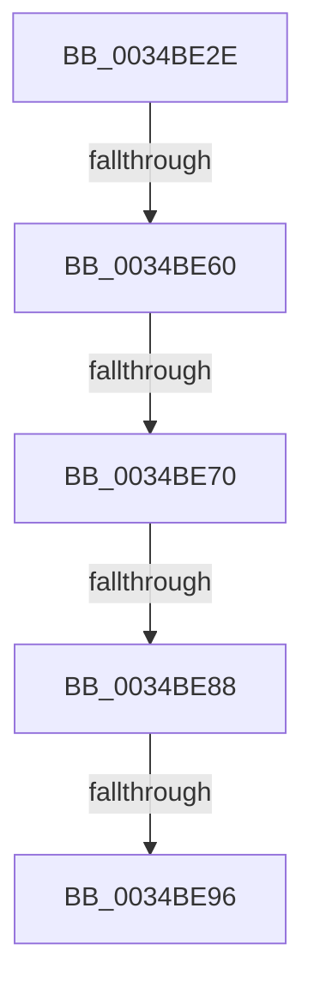

# sub_0034BE2E

- RVA: `0x0034BE2E`–`0x0034BEA8` (길이 `122` bytes)
- VA: `0x000000014034BE2E`
- 실행 섹션: `.text`
- PDB 이름 있음: `아니요`; PDB Function 태그: `아니요`
- unwind 정보 RVA: `0x00078660`
- 디코드: `34`개 명령, `122/122` bytes 표시
- 미해석 바이트: `0` (있으면 어셈블리에 `.byte`로 보존)

> 이 문서는 커널 이미지의 기계어와 PDB 기호를 분석해 생성했습니다. 4번과 5번은 함수 원형과 자료형을 바이너리 사용 방식에서 추정한 C 해석이며 원본 소스 복구 결과는 아닙니다.

## 1. Dependencies

- 직접 호출 지점: **0**; 고유 호출 대상: **0**
- 직접 호출자로 확인된 함수: **0**
- RIP 상대 이미지 참조: **0**

### Outgoing calls
- 직접 디코드된 call 명령이 없습니다.

### Direct callers
- 이 함수 시작 RVA로 연결되는 직접 call은 확인되지 않았습니다. 간접 호출은 완전히 역산할 수 없습니다.

### Static image references
- 디코드된 RIP-relative 메모리 참조가 없습니다.

## 2. Other-region calls and transfers

- 다른 실행 섹션으로 향하는 call: **0**
- call이 아닌 외부 분기/꼬리 이동: **4**
  - `0x0034BE5E` → [sub_0034BEB2 + 0xD](Unknown_function_0034BEB2.md) (`tail-transfer`)
  - `0x0034BE6E` → [sub_0034BEB2 + 0xD](Unknown_function_0034BEB2.md) (`tail-transfer`)
  - `0x0034BE86` → [sub_0034BEB2](Unknown_function_0034BEB2.md) (`tail-transfer`)
  - `0x0034BE94` → [sub_0034BEB2 + 0x11](Unknown_function_0034BEB2.md) (`tail-transfer`)

## 3. Assembly (complete function range)

```asm
0034BE2E  48 89 5C 24 30                  mov qword ptr [rsp + 0x30], rbx
0034BE33  0F B7 59 20                     movzx ebx, word ptr [rcx + 0x20]
0034BE37  83 E3 3F                        and ebx, 0x3f
0034BE3A  48 89 74 24 38                  mov qword ptr [rsp + 0x38], rsi
0034BE3F  C1 E3 0A                        shl ebx, 0xa
0034BE42  0B DA                           or ebx, edx
0034BE44  48 89 7C 24 20                  mov qword ptr [rsp + 0x20], rdi
0034BE49  8B CB                           mov ecx, ebx
0034BE4B  81 E1 FF 03 00 00               and ecx, 0x3ff
0034BE51  8B C1                           mov eax, ecx
0034BE53  48 C1 E8 05                     shr rax, 5
0034BE57  49 8B 14 C2                     mov rdx, qword ptr [r10 + rax*8]
0034BE5B  48 85 D2                        test rdx, rdx
0034BE5E  74 5F                           je 0x14034bebf
0034BE60  83 E1 1F                        and ecx, 0x1f
0034BE63  48 8D 04 89                     lea rax, [rcx + rcx*4]
0034BE67  48 8D 3C C2                     lea rdi, [rdx + rax*8]
0034BE6B  48 85 FF                        test rdi, rdi
0034BE6E  74 4F                           je 0x14034bebf
0034BE70  0F 0D 4F 08                     prefetchw byte ptr [rdi + 8]
0034BE74  48 8B 47 08                     mov rax, qword ptr [rdi + 8]
0034BE78  48 83 E0 FE                     and rax, 0xfffffffffffffffe
0034BE7C  48 8D 48 02                     lea rcx, [rax + 2]
0034BE80  F0 48 0F B1 4F 08               lock cmpxchg qword ptr [rdi + 8], rcx
0034BE86  75 2A                           jne 0x14034beb2
0034BE88  0F B7 47 20                     movzx eax, word ptr [rdi + 0x20]
0034BE8C  83 E0 3F                        and eax, 0x3f
0034BE8F  C1 EB 0A                        shr ebx, 0xa
0034BE92  3B C3                           cmp eax, ebx
0034BE94  75 2D                           jne 0x14034bec3
0034BE96  48 8B 07                        mov rax, qword ptr [rdi]
0034BE99  48 8B 7C 24 20                  mov rdi, qword ptr [rsp + 0x20]
0034BE9E  48 8B 74 24 38                  mov rsi, qword ptr [rsp + 0x38]
0034BEA3  48 8B 5C 24 30                  mov rbx, qword ptr [rsp + 0x30]
```

## 4. C-style interpretation (structured pseudocode)

```c
__int64 __fastcall sub_0034BE2E(__int64 a1, int a2, __int64 a3, __int64 a4, __int64 a5, __int64 a6, __int64 a7)
{
    __int64 result;
    __int64 v_rbx;
    unsigned __int64 v_stack_p20;
    unsigned __int64 v_stack_p30;
    unsigned __int64 v_stack_p38;

    v_stack_p30 = v_rbx;
    v_rbx = (unsigned int)((*(unsigned __int16 *)(a1 + 32)) & (63));
    v_stack_p38 = v_rsi;
    v_rbx = (unsigned int)((v_rbx) << (10));
    v_rbx = (unsigned int)((v_rbx) | (a2));
    v_stack_p20 = v_rdi;
    a1 = (unsigned int)(((unsigned int)((unsigned int)(v_rbx))) & (0x3FFULL));
    result = ((unsigned int)((unsigned int)(a1))) >> (5);
    a1 = (unsigned int)((a1) & (31));
    result = (*(unsigned __int64 *)(*(unsigned __int64 *)(v_r10 + result * 8) + a1 + a1 * 4 * 8 + 8)) & (-2);
    result = (unsigned int)((*(unsigned __int16 *)(*(unsigned __int64 *)(v_r10 + result * 8) + a1 + a1 * 4 * 8 + 32)) & (63));
    v_rbx = (unsigned int)((v_rbx) >> (10));
    return *(unsigned __int64 *)(*(unsigned __int64 *)(v_r10 + result * 8) + a1 + a1 * 4 * 8);
}
```

## 5. (Beta) C Style

```c
int64_t sub_0034BE2E(void *Arg1, int32_t Arg2, int64_t Arg3, int64_t Arg4, uint64_t Arg5, int64_t Arg6, int64_t Arg7)
{
    uint8_t *arg1 = (uint8_t *)Arg1;

    int64_t result;
    int64_t local_rbx;
    uint64_t v_stack_p20;
    uint64_t v_stack_p30;
    uint64_t v_stack_p38;

    v_stack_p30 = local_rbx;
    local_rbx = (uint32_t)((*(uint16_t *)(arg1 + 0x20)) & (63));
    v_stack_p38 = local_rsi;
    local_rbx = (uint32_t)((local_rbx) << (10));
    local_rbx = (uint32_t)((local_rbx) | (Arg2));
    v_stack_p20 = local_rdi;
    Arg1 = (uint32_t)(((uint32_t)((uint32_t)(local_rbx))) & (0x3FFULL));
    result = ((uint32_t)((uint32_t)(Arg1))) >> (5);
    Arg1 = (uint32_t)((Arg1) & (31));
    result = (*(uint64_t *)(*(uint64_t *)(local_r10 + result * 8) + arg1 + arg1 * 4 * 8 + 0x8)) & (-2);
    result = (uint32_t)((*(uint16_t *)(*(uint64_t *)(local_r10 + result * 8) + arg1 + arg1 * 4 * 8 + 0x20)) & (63));
    local_rbx = (uint32_t)((local_rbx) >> (10));
    return *(uint64_t *)(*(uint64_t *)(local_r10 + result * 8) + arg1 + arg1 * 4 * 8);
}
```

### 관측된 메모리 오프셋

구조체 형식이 확인되지 않은 접근은 인자 기준의 오프셋으로만 기록했습니다.

| 기준 인자 | 오프셋 표현 | 폭 (bit) | 접근 |
|---|---:|---:|---|
| `Arg1` | `+ 0x20` | `16` | `R` |

## 6. Execution-region graph

[열기: 2D/3D 그래프와 함수 탐색 컨트롤 패널](../../../control-panel.html?section=text&rva=0x0034BE2E&view=graph)

- 2D 그래프는 위에서 아래로 흐르고, 3D 그래프는 빈 공간을 드래그해 회전합니다. Shift+드래그는 이동, 휠은 확대·축소, 함수 노드 선택은 대상 보고서 이동입니다.

### Static fallback


