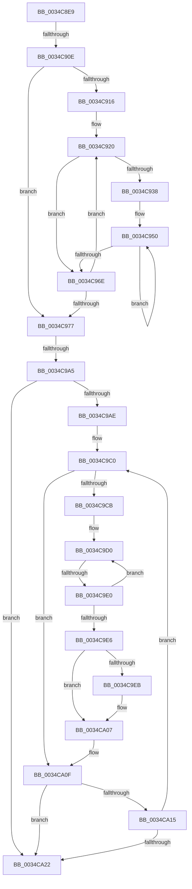

# sub_0034C8E9

- RVA: `0x0034C8E9`–`0x0034CA36` (길이 `333` bytes)
- VA: `0x000000014034C8E9`
- 실행 섹션: `.text`
- PDB 이름 있음: `아니요`; PDB Function 태그: `아니요`
- unwind 정보 RVA: `0x0007877C`
- 디코드: `85`개 명령, `333/333` bytes 표시
- 미해석 바이트: `0` (있으면 어셈블리에 `.byte`로 보존)

> 이 문서는 커널 이미지의 기계어와 PDB 기호를 분석해 생성했습니다. 4번과 5번은 함수 원형과 자료형을 바이너리 사용 방식에서 추정한 C 해석이며 원본 소스 복구 결과는 아닙니다.

## 1. Dependencies

- 직접 호출 지점: **4**; 고유 호출 대상: **4**
- 직접 호출자로 확인된 함수: **0**
- RIP 상대 이미지 참조: **0**

### Outgoing calls
- `0x0034C8FD` → [ExAllocatePool2](../../poolcode/B8/ExAllocatePool2_function_00B820F0.md) (function, `0x00B820F0`)
- `0x0034C998` → [ZwQueryVirtualMemory](../6A/ZwQueryVirtualMemory_function_006AD530.md) (function, `0x006AD530`)
- `0x0034CA02` → [ZwUnlockVirtualMemory](../6B/ZwUnlockVirtualMemory_function_006B0CB0.md) (function, `0x006B0CB0`)
- `0x0034CA27` → [ExFreePoolWithTag](../../poolcode/B8/ExFreePoolWithTag_function_00B82870.md) (function, `0x00B82870`)

### Direct callers
- 이 함수 시작 RVA로 연결되는 직접 call은 확인되지 않았습니다. 간접 호출은 완전히 역산할 수 없습니다.

### Static image references
- 디코드된 RIP-relative 메모리 참조가 없습니다.

## 2. Other-region calls and transfers

- 다른 실행 섹션으로 향하는 call: **2**
  - `0x0034C8FD` → [ExAllocatePool2](../../poolcode/B8/ExAllocatePool2_function_00B820F0.md) (`.text` → `POOLCODE`)
  - `0x0034CA27` → [ExFreePoolWithTag](../../poolcode/B8/ExFreePoolWithTag_function_00B82870.md) (`.text` → `POOLCODE`)
- call이 아닌 외부 분기/꼬리 이동: **3**
  - `0x0034C908` → [sub_0034CA8A + 0x23](Unknown_function_0034CA8A.md) (`tail-transfer`)
  - `0x0034C99F` → [sub_0034CA8A + 0x17](Unknown_function_0034CA8A.md) (`tail-transfer`)
  - `0x0034C9DA` → [sub_0034CA8A](Unknown_function_0034CA8A.md) (`tail-transfer`)

## 3. Assembly (complete function range)

```asm
0034C8E9  48 89 74 24 78                  mov qword ptr [rsp + 0x78], rsi
0034C8EE  48 C1 E7 04                     shl rdi, 4
0034C8F2  48 8B D7                        mov rdx, rdi
0034C8F5  48 89 AC 24 98 00 00 00         mov qword ptr [rsp + 0x98], rbp
0034C8FD  E8 EE 57 83 00                  call 0x140b820f0
0034C902  48 8B F0                        mov rsi, rax
0034C905  48 85 C0                        test rax, rax
0034C908  0F 84 9F 01 00 00               je 0x14034caad
0034C90E  45 33 DB                        xor r11d, r11d
0034C911  45 85 ED                        test r13d, r13d
0034C914  74 61                           je 0x14034c977
0034C916  4D 8B D7                        mov r10, r15
0034C919  0F 1F 80 00 00 00 00            nop dword ptr [rax]
0034C920  49 8B 0A                        mov rcx, qword ptr [r10]
0034C923  45 8D 4B 01                     lea r9d, [r11 + 1]
0034C927  45 8B D9                        mov r11d, r9d
0034C92A  48 89 4C 24 30                  mov qword ptr [rsp + 0x30], rcx
0034C92F  44 0F AF CD                     imul r9d, ebp
0034C933  41 3B D9                        cmp ebx, r9d
0034C936  73 36                           jae 0x14034c96e
0034C938  8B D3                           mov edx, ebx
0034C93A  45 8B C1                        mov r8d, r9d
0034C93D  48 C1 E2 04                     shl rdx, 4
0034C941  48 03 D6                        add rdx, rsi
0034C944  44 2B C3                        sub r8d, ebx
0034C947  41 8B D9                        mov ebx, r9d
0034C94A  66 0F 1F 44 00 00               nop word ptr [rax + rax]
0034C950  48 89 0A                        mov qword ptr [rdx], rcx
0034C953  48 8D 52 10                     lea rdx, [rdx + 0x10]
0034C957  48 8B 4C 24 30                  mov rcx, qword ptr [rsp + 0x30]
0034C95C  48 81 C1 00 10 00 00            add rcx, 0x1000
0034C963  48 89 4C 24 30                  mov qword ptr [rsp + 0x30], rcx
0034C968  49 83 E8 01                     sub r8, 1
0034C96C  75 E2                           jne 0x14034c950
0034C96E  49 83 C2 08                     add r10, 8
0034C972  45 3B DD                        cmp r11d, r13d
0034C975  72 A9                           jb 0x14034c920
0034C977  48 8B 10                        mov rdx, qword ptr [rax]
0034C97A  4C 8B CE                        mov r9, rsi
0034C97D  48 C7 44 24 28 00 00 00 00      mov qword ptr [rsp + 0x28], 0
0034C986  41 B8 04 00 00 00               mov r8d, 4
0034C98C  48 C7 C1 FF FF FF FF            mov rcx, 0xffffffffffffffff
0034C993  48 89 7C 24 20                  mov qword ptr [rsp + 0x20], rdi
0034C998  E8 93 0B 36 00                  call 0x1406ad530
0034C99D  85 C0                           test eax, eax
0034C99F  0F 88 FC 00 00 00               js 0x14034caa1
0034C9A5  33 DB                           xor ebx, ebx
0034C9A7  33 ED                           xor ebp, ebp
0034C9A9  45 85 ED                        test r13d, r13d
0034C9AC  74 74                           je 0x14034ca22
0034C9AE  48 8B 84 24 98 00 00 00         mov rax, qword ptr [rsp + 0x98]
0034C9B6  8B F8                           mov edi, eax
0034C9B8  0F 1F 84 00 00 00 00 00         nop dword ptr [rax + rax]
0034C9C0  33 C9                           xor ecx, ecx
0034C9C2  48 89 4C 24 30                  mov qword ptr [rsp + 0x30], rcx
0034C9C7  3B DF                           cmp ebx, edi
0034C9C9  73 44                           jae 0x14034ca0f
0034C9CB  0F 1F 44 00 00                  nop dword ptr [rax + rax]
0034C9D0  8B C3                           mov eax, ebx
0034C9D2  48 03 C0                        add rax, rax
0034C9D5  F6 44 C6 08 01                  test byte ptr [rsi + rax*8 + 8], 1
0034C9DA  0F 85 AA 00 00 00               jne 0x14034ca8a
0034C9E0  FF C3                           inc ebx
0034C9E2  3B DF                           cmp ebx, edi
0034C9E4  72 EA                           jb 0x14034c9d0
0034C9E6  48 85 C9                        test rcx, rcx
0034C9E9  74 1C                           je 0x14034ca07
0034C9EB  41 B9 01 00 00 00               mov r9d, 1
0034C9F1  4C 8D 44 24 38                  lea r8, [rsp + 0x38]
0034C9F6  48 8D 54 24 30                  lea rdx, [rsp + 0x30]
0034C9FB  48 C7 C1 FF FF FF FF            mov rcx, 0xffffffffffffffff
0034CA02  E8 A9 42 36 00                  call 0x1406b0cb0
0034CA07  48 8B 84 24 98 00 00 00         mov rax, qword ptr [rsp + 0x98]
0034CA0F  49 83 3E 00                     cmp qword ptr [r14], 0
0034CA13  74 0D                           je 0x14034ca22
0034CA15  FF C5                           inc ebp
0034CA17  03 F8                           add edi, eax
0034CA19  49 83 C7 08                     add r15, 8
0034CA1D  41 3B ED                        cmp ebp, r13d
0034CA20  72 9E                           jb 0x14034c9c0
0034CA22  33 D2                           xor edx, edx
0034CA24  48 8B CE                        mov rcx, rsi
0034CA27  E8 44 5E 83 00                  call 0x140b82870
0034CA2C  48 8B 7C 24 70                  mov rdi, qword ptr [rsp + 0x70]
0034CA31  48 8B 74 24 78                  mov rsi, qword ptr [rsp + 0x78]
```

## 4. C-style interpretation (structured pseudocode)

```c
__int64 __fastcall sub_0034C8E9(__int64 a1, __int64 a2, __int64 a3, __int64 a4, __int64 a5, __int64 a6, __int64 a7, __int64 a8, __int64 a9, __int64 a10, __int64 a11, __int64 a12, __int64 a13, __int64 a14, __int64 a15, __int64 a16, __int64 a17, __int64 a18, __int64 a19)
{
    __int64 result;
    __int64 v_r10;
    __int64 v_r11;
    __int64 v_r15;
    __int64 v_rbp;
    __int64 v_rbx;
    __int64 v_rdi;
    unsigned __int64 v_stack_p20;
    unsigned __int64 v_stack_p28;
    unsigned __int64 v_stack_p30;
    unsigned __int64 v_stack_p78;
    unsigned __int64 v_stack_p98;

    v_stack_p78 = v_rsi;
    v_rdi = (v_rdi) << (4);
    v_stack_p98 = v_rbp;
    result = ExAllocatePool2(a1, v_rdi, a3, a4);
    v_r11 = 0;
    if ((unsigned int)(v_r13) == 0) goto loc_0034C977;
loc_0034C920:
    v_stack_p30 = *(unsigned __int64 *)(v_r15);
    a4 = (unsigned int)((v_r11 + 1) * ((unsigned int)(v_rbp)));
    if (((unsigned int)(v_rbx)) >= ((unsigned int)(a4))) goto loc_0034C96E;
    a2 = ((unsigned int)((unsigned int)(v_rbx))) << (4);
    a2 = (a2) + (result);
    a3 = (unsigned int)(((unsigned int)((unsigned int)(a4))) - ((unsigned int)(v_rbx)));
loc_0034C950:
    *(unsigned __int64 *)(a2) = *(unsigned __int64 *)(v_r15);
    a1 = (a6) + (0x1000ULL);
    v_stack_p30 = a1;
    a3 = (a3) - (1);
    if (condition_is_not_equal) goto loc_0034C950;
loc_0034C96E:
    v_r10 = (v_r15) + (8);
    if (((unsigned int)((unsigned int)((unsigned int)(v_r11 + 1)))) < ((unsigned int)(v_r13))) goto loc_0034C920;
loc_0034C977:
    v_stack_p28 = 0;
    v_stack_p20 = v_rdi;
    result = ZwQueryVirtualMemory(-1, *(unsigned __int64 *)(result), 4, result);
    v_rbx = 0;
    v_rbp = 0;
    if ((unsigned int)(v_r13) == 0) goto loc_0034CA22;
loc_0034C9C0:
    a1 = 0;
    v_stack_p30 = 0;
    if (0 >= ((unsigned int)((unsigned int)((unsigned int)(a19))))) goto loc_0034CA0F;
loc_0034C9D0:
    result = (0) + (0);
    v_rbx = (unsigned int)((v_rbx) + 1);
    if (((unsigned int)(v_rbx)) < ((unsigned int)((unsigned int)((unsigned int)(a19))))) goto loc_0034C9D0;
    if (0 != 0) {
        a4 = 1;
        a3 = a7;
        a2 = a6;
        a1 = -1;
        result = ZwUnlockVirtualMemory(a1, a2, a3, a4);
    }
loc_0034CA0F:
    if ((*(unsigned __int64 *)(v_r14)) == 0) goto loc_0034CA22;
    v_rbp = (unsigned int)((v_rbp) + 1);
    v_rdi = (unsigned int)(((unsigned int)((unsigned int)(a19))) + ((unsigned int)(a19)));
    v_r15 = (v_r15) + (8);
    if (((unsigned int)(v_rbp)) < ((unsigned int)(v_r13))) goto loc_0034C9C0;
loc_0034CA22:
    a2 = 0;
    result = ExFreePoolWithTag(result, a2, a3, a4);
    return result;
}
```

## 5. (Beta) C Style

```c
int64_t sub_0034C8E9(int64_t Arg1, int64_t Arg2, int64_t Arg3, int64_t Arg4, uint64_t Arg5, int64_t Arg6, int64_t Arg7, uint64_t Arg8, uint64_t Arg9, uint64_t Arg10, uint64_t Arg11, uint64_t Arg12, uint64_t Arg13, int64_t Arg14, int64_t Arg15, uint64_t Arg16, uint64_t Arg17, uint64_t Arg18, void *Arg19)
{
    uint8_t *arg19 = (uint8_t *)Arg19;

    int64_t result;
    int64_t local_r10;
    int64_t local_r11;
    int64_t local_r15;
    int64_t local_rbp;
    int64_t local_rbx;
    int64_t local_rdi;
    uint64_t v_stack_p20;
    uint64_t v_stack_p28;
    uint64_t v_stack_p30;
    uint64_t v_stack_p78;
    uint64_t v_stack_p98;

    v_stack_p78 = local_rsi;
    local_rdi = (local_rdi) << (4);
    v_stack_p98 = local_rbp;
    result = ExAllocatePool2(Arg1, local_rdi, Arg3, Arg4);
    local_r11 = 0;
    if ((uint32_t)(local_r13) == 0) goto loc_0034C977;
loc_0034C920:
    v_stack_p30 = *(uint64_t *)(local_r15);
    Arg4 = (uint32_t)((local_r11 + 1) * ((uint32_t)(local_rbp)));
    if (((uint32_t)(local_rbx)) >= ((uint32_t)(Arg4))) goto loc_0034C96E;
    Arg2 = ((uint32_t)((uint32_t)(local_rbx))) << (4);
    Arg2 = (Arg2) + (result);
    Arg3 = (uint32_t)(((uint32_t)((uint32_t)(Arg4))) - ((uint32_t)(local_rbx)));
loc_0034C950:
    *(uint64_t *)(Arg2) = *(uint64_t *)(local_r15);
    Arg1 = (Arg6) + (0x1000ULL);
    v_stack_p30 = Arg1;
    Arg3 = (Arg3) - (1);
    if (condition_is_not_equal) goto loc_0034C950;
loc_0034C96E:
    local_r10 = (local_r15) + (8);
    if (((uint32_t)((uint32_t)((uint32_t)(local_r11 + 1)))) < ((uint32_t)(local_r13))) goto loc_0034C920;
loc_0034C977:
    v_stack_p28 = 0;
    v_stack_p20 = local_rdi;
    result = ZwQueryVirtualMemory(-1, *(uint64_t *)(result), 4, result);
    local_rbx = 0;
    local_rbp = 0;
    if ((uint32_t)(local_r13) == 0) goto loc_0034CA22;
loc_0034C9C0:
    Arg1 = 0;
    v_stack_p30 = 0;
    if (0 >= ((uint32_t)((uint32_t)((uint32_t)(Arg19))))) goto loc_0034CA0F;
loc_0034C9D0:
    result = (0) + (0);
    local_rbx = (uint32_t)((local_rbx) + 1);
    if (((uint32_t)(local_rbx)) < ((uint32_t)((uint32_t)((uint32_t)(Arg19))))) goto loc_0034C9D0;
    if (0 != 0) {
        Arg4 = 1;
        Arg3 = Arg7;
        Arg2 = Arg6;
        Arg1 = -1;
        result = ZwUnlockVirtualMemory(Arg1, Arg2, Arg3, Arg4);
    }
loc_0034CA0F:
    if ((*(uint64_t *)(local_r14)) == 0) goto loc_0034CA22;
    local_rbp = (uint32_t)((local_rbp) + 1);
    local_rdi = (uint32_t)(((uint32_t)((uint32_t)(Arg19))) + ((uint32_t)(Arg19)));
    local_r15 = (local_r15) + (8);
    if (((uint32_t)(local_rbp)) < ((uint32_t)(local_r13))) goto loc_0034C9C0;
loc_0034CA22:
    Arg2 = 0;
    result = ExFreePoolWithTag(result, Arg2, Arg3, Arg4);
    return result;
}
```

### 관측된 메모리 오프셋

구조체 형식이 확인되지 않은 접근은 인자 기준의 오프셋으로만 기록했습니다.

| 기준 인자 | 오프셋 표현 | 폭 (bit) | 접근 |
|---|---:|---:|---|
| `Arg19` | `+ 0x0 + rax*1` | `32` | `R` |

## 6. Execution-region graph

[열기: 2D/3D 그래프와 함수 탐색 컨트롤 패널](../../../control-panel.html?section=text&rva=0x0034C8E9&view=graph)

- 2D 그래프는 위에서 아래로 흐르고, 3D 그래프는 빈 공간을 드래그해 회전합니다. Shift+드래그는 이동, 휠은 확대·축소, 함수 노드 선택은 대상 보고서 이동입니다.

### Static fallback


