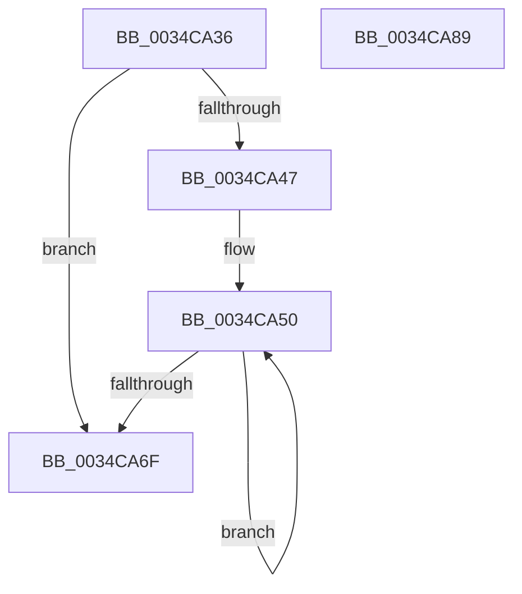

# sub_0034CA36

- RVA: `0x0034CA36`–`0x0034CA8A` (길이 `84` bytes)
- VA: `0x000000014034CA36`
- 실행 섹션: `.text`
- PDB 이름 있음: `아니요`; PDB Function 태그: `아니요`
- unwind 정보 RVA: `0x00078790`
- 디코드: `24`개 명령, `84/84` bytes 표시
- 미해석 바이트: `0` (있으면 어셈블리에 `.byte`로 보존)

> 이 문서는 커널 이미지의 기계어와 PDB 기호를 분석해 생성했습니다. 4번과 5번은 함수 원형과 자료형을 바이너리 사용 방식에서 추정한 C 해석이며 원본 소스 복구 결과는 아닙니다.

## 1. Dependencies

- 직접 호출 지점: **2**; 고유 호출 대상: **2**
- 직접 호출자로 확인된 함수: **0**
- RIP 상대 이미지 참조: **0**

### Outgoing calls
- `0x0034CA3D` → [StLockAcquireShared](StLockAcquireShared_function_0034C728.md) (function, `0x0034C728`)
- `0x0034CA5F` → [SMKM_STORE<SM_TRAITS>::SmStUnmapVirtualRegion](SMKM_STORE_SM_TRAITS_SmStUnmapVirtualRegion_function_0034CCA0.md) (function, `0x0034CCA0`)

### Direct callers
- 이 함수 시작 RVA로 연결되는 직접 call은 확인되지 않았습니다. 간접 호출은 완전히 역산할 수 없습니다.

### Static image references
- 디코드된 RIP-relative 메모리 참조가 없습니다.

## 2. Other-region calls and transfers

- 다른 실행 섹션으로 향하는 call: **0**
- 별도 외부 분기/꼬리 이동을 확인하지 못했습니다.

## 3. Assembly (complete function range)

```asm
0034CA36  48 8D 8F 98 1A 00 00            lea rcx, [rdi + 0x1a98]
0034CA3D  E8 E6 FC FF FF                  call 0x14034c728
0034CA42  45 85 ED                        test r13d, r13d
0034CA45  74 28                           je 0x14034ca6f
0034CA47  49 8B DD                        mov rbx, r13
0034CA4A  66 0F 1F 44 00 00               nop word ptr [rax + rax]
0034CA50  41 8B 14 24                     mov edx, dword ptr [r12]
0034CA54  48 8B CF                        mov rcx, rdi
0034CA57  C7 44 24 28 02 00 00 00         mov dword ptr [rsp + 0x28], 2
0034CA5F  E8 3C 02 00 00                  call 0x14034cca0
0034CA64  4D 8D 64 24 04                  lea r12, [r12 + 4]
0034CA69  48 83 EB 01                     sub rbx, 1
0034CA6D  75 E1                           jne 0x14034ca50
0034CA6F  4C 8D 5C 24 40                  lea r11, [rsp + 0x40]
0034CA74  49 8B 5B 40                     mov rbx, qword ptr [r11 + 0x40]
0034CA78  49 8B 6B 48                     mov rbp, qword ptr [r11 + 0x48]
0034CA7C  49 8B E3                        mov rsp, r11
0034CA7F  41 5F                           pop r15
0034CA81  41 5E                           pop r14
0034CA83  41 5D                           pop r13
0034CA85  41 5C                           pop r12
0034CA87  5F                              pop rdi
0034CA88  C3                              ret
0034CA89  CC                              int3
```

## 4. C-style interpretation (structured pseudocode)

```c
__int64 __fastcall sub_0034CA36(__int64 a1, __int64 a2, __int64 a3, __int64 a4, __int64 a5, __int64 a6, __int64 a7, __int64 a8)
{
    __int64 result;
    __int64 v_rbx;
    unsigned int v_stack_p28;

    result = StLockAcquireShared(v_rdi + 6808, a2, a3, a4);
    if ((unsigned int)(v_r13) == 0) goto loc_0034CA6F;
loc_0034CA50:
    v_stack_p28 = 2;
    result = SMKM_STORE_SM_TRAITS___SmStUnmapVirtualRegion(v_rdi, (unsigned int)(*(unsigned int *)(v_r12)), a3, a4);
    v_rbx = (v_r13) - (1);
    if (condition_is_not_equal) goto loc_0034CA50;
loc_0034CA6F:
    return result;
}
```

## 5. (Beta) C Style

```c
int64_t sub_0034CA36(int64_t Arg1, int64_t Arg2, int64_t Arg3, int64_t Arg4, uint64_t Arg5, uint64_t Arg6, uint64_t Arg7, int64_t Arg8)
{
    int64_t result;
    int64_t local_rbx;
    uint32_t v_stack_p28;

    result = StLockAcquireShared(local_rdi + 6808, Arg2, Arg3, Arg4);
    if ((uint32_t)(local_r13) == 0) goto loc_0034CA6F;
loc_0034CA50:
    v_stack_p28 = 2;
    result = SMKM_STORE_SM_TRAITS___SmStUnmapVirtualRegion(local_rdi, (uint32_t)(*(uint32_t *)(local_r12)), Arg3, Arg4);
    local_rbx = (local_r13) - (1);
    if (condition_is_not_equal) goto loc_0034CA50;
loc_0034CA6F:
    return result;
}
```

## 6. Execution-region graph

[열기: 2D/3D 그래프와 함수 탐색 컨트롤 패널](../../../control-panel.html?section=text&rva=0x0034CA36&view=graph)

- 2D 그래프는 위에서 아래로 흐르고, 3D 그래프는 빈 공간을 드래그해 회전합니다. Shift+드래그는 이동, 휠은 확대·축소, 함수 노드 선택은 대상 보고서 이동입니다.

### Static fallback


