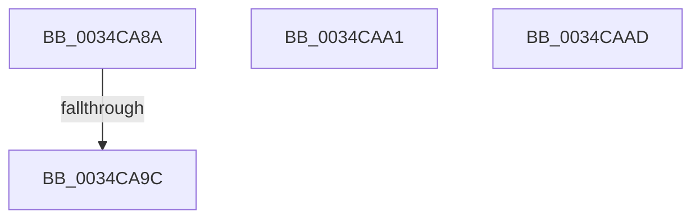

# sub_0034CA8A

- RVA: `0x0034CA8A`–`0x0034CAB5` (길이 `43` bytes)
- VA: `0x000000014034CA8A`
- 실행 섹션: `.text`
- PDB 이름 있음: `아니요`; PDB Function 태그: `아니요`
- unwind 정보 RVA: `0x000787A4`
- 디코드: `9`개 명령, `43/43` bytes 표시
- 미해석 바이트: `0` (있으면 어셈블리에 `.byte`로 보존)

> 이 문서는 커널 이미지의 기계어와 PDB 기호를 분석해 생성했습니다. 4번과 5번은 함수 원형과 자료형을 바이너리 사용 방식에서 추정한 C 해석이며 원본 소스 복구 결과는 아닙니다.

## 1. Dependencies

- 직접 호출 지점: **0**; 고유 호출 대상: **0**
- 직접 호출자로 확인된 함수: **0**
- RIP 상대 이미지 참조: **0**

### Outgoing calls
- 직접 디코드된 call 명령이 없습니다.

### Direct callers
- 이 함수 시작 RVA로 연결되는 직접 call은 확인되지 않았습니다. 간접 호출은 완전히 역산할 수 없습니다.

### Static image references
- 디코드된 RIP-relative 메모리 참조가 없습니다.

## 2. Other-region calls and transfers

- 다른 실행 섹션으로 향하는 call: **0**
- call이 아닌 외부 분기/꼬리 이동: **4**
  - `0x0034CA96` → [sub_0034C8E9 + 0xF7](Unknown_function_0034C8E9.md) (`tail-transfer`)
  - `0x0034CA9C` → [sub_0034C8E9 + 0xFD](Unknown_function_0034C8E9.md) (`tail-transfer`)
  - `0x0034CAA8` → [sub_0034C8E9 + 0x139](Unknown_function_0034C8E9.md) (`tail-transfer`)
  - `0x0034CAB0` → [sub_0034C8E9 + 0x143](Unknown_function_0034C8E9.md) (`tail-transfer`)

## 3. Assembly (complete function range)

```asm
0034CA8A  49 83 2E 01                     sub qword ptr [r14], 1
0034CA8E  49 8B 0F                        mov rcx, qword ptr [r15]
0034CA91  48 89 4C 24 30                  mov qword ptr [rsp + 0x30], rcx
0034CA96  0F 85 44 FF FF FF               jne 0x14034c9e0
0034CA9C  E9 45 FF FF FF                  jmp 0x14034c9e6
0034CAA1  49 C7 06 00 00 00 00            mov qword ptr [r14], 0
0034CAA8  E9 75 FF FF FF                  jmp 0x14034ca22
0034CAAD  49 89 1E                        mov qword ptr [r14], rbx
0034CAB0  E9 77 FF FF FF                  jmp 0x14034ca2c
```

## 4. C-style interpretation (structured pseudocode)

```c
void __fastcall sub_0034CA8A(void)
{
    unsigned __int64 v_stack_p30;

    v_stack_p30 = *(unsigned __int64 *)(v_r15);
}
```

## 5. (Beta) C Style

```c
void sub_0034CA8A(void)
{
    uint64_t v_stack_p30;

    v_stack_p30 = *(uint64_t *)(local_r15);
}
```

## 6. Execution-region graph

[열기: 2D/3D 그래프와 함수 탐색 컨트롤 패널](../../../control-panel.html?section=text&rva=0x0034CA8A&view=graph)

- 2D 그래프는 위에서 아래로 흐르고, 3D 그래프는 빈 공간을 드래그해 회전합니다. Shift+드래그는 이동, 휠은 확대·축소, 함수 노드 선택은 대상 보고서 이동입니다.

### Static fallback


