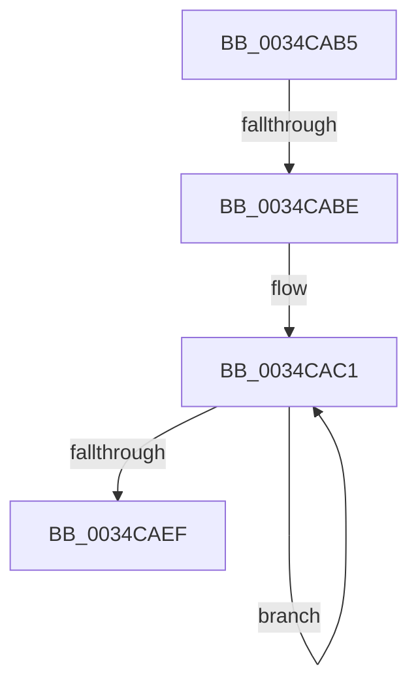

# sub_0034CAB5

- RVA: `0x0034CAB5`–`0x0034CB00` (길이 `75` bytes)
- VA: `0x000000014034CAB5`
- 실행 섹션: `.text`
- PDB 이름 있음: `아니요`; PDB Function 태그: `아니요`
- unwind 정보 RVA: `0x000787B8`
- 디코드: `16`개 명령, `75/75` bytes 표시
- 미해석 바이트: `0` (있으면 어셈블리에 `.byte`로 보존)

> 이 문서는 커널 이미지의 기계어와 PDB 기호를 분석해 생성했습니다. 4번과 5번은 함수 원형과 자료형을 바이너리 사용 방식에서 추정한 C 해석이며 원본 소스 복구 결과는 아닙니다.

## 1. Dependencies

- 직접 호출 지점: **2**; 고유 호출 대상: **2**
- 직접 호출자로 확인된 함수: **0**
- RIP 상대 이미지 참조: **0**

### Outgoing calls
- `0x0034CAE0` → [ZwUnlockVirtualMemory](../6B/ZwUnlockVirtualMemory_function_006B0CB0.md) (function, `0x006B0CB0`)
- `0x0034CAF6` → [StLockAcquireShared](StLockAcquireShared_function_0034C728.md) (function, `0x0034C728`)

### Direct callers
- 이 함수 시작 RVA로 연결되는 직접 call은 확인되지 않았습니다. 간접 호출은 완전히 역산할 수 없습니다.

### Static image references
- 디코드된 RIP-relative 메모리 참조가 없습니다.

## 2. Other-region calls and transfers

- 다른 실행 섹션으로 향하는 call: **0**
- call이 아닌 외부 분기/꼬리 이동: **2**
  - `0x0034CAB8` → [sub_0034CA36](Unknown_function_0034CA36.md) (`tail-transfer`)
  - `0x0034CAFB` → [sub_0034CA36 + 0x11](Unknown_function_0034CA36.md) (`tail-transfer`)

## 3. Assembly (complete function range)

```asm
0034CAB5  45 85 ED                        test r13d, r13d
0034CAB8  0F 84 78 FF FF FF               je 0x14034ca36
0034CABE  49 8B DD                        mov rbx, r13
0034CAC1  49 8B 07                        mov rax, qword ptr [r15]
0034CAC4  4C 8D 44 24 38                  lea r8, [rsp + 0x38]
0034CAC9  41 B9 01 00 00 00               mov r9d, 1
0034CACF  48 89 44 24 30                  mov qword ptr [rsp + 0x30], rax
0034CAD4  48 8D 54 24 30                  lea rdx, [rsp + 0x30]
0034CAD9  48 C7 C1 FF FF FF FF            mov rcx, 0xffffffffffffffff
0034CAE0  E8 CB 41 36 00                  call 0x1406b0cb0
0034CAE5  4D 8D 7F 08                     lea r15, [r15 + 8]
0034CAE9  48 83 EB 01                     sub rbx, 1
0034CAED  75 D2                           jne 0x14034cac1
0034CAEF  48 8D 8F 98 1A 00 00            lea rcx, [rdi + 0x1a98]
0034CAF6  E8 2D FC FF FF                  call 0x14034c728
0034CAFB  E9 47 FF FF FF                  jmp 0x14034ca47
```

## 4. C-style interpretation (structured pseudocode)

```c
__int64 __fastcall sub_0034CAB5(__int64 a1, __int64 a2, __int64 a3, __int64 a4, __int64 a5, __int64 a6, __int64 a7)
{
    __int64 result;
    __int64 v_rbx;
    unsigned __int64 v_stack_p30;

loc_0034CAC1:
    v_stack_p30 = *(unsigned __int64 *)(v_r15);
    result = ZwUnlockVirtualMemory(-1, a6, a7, 1);
    v_rbx = (v_r13) - (1);
    if (condition_is_not_equal) goto loc_0034CAC1;
    result = StLockAcquireShared(v_rdi + 6808, a6, a7, 1);
}
```

## 5. (Beta) C Style

```c
int64_t sub_0034CAB5(int64_t Arg1, int64_t Arg2, int64_t Arg3, int64_t Arg4, uint64_t Arg5, int64_t Arg6, int64_t Arg7)
{
    int64_t result;
    int64_t local_rbx;
    uint64_t v_stack_p30;

loc_0034CAC1:
    v_stack_p30 = *(uint64_t *)(local_r15);
    result = ZwUnlockVirtualMemory(-1, Arg6, Arg7, 1);
    local_rbx = (local_r13) - (1);
    if (condition_is_not_equal) goto loc_0034CAC1;
    result = StLockAcquireShared(local_rdi + 6808, Arg6, Arg7, 1);
}
```

## 6. Execution-region graph

[열기: 2D/3D 그래프와 함수 탐색 컨트롤 패널](../../../control-panel.html?section=text&rva=0x0034CAB5&view=graph)

- 2D 그래프는 위에서 아래로 흐르고, 3D 그래프는 빈 공간을 드래그해 회전합니다. Shift+드래그는 이동, 휠은 확대·축소, 함수 노드 선택은 대상 보고서 이동입니다.

### Static fallback


