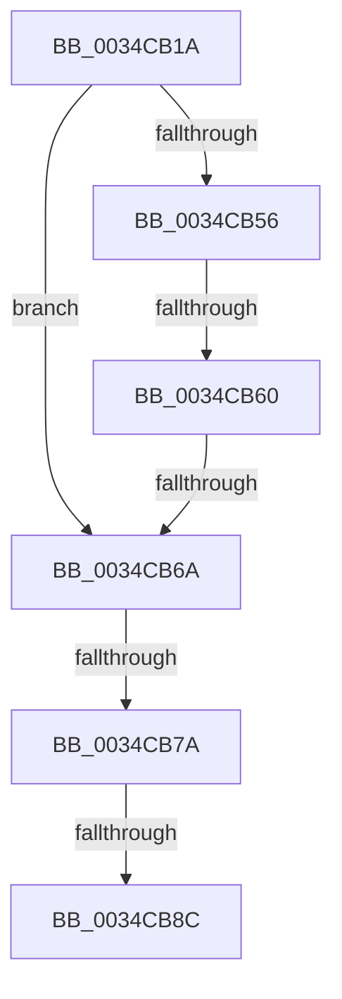

# sub_0034CB1A

- RVA: `0x0034CB1A`–`0x0034CBA6` (길이 `140` bytes)
- VA: `0x000000014034CB1A`
- 실행 섹션: `.text`
- PDB 이름 있음: `아니요`; PDB Function 태그: `아니요`
- unwind 정보 RVA: `0x000787D8`
- 디코드: `34`개 명령, `140/140` bytes 표시
- 미해석 바이트: `0` (있으면 어셈블리에 `.byte`로 보존)

> 이 문서는 커널 이미지의 기계어와 PDB 기호를 분석해 생성했습니다. 4번과 5번은 함수 원형과 자료형을 바이너리 사용 방식에서 추정한 C 해석이며 원본 소스 복구 결과는 아닙니다.

## 1. Dependencies

- 직접 호출 지점: **0**; 고유 호출 대상: **0**
- 직접 호출자로 확인된 함수: **0**
- RIP 상대 이미지 참조: **0**

### Outgoing calls
- 직접 디코드된 call 명령이 없습니다.

### Direct callers
- 이 함수 시작 RVA로 연결되는 직접 call은 확인되지 않았습니다. 간접 호출은 완전히 역산할 수 없습니다.

### Static image references
- 디코드된 RIP-relative 메모리 참조가 없습니다.

## 2. Other-region calls and transfers

- 다른 실행 섹션으로 향하는 call: **0**
- call이 아닌 외부 분기/꼬리 이동: **5**
  - `0x0034CB5A` → [sub_0034CBFD](Unknown_function_0034CBFD.md) (`tail-transfer`)
  - `0x0034CB64` → [sub_0034CBFD](Unknown_function_0034CBFD.md) (`tail-transfer`)
  - `0x0034CB74` → [sub_0034CBFD + 0x51](Unknown_function_0034CBFD.md) (`tail-transfer`)
  - `0x0034CB86` → [sub_0034CBFD + 0x86](Unknown_function_0034CBFD.md) (`tail-transfer`)
  - `0x0034CBA4` → [sub_0034CBA6 + 0x39](Unknown_function_0034CBA6.md) (`tail-transfer`)

## 3. Assembly (complete function range)

```asm
0034CB1A  48 89 7C 24 68                  mov qword ptr [rsp + 0x68], rdi
0034CB1F  48 8D 5A 08                     lea rbx, [rdx + 8]
0034CB23  4C 89 64 24 70                  mov qword ptr [rsp + 0x70], r12
0034CB28  48 8D 7A 14                     lea rdi, [rdx + 0x14]
0034CB2C  4C 89 6C 24 78                  mov qword ptr [rsp + 0x78], r13
0034CB31  49 8B E9                        mov rbp, r9
0034CB34  4D 8B E8                        mov r13, r8
0034CB37  4C 89 7C 24 30                  mov qword ptr [rsp + 0x30], r15
0034CB3C  45 33 C0                        xor r8d, r8d
0034CB3F  4C 8B F2                        mov r14, rdx
0034CB42  F7 81 08 03 00 00 00 00 02 00   test dword ptr [rcx + 0x308], 0x20000
0034CB4C  48 8B F1                        mov rsi, rcx
0034CB4F  44 89 44 24 60                  mov dword ptr [rsp + 0x60], r8d
0034CB54  74 14                           je 0x14034cb6a
0034CB56  48 83 3B 02                     cmp qword ptr [rbx], 2
0034CB5A  0F 84 9D 00 00 00               je 0x14034cbfd
0034CB60  8B 07                           mov eax, dword ptr [rdi]
0034CB62  A8 0C                           test al, 0xc
0034CB64  0F 85 93 00 00 00               jne 0x14034cbfd
0034CB6A  4D 8B E0                        mov r12, r8
0034CB6D  4D 8B F8                        mov r15, r8
0034CB70  48 83 3B 02                     cmp qword ptr [rbx], 2
0034CB74  0F 84 D4 00 00 00               je 0x14034cc4e
0034CB7A  8B AC 24 80 00 00 00            mov ebp, dword ptr [rsp + 0x80]
0034CB81  8B 07                           mov eax, dword ptr [rdi]
0034CB83  83 E0 0C                        and eax, 0xc
0034CB86  0F 85 F7 00 00 00               jne 0x14034cc83
0034CB8C  8B 07                           mov eax, dword ptr [rdi]
0034CB8E  4C 8B 7C 24 30                  mov r15, qword ptr [rsp + 0x30]
0034CB93  4C 8B 6C 24 78                  mov r13, qword ptr [rsp + 0x78]
0034CB98  4C 8B 64 24 70                  mov r12, qword ptr [rsp + 0x70]
0034CB9D  48 8B 7C 24 68                  mov rdi, qword ptr [rsp + 0x68]
0034CBA2  A8 01                           test al, 1
0034CBA4  74 39                           je 0x14034cbdf
```

## 4. C-style interpretation (structured pseudocode)

```c
__int64 __fastcall sub_0034CB1A(__int64 a1, __int64 a2, __int64 a3, __int64 a4, __int64 a5, __int64 a6, __int64 a7, __int64 a8, __int64 a9, __int64 a10, __int64 a11, __int64 a12, __int64 a13, __int64 a14, __int64 a15, unsigned int a16)
{
    __int64 result;
    unsigned __int64 v_stack_p30;
    unsigned int v_stack_p60;
    unsigned __int64 v_stack_p68;
    unsigned __int64 v_stack_p70;
    unsigned __int64 v_stack_p78;

    v_stack_p68 = v_rdi;
    v_stack_p70 = v_r12;
    v_stack_p78 = v_r13;
    v_stack_p30 = v_r15;
    a3 = 0;
    v_stack_p60 = 0;
    if (((*(unsigned int *)(a1 + 776)) & (0x20000ULL)) == 0) goto loc_0034CB6A;
loc_0034CB6A:
    result = (unsigned int)(((unsigned int)(*(unsigned int *)(a2 + 20))) & (12));
}
```

## 5. (Beta) C Style

```c
int64_t sub_0034CB1A(void *Arg1, void *Arg2, int64_t Arg3, int64_t Arg4, uint64_t Arg5, int64_t Arg6, uint64_t Arg7, uint64_t Arg8, uint64_t Arg9, uint64_t Arg10, uint64_t Arg11, uint64_t Arg12, int64_t Arg13, int64_t Arg14, int64_t Arg15, uint32_t Arg16)
{
    uint8_t *arg1 = (uint8_t *)Arg1;
    uint8_t *arg2 = (uint8_t *)Arg2;

    int64_t result;
    uint64_t v_stack_p30;
    uint32_t v_stack_p60;
    uint64_t v_stack_p68;
    uint64_t v_stack_p70;
    uint64_t v_stack_p78;

    v_stack_p68 = local_rdi;
    v_stack_p70 = local_r12;
    v_stack_p78 = local_r13;
    v_stack_p30 = local_r15;
    Arg3 = 0;
    v_stack_p60 = 0;
    if (((*(uint32_t *)(arg1 + 0x308)) & (0x20000ULL)) == 0) goto loc_0034CB6A;
loc_0034CB6A:
    result = (uint32_t)(((uint32_t)(*(uint32_t *)(arg2 + 0x14))) & (12));
}
```

### 관측된 메모리 오프셋

구조체 형식이 확인되지 않은 접근은 인자 기준의 오프셋으로만 기록했습니다.

| 기준 인자 | 오프셋 표현 | 폭 (bit) | 접근 |
|---|---:|---:|---|
| `Arg1` | `+ 0x308` | `32` | `R` |
| `Arg2` | `+ 0x0` | `32` | `R` |
| `Arg2` | `+ 0x0` | `64` | `R` |
| `Arg2` | `+ 0x8` | `64` | `R` |
| `Arg2` | `+ 0x14` | `64` | `R` |

## 6. Execution-region graph

[열기: 2D/3D 그래프와 함수 탐색 컨트롤 패널](../../../control-panel.html?section=text&rva=0x0034CB1A&view=graph)

- 2D 그래프는 위에서 아래로 흐르고, 3D 그래프는 빈 공간을 드래그해 회전합니다. Shift+드래그는 이동, 휠은 확대·축소, 함수 노드 선택은 대상 보고서 이동입니다.

### Static fallback


