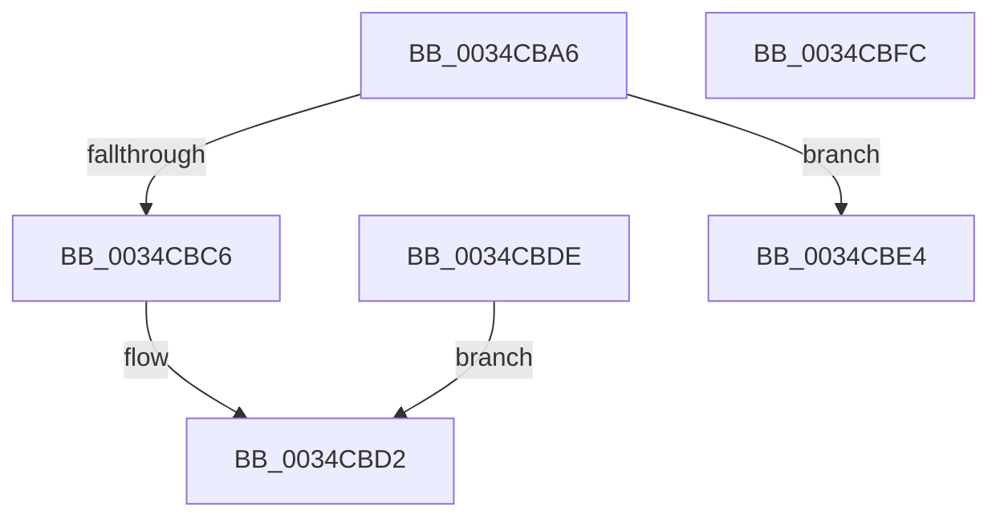

# sub_0034CBA6

- RVA: `0x0034CBA6`–`0x0034CBFD` (길이 `87` bytes)
- VA: `0x000000014034CBA6`
- 실행 섹션: `.text`
- PDB 이름 있음: `아니요`; PDB Function 태그: `아니요`
- unwind 정보 RVA: `0x000787F8`
- 디코드: `29`개 명령, `87/87` bytes 표시
- 미해석 바이트: `0` (있으면 어셈블리에 `.byte`로 보존)

> 이 문서는 커널 이미지의 기계어와 PDB 기호를 분석해 생성했습니다. 4번과 5번은 함수 원형과 자료형을 바이너리 사용 방식에서 추정한 C 해석이며 원본 소스 복구 결과는 아닙니다.

## 1. Dependencies

- 직접 호출 지점: **2**; 고유 호출 대상: **2**
- 직접 호출자로 확인된 함수: **0**
- RIP 상대 이미지 참조: **0**

### Outgoing calls
- `0x0034CBC6` → [SMKM_STORE<SM_TRAITS>::SmStUnmapVirtualRegion](SMKM_STORE_SM_TRAITS_SmStUnmapVirtualRegion_function_0034CCA0.md) (function, `0x0034CCA0`)
- `0x0034CBE4` → [SMKM_STORE<SM_TRAITS>::SmStUnmapPhysicalRegion](../3E/SMKM_STORE_SM_TRAITS_SmStUnmapPhysicalRegion_function_003E76E0.md) (function, `0x003E76E0`)

### Direct callers
- 이 함수 시작 RVA로 연결되는 직접 call은 확인되지 않았습니다. 간접 호출은 완전히 역산할 수 없습니다.

### Static image references
- 디코드된 RIP-relative 메모리 참조가 없습니다.

## 2. Other-region calls and transfers

- 다른 실행 섹션으로 향하는 call: **0**
- 별도 외부 분기/꼬리 이동을 확인하지 못했습니다.

## 3. Assembly (complete function range)

```asm
0034CBA6  8B 8E 2C 03 00 00               mov ecx, dword ptr [rsi + 0x32c]
0034CBAC  41 8B 16                        mov edx, dword ptr [r14]
0034CBAF  D3 EA                           shr edx, cl
0034CBB1  48 8B 8E 20 03 00 00            mov rcx, qword ptr [rsi + 0x320]
0034CBB8  44 89 44 24 28                  mov dword ptr [rsp + 0x28], r8d
0034CBBD  F6 81 95 1A 00 00 04            test byte ptr [rcx + 0x1a95], 4
0034CBC4  74 1E                           je 0x14034cbe4
0034CBC6  E8 D5 00 00 00                  call 0x14034cca0
0034CBCB  48 C7 03 00 00 00 00            mov qword ptr [rbx], 0
0034CBD2  8B C5                           mov eax, ebp
0034CBD4  48 83 C4 38                     add rsp, 0x38
0034CBD8  41 5E                           pop r14
0034CBDA  5E                              pop rsi
0034CBDB  5D                              pop rbp
0034CBDC  5B                              pop rbx
0034CBDD  C3                              ret
0034CBDE  CC                              int3
0034CBDF  4C 89 03                        mov qword ptr [rbx], r8
0034CBE2  EB EE                           jmp 0x14034cbd2
0034CBE4  E8 F7 AA 09 00                  call 0x1403e76e0
0034CBE9  8B C5                           mov eax, ebp
0034CBEB  48 C7 03 00 00 00 00            mov qword ptr [rbx], 0
0034CBF2  48 83 C4 38                     add rsp, 0x38
0034CBF6  41 5E                           pop r14
0034CBF8  5E                              pop rsi
0034CBF9  5D                              pop rbp
0034CBFA  5B                              pop rbx
0034CBFB  C3                              ret
0034CBFC  CC                              int3
```

## 4. C-style interpretation (structured pseudocode)

```c
__int64 __fastcall sub_0034CBA6(__int64 a1, __int64 a2, __int64 a3)
{
    __int64 result;
    __int64 v_rsp;
    unsigned int v_stack_p28;

    a2 = (unsigned int)(((unsigned int)(*(unsigned int *)(v_r14))) >> ((unsigned __int8)((unsigned int)(*(unsigned int *)(v_rsi + 812)))));
    v_stack_p28 = (unsigned int)(a3);
    if (((*(unsigned __int8 *)(*(unsigned __int64 *)(v_rsi + 800) + 6805)) & (4)) == 0) goto loc_0034CBE4;
    result = SMKM_STORE_SM_TRAITS___SmStUnmapVirtualRegion(*(unsigned __int64 *)(v_rsi + 800), a2, a3, a4);
    *(unsigned __int64 *)(v_rbx) = 0;
loc_0034CBD2:
    v_rsp = (v_rsp) + (56);
    return (unsigned int)((unsigned int)(v_rbp));
loc_0034CBE4:
    result = SMKM_STORE_SM_TRAITS___SmStUnmapPhysicalRegion(*(unsigned __int64 *)(v_rsi + 800), a2, a3, a4);
    *(unsigned __int64 *)(v_rbx) = 0;
    v_rsp = (v_rsp) + (56);
    return (unsigned int)((unsigned int)(v_rbp));
}
```

## 5. (Beta) C Style

```c
int64_t sub_0034CBA6(int64_t Arg1, int64_t Arg2, int64_t Arg3)
{
    int64_t result;
    int64_t local_rsp;
    uint32_t v_stack_p28;

    Arg2 = (uint32_t)(((uint32_t)(*(uint32_t *)(local_r14))) >> ((uint8_t)((uint32_t)(*(uint32_t *)(local_rsi + 0x32C)))));
    v_stack_p28 = (uint32_t)(Arg3);
    if (((*(uint8_t *)(*(uint64_t *)(local_rsi + 0x320) + 0x1A95)) & (4)) == 0) goto loc_0034CBE4;
    result = SMKM_STORE_SM_TRAITS___SmStUnmapVirtualRegion(*(uint64_t *)(local_rsi + 0x320), Arg2, Arg3, a4);
    *(uint64_t *)(local_rbx) = 0;
loc_0034CBD2:
    local_rsp = (local_rsp) + (56);
    return (uint32_t)((uint32_t)(local_rbp));
loc_0034CBE4:
    result = SMKM_STORE_SM_TRAITS___SmStUnmapPhysicalRegion(*(uint64_t *)(local_rsi + 0x320), Arg2, Arg3, a4);
    *(uint64_t *)(local_rbx) = 0;
    local_rsp = (local_rsp) + (56);
    return (uint32_t)((uint32_t)(local_rbp));
}
```

## 6. Execution-region graph

[열기: 2D/3D 그래프와 함수 탐색 컨트롤 패널](../../../control-panel.html?section=text&rva=0x0034CBA6&view=graph)

- 2D 그래프는 위에서 아래로 흐르고, 3D 그래프는 빈 공간을 드래그해 회전합니다. Shift+드래그는 이동, 휠은 확대·축소, 함수 노드 선택은 대상 보고서 이동입니다.

### Static fallback


