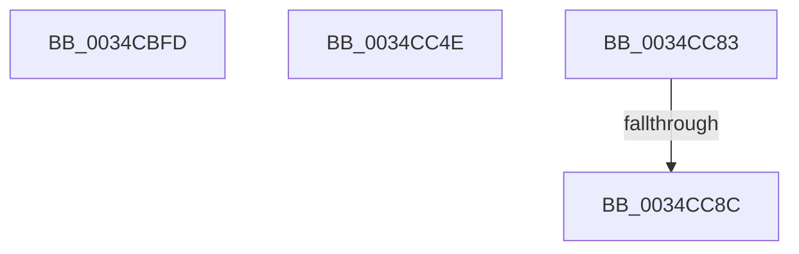

# sub_0034CBFD

- RVA: `0x0034CBFD`–`0x0034CC96` (길이 `153` bytes)
- VA: `0x000000014034CBFD`
- 실행 섹션: `.text`
- PDB 이름 있음: `아니요`; PDB Function 태그: `아니요`
- unwind 정보 RVA: `0x00078810`
- 디코드: `35`개 명령, `153/153` bytes 표시
- 미해석 바이트: `0` (있으면 어셈블리에 `.byte`로 보존)

> 이 문서는 커널 이미지의 기계어와 PDB 기호를 분석해 생성했습니다. 4번과 5번은 함수 원형과 자료형을 바이너리 사용 방식에서 추정한 C 해석이며 원본 소스 복구 결과는 아닙니다.

## 1. Dependencies

- 직접 호출 지점: **3**; 고유 호출 대상: **3**
- 직접 호출자로 확인된 함수: **0**
- RIP 상대 이미지 참조: **0**

### Outgoing calls
- `0x0034CC24` → [SMKM_STORE<SM_TRAITS>::SmStMapRegion](SMKM_STORE_SM_TRAITS_SmStMapRegion_function_0034D738.md) (function, `0x0034D738`)
- `0x0034CC35` → [SmMapPage](../31/SmMapPage_function_003187A0.md) (function, `0x003187A0`)
- `0x0034CC74` → [ST_STORE<SM_TRAITS>::StDmSinglePageCopy](../31/ST_STORE_SM_TRAITS_StDmSinglePageCopy_function_00317F44.md) (function, `0x00317F44`)

### Direct callers
- 이 함수 시작 RVA로 연결되는 직접 call은 확인되지 않았습니다. 간접 호출은 완전히 역산할 수 없습니다.

### Static image references
- 디코드된 RIP-relative 메모리 참조가 없습니다.

## 2. Other-region calls and transfers

- 다른 실행 섹션으로 향하는 call: **0**
- call이 아닌 외부 분기/꼬리 이동: **4**
  - `0x0034CC49` → [sub_0034CB1A + 0x56](Unknown_function_0034CB1A.md) (`tail-transfer`)
  - `0x0034CC7E` → [sub_0034CB1A + 0x67](Unknown_function_0034CB1A.md) (`tail-transfer`)
  - `0x0034CC86` → [sub_006E224E](../6E/Unknown_function_006E224E.md) (`tail-transfer`)
  - `0x0034CC91` → [sub_006E224E + 0xB](../6E/Unknown_function_006E224E.md) (`tail-transfer`)

## 3. Assembly (complete function range)

```asm
0034CBFD  44 8B 81 28 03 00 00            mov r8d, dword ptr [rcx + 0x328]
0034CC04  8B 12                           mov edx, dword ptr [rdx]
0034CC06  44 23 C2                        and r8d, edx
0034CC09  8B 89 2C 03 00 00               mov ecx, dword ptr [rcx + 0x32c]
0034CC0F  D3 EA                           shr edx, cl
0034CC11  48 8B 8E 20 03 00 00            mov rcx, qword ptr [rsi + 0x320]
0034CC18  41 C1 E0 04                     shl r8d, 4
0034CC1C  C7 44 24 20 02 00 00 00         mov dword ptr [rsp + 0x20], 2
0034CC24  E8 0F 0B 00 00                  call 0x14034d738
0034CC29  48 8B 4D 10                     mov rcx, qword ptr [rbp + 0x10]
0034CC2D  48 8D 54 24 60                  lea rdx, [rsp + 0x60]
0034CC32  4C 8B E0                        mov r12, rax
0034CC35  E8 66 BB FC FF                  call 0x1403187a0
0034CC3A  45 0F B7 7E 06                  movzx r15d, word ptr [r14 + 6]
0034CC3F  49 C1 E7 0C                     shl r15, 0xc
0034CC43  4C 03 F8                        add r15, rax
0034CC46  45 33 C0                        xor r8d, r8d
0034CC49  E9 22 FF FF FF                  jmp 0x14034cb70
0034CC4E  49 8B 55 10                     mov rdx, qword ptr [r13 + 0x10]
0034CC52  4D 8B CF                        mov r9, r15
0034CC55  49 83 C9 01                     or r9, 1
0034CC59  4C 89 6C 24 28                  mov qword ptr [rsp + 0x28], r13
0034CC5E  F7 45 08 00 00 00 08            test dword ptr [rbp + 8], 0x8000000
0034CC65  4D 8B C4                        mov r8, r12
0034CC68  48 8B CE                        mov rcx, rsi
0034CC6B  4C 89 74 24 20                  mov qword ptr [rsp + 0x20], r14
0034CC70  4D 0F 44 CF                     cmove r9, r15
0034CC74  E8 CB B2 FC FF                  call 0x140317f44
0034CC79  8B E8                           mov ebp, eax
0034CC7B  45 33 C0                        xor r8d, r8d
0034CC7E  E9 FE FE FF FF                  jmp 0x14034cb81
0034CC83  83 F8 04                        cmp eax, 4
0034CC86  0F 85 C2 55 39 00               jne 0x1406e224e
0034CC8C  BD E0 04 00 C0                  mov ebp, 0xc00004e0
0034CC91  E9 C3 55 39 00                  jmp 0x1406e2259
```

## 4. C-style interpretation (structured pseudocode)

```c
__int64 __fastcall sub_0034CBFD(__int64 a1, __int64 a2, __int64 a3, __int64 a4, __int64 a5, __int64 a6, __int64 a7, __int64 a8, __int64 a9, __int64 a10, __int64 a11, __int64 a12)
{
    __int64 result;
    __int64 v_r15;
    unsigned int v_stack_p20;
    unsigned __int64 v_stack_p28;

    a3 = (unsigned int)(((unsigned int)(*(unsigned int *)(a1 + 808))) & ((unsigned int)((unsigned int)(*(unsigned int *)(a2)))));
    a2 = (unsigned int)(((unsigned int)(*(unsigned int *)(a2))) >> ((unsigned __int8)((unsigned int)(*(unsigned int *)(a1 + 812)))));
    a3 = (unsigned int)((a3) << (4));
    v_stack_p20 = 2;
    result = SMKM_STORE_SM_TRAITS___SmStMapRegion(*(unsigned __int64 *)(v_rsi + 800), a2, a3, a4);
    result = SmMapPage(*(unsigned __int64 *)(v_rbp + 16), a12, a3, a4);
    v_r15 = (*(unsigned __int16 *)(v_r14 + 6)) << (12);
    v_r15 = (v_r15) + (result);
    a3 = 0;
}
```

## 5. (Beta) C Style

```c
int64_t sub_0034CBFD(void *Arg1, void *Arg2, int64_t Arg3, int64_t Arg4, uint64_t Arg5, uint64_t Arg6, uint64_t Arg7, uint64_t Arg8, uint64_t Arg9, uint64_t Arg10, uint64_t Arg11, int64_t Arg12)
{
    uint8_t *arg1 = (uint8_t *)Arg1;
    uint8_t *arg2 = (uint8_t *)Arg2;

    int64_t result;
    int64_t local_r15;
    uint32_t v_stack_p20;
    uint64_t v_stack_p28;

    Arg3 = (uint32_t)(((uint32_t)(*(uint32_t *)(arg1 + 0x328))) & ((uint32_t)((uint32_t)(*(uint32_t *)(arg2)))));
    Arg2 = (uint32_t)(((uint32_t)(*(uint32_t *)(arg2))) >> ((uint8_t)((uint32_t)(*(uint32_t *)(arg1 + 0x32C)))));
    Arg3 = (uint32_t)((Arg3) << (4));
    v_stack_p20 = 2;
    result = SMKM_STORE_SM_TRAITS___SmStMapRegion(*(uint64_t *)(local_rsi + 0x320), Arg2, Arg3, Arg4);
    result = SmMapPage(*(uint64_t *)(local_rbp + 0x10), Arg12, Arg3, Arg4);
    local_r15 = (*(uint16_t *)(local_r14 + 0x6)) << (12);
    local_r15 = (local_r15) + (result);
    Arg3 = 0;
}
```

### 관측된 메모리 오프셋

구조체 형식이 확인되지 않은 접근은 인자 기준의 오프셋으로만 기록했습니다.

| 기준 인자 | 오프셋 표현 | 폭 (bit) | 접근 |
|---|---:|---:|---|
| `Arg1` | `+ 0x328` | `32` | `R` |
| `Arg1` | `+ 0x32C` | `32` | `R` |
| `Arg2` | `+ 0x0` | `32` | `R` |

## 6. Execution-region graph

[열기: 2D/3D 그래프와 함수 탐색 컨트롤 패널](../../../control-panel.html?section=text&rva=0x0034CBFD&view=graph)

- 2D 그래프는 위에서 아래로 흐르고, 3D 그래프는 빈 공간을 드래그해 회전합니다. Shift+드래그는 이동, 휠은 확대·축소, 함수 노드 선택은 대상 보고서 이동입니다.

### Static fallback


