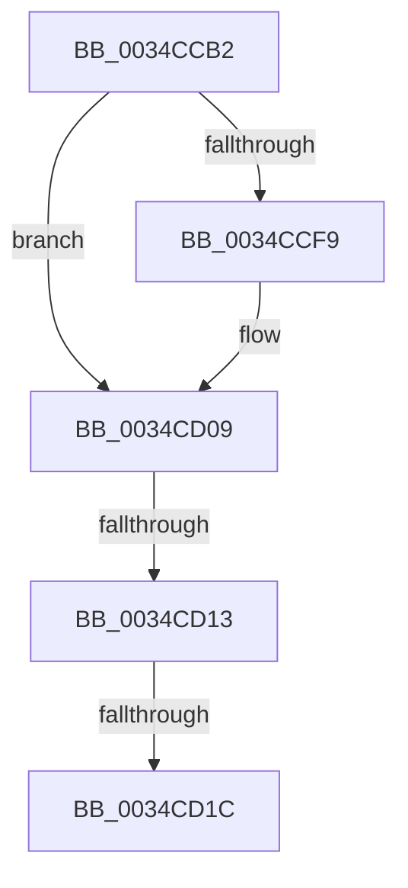

# sub_0034CCB2

- RVA: `0x0034CCB2`–`0x0034CD25` (길이 `115` bytes)
- VA: `0x000000014034CCB2`
- 실행 섹션: `.text`
- PDB 이름 있음: `아니요`; PDB Function 태그: `아니요`
- unwind 정보 RVA: `0x0007885C`
- 디코드: `26`개 명령, `115/115` bytes 표시
- 미해석 바이트: `0` (있으면 어셈블리에 `.byte`로 보존)

> 이 문서는 커널 이미지의 기계어와 PDB 기호를 분석해 생성했습니다. 4번과 5번은 함수 원형과 자료형을 바이너리 사용 방식에서 추정한 C 해석이며 원본 소스 복구 결과는 아닙니다.

## 1. Dependencies

- 직접 호출 지점: **1**; 고유 호출 대상: **1**
- 직접 호출자로 확인된 함수: **0**
- RIP 상대 이미지 참조: **0**

### Outgoing calls
- `0x0034CD04` → [StLockAcquireShared](StLockAcquireShared_function_0034C728.md) (function, `0x0034C728`)

### Direct callers
- 이 함수 시작 RVA로 연결되는 직접 call은 확인되지 않았습니다. 간접 호출은 완전히 역산할 수 없습니다.

### Static image references
- 디코드된 RIP-relative 메모리 참조가 없습니다.

## 2. Other-region calls and transfers

- 다른 실행 섹션으로 향하는 call: **0**
- call이 아닌 외부 분기/꼬리 이동: **2**
  - `0x0034CD0D` → [sub_0034CE47](Unknown_function_0034CE47.md) (`tail-transfer`)
  - `0x0034CD16` → [sub_0034CE47 + 0x78](Unknown_function_0034CE47.md) (`tail-transfer`)

## 3. Assembly (complete function range)

```asm
0034CCB2  48 89 5C 24 58                  mov qword ptr [rsp + 0x58], rbx
0034CCB7  48 8B F1                        mov rsi, rcx
0034CCBA  48 89 6C 24 60                  mov qword ptr [rsp + 0x60], rbp
0034CCBF  48 89 7C 24 68                  mov qword ptr [rsp + 0x68], rdi
0034CCC4  8B 7C 24 78                     mov edi, dword ptr [rsp + 0x78]
0034CCC8  4C 89 74 24 28                  mov qword ptr [rsp + 0x28], r14
0034CCCD  8B D2                           mov edx, edx
0034CCCF  48 8B 2C D0                     mov rbp, qword ptr [rax + rdx*8]
0034CCD3  48 8D 1C D0                     lea rbx, [rax + rdx*8]
0034CCD7  44 8B B1 60 1B 00 00            mov r14d, dword ptr [rcx + 0x1b60]
0034CCDE  48 B8 00 00 FF FF FF FF FF 7F   movabs rax, 0x7fffffffffff0000
0034CCE8  48 23 E8                        and rbp, rax
0034CCEB  4C 89 7C 24 20                  mov qword ptr [rsp + 0x20], r15
0034CCF0  45 8B FD                        mov r15d, r13d
0034CCF3  40 F6 C7 08                     test dil, 8
0034CCF7  74 10                           je 0x14034cd09
0034CCF9  48 81 C1 98 1A 00 00            add rcx, 0x1a98
0034CD00  45 8D 7D 01                     lea r15d, [r13 + 1]
0034CD04  E8 1F FA FF FF                  call 0x14034c728
0034CD09  40 F6 C7 04                     test dil, 4
0034CD0D  0F 84 34 01 00 00               je 0x14034ce47
0034CD13  4C 39 2B                        cmp qword ptr [rbx], r13
0034CD16  0F 8C A3 01 00 00               jl 0x14034cebf
0034CD1C  C1 EF 04                        shr edi, 4
0034CD1F  4C 8B C5                        mov r8, rbp
0034CD22  83 E7 07                        and edi, 7
```

## 4. C-style interpretation (structured pseudocode)

```c
__int64 __fastcall sub_0034CCB2(__int64 a1, int a2, __int64 a3, __int64 a4, __int64 a5, __int64 a6, __int64 a7, __int64 a8, __int64 a9, __int64 a10, __int64 a11, __int64 a12, __int64 a13, __int64 a14, unsigned int a15)
{
    __int64 result;
    __int64 v_r15;
    __int64 v_rbp;
    __int64 v_rdi;
    unsigned __int64 v_stack_p20;
    unsigned __int64 v_stack_p28;
    unsigned __int64 v_stack_p58;
    unsigned __int64 v_stack_p60;
    unsigned __int64 v_stack_p68;

    v_stack_p58 = v_rbx;
    v_stack_p60 = v_rbp;
    v_stack_p68 = v_rdi;
    v_stack_p28 = v_r14;
    v_rbp = (*(unsigned __int64 *)(result + (unsigned int)(a2) * 8)) & (result);
    v_stack_p20 = v_r15;
    v_r15 = (unsigned int)((unsigned int)(v_r13));
    if ((((unsigned __int8)((unsigned int)(a15))) & (8)) != 0) {
        a1 = (a1) + (0x1A98ULL);
        v_r15 = v_r13 + 1;
        result = StLockAcquireShared(a1, (unsigned int)(a2), a3, a4);
    }
    v_rdi = (unsigned int)(((unsigned int)(a15)) >> (4));
    v_rdi = (unsigned int)((v_rdi) & (7));
    return result;
}
```

## 5. (Beta) C Style

```c
int64_t sub_0034CCB2(void *Arg1, int32_t Arg2, int64_t Arg3, int64_t Arg4, uint64_t Arg5, uint64_t Arg6, uint64_t Arg7, uint64_t Arg8, uint64_t Arg9, uint64_t Arg10, uint64_t Arg11, uint64_t Arg12, uint64_t Arg13, uint64_t Arg14, uint32_t Arg15)
{
    uint8_t *arg1 = (uint8_t *)Arg1;

    int64_t result;
    int64_t local_r15;
    int64_t local_rbp;
    int64_t local_rdi;
    uint64_t v_stack_p20;
    uint64_t v_stack_p28;
    uint64_t v_stack_p58;
    uint64_t v_stack_p60;
    uint64_t v_stack_p68;

    v_stack_p58 = local_rbx;
    v_stack_p60 = local_rbp;
    v_stack_p68 = local_rdi;
    v_stack_p28 = local_r14;
    local_rbp = (*(uint64_t *)(result + (uint32_t)(Arg2) * 8)) & (result);
    v_stack_p20 = local_r15;
    local_r15 = (uint32_t)((uint32_t)(local_r13));
    if ((((uint8_t)((uint32_t)(Arg15))) & (8)) != 0) {
        Arg1 = (Arg1) + (0x1A98ULL);
        local_r15 = local_r13 + 1;
        result = StLockAcquireShared(Arg1, (uint32_t)(Arg2), Arg3, Arg4);
    }
    local_rdi = (uint32_t)(((uint32_t)(Arg15)) >> (4));
    local_rdi = (uint32_t)((local_rdi) & (7));
    return result;
}
```

### 관측된 메모리 오프셋

구조체 형식이 확인되지 않은 접근은 인자 기준의 오프셋으로만 기록했습니다.

| 기준 인자 | 오프셋 표현 | 폭 (bit) | 접근 |
|---|---:|---:|---|
| `Arg1` | `+ 0x1B60` | `32` | `R` |

## 6. Execution-region graph

[열기: 2D/3D 그래프와 함수 탐색 컨트롤 패널](../../../control-panel.html?section=text&rva=0x0034CCB2&view=graph)

- 2D 그래프는 위에서 아래로 흐르고, 3D 그래프는 빈 공간을 드래그해 회전합니다. Shift+드래그는 이동, 휠은 확대·축소, 함수 노드 선택은 대상 보고서 이동입니다.

### Static fallback


