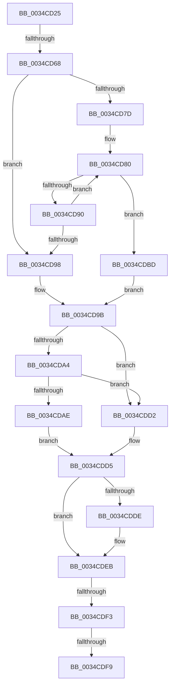

# sub_0034CD25

- RVA: `0x0034CD25`–`0x0034CE1C` (길이 `247` bytes)
- VA: `0x000000014034CD25`
- 실행 섹션: `.text`
- PDB 이름 있음: `아니요`; PDB Function 태그: `아니요`
- unwind 정보 RVA: `0x00078880`
- 디코드: `66`개 명령, `247/247` bytes 표시
- 미해석 바이트: `0` (있으면 어셈블리에 `.byte`로 보존)

> 이 문서는 커널 이미지의 기계어와 PDB 기호를 분석해 생성했습니다. 4번과 5번은 함수 원형과 자료형을 바이너리 사용 방식에서 추정한 C 해석이며 원본 소스 복구 결과는 아닙니다.

## 1. Dependencies

- 직접 호출 지점: **6**; 고유 호출 대상: **6**
- 직접 호출자로 확인된 함수: **0**
- RIP 상대 이미지 참조: **3**

### Outgoing calls
- `0x0034CD2F` → [SMKM_STORE<SM_TRAITS>::SmStFindVirtualLockedRegion](../46/SMKM_STORE_SM_TRAITS_SmStFindVirtualLockedRegion_function_00469C2C.md) (function, `0x00469C2C`)
- `0x0034CD4B` → [SmKmUnlockMdl](../37/SmKmUnlockMdl_function_00372A44.md) (function, `0x00372A44`)
- `0x0034CD6B` → [ExAcquireSpinLockExclusive](../24/ExAcquireSpinLockExclusive_function_00248690.md) (function, `0x00248690`)
- `0x0034CDB6` → [ExpReleaseSpinLockExclusiveFromDpcLevelInstrumented](../2C/ExpReleaseSpinLockExclusiveFromDpcLevelInstrumented_function_002C0F44.md) (function, `0x002C0F44`)
- `0x0034CDE6` → [KiLowerIrqlProcessIrqlFlags](../4F/KiLowerIrqlProcessIrqlFlags_function_004F5698.md) (function, `0x004F5698`)
- `0x0034CE09` → [KeSetEvent](../33/KeSetEvent_function_0033F310.md) (function, `0x0033F310`)

### Direct callers
- 이 함수 시작 RVA로 연결되는 직접 call은 확인되지 않았습니다. 간접 호출은 완전히 역산할 수 없습니다.

### Static image references
- `0x0034CD9B` → RVA `0x00FC6B06` (`ALMOSTRO`; read)
- `0x0034CDA4` → RVA `0x00F0DE58` (`.data`; read)
- `0x0034CDD5` → RVA `0x00FC6D20` (`ALMOSTRO`; read)

## 2. Other-region calls and transfers

- 다른 실행 섹션으로 향하는 call: **0**
- call이 아닌 외부 분기/꼬리 이동: **4**
  - `0x0034CD62` → [sub_0034CE1C](Unknown_function_0034CE1C.md) (`tail-transfer`)
  - `0x0034CDF1` → [sub_0034CE1C](Unknown_function_0034CE1C.md) (`tail-transfer`)
  - `0x0034CDF7` → [sub_0034CE1C + 0x20](Unknown_function_0034CE1C.md) (`tail-transfer`)
  - `0x0034CE17` → [sub_0034CE47 + 0x78](Unknown_function_0034CE47.md) (`tail-transfer`)

## 3. Assembly (complete function range)

```asm
0034CD25  4C 89 64 24 30                  mov qword ptr [rsp + 0x30], r12
0034CD2A  8B D7                           mov edx, edi
0034CD2C  48 8B CE                        mov rcx, rsi
0034CD2F  E8 F8 CE 11 00                  call 0x140469c2c
0034CD34  48 8B 96 88 1C 00 00            mov rdx, qword ptr [rsi + 0x1c88]
0034CD3B  48 8D 9E 08 1C 00 00            lea rbx, [rsi + 0x1c08]
0034CD42  4C 8B C3                        mov r8, rbx
0034CD45  4C 8B E0                        mov r12, rax
0034CD48  48 8B 08                        mov rcx, qword ptr [rax]
0034CD4B  E8 F4 5C 02 00                  call 0x140372a44
0034CD50  48 8B BE 88 1C 00 00            mov rdi, qword ptr [rsi + 0x1c88]
0034CD57  49 8B 2C 24                     mov rbp, qword ptr [r12]
0034CD5B  48 8B 4F 70                     mov rcx, qword ptr [rdi + 0x70]
0034CD5F  48 3B CB                        cmp rcx, rbx
0034CD62  0F 85 B4 00 00 00               jne 0x14034ce1c
0034CD68  48 8B CF                        mov rcx, rdi
0034CD6B  E8 20 B9 EF FF                  call 0x140248690
0034CD70  48 8B 57 38                     mov rdx, qword ptr [rdi + 0x38]
0034CD74  44 0F B6 F0                     movzx r14d, al
0034CD78  48 85 D2                        test rdx, rdx
0034CD7B  74 1B                           je 0x14034cd98
0034CD7D  0F 1F 00                        nop dword ptr [rax]
0034CD80  4C 8B 42 08                     mov r8, qword ptr [rdx + 8]
0034CD84  49 8B C8                        mov rcx, r8
0034CD87  48 83 E1 F8                     and rcx, 0xfffffffffffffff8
0034CD8B  48 3B CD                        cmp rcx, rbp
0034CD8E  74 2D                           je 0x14034cdbd
0034CD90  48 8B 12                        mov rdx, qword ptr [rdx]
0034CD93  48 85 D2                        test rdx, rdx
0034CD96  75 E8                           jne 0x14034cd80
0034CD98  41 8B DD                        mov ebx, r13d
0034CD9B  F6 05 64 9D C7 00 01            test byte ptr [rip + 0xc79d64], 1
0034CDA2  74 2E                           je 0x14034cdd2
0034CDA4  8B 05 AE 10 BC 00               mov eax, dword ptr [rip + 0xbc10ae]
0034CDAA  85 C0                           test eax, eax
0034CDAC  75 24                           jne 0x14034cdd2
0034CDAE  48 8B 54 24 48                  mov rdx, qword ptr [rsp + 0x48]
0034CDB3  48 8B CF                        mov rcx, rdi
0034CDB6  E8 89 41 F7 FF                  call 0x1402c0f44
0034CDBB  EB 18                           jmp 0x14034cdd5
0034CDBD  41 83 E0 FE                     and r8d, 0xfffffffe
0034CDC1  BB 01 00 00 00                  mov ebx, 1
0034CDC6  44 89 42 08                     mov dword ptr [rdx + 8], r8d
0034CDCA  FE 4F 5A                        dec byte ptr [rdi + 0x5a]
0034CDCD  FE 4F 5E                        dec byte ptr [rdi + 0x5e]
0034CDD0  EB C9                           jmp 0x14034cd9b
0034CDD2  44 89 2F                        mov dword ptr [rdi], r13d
0034CDD5  44 39 2D 44 9F C7 00            cmp dword ptr [rip + 0xc79f44], r13d
0034CDDC  74 0D                           je 0x14034cdeb
0034CDDE  44 0F 20 C1                     mov rcx, cr8
0034CDE2  41 0F B6 D6                     movzx edx, r14b
0034CDE6  E8 AD 88 1A 00                  call 0x1404f5698
0034CDEB  45 0F 22 C6                     mov cr8, r14
0034CDEF  85 DB                           test ebx, ebx
0034CDF1  74 29                           je 0x14034ce1c
0034CDF3  44 38 6F 5E                     cmp byte ptr [rdi + 0x5e], r13b
0034CDF7  75 43                           jne 0x14034ce3c
0034CDF9  49 8B C5                        mov rax, r13
0034CDFC  48 8D 4F 08                     lea rcx, [rdi + 8]
0034CE00  48 87 47 70                     xchg qword ptr [rdi + 0x70], rax
0034CE04  45 33 C0                        xor r8d, r8d
0034CE07  33 D2                           xor edx, edx
0034CE09  E8 02 25 FF FF                  call 0x14033f310
0034CE0E  4D 89 2C 24                     mov qword ptr [r12], r13
0034CE12  4C 8B 64 24 30                  mov r12, qword ptr [rsp + 0x30]
0034CE17  E9 A3 00 00 00                  jmp 0x14034cebf
```

## 4. C-style interpretation (structured pseudocode)

```c
__int64 __fastcall sub_0034CD25(__int64 a1, __int64 a2, __int64 a3, __int64 a4, __int64 a5, __int64 a6, __int64 a7, __int64 a8, __int64 a9)
{
    __int64 result;
    unsigned __int64 v_stack_p30;

    v_stack_p30 = v_r12;
    result = SMKM_STORE_SM_TRAITS___SmStFindVirtualLockedRegion(v_rsi, (unsigned int)((unsigned int)(v_rdi)), a3, a4);
    result = SmKmUnlockMdl(*(unsigned __int64 *)(result), *(unsigned __int64 *)(v_rsi + 7304), v_rsi + 7176, a4);
    result = ExAcquireSpinLockExclusive(*(unsigned __int64 *)(v_rsi + 7304), *(unsigned __int64 *)(v_rsi + 7304), v_rsi + 7176, a4);
    if (*(unsigned __int64 *)(*(unsigned __int64 *)(v_rsi + 7304) + 56) == 0) goto loc_0034CD98;
loc_0034CD80:
    a1 = (*(unsigned __int64 *)(*(unsigned __int64 *)(*(unsigned __int64 *)(v_rsi + 7304) + 56) + 8)) & (-8);
    if (a1 == (*(unsigned __int64 *)(result))) goto loc_0034CDBD;
    if (*(unsigned __int64 *)(*(unsigned __int64 *)(*(unsigned __int64 *)(v_rsi + 7304) + 56)) != 0) goto loc_0034CD80;
loc_0034CD98:
loc_0034CD9B:
    if (((*(unsigned __int8 *)(v_rip + 13081956)) & (1)) == 0) goto loc_0034CDD2;
    if ((unsigned int)((unsigned int)(*(unsigned int *)(v_rip + 12325038))) != 0) goto loc_0034CDD2;
    result = ExpReleaseSpinLockExclusiveFromDpcLevelInstrumented(*(unsigned __int64 *)(v_rsi + 7304), a9, *(unsigned __int64 *)(*(unsigned __int64 *)(*(unsigned __int64 *)(v_rsi + 7304) + 56) + 8), a4);
    goto loc_0034CDD5;
loc_0034CDBD:
    a3 = (unsigned int)((*(unsigned __int64 *)(*(unsigned __int64 *)(*(unsigned __int64 *)(v_rsi + 7304) + 56) + 8)) & (0xFFFFFFFEULL));
    *(unsigned int *)(a9 + 8) = (unsigned int)(a3);
    goto loc_0034CD9B;
loc_0034CDD2:
    *(unsigned int *)(*(unsigned __int64 *)(v_rsi + 7304)) = (unsigned int)(v_r13);
loc_0034CDD5:
    if ((*(unsigned int *)(v_rip + 13082436)) != ((unsigned int)(v_r13))) {
        a1 = v_cr8;
        a2 = (unsigned __int8)((unsigned __int8)(result));
        result = KiLowerIrqlProcessIrqlFlags(a1, a2, a3, a4);
    }
    a3 = 0;
    a2 = 0;
    result = KeSetEvent(*(unsigned __int64 *)(v_rsi + 7304) + 8, a2, a3, a4);
    *(unsigned __int64 *)(result) = v_r13;
}
```

## 5. (Beta) C Style

```c
int64_t sub_0034CD25(int64_t Arg1, int64_t Arg2, int64_t Arg3, int64_t Arg4, uint64_t Arg5, int64_t Arg6, uint64_t Arg7, uint64_t Arg8, int64_t Arg9)
{
    int64_t result;
    uint64_t v_stack_p30;

    v_stack_p30 = local_r12;
    result = SMKM_STORE_SM_TRAITS___SmStFindVirtualLockedRegion(local_rsi, (uint32_t)((uint32_t)(local_rdi)), Arg3, Arg4);
    result = SmKmUnlockMdl(*(uint64_t *)(result), *(uint64_t *)(local_rsi + 0x1C88), local_rsi + 7176, Arg4);
    result = ExAcquireSpinLockExclusive(*(uint64_t *)(local_rsi + 0x1C88), *(uint64_t *)(local_rsi + 0x1C88), local_rsi + 7176, Arg4);
    if (*(uint64_t *)(*(uint64_t *)(local_rsi + 0x1C88) + 0x38) == 0) goto loc_0034CD98;
loc_0034CD80:
    Arg1 = (*(uint64_t *)(*(uint64_t *)(*(uint64_t *)(local_rsi + 0x1C88) + 0x38) + 0x8)) & (-8);
    if (Arg1 == (*(uint64_t *)(result))) goto loc_0034CDBD;
    if (*(uint64_t *)(*(uint64_t *)(*(uint64_t *)(local_rsi + 0x1C88) + 0x38)) != 0) goto loc_0034CD80;
loc_0034CD98:
loc_0034CD9B:
    if (((*(uint8_t *)(v_rip + 0xC79D64)) & (1)) == 0) goto loc_0034CDD2;
    if ((uint32_t)((uint32_t)(*(uint32_t *)(v_rip + 0xBC10AE))) != 0) goto loc_0034CDD2;
    result = ExpReleaseSpinLockExclusiveFromDpcLevelInstrumented(*(uint64_t *)(local_rsi + 0x1C88), Arg9, *(uint64_t *)(*(uint64_t *)(*(uint64_t *)(local_rsi + 0x1C88) + 0x38) + 0x8), Arg4);
    goto loc_0034CDD5;
loc_0034CDBD:
    Arg3 = (uint32_t)((*(uint64_t *)(*(uint64_t *)(*(uint64_t *)(local_rsi + 0x1C88) + 0x38) + 0x8)) & (0xFFFFFFFEULL));
    *(uint32_t *)(Arg9 + 0x8) = (uint32_t)(Arg3);
    goto loc_0034CD9B;
loc_0034CDD2:
    *(uint32_t *)(*(uint64_t *)(local_rsi + 0x1C88)) = (uint32_t)(local_r13);
loc_0034CDD5:
    if ((*(uint32_t *)(v_rip + 0xC79F44)) != ((uint32_t)(local_r13))) {
        Arg1 = v_cr8;
        Arg2 = (uint8_t)((uint8_t)(result));
        result = KiLowerIrqlProcessIrqlFlags(Arg1, Arg2, Arg3, Arg4);
    }
    Arg3 = 0;
    Arg2 = 0;
    result = KeSetEvent(*(uint64_t *)(local_rsi + 0x1C88) + 8, Arg2, Arg3, Arg4);
    *(uint64_t *)(result) = local_r13;
}
```

## 6. Execution-region graph

[열기: 2D/3D 그래프와 함수 탐색 컨트롤 패널](../../../control-panel.html?section=text&rva=0x0034CD25&view=graph)

- 2D 그래프는 위에서 아래로 흐르고, 3D 그래프는 빈 공간을 드래그해 회전합니다. Shift+드래그는 이동, 휠은 확대·축소, 함수 노드 선택은 대상 보고서 이동입니다.

### Static fallback


