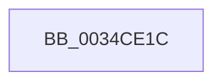

# sub_0034CE1C

- RVA: `0x0034CE1C`–`0x0034CE47` (길이 `43` bytes)
- VA: `0x000000014034CE1C`
- 실행 섹션: `.text`
- PDB 이름 있음: `아니요`; PDB Function 태그: `아니요`
- unwind 정보 RVA: `0x00078894`
- 디코드: `11`개 명령, `43/43` bytes 표시
- 미해석 바이트: `0` (있으면 어셈블리에 `.byte`로 보존)

> 이 문서는 커널 이미지의 기계어와 PDB 기호를 분석해 생성했습니다. 4번과 5번은 함수 원형과 자료형을 바이너리 사용 방식에서 추정한 C 해석이며 원본 소스 복구 결과는 아닙니다.

## 1. Dependencies

- 직접 호출 지점: **2**; 고유 호출 대상: **2**
- 직접 호출자로 확인된 함수: **0**
- RIP 상대 이미지 참조: **0**

### Outgoing calls
- `0x0034CE2D` → [SmAcquireReleaseCharges](../28/SmAcquireReleaseCharges_function_00285C40.md) (function, `0x00285C40`)
- `0x0034CE37` → [ExFreePoolWithTag](../../poolcode/B8/ExFreePoolWithTag_function_00B82870.md) (function, `0x00B82870`)

### Direct callers
- 이 함수 시작 RVA로 연결되는 직접 call은 확인되지 않았습니다. 간접 호출은 완전히 역산할 수 없습니다.

### Static image references
- 디코드된 RIP-relative 메모리 참조가 없습니다.

## 2. Other-region calls and transfers

- 다른 실행 섹션으로 향하는 call: **1**
  - `0x0034CE37` → [ExFreePoolWithTag](../../poolcode/B8/ExFreePoolWithTag_function_00B82870.md) (`.text` → `POOLCODE`)
- call이 아닌 외부 분기/꼬리 이동: **1**
  - `0x0034CE45` → [sub_0034CE47 + 0x78](Unknown_function_0034CE47.md) (`tail-transfer`)

## 3. Assembly (complete function range)

```asm
0034CE1C  8B 55 28                        mov edx, dword ptr [rbp + 0x28]
0034CE1F  41 B9 01 00 00 00               mov r9d, 1
0034CE25  48 8B 4F 20                     mov rcx, qword ptr [rdi + 0x20]
0034CE29  45 8D 41 02                     lea r8d, [r9 + 2]
0034CE2D  E8 0E 8E F3 FF                  call 0x140285c40
0034CE32  33 D2                           xor edx, edx
0034CE34  48 8B CD                        mov rcx, rbp
0034CE37  E8 34 5A 83 00                  call 0x140b82870
0034CE3C  4D 89 2C 24                     mov qword ptr [r12], r13
0034CE40  4C 8B 64 24 30                  mov r12, qword ptr [rsp + 0x30]
0034CE45  EB 78                           jmp 0x14034cebf
```

## 4. C-style interpretation (structured pseudocode)

```c
__int64 __fastcall sub_0034CE1C(__int64 a1, __int64 a2, __int64 a3, __int64 a4, __int64 a5, __int64 a6)
{
    __int64 result;

    result = SmAcquireReleaseCharges(*(unsigned __int64 *)(v_rdi + 32), (unsigned int)(*(unsigned int *)(v_rbp + 40)), 1 + 2, 1);
    a2 = 0;
    result = ExFreePoolWithTag(v_rbp, a2, 1 + 2, 1);
    *(unsigned __int64 *)(v_r12) = v_r13;
}
```

## 5. (Beta) C Style

```c
int64_t sub_0034CE1C(int64_t Arg1, int64_t Arg2, int64_t Arg3, int64_t Arg4, uint64_t Arg5, int64_t Arg6)
{
    int64_t result;

    result = SmAcquireReleaseCharges(*(uint64_t *)(local_rdi + 0x20), (uint32_t)(*(uint32_t *)(local_rbp + 0x28)), 1 + 2, 1);
    Arg2 = 0;
    result = ExFreePoolWithTag(local_rbp, Arg2, 1 + 2, 1);
    *(uint64_t *)(local_r12) = local_r13;
}
```

## 6. Execution-region graph

[열기: 2D/3D 그래프와 함수 탐색 컨트롤 패널](../../../control-panel.html?section=text&rva=0x0034CE1C&view=graph)

- 2D 그래프는 위에서 아래로 흐르고, 3D 그래프는 빈 공간을 드래그해 회전합니다. Shift+드래그는 이동, 휠은 확대·축소, 함수 노드 선택은 대상 보고서 이동입니다.

### Static fallback


