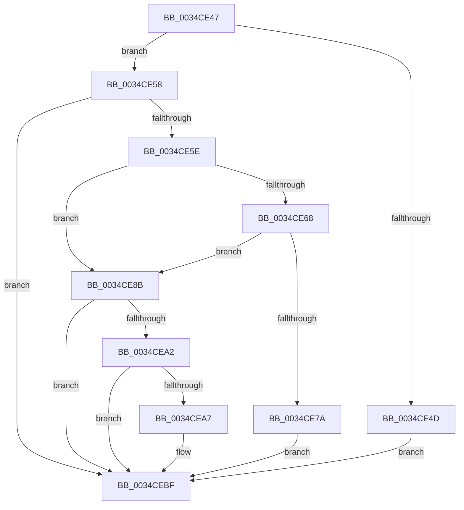

# sub_0034CE47

- RVA: `0x0034CE47`–`0x0034CEDD` (길이 `150` bytes)
- VA: `0x000000014034CE47`
- 실행 섹션: `.text`
- PDB 이름 있음: `아니요`; PDB Function 태그: `아니요`
- unwind 정보 RVA: `0x000788A8`
- 디코드: `37`개 명령, `150/150` bytes 표시
- 미해석 바이트: `0` (있으면 어셈블리에 `.byte`로 보존)

> 이 문서는 커널 이미지의 기계어와 PDB 기호를 분석해 생성했습니다. 4번과 5번은 함수 원형과 자료형을 바이너리 사용 방식에서 추정한 C 해석이며 원본 소스 복구 결과는 아닙니다.

## 1. Dependencies

- 직접 호출 지점: **1**; 고유 호출 대상: **1**
- 직접 호출자로 확인된 함수: **0**
- RIP 상대 이미지 참조: **0**

### Outgoing calls
- `0x0034CEBA` → [SmAcquireReleaseCharges](../28/SmAcquireReleaseCharges_function_00285C40.md) (function, `0x00285C40`)

### Direct callers
- 이 함수 시작 RVA로 연결되는 직접 call은 확인되지 않았습니다. 간접 호출은 완전히 역산할 수 없습니다.

### Static image references
- 디코드된 RIP-relative 메모리 참조가 없습니다.

## 2. Other-region calls and transfers

- 다른 실행 섹션으로 향하는 call: **0**
- call이 아닌 외부 분기/꼬리 이동: **1**
  - `0x0034CEDB` → [sub_0034CEDD + 0x4D](Unknown_function_0034CEDD.md) (`tail-transfer`)

## 3. Assembly (complete function range)

```asm
0034CE47  40 F6 C7 02                     test dil, 2
0034CE4B  74 0B                           je 0x14034ce58
0034CE4D  B8 FF 7F 00 00                  mov eax, 0x7fff
0034CE52  66 F0 21 03                     lock and word ptr [rbx], ax
0034CE56  EB 67                           jmp 0x14034cebf
0034CE58  40 F6 C7 01                     test dil, 1
0034CE5C  75 61                           jne 0x14034cebf
0034CE5E  0F B7 03                        movzx eax, word ptr [rbx]
0034CE61  66 0F BA E0 0D                  bt ax, 0xd
0034CE66  73 23                           jae 0x14034ce8b
0034CE68  65 48 8B 04 25 88 01 00 00      mov rax, qword ptr gs:[0x188]
0034CE71  48 3B 86 98 1C 00 00            cmp rax, qword ptr [rsi + 0x1c98]
0034CE78  75 11                           jne 0x14034ce8b
0034CE7A  FF 8E E8 1C 00 00               dec dword ptr [rsi + 0x1ce8]
0034CE80  B8 FF DF FF FF                  mov eax, 0xffffdfff
0034CE85  66 F0 21 03                     lock and word ptr [rbx], ax
0034CE89  EB 34                           jmp 0x14034cebf
0034CE8B  B8 FF FF FF FF                  mov eax, 0xffffffff
0034CE90  66 F0 0F C1 03                  lock xadd word ptr [rbx], ax
0034CE95  66 FF C8                        dec ax
0034CE98  B9 FF 1F 00 00                  mov ecx, 0x1fff
0034CE9D  66 85 C1                        test cx, ax
0034CEA0  75 1D                           jne 0x14034cebf
0034CEA2  4C 39 2B                        cmp qword ptr [rbx], r13
0034CEA5  7C 18                           jl 0x14034cebf
0034CEA7  48 8B 8E 90 1D 00 00            mov rcx, qword ptr [rsi + 0x1d90]
0034CEAE  41 B9 01 00 00 00               mov r9d, 1
0034CEB4  45 8B C1                        mov r8d, r9d
0034CEB7  49 8B D6                        mov rdx, r14
0034CEBA  E8 81 8D F3 FF                  call 0x140285c40
0034CEBF  4C 8B 74 24 28                  mov r14, qword ptr [rsp + 0x28]
0034CEC4  45 85 FF                        test r15d, r15d
0034CEC7  4C 8B 7C 24 20                  mov r15, qword ptr [rsp + 0x20]
0034CECC  48 8B 7C 24 68                  mov rdi, qword ptr [rsp + 0x68]
0034CED1  48 8B 6C 24 60                  mov rbp, qword ptr [rsp + 0x60]
0034CED6  48 8B 5C 24 58                  mov rbx, qword ptr [rsp + 0x58]
0034CEDB  74 4D                           je 0x14034cf2a
```

## 4. C-style interpretation (structured pseudocode)

```c
__int64 __fastcall sub_0034CE47(__int64 a1, __int64 a2, __int64 a3, __int64 a4, __int64 a5, __int64 a6, __int64 a7, __int64 a8, __int64 a9, __int64 a10, __int64 a11, __int64 a12, __int64 a13)
{
    __int64 result;
    unsigned __int64 v_stack_p20;

    if ((((unsigned __int8)(v_rdi)) & (2)) == 0) goto loc_0034CE58;
    goto loc_0034CEBF;
loc_0034CE58:
    if ((((unsigned __int8)(v_rdi)) & (1)) != 0) goto loc_0034CEBF;
    if (condition_is_above_or_equal) goto loc_0034CE8B;
    if ((*(unsigned __int64 *)(gs_base + (0 + 392))) != (*(unsigned __int64 *)(v_rsi + 7320))) goto loc_0034CE8B;
    goto loc_0034CEBF;
loc_0034CE8B:
    result = (unsigned __int16)(((unsigned int)(0xFFFFFFFFULL)) - 1);
    if ((((unsigned __int16)((unsigned int)(0x1FFFULL))) & ((unsigned __int16)(result))) != 0) goto loc_0034CEBF;
    if ((*(unsigned __int64 *)(v_rbx)) >= v_r13) {
        a1 = *(unsigned __int64 *)(v_rsi + 7568);
        a4 = 1;
        a3 = (unsigned int)(a4);
        a2 = v_r14;
        result = SmAcquireReleaseCharges(a1, a2, a3, a4);
    }
}
```

## 5. (Beta) C Style

```c
int64_t sub_0034CE47(int64_t Arg1, int64_t Arg2, int64_t Arg3, int64_t Arg4, int64_t Arg5, uint64_t Arg6, uint64_t Arg7, uint64_t Arg8, uint64_t Arg9, uint64_t Arg10, int64_t Arg11, int64_t Arg12, int64_t Arg13)
{
    int64_t result;
    uint64_t v_stack_p20;

    if ((((uint8_t)(local_rdi)) & (2)) == 0) goto loc_0034CE58;
    goto loc_0034CEBF;
loc_0034CE58:
    if ((((uint8_t)(local_rdi)) & (1)) != 0) goto loc_0034CEBF;
    if (condition_is_above_or_equal) goto loc_0034CE8B;
    if ((*(uint64_t *)(gs_base + (0 + 0x188))) != (*(uint64_t *)(local_rsi + 0x1C98))) goto loc_0034CE8B;
    goto loc_0034CEBF;
loc_0034CE8B:
    result = (uint16_t)(((uint32_t)(0xFFFFFFFFULL)) - 1);
    if ((((uint16_t)((uint32_t)(0x1FFFULL))) & ((uint16_t)(result))) != 0) goto loc_0034CEBF;
    if ((*(uint64_t *)(local_rbx)) >= local_r13) {
        Arg1 = *(uint64_t *)(local_rsi + 0x1D90);
        Arg4 = 1;
        Arg3 = (uint32_t)(Arg4);
        Arg2 = local_r14;
        result = SmAcquireReleaseCharges(Arg1, Arg2, Arg3, Arg4);
    }
}
```

## 6. Execution-region graph

[열기: 2D/3D 그래프와 함수 탐색 컨트롤 패널](../../../control-panel.html?section=text&rva=0x0034CE47&view=graph)

- 2D 그래프는 위에서 아래로 흐르고, 3D 그래프는 빈 공간을 드래그해 회전합니다. Shift+드래그는 이동, 휠은 확대·축소, 함수 노드 선택은 대상 보고서 이동입니다.

### Static fallback


