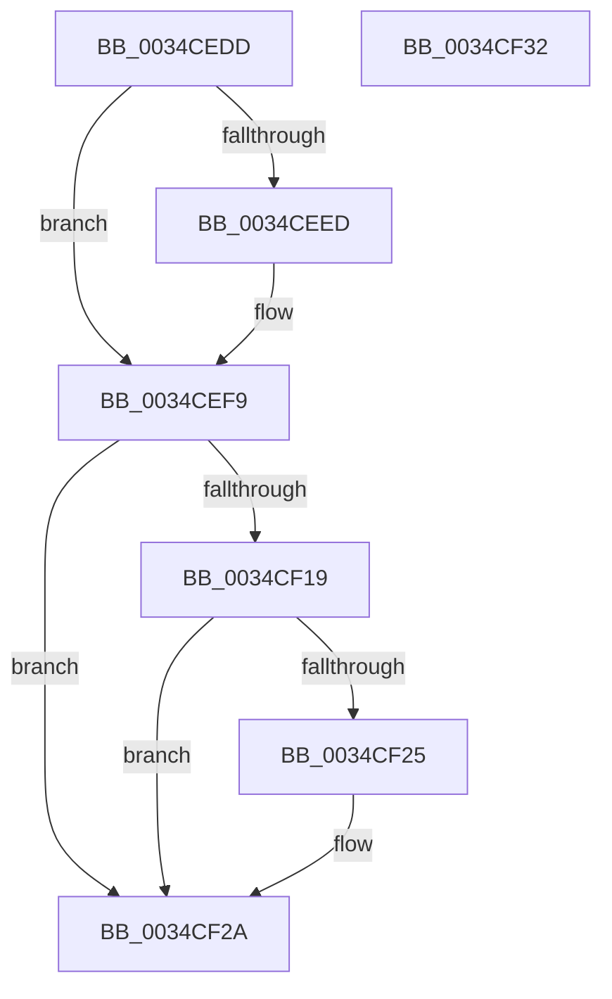

# sub_0034CEDD

- RVA: `0x0034CEDD`–`0x0034CF33` (길이 `86` bytes)
- VA: `0x000000014034CEDD`
- 실행 섹션: `.text`
- PDB 이름 있음: `아니요`; PDB Function 태그: `아니요`
- unwind 정보 RVA: `0x000788B8`
- 디코드: `21`개 명령, `86/86` bytes 표시
- 미해석 바이트: `0` (있으면 어셈블리에 `.byte`로 보존)

> 이 문서는 커널 이미지의 기계어와 PDB 기호를 분석해 생성했습니다. 4번과 5번은 함수 원형과 자료형을 바이너리 사용 방식에서 추정한 C 해석이며 원본 소스 복구 결과는 아닙니다.

## 1. Dependencies

- 직접 호출 지점: **3**; 고유 호출 대상: **3**
- 직접 호출자로 확인된 함수: **0**
- RIP 상대 이미지 참조: **0**

### Outgoing calls
- `0x0034CEF4` → [ExfReleasePushLockShared](../26/ExfReleasePushLockShared_function_00263440.md) (function, `0x00263440`)
- `0x0034CF00` → [KeAbPostRelease](../2E/KeAbPostRelease_function_002E1600.md) (function, `0x002E1600`)
- `0x0034CF25` → [KiCheckForKernelApcDelivery](../2E/KiCheckForKernelApcDelivery_function_002E2C80.md) (function, `0x002E2C80`)

### Direct callers
- 이 함수 시작 RVA로 연결되는 직접 call은 확인되지 않았습니다. 간접 호출은 완전히 역산할 수 없습니다.

### Static image references
- 디코드된 RIP-relative 메모리 참조가 없습니다.

## 2. Other-region calls and transfers

- 다른 실행 섹션으로 향하는 call: **0**
- 별도 외부 분기/꼬리 이동을 확인하지 못했습니다.

## 3. Assembly (complete function range)

```asm
0034CEDD  B8 11 00 00 00                  mov eax, 0x11
0034CEE2  F0 4C 0F B1 AE 98 1A 00 00      lock cmpxchg qword ptr [rsi + 0x1a98], r13
0034CEEB  74 0C                           je 0x14034cef9
0034CEED  48 8D 8E 98 1A 00 00            lea rcx, [rsi + 0x1a98]
0034CEF4  E8 47 65 F1 FF                  call 0x140263440
0034CEF9  48 8D 8E 98 1A 00 00            lea rcx, [rsi + 0x1a98]
0034CF00  E8 FB 46 F9 FF                  call 0x1402e1600
0034CF05  65 48 8B 04 25 88 01 00 00      mov rax, qword ptr gs:[0x188]
0034CF0E  90                              nop
0034CF0F  66 83 80 E6 01 00 00 01         add word ptr [rax + 0x1e6], 1
0034CF17  75 11                           jne 0x14034cf2a
0034CF19  48 05 98 00 00 00               add rax, 0x98
0034CF1F  90                              nop
0034CF20  48 39 00                        cmp qword ptr [rax], rax
0034CF23  74 05                           je 0x14034cf2a
0034CF25  E8 56 5D F9 FF                  call 0x1402e2c80
0034CF2A  48 83 C4 38                     add rsp, 0x38
0034CF2E  41 5D                           pop r13
0034CF30  5E                              pop rsi
0034CF31  C3                              ret
0034CF32  CC                              int3
```

## 4. C-style interpretation (structured pseudocode)

```c
__int64 __fastcall sub_0034CEDD(void)
{
    __int64 result;
    __int64 v_rsp;

    result = 17;
    if (!(condition_is_equal)) {
        a1 = v_rsi + 6808;
        result = ExfReleasePushLockShared(a1, a2, a3, a4);
    }
    result = KeAbPostRelease(v_rsi + 6808, a2, a3, a4);
    if (condition_is_not_equal) goto loc_0034CF2A;
    result = (*(unsigned __int64 *)(gs_base + (0 + 392))) + (152);
    if ((*(unsigned __int64 *)(result)) != result) {
        result = KiCheckForKernelApcDelivery(v_rsi + 6808, a2, a3, a4);
    }
    v_rsp = (v_rsp) + (56);
    return result;
}
```

## 5. (Beta) C Style

```c
void sub_0034CEDD(void)
{
    int64_t result;
    int64_t local_rsp;

    result = 17;
    if (!(condition_is_equal)) {
        a1 = local_rsi + 6808;
        result = ExfReleasePushLockShared(a1, a2, a3, a4);
    }
    result = KeAbPostRelease(local_rsi + 6808, a2, a3, a4);
    if (condition_is_not_equal) goto loc_0034CF2A;
    result = (*(uint64_t *)(gs_base + (0 + 0x188))) + (152);
    if ((*(uint64_t *)(result)) != result) {
        result = KiCheckForKernelApcDelivery(local_rsi + 6808, a2, a3, a4);
    }
    local_rsp = (local_rsp) + (56);
    return result;
}
```

## 6. Execution-region graph

[열기: 2D/3D 그래프와 함수 탐색 컨트롤 패널](../../../control-panel.html?section=text&rva=0x0034CEDD&view=graph)

- 2D 그래프는 위에서 아래로 흐르고, 3D 그래프는 빈 공간을 드래그해 회전합니다. Shift+드래그는 이동, 휠은 확대·축소, 함수 노드 선택은 대상 보고서 이동입니다.

### Static fallback


