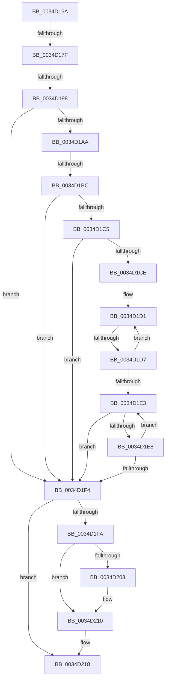

# sub_0034D16A

- RVA: `0x0034D16A`–`0x0034D227` (길이 `189` bytes)
- VA: `0x000000014034D16A`
- 실행 섹션: `.text`
- PDB 이름 있음: `아니요`; PDB Function 태그: `아니요`
- unwind 정보 RVA: `0x000788F4`
- 디코드: `46`개 명령, `189/189` bytes 표시
- 미해석 바이트: `0` (있으면 어셈블리에 `.byte`로 보존)

> 이 문서는 커널 이미지의 기계어와 PDB 기호를 분석해 생성했습니다. 4번과 5번은 함수 원형과 자료형을 바이너리 사용 방식에서 추정한 C 해석이며 원본 소스 복구 결과는 아닙니다.

## 1. Dependencies

- 직접 호출 지점: **1**; 고유 호출 대상: **1**
- 직접 호출자로 확인된 함수: **0**
- RIP 상대 이미지 참조: **1**

### Outgoing calls
- `0x0034D20B` → [KiLowerIrqlProcessIrqlFlags](../4F/KiLowerIrqlProcessIrqlFlags_function_004F5698.md) (function, `0x004F5698`)

### Direct callers
- 이 함수 시작 RVA로 연결되는 직접 call은 확인되지 않았습니다. 간접 호출은 완전히 역산할 수 없습니다.

### Static image references
- `0x0034D18C` → RVA `0x00FC6D20` (`ALMOSTRO`; read)

## 2. Other-region calls and transfers

- 다른 실행 섹션으로 향하는 call: **0**
- call이 아닌 외부 분기/꼬리 이동: **4**
  - `0x0034D179` → [sub_0034D233](Unknown_function_0034D233.md) (`tail-transfer`)
  - `0x0034D192` → [sub_0034D242](Unknown_function_0034D242.md) (`tail-transfer`)
  - `0x0034D1B6` → [sub_0034D242 + 0x1E](Unknown_function_0034D242.md) (`tail-transfer`)
  - `0x0034D1D5` → [sub_0034D242 + 0x11](Unknown_function_0034D242.md) (`tail-transfer`)

## 3. Assembly (complete function range)

```asm
0034D16A  48 89 5C 24 30                  mov qword ptr [rsp + 0x30], rbx
0034D16F  33 DB                           xor ebx, ebx
0034D171  48 89 74 24 38                  mov qword ptr [rsp + 0x38], rsi
0034D176  48 85 D2                        test rdx, rdx
0034D179  0F 85 B4 00 00 00               jne 0x14034d233
0034D17F  44 0F 20 C6                     mov rsi, cr8
0034D183  B8 02 00 00 00                  mov eax, 2
0034D188  44 0F 22 C0                     mov cr8, rax
0034D18C  39 1D 8E 9B C7 00               cmp dword ptr [rip + 0xc79b8e], ebx
0034D192  0F 85 AA 00 00 00               jne 0x14034d242
0034D198  65 48 8B 04 25 20 00 00 00      mov rax, qword ptr gs:[0x20]
0034D1A1  48 8B 4F 68                     mov rcx, qword ptr [rdi + 0x68]
0034D1A5  48 85 C9                        test rcx, rcx
0034D1A8  74 4A                           je 0x14034d1f4
0034D1AA  8B 90 D8 00 00 00               mov edx, dword ptr [rax + 0xd8]
0034D1B0  48 03 D1                        add rdx, rcx
0034D1B3  48 85 ED                        test rbp, rbp
0034D1B6  0F 84 A4 00 00 00               je 0x14034d260
0034D1BC  80 BF C3 00 00 00 10            cmp byte ptr [rdi + 0xc3], 0x10
0034D1C3  7D 2F                           jge 0x14034d1f4
0034D1C5  F7 47 78 00 02 00 00            test dword ptr [rdi + 0x78], 0x200
0034D1CC  75 26                           jne 0x14034d1f4
0034D1CE  48 8B C2                        mov rax, rdx
0034D1D1  F6 40 70 02                     test byte ptr [rax + 0x70], 2
0034D1D5  75 7C                           jne 0x14034d253
0034D1D7  48 8B 80 A0 01 00 00            mov rax, qword ptr [rax + 0x1a0]
0034D1DE  48 85 C0                        test rax, rax
0034D1E1  75 EE                           jne 0x14034d1d1
0034D1E3  03 5A 7C                        add ebx, dword ptr [rdx + 0x7c]
0034D1E6  75 0C                           jne 0x14034d1f4
0034D1E8  48 8B 92 A0 01 00 00            mov rdx, qword ptr [rdx + 0x1a0]
0034D1EF  48 85 D2                        test rdx, rdx
0034D1F2  75 EF                           jne 0x14034d1e3
0034D1F4  40 80 FE 02                     cmp sil, 2
0034D1F8  73 1E                           jae 0x14034d218
0034D1FA  83 3D 1F 9B C7 00 00            cmp dword ptr [rip + 0xc79b1f], 0
0034D201  74 0D                           je 0x14034d210
0034D203  44 0F 20 C1                     mov rcx, cr8
0034D207  40 0F B6 D6                     movzx edx, sil
0034D20B  E8 88 84 1A 00                  call 0x1404f5698
0034D210  40 0F B6 C6                     movzx eax, sil
0034D214  44 0F 22 C0                     mov cr8, rax
0034D218  48 8B 74 24 38                  mov rsi, qword ptr [rsp + 0x38]
0034D21D  85 DB                           test ebx, ebx
0034D21F  48 8B 5C 24 30                  mov rbx, qword ptr [rsp + 0x30]
0034D224  0F 95 C0                        setne al
```

## 4. C-style interpretation (structured pseudocode)

```c
__int64 __fastcall sub_0034D16A(__int64 a1, __int64 a2, __int64 a3, __int64 a4, __int64 a5, __int64 a6, __int64 a7)
{
    __int64 result;
    __int64 v_rbx;
    unsigned __int64 v_stack_p30;
    unsigned __int64 v_stack_p38;

    v_stack_p30 = v_rbx;
    v_rbx = 0;
    v_stack_p38 = v_rsi;
    if (*(unsigned __int64 *)(v_rdi + 104) == 0) goto loc_0034D1F4;
    a2 = ((unsigned int)(*(unsigned int *)(*(unsigned __int64 *)(gs_base + (0 + 32)) + 216))) + (*(unsigned __int64 *)(v_rdi + 104));
    if ((*(unsigned __int8 *)(v_rdi + 195)) >= 16) goto loc_0034D1F4;
    if (((*(unsigned int *)(v_rdi + 120)) & (512)) != 0) goto loc_0034D1F4;
loc_0034D1D1:
    if (*(unsigned __int64 *)(a2 + 416) != 0) goto loc_0034D1D1;
loc_0034D1E3:
    v_rbx = (unsigned int)((v_rbx) + (*(unsigned int *)(a2 + 124)));
    if (condition_is_not_equal) goto loc_0034D1F4;
    if (*(unsigned __int64 *)(a2 + 416) != 0) goto loc_0034D1E3;
loc_0034D1F4:
    if (((unsigned __int8)(v_cr8)) >= 2) goto loc_0034D218;
    result = *(unsigned __int64 *)(a2 + 416);
    if ((*(unsigned int *)(v_rip + 13081375)) != 0) {
        a1 = 2;
        a2 = (unsigned __int8)(v_cr8);
        result = KiLowerIrqlProcessIrqlFlags(a1, a2, a3, a4);
    }
loc_0034D218:
    result = ((unsigned int)(v_rbx) != 0) ? 1 : 0;
    return result;
}
```

## 5. (Beta) C Style

```c
int64_t sub_0034D16A(int64_t Arg1, int64_t Arg2, int64_t Arg3, int64_t Arg4, uint64_t Arg5, int64_t Arg6, int64_t Arg7)
{
    int64_t result;
    int64_t local_rbx;
    uint64_t v_stack_p30;
    uint64_t v_stack_p38;

    v_stack_p30 = local_rbx;
    local_rbx = 0;
    v_stack_p38 = local_rsi;
    if (*(uint64_t *)(local_rdi + 0x68) == 0) goto loc_0034D1F4;
    Arg2 = ((uint32_t)(*(uint32_t *)(*(uint64_t *)(gs_base + (0 + 0x20)) + 0xD8))) + (*(uint64_t *)(local_rdi + 0x68));
    if ((*(uint8_t *)(local_rdi + 0xC3)) >= 16) goto loc_0034D1F4;
    if (((*(uint32_t *)(local_rdi + 0x78)) & (512)) != 0) goto loc_0034D1F4;
loc_0034D1D1:
    if (*(uint64_t *)(Arg2 + 0x1A0) != 0) goto loc_0034D1D1;
loc_0034D1E3:
    local_rbx = (uint32_t)((local_rbx) + (*(uint32_t *)(Arg2 + 0x7C)));
    if (condition_is_not_equal) goto loc_0034D1F4;
    if (*(uint64_t *)(Arg2 + 0x1A0) != 0) goto loc_0034D1E3;
loc_0034D1F4:
    if (((uint8_t)(v_cr8)) >= 2) goto loc_0034D218;
    result = *(uint64_t *)(Arg2 + 0x1A0);
    if ((*(uint32_t *)(v_rip + 0xC79B1F)) != 0) {
        Arg1 = 2;
        Arg2 = (uint8_t)(v_cr8);
        result = KiLowerIrqlProcessIrqlFlags(Arg1, Arg2, Arg3, Arg4);
    }
loc_0034D218:
    result = ((uint32_t)(local_rbx) != 0) ? 1 : 0;
    return result;
}
```

## 6. Execution-region graph

[열기: 2D/3D 그래프와 함수 탐색 컨트롤 패널](../../../control-panel.html?section=text&rva=0x0034D16A&view=graph)

- 2D 그래프는 위에서 아래로 흐르고, 3D 그래프는 빈 공간을 드래그해 회전합니다. Shift+드래그는 이동, 휠은 확대·축소, 함수 노드 선택은 대상 보고서 이동입니다.

### Static fallback


