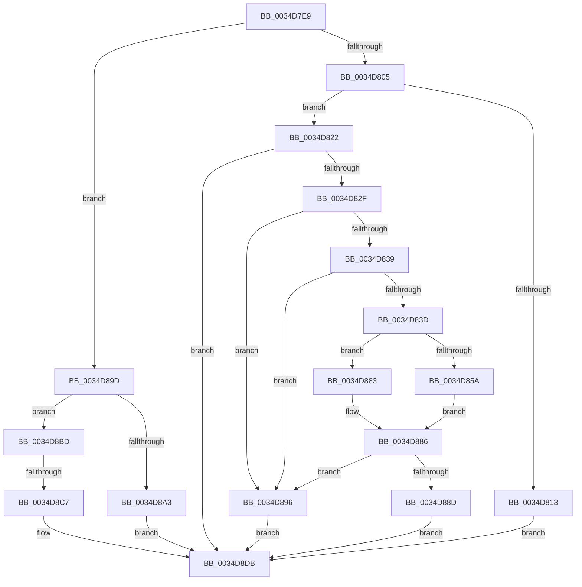

# sub_0034D7E9

- RVA: `0x0034D7E9`–`0x0034D8EA` (길이 `257` bytes)
- VA: `0x000000014034D7E9`
- 실행 섹션: `.text`
- PDB 이름 있음: `아니요`; PDB Function 태그: `아니요`
- unwind 정보 RVA: `0x000789DC`
- 디코드: `64`개 명령, `257/257` bytes 표시
- 미해석 바이트: `0` (있으면 어셈블리에 `.byte`로 보존)

> 이 문서는 커널 이미지의 기계어와 PDB 기호를 분석해 생성했습니다. 4번과 5번은 함수 원형과 자료형을 바이너리 사용 방식에서 추정한 C 해석이며 원본 소스 복구 결과는 아닙니다.

## 1. Dependencies

- 직접 호출 지점: **3**; 고유 호출 대상: **3**
- 직접 호출자로 확인된 함수: **0**
- RIP 상대 이미지 참조: **0**

### Outgoing calls
- `0x0034D851` → [KeWaitForSingleObject](../20/KeWaitForSingleObject_function_0020E6B0.md) (function, `0x0020E6B0`)
- `0x0034D861` → [KeResetEvent](../24/KeResetEvent_function_00248350.md) (function, `0x00248350`)
- `0x0034D8B3` → [SMKM_STORE<SM_TRAITS>::SmStLockVirtualRegion](../4E/SMKM_STORE_SM_TRAITS_SmStLockVirtualRegion_function_004EAF8C.md) (function, `0x004EAF8C`)

### Direct callers
- 이 함수 시작 RVA로 연결되는 직접 call은 확인되지 않았습니다. 간접 호출은 완전히 역산할 수 없습니다.

### Static image references
- 디코드된 RIP-relative 메모리 참조가 없습니다.

## 2. Other-region calls and transfers

- 다른 실행 섹션으로 향하는 call: **0**
- call이 아닌 외부 분기/꼬리 이동: **2**
  - `0x0034D8C1` → [sub_0034D947](Unknown_function_0034D947.md) (`tail-transfer`)
  - `0x0034D8E8` → [sub_0034D8EA + 0x4A](Unknown_function_0034D8EA.md) (`tail-transfer`)

## 3. Assembly (complete function range)

```asm
0034D7E9  4C 89 6C 24 78                  mov qword ptr [rsp + 0x78], r13
0034D7EE  4D 8B 2E                        mov r13, qword ptr [r14]
0034D7F1  4D 23 EC                        and r13, r12
0034D7F4  44 8B A6 60 1B 00 00            mov r12d, dword ptr [rsi + 0x1b60]
0034D7FB  41 F6 C7 08                     test r15b, 8
0034D7FF  0F 84 98 00 00 00               je 0x14034d89d
0034D805  41 0F B7 06                     movzx eax, word ptr [r14]
0034D809  49 8B E8                        mov rbp, r8
0034D80C  66 0F BA E0 0E                  bt ax, 0xe
0034D811  73 0F                           jae 0x14034d822
0034D813  B8 FF BF FF FF                  mov eax, 0xffffbfff
0034D818  66 F0 41 21 06                  lock and word ptr [r14], ax
0034D81D  E9 B9 00 00 00                  jmp 0x14034d8db
0034D822  4C 39 B6 F8 1C 00 00            cmp qword ptr [rsi + 0x1cf8], r14
0034D829  0F 85 AC 00 00 00               jne 0x14034d8db
0034D82F  8B 86 40 1C 00 00               mov eax, dword ptr [rsi + 0x1c40]
0034D835  85 C0                           test eax, eax
0034D837  74 5D                           je 0x14034d896
0034D839  A8 01                           test al, 1
0034D83B  74 59                           je 0x14034d896
0034D83D  4C 89 44 24 20                  mov qword ptr [rsp + 0x20], r8
0034D842  48 8D 8E 28 1C 00 00            lea rcx, [rsi + 0x1c28]
0034D849  45 33 C0                        xor r8d, r8d
0034D84C  45 33 C9                        xor r9d, r9d
0034D84F  33 D2                           xor edx, edx
0034D851  E8 5A 0E EC FF                  call 0x14020e6b0
0034D856  85 C0                           test eax, eax
0034D858  75 29                           jne 0x14034d883
0034D85A  48 8D 8E 28 1C 00 00            lea rcx, [rsi + 0x1c28]
0034D861  E8 EA AA EF FF                  call 0x140248350
0034D866  8B 86 40 1C 00 00               mov eax, dword ptr [rsi + 0x1c40]
0034D86C  45 33 C0                        xor r8d, r8d
0034D86F  24 02                           and al, 2
0034D871  44 89 86 40 1C 00 00            mov dword ptr [rsi + 0x1c40], r8d
0034D878  F6 D8                           neg al
0034D87A  1B C0                           sbb eax, eax
0034D87C  25 20 01 00 C0                  and eax, 0xc0000120
0034D881  EB 03                           jmp 0x14034d886
0034D883  45 33 C0                        xor r8d, r8d
0034D886  3D 20 01 00 C0                  cmp eax, 0xc0000120
0034D88B  75 09                           jne 0x14034d896
0034D88D  4C 89 86 F8 1C 00 00            mov qword ptr [rsi + 0x1cf8], r8
0034D894  EB 45                           jmp 0x14034d8db
0034D896  BD 03 00 00 00                  mov ebp, 3
0034D89B  EB 3E                           jmp 0x14034d8db
0034D89D  41 F6 C7 10                     test r15b, 0x10
0034D8A1  74 1A                           je 0x14034d8bd
0034D8A3  4D 8B CD                        mov r9, r13
0034D8A6  44 89 7C 24 20                  mov dword ptr [rsp + 0x20], r15d
0034D8AB  4D 8B C6                        mov r8, r14
0034D8AE  8B D7                           mov edx, edi
0034D8B0  48 8B CE                        mov rcx, rsi
0034D8B3  E8 D4 D6 19 00                  call 0x1404eaf8c
0034D8B8  48 8B E8                        mov rbp, rax
0034D8BB  EB 1E                           jmp 0x14034d8db
0034D8BD  41 F6 C7 04                     test r15b, 4
0034D8C1  0F 84 80 00 00 00               je 0x14034d947
0034D8C7  B8 00 80 FF FF                  mov eax, 0xffff8000
0034D8CC  66 F0 41 09 06                  lock or word ptr [r14], ax
0034D8D1  8B AC 24 80 00 00 00            mov ebp, dword ptr [rsp + 0x80]
0034D8D8  49 03 ED                        add rbp, r13
0034D8DB  83 BC 24 88 00 00 00 00         cmp dword ptr [rsp + 0x88], 0
0034D8E3  4C 8B 6C 24 78                  mov r13, qword ptr [rsp + 0x78]
0034D8E8  74 4A                           je 0x14034d934
```

## 4. C-style interpretation (structured pseudocode)

```c
__int64 __fastcall sub_0034D7E9(__int64 a1, int a2, __int64 a3, int a4, __int64 a5, __int64 a6, __int64 a7, __int64 a8, __int64 a9, __int64 a10, __int64 a11, __int64 a12, __int64 a13, __int64 a14, __int64 a15, unsigned int a16, unsigned int a17)
{
    __int64 result;
    __int64 v_r13;
    __int64 v_rbp;
    unsigned __int64 v_stack_p20;
    unsigned __int64 v_stack_p78;

    v_stack_p78 = v_r13;
    v_r13 = (*(unsigned __int64 *)(v_r14)) & (v_r12);
    if ((((unsigned __int8)(v_r15)) & (8)) == 0) goto loc_0034D89D;
    if (condition_is_above_or_equal) goto loc_0034D822;
    goto loc_0034D8DB;
loc_0034D822:
    if ((*(unsigned __int64 *)(v_rsi + 7416)) != v_r14) goto loc_0034D8DB;
    if ((unsigned int)((unsigned int)(*(unsigned int *)(v_rsi + 7232))) == 0) goto loc_0034D896;
    if ((((unsigned __int8)((unsigned int)(*(unsigned int *)(v_rsi + 7232)))) & (1)) == 0) goto loc_0034D896;
    v_stack_p20 = a3;
    a3 = 0;
    a4 = 0;
    a2 = 0;
    result = KeWaitForSingleObject(v_rsi + 7208, a2, a3, a4);
    if ((unsigned int)(result) != 0) goto loc_0034D883;
    result = KeResetEvent(v_rsi + 7208, a2, a3, a4);
    a3 = 0;
    result = (unsigned __int8)(((unsigned int)(*(unsigned int *)(v_rsi + 7232))) & (2));
    *(unsigned int *)(v_rsi + 7232) = 0;
    result = (unsigned __int8)(-(result));
    result = (unsigned int)((result) & (0xC0000120ULL));
    goto loc_0034D886;
loc_0034D883:
    a3 = 0;
loc_0034D886:
    if (((unsigned int)(result)) != 0xC0000120ULL) goto loc_0034D896;
    *(unsigned __int64 *)(v_rsi + 7416) = 0;
    goto loc_0034D8DB;
loc_0034D896:
    goto loc_0034D8DB;
loc_0034D89D:
    if ((((unsigned __int8)(v_r15)) & (16)) == 0) goto loc_0034D8BD;
    v_stack_p20 = (unsigned int)(v_r15);
    result = SMKM_STORE_SM_TRAITS___SmStLockVirtualRegion(v_rsi, (unsigned int)((unsigned int)(v_rdi)), v_r14, v_r13);
    goto loc_0034D8DB;
loc_0034D8BD:
    v_rbp = ((unsigned int)(a16)) + (v_r13);
loc_0034D8DB:
}
```

## 5. (Beta) C Style

```c
int64_t sub_0034D7E9(int64_t Arg1, int32_t Arg2, int64_t Arg3, int32_t Arg4, uint64_t Arg5, uint64_t Arg6, uint64_t Arg7, uint64_t Arg8, uint64_t Arg9, uint64_t Arg10, uint64_t Arg11, uint64_t Arg12, uint64_t Arg13, uint64_t Arg14, int64_t Arg15, uint32_t Arg16, uint32_t Arg17)
{
    int64_t result;
    int64_t local_r13;
    int64_t local_rbp;
    uint64_t v_stack_p20;
    uint64_t v_stack_p78;

    v_stack_p78 = local_r13;
    local_r13 = (*(uint64_t *)(local_r14)) & (local_r12);
    if ((((uint8_t)(local_r15)) & (8)) == 0) goto loc_0034D89D;
    if (condition_is_above_or_equal) goto loc_0034D822;
    goto loc_0034D8DB;
loc_0034D822:
    if ((*(uint64_t *)(local_rsi + 0x1CF8)) != local_r14) goto loc_0034D8DB;
    if ((uint32_t)((uint32_t)(*(uint32_t *)(local_rsi + 0x1C40))) == 0) goto loc_0034D896;
    if ((((uint8_t)((uint32_t)(*(uint32_t *)(local_rsi + 0x1C40)))) & (1)) == 0) goto loc_0034D896;
    v_stack_p20 = Arg3;
    Arg3 = 0;
    Arg4 = 0;
    Arg2 = 0;
    result = KeWaitForSingleObject(local_rsi + 7208, Arg2, Arg3, Arg4);
    if ((uint32_t)(result) != 0) goto loc_0034D883;
    result = KeResetEvent(local_rsi + 7208, Arg2, Arg3, Arg4);
    Arg3 = 0;
    result = (uint8_t)(((uint32_t)(*(uint32_t *)(local_rsi + 0x1C40))) & (2));
    *(uint32_t *)(local_rsi + 0x1C40) = 0;
    result = (uint8_t)(-(result));
    result = (uint32_t)((result) & (0xC0000120ULL));
    goto loc_0034D886;
loc_0034D883:
    Arg3 = 0;
loc_0034D886:
    if (((uint32_t)(result)) != 0xC0000120ULL) goto loc_0034D896;
    *(uint64_t *)(local_rsi + 0x1CF8) = 0;
    goto loc_0034D8DB;
loc_0034D896:
    goto loc_0034D8DB;
loc_0034D89D:
    if ((((uint8_t)(local_r15)) & (16)) == 0) goto loc_0034D8BD;
    v_stack_p20 = (uint32_t)(local_r15);
    result = SMKM_STORE_SM_TRAITS___SmStLockVirtualRegion(local_rsi, (uint32_t)((uint32_t)(local_rdi)), local_r14, local_r13);
    goto loc_0034D8DB;
loc_0034D8BD:
    local_rbp = ((uint32_t)(Arg16)) + (local_r13);
loc_0034D8DB:
}
```

## 6. Execution-region graph

[열기: 2D/3D 그래프와 함수 탐색 컨트롤 패널](../../../control-panel.html?section=text&rva=0x0034D7E9&view=graph)

- 2D 그래프는 위에서 아래로 흐르고, 3D 그래프는 빈 공간을 드래그해 회전합니다. Shift+드래그는 이동, 휠은 확대·축소, 함수 노드 선택은 대상 보고서 이동입니다.

### Static fallback


