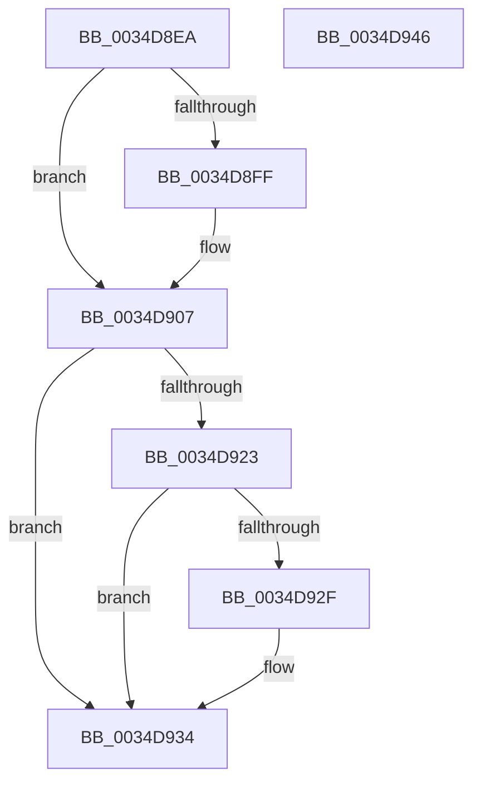

# sub_0034D8EA

- RVA: `0x0034D8EA`–`0x0034D947` (길이 `93` bytes)
- VA: `0x000000014034D8EA`
- 실행 섹션: `.text`
- PDB 이름 있음: `아니요`; PDB Function 태그: `아니요`
- unwind 정보 RVA: `0x000789F0`
- 디코드: `29`개 명령, `93/93` bytes 표시
- 미해석 바이트: `0` (있으면 어셈블리에 `.byte`로 보존)

> 이 문서는 커널 이미지의 기계어와 PDB 기호를 분석해 생성했습니다. 4번과 5번은 함수 원형과 자료형을 바이너리 사용 방식에서 추정한 C 해석이며 원본 소스 복구 결과는 아닙니다.

## 1. Dependencies

- 직접 호출 지점: **3**; 고유 호출 대상: **3**
- 직접 호출자로 확인된 함수: **0**
- RIP 상대 이미지 참조: **0**

### Outgoing calls
- `0x0034D902` → [ExfReleasePushLockShared](../26/ExfReleasePushLockShared_function_00263440.md) (function, `0x00263440`)
- `0x0034D90A` → [KeAbPostRelease](../2E/KeAbPostRelease_function_002E1600.md) (function, `0x002E1600`)
- `0x0034D92F` → [KiCheckForKernelApcDelivery](../2E/KiCheckForKernelApcDelivery_function_002E2C80.md) (function, `0x002E2C80`)

### Direct callers
- 이 함수 시작 RVA로 연결되는 직접 call은 확인되지 않았습니다. 간접 호출은 완전히 역산할 수 없습니다.

### Static image references
- 디코드된 RIP-relative 메모리 참조가 없습니다.

## 2. Other-region calls and transfers

- 다른 실행 섹션으로 향하는 call: **0**
- 별도 외부 분기/꼬리 이동을 확인하지 못했습니다.

## 3. Assembly (complete function range)

```asm
0034D8EA  48 8D 9E 98 1A 00 00            lea rbx, [rsi + 0x1a98]
0034D8F1  33 C9                           xor ecx, ecx
0034D8F3  B8 11 00 00 00                  mov eax, 0x11
0034D8F8  F0 48 0F B1 0B                  lock cmpxchg qword ptr [rbx], rcx
0034D8FD  74 08                           je 0x14034d907
0034D8FF  48 8B CB                        mov rcx, rbx
0034D902  E8 39 5B F1 FF                  call 0x140263440
0034D907  48 8B CB                        mov rcx, rbx
0034D90A  E8 F1 3C F9 FF                  call 0x1402e1600
0034D90F  65 48 8B 04 25 88 01 00 00      mov rax, qword ptr gs:[0x188]
0034D918  90                              nop
0034D919  66 83 80 E6 01 00 00 01         add word ptr [rax + 0x1e6], 1
0034D921  75 11                           jne 0x14034d934
0034D923  48 05 98 00 00 00               add rax, 0x98
0034D929  90                              nop
0034D92A  48 39 00                        cmp qword ptr [rax], rax
0034D92D  74 05                           je 0x14034d934
0034D92F  E8 4C 53 F9 FF                  call 0x1402e2c80
0034D934  48 8B C5                        mov rax, rbp
0034D937  48 83 C4 30                     add rsp, 0x30
0034D93B  41 5F                           pop r15
0034D93D  41 5E                           pop r14
0034D93F  41 5C                           pop r12
0034D941  5F                              pop rdi
0034D942  5E                              pop rsi
0034D943  5D                              pop rbp
0034D944  5B                              pop rbx
0034D945  C3                              ret
0034D946  CC                              int3
```

## 4. C-style interpretation (structured pseudocode)

```c
__int64 __fastcall sub_0034D8EA(int a1)
{
    __int64 result;
    __int64 v_rsp;

    a1 = 0;
    result = 17;
    if (!(condition_is_equal)) {
        a1 = v_rsi + 6808;
        result = ExfReleasePushLockShared(a1, a2, a3, a4);
    }
    result = KeAbPostRelease(v_rsi + 6808, a2, a3, a4);
    if (condition_is_not_equal) goto loc_0034D934;
    result = (*(unsigned __int64 *)(gs_base + (0 + 392))) + (152);
    if ((*(unsigned __int64 *)(result)) != result) {
        result = KiCheckForKernelApcDelivery(v_rsi + 6808, a2, a3, a4);
    }
    v_rsp = (v_rsp) + (48);
    return v_rbp;
}
```

## 5. (Beta) C Style

```c
int64_t sub_0034D8EA(int32_t Arg1)
{
    int64_t result;
    int64_t local_rsp;

    Arg1 = 0;
    result = 17;
    if (!(condition_is_equal)) {
        Arg1 = local_rsi + 6808;
        result = ExfReleasePushLockShared(Arg1, a2, a3, a4);
    }
    result = KeAbPostRelease(local_rsi + 6808, a2, a3, a4);
    if (condition_is_not_equal) goto loc_0034D934;
    result = (*(uint64_t *)(gs_base + (0 + 0x188))) + (152);
    if ((*(uint64_t *)(result)) != result) {
        result = KiCheckForKernelApcDelivery(local_rsi + 6808, a2, a3, a4);
    }
    local_rsp = (local_rsp) + (48);
    return local_rbp;
}
```

## 6. Execution-region graph

[열기: 2D/3D 그래프와 함수 탐색 컨트롤 패널](../../../control-panel.html?section=text&rva=0x0034D8EA&view=graph)

- 2D 그래프는 위에서 아래로 흐르고, 3D 그래프는 빈 공간을 드래그해 회전합니다. Shift+드래그는 이동, 휠은 확대·축소, 함수 노드 선택은 대상 보고서 이동입니다.

### Static fallback


