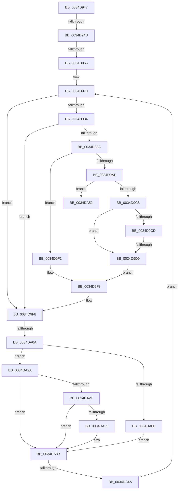

# sub_0034D947

- RVA: `0x0034D947`–`0x0034DA5C` (길이 `277` bytes)
- VA: `0x000000014034D947`
- 실행 섹션: `.text`
- PDB 이름 있음: `아니요`; PDB Function 태그: `아니요`
- unwind 정보 RVA: `0x00078A04`
- 디코드: `70`개 명령, `277/277` bytes 표시
- 미해석 바이트: `0` (있으면 어셈블리에 `.byte`로 보존)

> 이 문서는 커널 이미지의 기계어와 PDB 기호를 분석해 생성했습니다. 4번과 5번은 함수 원형과 자료형을 바이너리 사용 방식에서 추정한 C 해석이며 원본 소스 복구 결과는 아닙니다.

## 1. Dependencies

- 직접 호출 지점: **2**; 고유 호출 대상: **2**
- 직접 호출자로 확인된 함수: **0**
- RIP 상대 이미지 참조: **0**

### Outgoing calls
- `0x0034D9A5` → [MiChargeCommit](../28/MiChargeCommit_function_00286EB0.md) (function, `0x00286EB0`)
- `0x0034DA1E` → [SmAcquireReleaseCharges](../28/SmAcquireReleaseCharges_function_00285C40.md) (function, `0x00285C40`)

### Direct callers
- 이 함수 시작 RVA로 연결되는 직접 call은 확인되지 않았습니다. 간접 호출은 완전히 역산할 수 없습니다.

### Static image references
- 디코드된 RIP-relative 메모리 참조가 없습니다.

## 2. Other-region calls and transfers

- 다른 실행 섹션으로 향하는 call: **0**
- call이 아닌 외부 분기/꼬리 이동: **6**
  - `0x0034D94B` → [sub_0034D7E9 + 0xE8](Unknown_function_0034D7E9.md) (`tail-transfer`)
  - `0x0034D95F` → [sub_0034D7E9 + 0xF2](Unknown_function_0034D7E9.md) (`tail-transfer`)
  - `0x0034D9D3` → [sub_0034D7E9 + 0xF2](Unknown_function_0034D7E9.md) (`tail-transfer`)
  - `0x0034DA04` → [sub_0034D7E9 + 0xE8](Unknown_function_0034D7E9.md) (`tail-transfer`)
  - `0x0034DA44` → [sub_0034D7E9 + 0xF2](Unknown_function_0034D7E9.md) (`tail-transfer`)
  - `0x0034DA57` → [sub_0034D7E9 + 0xF2](Unknown_function_0034D7E9.md) (`tail-transfer`)

## 3. Assembly (complete function range)

```asm
0034D947  41 F6 C7 02                     test r15b, 2
0034D94B  75 84                           jne 0x14034d8d1
0034D94D  41 0F B7 3E                     movzx edi, word ptr [r14]
0034D951  BA FF 1F 00 00                  mov edx, 0x1fff
0034D956  0F B7 C7                        movzx eax, di
0034D959  66 23 C2                        and ax, dx
0034D95C  66 3B C2                        cmp ax, dx
0034D95F  0F 84 76 FF FF FF               je 0x14034d8db
0034D965  66 66 66 0F 1F 84 00 00 00 00 00  nop word ptr [rax + rax]
0034D970  8D 5F 01                        lea ebx, [rdi + 1]
0034D973  41 8B C8                        mov ecx, r8d
0034D976  66 33 DF                        xor bx, di
0034D979  66 23 DA                        and bx, dx
0034D97C  66 33 DF                        xor bx, di
0034D97F  66 85 FA                        test dx, di
0034D982  75 74                           jne 0x14034d9f8
0034D984  49 83 3E 00                     cmp qword ptr [r14], 0
0034D988  7C 6E                           jl 0x14034d9f8
0034D98A  48 8B 86 90 1D 00 00            mov rax, qword ptr [rsi + 0x1d90]
0034D991  49 8B D4                        mov rdx, r12
0034D994  48 C1 EA 0C                     shr rdx, 0xc
0034D998  44 8B C5                        mov r8d, ebp
0034D99B  48 8B 88 30 08 00 00            mov rcx, qword ptr [rax + 0x830]
0034D9A2  48 8B 09                        mov rcx, qword ptr [rcx]
0034D9A5  E8 06 95 F3 FF                  call 0x140286eb0
0034D9AA  85 C0                           test eax, eax
0034D9AC  75 43                           jne 0x14034d9f1
0034D9AE  33 C0                           xor eax, eax
0034D9B0  8B C8                           mov ecx, eax
0034D9B2  65 48 8B 04 25 88 01 00 00      mov rax, qword ptr gs:[0x188]
0034D9BB  48 3B 86 98 1C 00 00            cmp rax, qword ptr [rsi + 0x1c98]
0034D9C2  0F 85 8A 00 00 00               jne 0x14034da52
0034D9C8  45 84 FF                        test r15b, r15b
0034D9CB  79 0C                           jns 0x14034d9d9
0034D9CD  39 8E E8 1C 00 00               cmp dword ptr [rsi + 0x1ce8], ecx
0034D9D3  0F 85 02 FF FF FF               jne 0x14034d8db
0034D9D9  FF 86 E8 1C 00 00               inc dword ptr [rsi + 0x1ce8]
0034D9DF  B8 00 E0 00 00                  mov eax, 0xe000
0034D9E4  66 23 D8                        and bx, ax
0034D9E7  B8 00 20 00 00                  mov eax, 0x2000
0034D9EC  66 0B D8                        or bx, ax
0034D9EF  EB 02                           jmp 0x14034d9f3
0034D9F1  8B CD                           mov ecx, ebp
0034D9F3  BA FF 1F 00 00                  mov edx, 0x1fff
0034D9F8  0F B7 C7                        movzx eax, di
0034D9FB  66 F0 41 0F B1 1E               lock cmpxchg word ptr [r14], bx
0034DA01  0F B7 D8                        movzx ebx, ax
0034DA04  0F 84 C7 FE FF FF               je 0x14034d8d1
0034DA0A  85 C9                           test ecx, ecx
0034DA0C  74 1C                           je 0x14034da2a
0034DA0E  48 8B 8E 90 1D 00 00            mov rcx, qword ptr [rsi + 0x1d90]
0034DA15  44 8B CD                        mov r9d, ebp
0034DA18  44 8B C5                        mov r8d, ebp
0034DA1B  49 8B D4                        mov rdx, r12
0034DA1E  E8 1D 82 F3 FF                  call 0x140285c40
0034DA23  BA FF 1F 00 00                  mov edx, 0x1fff
0034DA28  EB 11                           jmp 0x14034da3b
0034DA2A  66 85 FA                        test dx, di
0034DA2D  75 0C                           jne 0x14034da3b
0034DA2F  49 83 3E 00                     cmp qword ptr [r14], 0
0034DA33  7C 06                           jl 0x14034da3b
0034DA35  FF 8E E8 1C 00 00               dec dword ptr [rsi + 0x1ce8]
0034DA3B  0F B7 FB                        movzx edi, bx
0034DA3E  66 23 DA                        and bx, dx
0034DA41  66 3B DA                        cmp bx, dx
0034DA44  0F 84 91 FE FF FF               je 0x14034d8db
0034DA4A  45 33 C0                        xor r8d, r8d
0034DA4D  E9 1E FF FF FF                  jmp 0x14034d970
0034DA52  BD 02 00 00 00                  mov ebp, 2
0034DA57  E9 7F FE FF FF                  jmp 0x14034d8db
```

## 4. C-style interpretation (structured pseudocode)

```c
__int64 __fastcall sub_0034D947(__int64 a1, __int64 a2, int a3)
{
    __int64 result;
    __int64 v_rbx;

    result = (unsigned __int16)(((unsigned __int16)(*(unsigned __int16 *)(v_r14))) & ((unsigned __int16)((unsigned int)(0x1FFFULL))));
loc_0034D970:
    v_rbx = (unsigned __int16)((*(unsigned __int16 *)(v_r14) + 1) ^ ((unsigned __int16)(*(unsigned __int16 *)(v_r14))));
    v_rbx = (unsigned __int16)((v_rbx) & ((unsigned __int16)((unsigned int)(0x1FFFULL))));
    v_rbx = (unsigned __int16)((v_rbx) ^ ((unsigned __int16)(*(unsigned __int16 *)(v_r14))));
    if ((((unsigned __int16)((unsigned int)(0x1FFFULL))) & ((unsigned __int16)(*(unsigned __int16 *)(v_r14)))) != 0) goto loc_0034D9F8;
    if ((*(unsigned __int64 *)(v_r14)) < 0) goto loc_0034D9F8;
    a2 = (v_r12) >> (12);
    result = MiChargeCommit(*(unsigned __int64 *)(*(unsigned __int64 *)(*(unsigned __int64 *)(v_rsi + 7568) + 2096)), a2, (unsigned int)((unsigned int)(v_rbp)), a4);
    if ((unsigned int)(result) != 0) goto loc_0034D9F1;
    result = 0;
    if ((*(unsigned __int64 *)(gs_base + (0 + 392))) != (*(unsigned __int64 *)(v_rsi + 7320))) goto loc_0034DA52;
    if (!sign_flag) goto loc_0034D9D9;
loc_0034D9D9:
    v_rbx = (unsigned __int16)((v_rbx) & ((unsigned __int16)((unsigned int)(0xE000ULL))));
    v_rbx = (unsigned __int16)((v_rbx) | ((unsigned __int16)((unsigned int)(0x2000ULL))));
    goto loc_0034D9F3;
loc_0034D9F1:
loc_0034D9F3:
loc_0034D9F8:
    if ((unsigned int)((unsigned int)((unsigned int)(v_rbp))) == 0) goto loc_0034DA2A;
    result = SmAcquireReleaseCharges(*(unsigned __int64 *)(v_rsi + 7568), v_r12, (unsigned int)((unsigned int)(v_rbp)), (unsigned int)((unsigned int)(v_rbp)));
    goto loc_0034DA3B;
loc_0034DA2A:
    if ((((unsigned __int16)((unsigned int)(0x1FFFULL))) & ((unsigned __int16)(*(unsigned __int16 *)(v_r14)))) != 0) goto loc_0034DA3B;
    if ((*(unsigned __int64 *)(v_r14)) >= 0) {
    }
    v_rbx = (unsigned __int16)(((unsigned __int16)((unsigned __int16)(*(unsigned __int16 *)(v_r14)))) & ((unsigned __int16)((unsigned int)(0x1FFFULL))));
    a3 = 0;
    goto loc_0034D970;
loc_0034DA52:
}
```

## 5. (Beta) C Style

```c
int64_t sub_0034D947(int64_t Arg1, int64_t Arg2, int32_t Arg3)
{
    int64_t result;
    int64_t local_rbx;

    result = (uint16_t)(((uint16_t)(*(uint16_t *)(local_r14))) & ((uint16_t)((uint32_t)(0x1FFFULL))));
loc_0034D970:
    local_rbx = (uint16_t)((*(uint16_t *)(local_r14) + 1) ^ ((uint16_t)(*(uint16_t *)(local_r14))));
    local_rbx = (uint16_t)((local_rbx) & ((uint16_t)((uint32_t)(0x1FFFULL))));
    local_rbx = (uint16_t)((local_rbx) ^ ((uint16_t)(*(uint16_t *)(local_r14))));
    if ((((uint16_t)((uint32_t)(0x1FFFULL))) & ((uint16_t)(*(uint16_t *)(local_r14)))) != 0) goto loc_0034D9F8;
    if ((*(uint64_t *)(local_r14)) < 0) goto loc_0034D9F8;
    Arg2 = (local_r12) >> (12);
    result = MiChargeCommit(*(uint64_t *)(*(uint64_t *)(*(uint64_t *)(local_rsi + 0x1D90) + 0x830)), Arg2, (uint32_t)((uint32_t)(local_rbp)), a4);
    if ((uint32_t)(result) != 0) goto loc_0034D9F1;
    result = 0;
    if ((*(uint64_t *)(gs_base + (0 + 0x188))) != (*(uint64_t *)(local_rsi + 0x1C98))) goto loc_0034DA52;
    if (!sign_flag) goto loc_0034D9D9;
loc_0034D9D9:
    local_rbx = (uint16_t)((local_rbx) & ((uint16_t)((uint32_t)(0xE000ULL))));
    local_rbx = (uint16_t)((local_rbx) | ((uint16_t)((uint32_t)(0x2000ULL))));
    goto loc_0034D9F3;
loc_0034D9F1:
loc_0034D9F3:
loc_0034D9F8:
    if ((uint32_t)((uint32_t)((uint32_t)(local_rbp))) == 0) goto loc_0034DA2A;
    result = SmAcquireReleaseCharges(*(uint64_t *)(local_rsi + 0x1D90), local_r12, (uint32_t)((uint32_t)(local_rbp)), (uint32_t)((uint32_t)(local_rbp)));
    goto loc_0034DA3B;
loc_0034DA2A:
    if ((((uint16_t)((uint32_t)(0x1FFFULL))) & ((uint16_t)(*(uint16_t *)(local_r14)))) != 0) goto loc_0034DA3B;
    if ((*(uint64_t *)(local_r14)) >= 0) {
    }
    local_rbx = (uint16_t)(((uint16_t)((uint16_t)(*(uint16_t *)(local_r14)))) & ((uint16_t)((uint32_t)(0x1FFFULL))));
    Arg3 = 0;
    goto loc_0034D970;
loc_0034DA52:
}
```

## 6. Execution-region graph

[열기: 2D/3D 그래프와 함수 탐색 컨트롤 패널](../../../control-panel.html?section=text&rva=0x0034D947&view=graph)

- 2D 그래프는 위에서 아래로 흐르고, 3D 그래프는 빈 공간을 드래그해 회전합니다. Shift+드래그는 이동, 휠은 확대·축소, 함수 노드 선택은 대상 보고서 이동입니다.

### Static fallback


