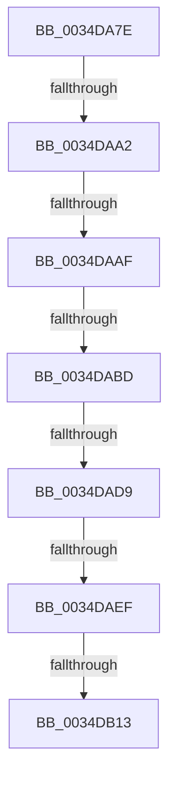

# sub_0034DA7E

- RVA: `0x0034DA7E`–`0x0034DB2A` (길이 `172` bytes)
- VA: `0x000000014034DA7E`
- 실행 섹션: `.text`
- PDB 이름 있음: `아니요`; PDB Function 태그: `아니요`
- unwind 정보 RVA: `0x00078A34`
- 디코드: `34`개 명령, `172/172` bytes 표시
- 미해석 바이트: `0` (있으면 어셈블리에 `.byte`로 보존)

> 이 문서는 커널 이미지의 기계어와 PDB 기호를 분석해 생성했습니다. 4번과 5번은 함수 원형과 자료형을 바이너리 사용 방식에서 추정한 C 해석이며 원본 소스 복구 결과는 아닙니다.

## 1. Dependencies

- 직접 호출 지점: **1**; 고유 호출 대상: **1**
- 직접 호출자로 확인된 함수: **0**
- RIP 상대 이미지 참조: **5**

### Outgoing calls
- `0x0034DAC4` → [KiAcquireSpinLockInstrumented](../20/KiAcquireSpinLockInstrumented_function_002084F0.md) (function, `0x002084F0`)

### Direct callers
- 이 함수 시작 RVA로 연결되는 직접 call은 확인되지 않았습니다. 간접 호출은 완전히 역산할 수 없습니다.

### Static image references
- `0x0034DA95` → RVA `0x00FC6D20` (`ALMOSTRO`; read)
- `0x0034DAA2` → RVA `0x00FC6B06` (`ALMOSTRO`; read)
- `0x0034DAAF` → RVA `0x00F0DE58` (`.data`; read)
- `0x0034DABD` → RVA `0x00E67260` (`.data`; read)
- `0x0034DAC9` → RVA `0x00E67250` (`.data`; read)

## 2. Other-region calls and transfers

- 다른 실행 섹션으로 향하는 call: **0**
- call이 아닌 외부 분기/꼬리 이동: **7**
  - `0x0034DA9C` → [sub_0034DBAE + 0x8](Unknown_function_0034DBAE.md) (`tail-transfer`)
  - `0x0034DAA9` → [sub_0034DB86](Unknown_function_0034DB86.md) (`tail-transfer`)
  - `0x0034DAB7` → [sub_0034DB86](Unknown_function_0034DB86.md) (`tail-transfer`)
  - `0x0034DAD3` → [sub_0034DBAE](Unknown_function_0034DBAE.md) (`tail-transfer`)
  - `0x0034DAE9` → [sub_0034DBA7](Unknown_function_0034DBA7.md) (`tail-transfer`)
  - `0x0034DB0D` → [sub_0034DBCE](Unknown_function_0034DBCE.md) (`tail-transfer`)
  - `0x0034DB24` → [sub_0034DBE0](Unknown_function_0034DBE0.md) (`tail-transfer`)

## 3. Assembly (complete function range)

```asm
0034DA7E  48 89 7C 24 28                  mov qword ptr [rsp + 0x28], rdi
0034DA83  4C 89 74 24 20                  mov qword ptr [rsp + 0x20], r14
0034DA88  44 0F 20 C6                     mov rsi, cr8
0034DA8C  B8 02 00 00 00                  mov eax, 2
0034DA91  44 0F 22 C0                     mov cr8, rax
0034DA95  83 3D 84 92 C7 00 00            cmp dword ptr [rip + 0xc79284], 0
0034DA9C  0F 85 14 01 00 00               jne 0x14034dbb6
0034DAA2  F6 05 5D 90 C7 00 21            test byte ptr [rip + 0xc7905d], 0x21
0034DAA9  0F 84 D7 00 00 00               je 0x14034db86
0034DAAF  8B 05 A3 03 BC 00               mov eax, dword ptr [rip + 0xbc03a3]
0034DAB5  85 C0                           test eax, eax
0034DAB7  0F 85 C9 00 00 00               jne 0x14034db86
0034DABD  48 8D 0D 9C 97 B1 00            lea rcx, [rip + 0xb1979c]
0034DAC4  E8 27 AA EB FF                  call 0x1402084f0
0034DAC9  4C 8D 35 80 97 B1 00            lea r14, [rip + 0xb19780]
0034DAD0  48 85 DB                        test rbx, rbx
0034DAD3  0F 84 D5 00 00 00               je 0x14034dbae
0034DAD9  48 8D 7B 08                     lea rdi, [rbx + 8]
0034DADD  48 89 6C 24 48                  mov qword ptr [rsp + 0x48], rbp
0034DAE2  48 8B 7F 08                     mov rdi, qword ptr [rdi + 8]
0034DAE6  49 3B FE                        cmp rdi, r14
0034DAE9  0F 84 B8 00 00 00               je 0x14034dba7
0034DAEF  48 8D 6F F8                     lea rbp, [rdi - 8]
0034DAF3  48 8D 8D 68 01 00 00            lea rcx, [rbp + 0x168]
0034DAFA  0F 0D 09                        prefetchw byte ptr [rcx]
0034DAFD  48 8B 01                        mov rax, qword ptr [rcx]
0034DB00  48 83 E0 FE                     and rax, 0xfffffffffffffffe
0034DB04  48 8D 50 02                     lea rdx, [rax + 2]
0034DB08  F0 48 0F B1 11                  lock cmpxchg qword ptr [rcx], rdx
0034DB0D  0F 85 BB 00 00 00               jne 0x14034dbce
0034DB13  F6 05 EC 8F C7 00 01            test byte ptr [rip + 0xc78fec], 1
0034DB1A  4C 8B 74 24 20                  mov r14, qword ptr [rsp + 0x20]
0034DB1F  48 8B 7C 24 28                  mov rdi, qword ptr [rsp + 0x28]
0034DB24  0F 85 B6 00 00 00               jne 0x14034dbe0
```

## 4. C-style interpretation (structured pseudocode)

```c
__int64 __fastcall sub_0034DA7E(__int64 a1, __int64 a2, __int64 a3, __int64 a4, __int64 a5)
{
    __int64 result;
    unsigned __int64 v_stack_p20;
    unsigned __int64 v_stack_p28;
    unsigned __int64 v_stack_p48;

    v_stack_p28 = v_rdi;
    v_stack_p20 = v_r14;
    result = KiAcquireSpinLockInstrumented(v_rip + 11638684, a2, a3, a4);
    v_stack_p48 = v_rbp;
    result = (*(unsigned __int64 *)(*(unsigned __int64 *)(v_rbx + 8 + 8) - 8 + 360)) & (-2);
}
```

## 5. (Beta) C Style

```c
int64_t sub_0034DA7E(int64_t Arg1, int64_t Arg2, int64_t Arg3, int64_t Arg4, int64_t Arg5)
{
    int64_t result;
    uint64_t v_stack_p20;
    uint64_t v_stack_p28;
    uint64_t v_stack_p48;

    v_stack_p28 = local_rdi;
    v_stack_p20 = local_r14;
    result = KiAcquireSpinLockInstrumented(v_rip + 11638684, Arg2, Arg3, Arg4);
    v_stack_p48 = local_rbp;
    result = (*(uint64_t *)(*(uint64_t *)(local_rbx + 0x8 + 0x8) - 0x8 + 0x168)) & (-2);
}
```

## 6. Execution-region graph

[열기: 2D/3D 그래프와 함수 탐색 컨트롤 패널](../../../control-panel.html?section=text&rva=0x0034DA7E&view=graph)

- 2D 그래프는 위에서 아래로 흐르고, 3D 그래프는 빈 공간을 드래그해 회전합니다. Shift+드래그는 이동, 휠은 확대·축소, 함수 노드 선택은 대상 보고서 이동입니다.

### Static fallback


